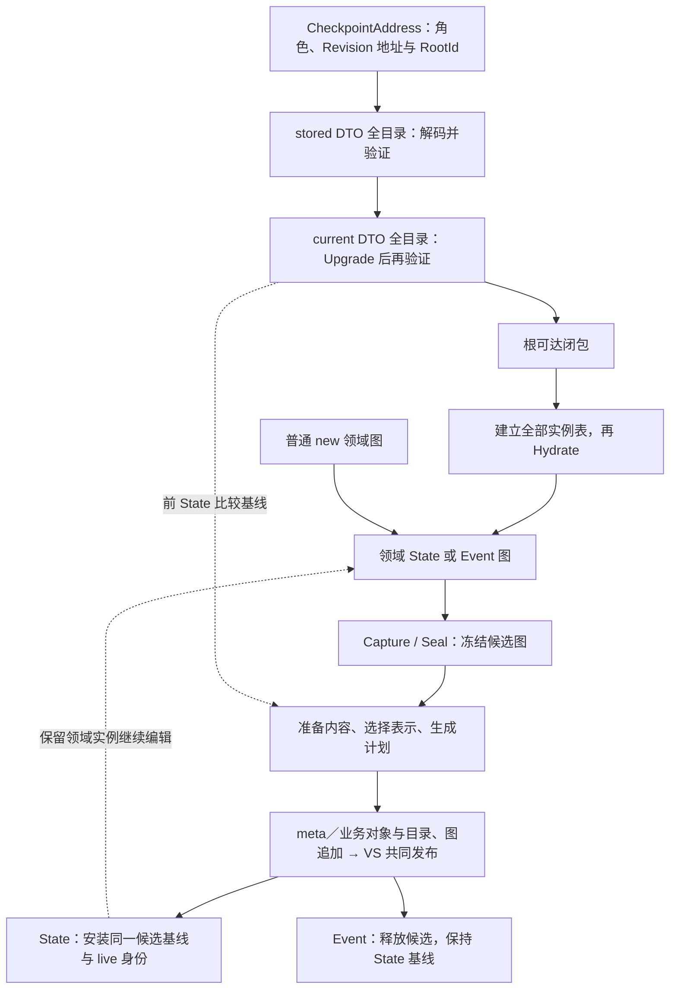

# DurableGraph 项目术语表

> 用语校准：2026-10-19；Schema 接纳路线按 [DB-096 Private 删除](design-branches/0096-history-and-head-model/private-removal.md)与当前源码更新，整体验收状态见 [PROJECT-STATE](../src/PROJECT-STATE.md)。公共基础见 [078-A 记录](design-branches/0078-editable-checkpoint-fork-slice/0078-a-repository-free-history-implementation.md)，Checkpoint/固定查询见 [078-B 记录](design-branches/0078-editable-checkpoint-fork-slice/0078-b-checkpoint-history-query-implementation.md)。[DB-083](design-branches/0083-checkpoint-api-user-stories/0083-repository-checkpoint-api-user-stories.md) 的后续目标/候选词义仍不作为已实施合同。
> 本文是项目首选术语的维护入口；定义概念、区分歧义并映射代码，不代替各分片合同。
> 公共入口为根命名空间 `Atelia.DurableGraph` 下的 `Repository`、非泛型 `BranchCheckout` 与 `CheckpointAddress`；签出操作为 `Checkout`。旧名只作历史映射，固定模型环境由本次 Open 持有。
> 当前能力查 [PROJECT-STATE](../src/PROJECT-STATE.md)，长期约束查[目标设计](DurableGraph-target-design-v0.md)，未完成工作查[路线图](DurableGraph-research-roadmap.md)。

上游统一用语：HeadStore、HeadId、HeadEntryId、HeadEntry、HeadEntryPayload（概念）、HeadSetTag。Head 是稳定发布入口；Entry 是某个接受位置；HS 的 Tag 固定所选当前 Head 位置表。DG 的 branch head 是逻辑 tip，DG tag 是历史图书签，两者均不直接等同底层实体。细节见 [DB-096](design-branches/0096-history-and-head-model/README.md)。

## 使用与维护

版本、历史、命名入口与来源关系的下一轮概念研究见 [DB-096](design-branches/0096-history-and-head-model/README.md)。其 [API 草图](design-branches/0096-history-and-head-model/api-sketch.md)推荐 Branch / Commit / WorkingCopy；这些候选术语尚未替换本文的现行合同，也不是代码改名指令。

- 表中粗体为讨论和说明文字的首选术语；代码符号标明**当前落点**，不意味着所有符号已经采用首选命名。
  同一行并列的词由释义说明其关系，只有明确标为同义才可互换。
- 当前类型／namespace 的候选改名与实施边界见 [DB-092](design-branches/0092-type-namespace-refactoring/README.md)；A／B 代码已采用对应映射，本表保当前落点；员工与公开候选仍按提议处理，资格在分片记录查证。
- 已实现词条以当前源码为依据；遇到词义与实现不一致，应记录差异并修订，不能据词条推定代码已有某种行为。
  标为“目标”的词只链接设计，不虚构代码落点。本文不维护实现进度或测试计数。
- 解释 `Current`、`Base/Delta`、`head`、`body/payload` 等词时保留所属对象或阶段；代码引用保留符号原拼写。
  本文内的链接锚点按概念命名，后续改名尽量保留原锚点供旧链接检索。
- 概念演变时同步更新首选词、边界和旧称映射。确有等价改名证据才写“旧称 → 新称”；
  拆分、合并或职责改变需说明对应关系。历史文档保留当时用语及上下文，迁移范围由独立变更确定。
- 生成符号标注“SG 生成”，链接生成器发出位置或代表性测试；不依赖临时 `obj` 路径。
  每项取最能解释含义的代码入口，避免扩展为所有方法的 API 索引。
- 新设计及活动说明采用本表首选词；当前可执行示例、源文件路径、测试名和代码符号保留实际拼写，并在入口说明映射。
  已完成的历史记录和 archive 保留当时称谓；只在仍作为入口的旧草稿补充现行术语链接，不逐篇追改历史。

## 先区分这几个公共概念

**仓库持有分支；签出分支得到工作副本；修改领域状态并显式提交到它绑定的分支。**
历史允许 Event-first、连续 Event 和连续 State；事件处理顺序由应用决定。
Checkout 不切换 Repository 的全局“当前分支”。Commit 后工作副本继续存活；Dispose 释放编辑占用，不自动保存、撤销领域修改或删除分支。

| 首选词 | 含义与边界 | 代码与设计状态 |
|---|---|---|
| **仓库（Repository）** | 持久资源与命名分支的宿主。讨论寿命时写“本次打开的仓库实例”，同一路径重开是新实例。 | 当前 [Atelia.DurableGraph.Repository](../src/DurableGraph.Persistence/Repository.cs)。 |
| <a id="branch"></a>**分支（Branch）** | 指向已发布历史位置的持久命名引用（ref）；不等于加载的 CLR 对象图，也不因关闭工作副本而消失。 | 当前已有 CreateBranch / MoveBranch；[发布 head](#publication-head)。 |
| <a id="branch-checkout"></a>**分支工作副本（Branch checkout）**，上下文明确时简称**工作副本** | 绑定一个分支的可选 State、已提交 State 保存基线、身份分配状态与当前 head 的组合；不能简化为根对象本身。 | 非泛型 [BranchCheckout](../src/DurableGraph.Persistence/BranchCheckout.cs)，State 为 `IDurableObject?`，null 仅表示尚无 State；允许实际根跨类型替换，无 PendingEvent。 |
| <a id="checkout-operation"></a>**签出（Checkout）** | 从已有分支当前 head 恢复并取得一个工作副本，不新建分支，也不自动执行事件处理器。 | `CheckoutShared(branchName)` 保持精确 Head，只恢复最近 State；纯 Event 历史不物化 Event，交付 State=null；已有 State 恢复失败直接传播。 |
| <a id="state-event"></a>**领域状态 / 领域事件（State / Event）** | 逻辑历史中的两种角色，不由 CLR 类型名决定。允许 Event-first、连续 E 或 S，同一 CLR 类型也可承担两种角色；应用自己规定处理顺序，每份持久图仍选非空根。 | 根 namespace 的 [CheckpointKind](../src/DurableGraph.Persistence/CheckpointKind.cs) 与 `CommitEvent` / `CommitState`；内部含 Meta 的 StoredGraphKind 是另一种存储分类。 |
| <a id="pending-event"></a>**待完成事件（PendingEvent，历史交替协议用语）** | 旧协议中已记录、等待后继 State 提交的 Event；不是尚未提交的事件。当前仓库不判定业务处理进度，应用可自行使用此概念；不保证外部副作用 exactly-once。 | 旧 `EventHistorySession.PendingEvent` 已移除；当前 Checkout 不恢复 Event。 |
| <a id="checkpoint"></a>**已提交检查点（committed checkpoint）** | 可用来恢复或分叉的已发布 State/Event 历史位置。其角色与图内容由该位置确定；不因分支继续推进而改变。读取视图与可保存工作副本分别定义，不能从 Event 位置自动推断业务已完成。 | 在本次仓库实例中用 [CheckpointAddress](#checkpoint-address) 指代；仅 RevisionAddress 不足以表达其完整含义。 |
| <a id="checkpoint-view"></a>**检查点读取视图（Checkpoint）** | 非泛型 EventCheckpoint / StateCheckpoint，直接提供本项与最近严格祖先异种角色的领域根及地址；PreviousX 缺失时两者均空，不递归构造视图。首版 eager 至多两图，各根 getter 稳定；修改不自动保存，两图可变隔离。 | [Checkpoint](../src/DurableGraph.Persistence/Checkpoint.cs)、[078-B 记录](design-branches/0078-editable-checkpoint-fork-slice/0078-b-checkpoint-history-query-implementation.md)；当前项根始终非空。 |
| <a id="checkpoint-address"></a>**检查点地址（CheckpointAddress）** | 定位业务历史中图帧位置的 opaque 句柄；仅裸 FrameAddress 不包含本次签发身份。限同次打开，以 owner 和图帧位置判等；重开从持久 branch/tag 名取得新地址，null 与外实例地址拒绝，无外部序列化入口。 | 当前 sealed class [CheckpointAddress](../src/DurableGraph.Persistence/CheckpointAddress.cs)，只由库签发；公开 Kind、RootId 与诊断用 RevisionAddress 不构成来源认证。 |
| <a id="immutable-tag"></a>**不可变标签（tag）** | 仓库内持久名字绑定固定历史位置；创建后不移动、覆盖或删除，按名解析签发本次打开的新地址。与可移动 branch 分名空间，不占工作副本。 | 当前 `CreateTag` / `ResolveTag` 使用独立书签目录 Head 3，payload 为 `P0T1` + NamedFrameMap；与上游捕获当前 Head 集合的 HeadSetTag 分开。旧接入依据为 [DB-084](design-branches/0084-eventjournal-immutable-tags-slice/0084-eventjournal-immutable-tags-slice.md)，当前接线见 [DB-096](design-branches/0096-history-and-head-model/headstore-adaptation.md) 与 [Repository](../src/DurableGraph.Persistence/Repository.cs)。 |
| <a id="fork"></a>**分叉（Fork）** | 从已提交检查点创建新命名分支并交付工作副本，Head 保持精确选点；有 State 则独立恢复，无 State 则 State=null；准备完成后发布 ref。源工作副本未提交的修改不参与；发布后失败仍须检查实际结果。 | `ForkShared(name, address)`；与分步 `CreateBranch(name, address)` + `CheckoutShared(name)` 的成功结果等效，但普通恢复失败不先留下新 ref；见 [DB-078-C](design-branches/0078-editable-checkpoint-fork-slice/0078-c-branch-checkout-fork-implementation.md)。 |
| <a id="commit"></a>**提交（Commit）** | 捕获并持久发布到工作副本绑定的分支，成功后推进 head；State 提交另安装保存基线。不是单纯 Append 或 CaptureSession.Accept。 | `CommitEvent` / `CommitState` 各自独立提交；无参 State 提交要求已有 State，显式非空根可建立首 State 或跨类型替换，均非隐式事件处理器。 |
| <a id="revision"></a>**状态修订（Revision）** | 内容固定的一次图存储版本，包含准确根、对象版本与存活目录，可承载 State 或 Event；不是编辑工作副本。尚未追加的写计划不授已发布资格。 | 默认 [StoredGraphRevision](../src/DurableGraph.Persistence/GraphPersistenceContracts.cs)；旧 [StateRevision](#state-revision) 只作历史检索。 |

签出数量与线程安全是不同问题：**每分支至多一个活动工作副本**，不同分支可各有一个，同分支第二次签出拒绝。
显式 Dispose 释放占用，不由 GC 自动解锁。仓库操作仍串行；“多个工作副本”不表示多线程或多 writer。
`CreateSharedBranch(name, initialState)` 创建初始 S0，`CreateSharedBranchFromEvent(name, initialEvent)` 创建初始 E0，均交付工作副本；
`CreateBranch(name, address)` 仅创建 ref；它们都不应简称成签出。

### 命名选择与迁移边界

采用 `BranchCheckout` 是为了同时表达“绑定分支”和“加载后持续编辑”的寿命，避免占用下游业务常用的 Session。
`Revision` 留给固定修订；`Workspace` / `BusinessWorkspace` 留给内部 State 保存工作区；`WorkingTree` 不作为对象图的首选称谓。
公共基础已按 DB-078-A 迁移，不保留旧名、泛型工作副本或泛型历史读取兼容重载；后续能力仍按阶段交付。

| 上下文 | 使用方式 |
|---|---|
| DB-076–082 的拟议公开 API | 使用 `BranchCheckout` / `Checkout`，按具体分片区分当前能力与未实施目标。 |
| 当前 README 可运行示例、源码证据 | 使用 `Repository` / `BranchCheckout` / `Checkout` / `CheckpointAddress`；历史记录和见证名称可保留旧名。 |
| 内部 `CaptureSession` / `GraphReadContext` | 分别称捕获会话 / 操作级恢复上下文；旧 `RevisionReadSession` 已退出，见[恢复上下文](#revision-read-session)。 |
| Coding Agent 主会话、LLM tool-loop session、兄弟项目类型 | 按其自身语义保留 Session / 会话，不套用分支工作副本。 |

## 恢复与复用路线的用语

以下只确定词义；尚未实施的机制以各设计状态为准，不把术语变成新公共类型。

| 首选词 | 含义与边界 | 依据 |
|---|---|---|
| <a id="model-environment"></a>**模型执行环境（model environment）** | Open 冻结的模型/定义/provider/策略配置及按需闭合的执行能力。配置冻结保留应用委托／比较器引用，不复制其外部状态。默认准确 S 环境固定查所选不可变 view，同 S 可显式复用、跨 S 独立闭合 memo；代码登记变化须重新 Open，重新 Checkout 不够。 | `ModelExecutionEnvironment`、[长期行为约束](DurableGraph-target-design-v0.md#模型执行环境与-factory-行为)、[DB-087 执行环境合同](design-branches/0087-meta-bootstrap-refactoring-route/0087-meta-bootstrap-refactoring-route.md#view-contract)；[DB-089](design-branches/0089-checkout-environment-and-factory-query-refactoring/0089-checkout-environment-and-factory-query-refactoring.md) 已将 raw lookup 收为 protected 核心实现接缝，普通 factory 保公开绑定服务。调用者须保证相同输入／代码／明确布局在依赖成立时的持久结果稳定，无关目录条目不能作业务开关；合同不等于库能验证任意用户闭包。 |
| <a id="execution-schema-view"></a>**执行 Schema 视图（execution Schema view）** | checkout 创建／恢复时固定的 Schema lookup，供 current binding／Capture 使用；有 State 取 State.S，无 State 取创建时 shared／空库 None。业务历史恢复保身份，准确来源由实际 Store／root 签发。提交不原地换 models／preparation；V2 程序恢复 V1 已执行 Upgrade，无需每笔保存后重签出。 | [模型执行环境合同](DurableGraph-target-design-v0.md#模型执行环境与-factory-行为)；有 State 时重新签出从最近 State 恢复，不追到最新目录；独立读取另用所读图的准确 S。不是新增持久字段或 rebind API；旧 live SchemaStore 已退出。 |
| <a id="selected-schema-view"></a>**存储 Schema 视图（selected Schema view）** | 默认业务图所 pin 的完整 catalog，约束该图全部 heads 的解释相容性；动态 Base 先由其自身 batch 的 origin S 解释。State 保存可以推进此视图，而不更换同一 checkout 的执行环境。 | [NormalizedGraphState.SelectedSchemaView](../src/DurableGraph.Persistence/NormalizedGraphState.cs)、[DB-087 视图合同](design-branches/0087-meta-bootstrap-refactoring-route/0087-meta-bootstrap-refactoring-route.md#view-contract)；与执行 Schema 视图分责，不因 shared 之后推进而改写历史解释。 |
| <a id="restoration-preparation"></a>**恢复准备（restoration preparation / Prepare）** | 为选定根准备完整 source/current DTO、类型检查、可达信息及来源，尚不交付领域实例；与写入侧内容准备区分。 | `GraphReader.Prepare` 共用流程；[DB-079 实施记录](design-branches/0079-shared-graph-restoration-core-slice/0079-shared-graph-restoration-core-implementation.md)。 |
| <a id="materialization"></a>**物化（Materialize）** | 依据准备材料建立对象身份表，完成 Allocate/登记及 Hydrate，再交付领域图；策略允许的已有实例可复用。可编辑恢复还须导入独立保存状态。 | [实例分配与填充](#allocate-hydrate)、DB-079；不把解码 DTO 简称为领域图物化。 |
| <a id="prepared-selection"></a>**单图准备材料（prepared selection）** | 一个所选根的 normalized baseline、根类型/可达信息及来源；完整基线含不可达 source 行，不能仅留下可达 DTO。 | [PreparedGraphSelection](../src/DurableGraph.Persistence/PreparedGraphSelection.cs)；不是 live 领域图、跨操作复用证书或新公开 ForkSource。 |
| <a id="prepared-checkpoint"></a>**State 检查点准备材料（prepared State）** | 最近 State 的单图准备材料及复用证书；不含请求 Head 或 Event 图。每次先独立验证 Head→最近 State，再按精确 State 查槽；无 State 时绕过槽/证书/叶表，不影响其他分支槽。Head 始终取本次请求。 | [PreparedStateRestoration](../src/DurableGraph.Persistence/PreparedStateRestoration.cs)、[DB-080 记录](design-branches/0080-prepared-checkpoint-reuse-slice/0080-prepared-checkpoint-reuse-implementation.md)；同一 State 后不同 Event 选点可复用，数量有界不等于字节或总堆有界。 |
| <a id="schema-dependency-certificate"></a>**精确 Schema 依赖证书（exact Schema dependency certificate）** | 被复用步骤依赖的完整 exact Schema 要求集合；槽持 State 的准确 reader 环境，命中按其标准查询复核。后续 shared 不污染旧 S，真正新 S 冲突仍拒绝。是内部验证材料，不是跨仓库授权。 | [词法收集](../src/DurableGraph/Runtime/Binding/StateBindingContext.Requirements.cs)、DB-080／[DB-087 依赖与视图合同](design-branches/0087-meta-bootstrap-refactoring-route/0087-meta-bootstrap-refactoring-route.md#view-contract)；含历史中间及缓存工厂标准检查，不只核两端。 |
| <a id="immutable-leaf"></a>**不可变叶对象（Immutable leaf）** | `IsImmutableLeaf` 表达的 durable 领域对象资格：恢复后无可变实例状态或引用边。生成绑定执行最终结构核对，手写 true 是调用者断言。它不是“DTO 已冻结”的同义词，也不是任意 readonly 字段类型。 | [DB-075](design-branches/0075-immutable-leaf-proof-and-family-refactor/0075-immutable-leaf-proof-and-family-refactor.md) 已实现资格与最终结构核对；[DB-082](design-branches/0082-prepared-immutable-leaf-reuse-slice/0082-prepared-immutable-leaf-reuse-slice.md) 的实例复用仍是条件实验。 |
| <a id="readonly-immutable"></a>**只读使用 / 不可变状态 / 不可变实例** | ReadPair 的只读是调用者使用合同（含 Transient），可共享原本可变的类型；冻结 DTO 是恢复材料不受 live 修改影响；不可变叶资格才涉及领域实例可否在可编辑图间共享。 | 三者分别证明不同事情；ReadPair 的共享闭包不等于深不可变闭包。 |

使用“快照（snapshot）”须限定为模型配置快照、冻结 DTO 快照或只读历史图；其中只读历史图不承诺 CLR 深不可变。
使用“基线（baseline）”须指出已提交 State 保存基线、待安装候选基线或性能测量基线。
“恢复”指从历史材料还原图和必要保存状态；“重放业务事件”由应用负责，两者不可混称。

## 一张流程图定位阶段



分支工作副本 `BranchCheckout` 受控完成发布与安装；低层 Append 自身仍不发布。
业务 Parent 是提交前精确 Head；业务内容来源取该 Head 或其祖先中最近 State，无 State 时为 null，旧称 Revision Parent。业务 Parent 存于图封套，内容来源由该 Parent 派生并由目录／batch 来源核对；不能从 VS 根发布的上一项推导业务 Parent。
例如 S0→E1→E2→S1 的后三项均以 S0 为图保存来源，Event-first 的 E0→E1→S0 则全部无 State 内容来源，业务 Parent 仍串接历史。
内容层 `CaptureSession.Prepare` 只消费已经 Seal 的候选。各阶段推进什么状态见下列词条。

## Schema、类型与生成代码

统一目录的设计与实现证据见 [DB-046（Git 历史）](design-branches/0091-retired-material-cleanup/README.md#git-history "Git 6dbaf0e:docs/design-branches/0046-unified-schema-catalog-slice/README.md")。
默认 catalog／descriptor 使用[自举术语](#meta-bootstrap)。下表保留 `RepresentationId`、`SchemaCatalogEntry` 与 `SchemaStore` 的历史 anchor，当前含义映射至 descriptor／catalog view／共同保存；旧类型及权威由 [DB-087 §37（归档）（Git 历史）](design-branches/0091-retired-material-cleanup/README.md#git-history "Git 6dbaf0e:docs/archive/2026-10-13/0087-meta-bootstrap-refactoring-route.md#37-p1d-第八片旧schema权威与owner模式退出") 退出，不提供旧格式兼容。

| 项目内术语／代码符号 | 释义与示意 | 关键代码 |
|---|---|---|
| <a id="schema-family"></a>**定义身份与闭合 Schema 族（definition identity / closed Schema family）** | DefinitionId 标识声明，例如 `Box<T>` 的 `Box`；闭合族还包括有序类型实参，`Box<int>` 与 `Box<Point>` 是不同族。`DurableSchema.SchemaId` 保留定义 ID 便捷入口，不能独自区分泛型闭合族；两者都不指定版本。 | [TypeExpr](../src/DurableGraph/Schema/TypeExpr.cs)、[DurableSchema](../src/DurableGraph/Schema/DurableSchema.cs) |
| <a id="type-expression"></a>**类型表达与定义模式（TypeExpr / type pattern）** | `Builtin(tag)`、`Named(DefinitionId, args)`、SZ/rank 2–4 数组及 `List(element)`、`Nullable(child)`、`Dictionary(key,value)` 构造递归表达支持范围内的名义类型；定义模板还可含声明内的 `Parameter(ordinal)`，如 `List<T[]>`。List/Nullable 是内建一元构造，Dictionary 是内建双实参构造，不使用 Named 冒充用户定义。闭合 Schema/key 不允许 Parameter；类型形参名字、CLR Type/helper 类型不是持久身份。 | [TypeExpr](../src/DurableGraph/Schema/TypeExpr.cs)、[类型表达 wire](../src/DurableGraph.Persistence/TypeExprWireCodec.cs) |
| <a id="schema-key"></a>**Schema 键（SchemaKey）** | `(闭合 TypeExpr, DefinitionVersion)`，由完整用户 Schema 派生的查询、冲突索引；非泛型是 `Named(id, [])`。统一目录不单独编码 SchemaKey，exact 依赖使用记录 ID。相同键仍须核对完整定义，不承诺两个独立空仓库的同键布局相同；key 不能代替完整布局或用于跨库互换。 | [SchemaKey](../src/DurableGraph.Persistence/SchemaKey.cs)、[SchemaCatalogView](../src/DurableGraph.Persistence/SchemaCatalogView.cs) |
| <a id="representation-id"></a>**持久表示入口（历史 RepresentationId）** | 旧 SCB1 的独立整数类型已退出。默认 dynamic Base 直接携 descriptor 的 meta ObjectId，并按自身 batch 的 `(SchemaRoot, ObjectId)` 解释；不同 S 的同数字不等义。完整布局相同才复用，InlineValue／Field／TypeExpr 不授对象头资格；ID 不标识业务对象实例，也不锁定普通引用目标版本。 | [布局描述节点](#meta-bootstrap)、[TypedBaseBodyCodec](../src/DurableGraph.Persistence/StoredGraphBodies.cs)、[退出边界 §37（归档）（Git 历史）](design-branches/0091-retired-material-cleanup/README.md#git-history "Git 6dbaf0e:docs/archive/2026-10-13/0087-meta-bootstrap-refactoring-route.md#37-p1d-第八片旧schema权威与owner模式退出") |
| <a id="schema-catalog-entry"></a>**闭合目录记录（历史 SchemaCatalogEntry）** | 默认 catalog 根声明完整 Schema／容器 descriptor 集合；员工 DTO 保存名义身份、版本、字段、TypeExpr、base／inline／nullable exact 依赖，冷投影经原工厂构造不可变 Schema／ObjectLayout。普通引用槽只含 nominal 约束；string／有限员工与 builtin-only structural 另走固定路由。旧 SCB1 record／wire 已退出。 | [SchemaCatalogView](../src/DurableGraph.Persistence/SchemaCatalogView.cs)、[自举术语](#meta-bootstrap) |
| <a id="exact-schema"></a>**完整精确 Schema（exact Schema）**／`DurableSchema` | 一版不可变闭合定义：完整名义类型、定义版本、SchemaKind、本层字段及完整 base/inline 精确依赖闭包。`DurableSchema.Equals` 检查这些内容；“同 exact Schema”比“同 Schema 键”更强。本文不加限定的 Schema 指完整定义。 | [DurableSchema.Equals](../src/DurableGraph/Schema/DurableSchema.cs) |
| <a id="definition-template"></a>**定义模板（definition template）**／`StateSchemaTemplate` | 一版开放声明的 kind、arity、字段模式及固定 base/inline 版本。它与完整 stored Schema 结构匹配后才能得到该次历史执行布局；模板本身不替代闭合 exact Schema。DTO 参数与 CLR 工厂信息属于派生执行材料，不额外形成持久身份。 | [StateSchemaTemplate](../src/DurableGraph/Runtime/Binding/StateDefinitionBinding.cs)、[StateBindingContext.BindSchema](../src/DurableGraph/Runtime/Binding/StateBindingContext.cs) |
| <a id="base-schema"></a>**精确基 Schema（exact BaseSchema）** | 派生定义绑定某一完整基类定义，例如 `Hero V3 → Character V2`。基类定义改变会改变派生定义，派生版本也须递增；这里的 Base 是继承关系，不是对象内容 Base。 | [DurableSchema.BaseSchema](../src/DurableGraph/Schema/DurableSchema.cs)、[祖先历史验证](../tests/DurableGraph.Tests/SchemaAncestryHistoryTests.cs) |
| <a id="schema-kind"></a>**Schema 种类（SchemaKind）** | ReferenceObject 表示具有对象身份的用户引用类型，InlineValue 表示嵌套值布局；同 DefinitionId 跨版本不得切换 kind 或 arity。不同于 ObjectStateKind 的 durable/string/array/list 内容分类，也不同于目录行的编码 kind。 | [SchemaKind](../src/DurableGraph/Schema/SchemaKind.cs)、[DurableSchema](../src/DurableGraph/Schema/DurableSchema.cs) |
| <a id="inline-value"></a>**内联复合值（inline value）／精确值 Schema** | 用户直接标记 DurableType 的 struct（含 record struct），拥有 Schema/history；字段的 InlineSchema 绑定 exact 布局，变化沿 inline/base 传播。record 属性以 field-target 标注实际 backing storage，不持久化属性方法或合成比较。DTO/body 嵌套而非 CLR 声明嵌套；无独立对象行、Model 或自动 Upgrade。 | [DurableFieldInfo.InlineSchema](../src/DurableGraph/Schema/DurableFieldInfo.cs)、[共享值 DTO/body 发出逻辑](../src/DurableGraph.Generator/DurableGraphGenerator.InlineState.cs)、[record 字段合同](design-branches/0056-record-struct-state-slice/README.md) |
| <a id="durable-enum"></a>**持久枚举（Durable enum）** | 显式 DurableType 的用户 enum；复用 InlineValue Schema，以独立 nominal/版本及 FieldId=1 的底层整数槽描述。生成 Family DTO/body，外置投影静态转换领域 enum；不持久化常量表/Flags，不拒绝未命名数值。底层布局变化须升版，数值业务重解释由显式 Upgrade 负责。无独立对象行或新格式；不同 enum 不因整数宽度相同合并身份。 | [enum 生成](../src/DurableGraph.Generator/DurableGraphGenerator.Enums.cs)、[当前模板校验](../src/DurableGraph/Runtime/Binding/StateDefinitionBinding.cs)、[DB-053](design-branches/0053-enum-inline-state-slice/README.md) |
| <a id="builtin-scalar"></a>**内建标量值（builtin scalar value）** | 无递归子槽的框架内建值，不等于 CLR Primitive 或固定字节宽度。包括原 13 种标量及 Guid/decimal/TimeSpan、DateOnly/TimeOnly/DateTimeOffset；DTO 直接保留值，不创建用户 Schema 或对象行。Guid 完整 128 bit、decimal 四字含 scale/符号、TimeSpan 有符号 Ticks；日期时间值保留 DayNumber、日内 Ticks 或 clock Ticks + offset，同瞬间不同 offset 也不同状态。string 仍是引用对象。 | [TypeTag](../src/DurableGraph/Schema/TypeTag.cs)、[BCL 静态操作](../src/DurableGraph/Runtime/State/BclScalarStateValues.cs)、[日期时间静态操作](../src/DurableGraph/Runtime/State/TemporalScalarStateValues.cs)、[完整 decimal 比较](../src/DurableGraph.Serialization/ScalarStateEquality.cs) |
| <a id="nullable-value"></a>**可空值槽（Nullable value slot）**／`NullableValueLayout`、`NullableState<TState>` | 领域使用 `T?`，冻结状态保存有值/无值标记及 unmanaged child；完整槽保留 child exact 布局，ValueSchema 暴露内部 inline 依赖。absent 不访问 child 或形成引用边；包装无独立 Schema 版本、ObjectId 或目录行。显式 `AllowNullableLifting` 可提升已绑定 child 升级工具，但空内容不免除能力预检。 | [NullableValueLayout](../src/DurableGraph/Schema/NullableValueLayout.cs)、[状态与静态操作](../src/DurableGraph/Runtime/State/NullableStateValues.cs)、[DB-052](design-branches/0052-nullable-value-slot-slice/README.md) |
| <a id="nominal-reference"></a>**名义引用约束（nominal reference constraint）**／`TargetType` | 引用槽约束目标的完整闭合族，不绑定目标版本。实际目标 Schema 自身或其祖先须属于该族；泛型实参不自动协变。目标升版不使引用方升版，改变槽约束则改变引用方 Schema；旧 `TargetSchemaId` 只是定义 ID 便捷入口。 | [DurableFieldInfo](../src/DurableGraph/Schema/DurableFieldInfo.cs)、[StateReferenceValidator](../src/DurableGraph/Runtime/Binding/StateReferenceVisitor.cs) |
| <a id="field-id"></a>**持久字段编号（FieldId）与声明段** | FieldId 在声明它的 Schema 内唯一，继承链各段独立编号；基类和派生类都可有字段 1。容器中的完整槽也带编号：Array/List/Nullable child 规范为 1，Dictionary key/value 为 1/2，不是元素索引；编号参与完整槽相等。Schema 字段类型由 TypeTag 描述；ObjectReference tag 15 携带 closed Named/Array/List/Dictionary 约束，string 槽仍用 tag 4。引用 DTO 槽为 ObjectId，wire ID 编码为 UInt32。 | [DurableFieldInfo](../src/DurableGraph/Schema/DurableFieldInfo.cs)、[TypeTag](../src/DurableGraph/Schema/TypeTag.cs) |
| <a id="value-slot"></a>**完整持久值槽（complete value slot）** | 带编号、TypeTag 和准确依赖的不可变描述，涵盖普通字段、容器元素／key/value 与 Nullable child。`WithFieldId` 重编号并保精确依赖；`NominalType` 仅投影 TypeExpr，不包含 FieldId 或 inline 版本，不能代替完整槽相等。 | [DurableFieldInfo](../src/DurableGraph/Schema/DurableFieldInfo.cs)、[D4 职责归位](design-branches/0092-type-namespace-refactoring/README.md#d4-status) |
| <a id="state-dto"></a>**版本化状态 DTO（Versioned state DTO）** | 与 exact Schema 配对的 readonly/unmanaged 状态值：标量存值，引用存非泛型 `ObjectId`，inline struct 嵌套 exact DTO，包含祖先字段。泛型 DTO 只带状态表示参数，不带领域/helper 参数；相同 DTO CLR 类型仍不证明槽语义或 exact Schema 相同。 | [Family DTO/body 发出逻辑](../src/DurableGraph.Generator/DurableGraphGenerator.GenericState.cs)、[原非泛型 DTO 发出逻辑](../src/DurableGraph.Generator/DurableGraphGenerator.GeneratedState.cs) |
| <a id="state-family-host"></a>**状态族宿主（generated Family host）**／`Generated.Family_<UTF8HexId>.Vn<TState…>` | 泛型、组合值（含 Nullable）、当前 enum/record struct、显式 owner/value Upgrade、有当前声明且保留孤立 inline history 或需要外部 exact base/inline 模板的编译使用的独立生成宿主；历史 DTO/body 不嵌入当前领域类型，可由普通 using 别名命名。`DurableGraphGenerateDefinitions=true` 可显式启用；其余使用普通路径的编译保留 `__DurableState.Vn` 及共享 inline helper。这是生成 API 路径差异，不是两套持久身份。 | [Family 发出逻辑](../src/DurableGraph.Generator/DurableGraphGenerator.GenericFactories.cs)、[真实消费者 Upgrade](../experiments/PackageConsumerProbe/GenericConsumer/Upgrades.cs) |
| <a id="schema-history"></a>**Schema 历史材料（Schema history）**／`.dgschema` | 构建期积累的定义模板记录，含声明 arity、参数模式与固定依赖版本，供 SG 重建历史状态代码；不是某次对象状态，也不枚举全部闭合布局。当前新写 v9：v5/v6/v7 分别引入 List/Nullable/Dictionary，v8 引入 Guid/decimal/TimeSpan，v9 引入 DateOnly/TimeOnly/DateTimeOffset；已有 v1–v8 文件原样保留，各版递归拒绝不属于该版的构造或叶子。manifest 描述本次候选；已接受历史可使用只读外部模板闭合，当前候选不能修补旧缺口，外部记录不发布为本地 history。 | [SchemaHistoryTool](../src/DurableGraph.Build/SchemaHistoryTool.cs)、[模板解析](../src/DurableGraph.Generator/DurableGraphGenerator.TemplateHistory.cs) |
| <a id="schema-export"></a>**只读声明模板导出（Schema export）** | 定义库通过 `DurableSchemaExportAttribute` 提供的当前/保留声明模板及生成执行合同版本：InlineValue 为 1，ReferenceObject 为 2。消费方按需经编译元数据读取 exact base/inline 闭包并复用公开状态能力；reference manifest 为本次 Build 的派生输入，不是新持久目录或运行时能力登记。引用闭包与本地归属严格分开，内部领域实现类型无需变为 public。 | [导出标记](../src/DurableGraph/DurableSchemaExportAttribute.cs)、[SG 导入导出](../src/DurableGraph.Generator/DurableGraphGenerator.SchemaExports.cs)、[DB-061](design-branches/0061-cross-assembly-inheritance-slice/README.md) |
| <a id="schema-store"></a>**持久 Schema 查询与保存（历史 SchemaStore）** | 从所选准确 meta 根加载不可变 catalog view，派生 SchemaKey／完整 ObjectLayout 查询索引；查询不登记、不借 latest 补解释。受控编辑保手工 dirty 意图，本次 Capture 后临时闭合依赖，meta 与业务由同一 pending 共同发布，确认后接受；登记不独立推进共享根。旧 SchemaStore／SCB1 独立发布已退出。 | [SchemaCatalogWorkspace](../src/DurableGraph.Persistence/SchemaCatalogWorkspace.cs)、[SchemaCatalogView](../src/DurableGraph.Persistence/SchemaCatalogView.cs)、[共同 owner](../src/DurableGraph.Persistence/RepositoryResources.MetaBootstrap.cs) |
| <a id="definition-binding"></a>**定义能力绑定（StateDefinitionBinding）** | 某声明的保留模板、当前/历史工厂及 owner Upgrade providers；程序集内的 `Generated.DurableDefinitions.Register` 显式登记；跨程序集经各库公开 facade 聚合，不枚举全部闭合组合。冻结代码配置及其执行环境按实际 CLR 类型或 stored exact Schema 按需闭合为 value/reader/model binding；nominal/动态参数、固定 inline 和基类可以跨库，构建期导入不代替此登记。 | [StateDefinitionBinding](../src/DurableGraph/Runtime/Binding/StateDefinitionBinding.cs)、[模型执行环境](../src/DurableGraph.Persistence/ModelExecutionEnvironment.cs) |
| <a id="value-binding"></a>**值槽绑定与静态操作（StateValueBinding / IStateOps / IValueProjection）** | 值槽绑定把完整槽语义与派生的状态/操作 CLR 类型配对；历史 IStateOps 只处理冻结 DTO，当前 IValueProjection 在领域值与状态间转换。SG 已知字段直接调用，未定泛型值经闭合静态 helper 调用；这些 CLR 类型不写入持久身份。 | [静态值合同](../src/DurableGraph/Runtime/Binding/StateValueBinding.cs)、[绑定与结构匹配](../src/DurableGraph/Runtime/Binding/StateBindingContext.cs) |
| <a id="state-equals"></a>**持久状态相等（StateEquals）** | 同一 exact 值槽下的静态比较能力，正常调用不编码、不装箱、无堆分配。按持久字段比较，浮点按 bit pattern、decimal 按 GetBits 完整表示、DateTimeOffset 按 EqualsExact、引用按 ObjectId，忽略 padding/Transient/领域 Equals；与 `!PrepareDelta(a,b).HasChanges` 一致。List 匹配用它试探，真正需要子 patch 的元素对才准备并复用 Delta bytes；不要求普通 owner 额外完整预扫。 | [IStateOps](../src/DurableGraph/Runtime/Binding/StateValueBinding.cs)、[内建比较](../src/DurableGraph/Runtime/State/BuiltinStateValues.cs)、[泛型生成](../src/DurableGraph.Generator/DurableGraphGenerator.GenericState.cs)、[传统 DTO 生成](../src/DurableGraph.Generator/DurableGraphGenerator.GeneratedState.cs) |
| <a id="dictionary-key-equality"></a>**字典查找相等与持久键相等** | 查找相等由领域 Dictionary 的 comparer 决定；持久相等以同 exact key 槽的完整 canonical Base bytes 对应 frozen 条目。业务可忽略需要保存的 Timestamp；内容相同但 ObjectId 不同的 string 键也可查找等价而持久状态不同，后者应 Remove+Add。CurrentDefault 使用当前 CLR Default，Application 使用 snapshot 的闭合类型选择；历史 DTO 不执行这两种模式的当前业务 lookup，实际 TryAdd 才拒绝当前碰撞。 | [Dictionary body](../src/DurableGraph/Runtime/Containers/DictionaryStateReader.cs)、[key policy](../src/DurableGraph/Runtime/Containers/DictionaryKeyPolicy.cs)、[复合 Key 设计](design-branches/0055-composite-dictionary-key-design/README.md) |
| <a id="reader-binding"></a>**精确版本读取绑定（ObjectReaderBinding / StateReaderBinding）** | 一份 exact ObjectLayout 与 Base reader、同布局 Delta applier、引用遍历的绑定；独立于当前 CLR 实例及 Upgrade 能力。StateReaderBinding 是用户 class Schema/DTO 的适配器，ArrayStateReader / ListStateReader / DictionaryStateReader 依据 exact 元素或 key/value 槽 绑定历史元素操作，不要求旧领域 struct CLR 类型。 | [对象读取合同](../src/DurableGraph/Runtime/Binding/ObjectBinding.cs)、[StateReaderBinding](../src/DurableGraph/Runtime/Binding/StateReaderBinding.cs)、[ArrayStateReader](../src/DurableGraph/Runtime/Containers/ArrayStateReader.cs)、[ListStateReader](../src/DurableGraph/Runtime/Containers/ListStateReader.cs) |
| <a id="object-binding"></a>**当前对象绑定（ObjectBinding）** | 一个受支持 CLR 引用类型的 current layout、Capture、Normalize、引用遍历、Allocate(record)/Hydrate 能力；统一承接 class、string、array、List、Dictionary。对象边界允许类型擦除，字段/元素热循环仍静态绑定；历史 reader 可独立取得。 | [ObjectBinding](../src/DurableGraph/Runtime/Binding/ObjectBinding.cs)、[ArrayObjectBinding](../src/DurableGraph/Runtime/Containers/ArrayObjectBinding.cs)、[ListObjectBinding](../src/DurableGraph/Runtime/Containers/ListObjectBinding.cs) |
| <a id="model-binding"></a>**当前模型绑定（StateModelBinding）** | ObjectBinding 的用户 durable class 适配器，负责一个闭合族的当前实现及其保留 reader。Repository 打开时冻结模型、定义及 Upgrade provider；执行绑定在准确 S 的不可变 lookup 中闭合；缓存 UpgradePlan 按该环境的完整 exact 依赖在 callback 前复核，后续 shared 不污染旧 S，真正新 S 的冲突仍拒绝。 | [StateModelBinding](../src/DurableGraph/Runtime/Binding/StateModelBinding.cs)、[StateModelRegistry](../src/DurableGraph.Persistence/StateModelRegistry.cs)、[Schema requirement set](design-branches/0042-upgrade-schema-requirement-set/README.md) |
| <a id="base-state-projection"></a>**基类状态投影（StateBaseProjection）** | current model 显式授予、按完整 Schema/DTO 冷绑定的强类型 Capture/Hydrate 委托。Family class 处理本声明字段并通过 immediate base 投影访问祖先状态，消费方无需知道基类 private 字段的 CLR 类型。只作用于同一领域实例，不独立分配、登记或升级基类；普通整对象 binding 仍要求 exact CLR 类型，完整 leaf DTO/body 仍展开。 | [StateBaseProjection](../src/DurableGraph/Runtime/Binding/StateBaseProjection.cs)、[投影生成](../src/DurableGraph.Generator/DurableGraphGenerator.GenericProjection.cs)、[DB-061](design-branches/0061-cross-assembly-inheritance-slice/README.md) |

<a id="meta-bootstrap"></a>

### meta 自举路径的用语

[DB-087 自举合同](design-branches/0087-meta-bootstrap-refactoring-route/0087-meta-bootstrap-refactoring-route.md#bootstrap-contract) 区分布局解释来源与变化获取方式；以下词义不另立公共类型；默认前端现已接新路径，当前范围与有限停点见 [当前状态](design-branches/0087-meta-bootstrap-refactoring-route/0087-meta-bootstrap-refactoring-route.md#current-status)，历史内部分片仍保原资格范围。

| 首选词 | 含义与边界 | 内部落点 |
|---|---|---|
| **固定通道（builtin／employee）** | 由固定格式规则和完整布局确定 header/body 的解释能力，不查询业务 Schema 目录。有限员工表与 builtin-only 结构容器是不同资格；meta 不因后者可固定解码而扩大员工白名单。员工不能由命名空间、marker 或仅 DTO CLR 类型授予资格，结构准入核对 closed TypeExpr 全树无 Named，并匹配所选 ABI 明确支持的对象 root／codec。 | `BootstrapBindings`、`TypedBaseBodyCodec`；List／Array 历史证据见 [DB-087 §14–15（归档）（Git 历史）](design-branches/0091-retired-material-cleanup/README.md#git-history "Git 6dbaf0e:docs/archive/2026-10-13/0087-meta-bootstrap-refactoring-route.md#14-p1b-第三片builtin-only-list-结构固定路由")，[ABI5 Dictionary 扩展（归档）（Git 历史）](design-branches/0091-retired-material-cleanup/README.md#git-history "Git 6dbaf0e:docs/archive/2026-10-13/0087-meta-bootstrap-refactoring-route.md#16-p1b-第五片dictionary-双槽与-source-lookup") 已验源码与包；不授予任意 BCL 或所有图免 S 资格。 |
| **布局描述节点（descriptor）与 meta ObjectId** | catalog 声明的完整 Schema／容器布局节点，直接用其 meta 图 ObjectId 寻址；动态 Base 按自身 batch 的 `(SchemaRoot, descriptor ObjectId)` 解释。inline 描述可作为精确值依赖，但不能作为对象 Base 布局；普通字段／TypeExpr 节点也不是对象 descriptor。 | [SchemaCatalogView](../src/DurableGraph.Persistence/SchemaCatalogView.cs)；取代已退出的独立 RepresentationId，固定根与完整闭包不因编号合并而省略。 |
| **闭合描述身份与执行能力** | 同 DefinitionId 的不同有序实参／版本分别拥有完整 Schema 身份；不能按 DTO CLR 类型或裸 descriptor 数字合并。enum 使用普通整数 InlineValue 布局，meta 不从名字推断 CLR enum 身份；当前 CLR 宽度与模板匹配属于执行绑定。 | `SchemaCatalogView`、`StateDefinitionBinding`；[完整精确 Schema](#exact-schema)与[持久枚举](#durable-enum)。 |
| **准确 Schema 视图（selected Schema view）** | 从指定 meta 图根恢复的不可变定义／布局查询；所选业务图用它核对 retained 对象的完整布局。原 Base 的解释来源和目标模型执行能力仍分别核对，不能借最新 shared 补缺。 | `SchemaCatalogView`、`ModelExecutionEnvironment` 的只读 lookup；读取不准备或发布新 meta。 |
| **冻结配置与准确 S 执行环境** | frozen 配置只复制代码／provider／策略索引，不克隆应用能力引用。准确 S 环境由具体 reader 从实际 Store／S 私有签发；同 S 可显式复用，跨 S 独立 factory/runtime memo，稳定已 Register 的 Model/Reader/Comparer 仍可同引用。执行环境与存储 selected view 分责，不能仅按裸 descriptor ID 或相同 SchemaKey 串用闭包。 | 内部接缝 `StateModelRegistry.FrozenConfiguration`、`DecodedRevision.SchemaViewBindingEnvironment` 已实现；限定源码验收见 [DB-087 视图合同](design-branches/0087-meta-bootstrap-refactoring-route/0087-meta-bootstrap-refactoring-route.md#view-contract)，不授公开环境或完整 hot／cold 等价资格。 |
| **受控 meta 修改与共同保存** | meta 按逻辑 key 记录最终待改定义，业务通过 Capture／比较发现变化；两者交付对象版本记录给同一 writer，再由唯一 owner 发布。Schema 准备以仓库最新 accepted Catalog 为基础；Event 接受已发布 meta，同时保留已提交 State 保存基线。 | `SchemaCatalogWorkspace`、`GraphRecordStore`、[RepositoryResources 共同 owner](../src/DurableGraph.Persistence/RepositoryResources.MetaBootstrap.cs)；RepositoryStorageFacade 是薄存储外观，后继范围见 [DB-096](design-branches/0096-history-and-head-model/private-removal.md)；不是通用变化追踪框架。 |
| **split 元数据导航与 ref-only 操作** | 默认 history 导航只查 graph 封套，不解业务 DTO；历史 Fork 从 selected head 选择最近 State 后独立恢复。ref-only 更新只发布分支目录，shared Schema root 与完整 graph 数据保持；tag 沿不可变名字绑定协议。内容 source 与业务 Parent 分开，句柄只属于签发的 open owner。 | [DB-087 来源合同](design-branches/0087-meta-bootstrap-refactoring-route/0087-meta-bootstrap-refactoring-route.md#source-contract) 已完成；当前默认接线见 [DB-087 当前状态](design-branches/0087-meta-bootstrap-refactoring-route/0087-meta-bootstrap-refactoring-route.md#current-status)；[§26（归档）（Git 历史）](design-branches/0091-retired-material-cleanup/README.md#git-history "Git 6dbaf0e:docs/archive/2026-10-13/0087-meta-bootstrap-refactoring-route.md#26-p1c-第七片history-元数据与-ref-操作")保原当片资格，不据 ref-only 推定 typed／Pair／缓存认证。 |
| **split 双图读取环境资格** | 两侧完整恢复各自准确 S；操作内严格复用同一个 reader-issued 环境后才求共享闭包，环境相同仍不代替实际 heads、Model／Preparation、完整状态／布局和 rewrite 检查。跨环境先独立物化，Pair 不借 State 槽或导入保存身份；这是保守实现边界，不是跨图身份保证。 | [DB-087 双图环境合同](design-branches/0087-meta-bootstrap-refactoring-route/0087-meta-bootstrap-refactoring-route.md#view-contract) 已通过限定源码验收；不由 S 地址相等或 DTO CLR 类型相同授共享资格。 |
| **split State 准备槽** | 持最近 State 的准确 reader 环境、Selection 与完整标准依赖；请求 Head 每次独立选择，命中仍独立物化可变图并导入完整保存身份。Event-only 绕槽，Fork 发布成功后安装；不由热保存授读取资格，不供只读 Pair 使用。 | [DB-087 实现去向](design-branches/0087-meta-bootstrap-refactoring-route/0087-meta-bootstrap-refactoring-route.md#implementation-map) 已通过限定源码验收；DB-082 候选仍默认关闭，不是物理缓存或新公共类型。 |
| **owned 物理读取缓存** | 同一 owner 下按完成帧地址缓存固定角色原始事实与完整目录/H，共用 frame/map 两组件的一份驻留 charge／预算／LRU。值 owned 且只读；hit 前核 owner，可复用解析但不复用整个 graph 的关系、typed／准确 S／source 资格。成功 raw 组件无需因上层失败回滚，不缓存应用领域实例。 | [DB-087 实现去向](design-branches/0087-meta-bootstrap-refactoring-route/0087-meta-bootstrap-refactoring-route.md#implementation-map) 已通过限定源码验收；内部机制复用，非公共 cache 平台。 |
| **split 三入口初始化** | Head 1 为分支目录、Head 2 为 shared 根、Head 3 为书签目录；分别 CreateHead，不是 CU。Open 必须取得三个必要入口再构造 DG Store/cache；缺任一拒绝，不补建／删完成内容。创建中 pending 可按 VS 正常控制协议清理。 | [RepositoryResources split 工厂](../src/DurableGraph.Persistence/RepositoryResources.MetaBootstrap.cs)、[DB-087 根与发布合同](design-branches/0087-meta-bootstrap-refactoring-route/0087-meta-bootstrap-refactoring-route.md#save-contract)；初始化／正常恢复证据保原范围；[§32（归档）（Git 历史）](design-branches/0091-retired-material-cleanup/README.md#git-history "Git 6dbaf0e:docs/archive/2026-10-13/0087-meta-bootstrap-refactoring-route.md#32-p1d-第三片直接初始化-kill-与实际返回-outcome") 已验真实 internal factory 成功创建后外部 Kill，仍不外推未测试的初始化中间位置或断电。 |
| **必要读取与惰性首开恢复** | 打开 DG 时读取格式要求的 roots／所选内容；未引用 ref/tag 不为全库恢复而预开。实际访问控制文件时才触发底座正常 lazy recovery；readonly 不执行写修复。完成 DG 数据帧保持 append-only，控制文件遵其自身协议。 | [RepositoryResources](../src/DurableGraph.Persistence/RepositoryResources.cs)、[DB-087 保存与恢复合同](design-branches/0087-meta-bootstrap-refactoring-route/0087-meta-bootstrap-refactoring-route.md#save-contract)；不等于启动 audit 或离线救援。 |
| **split ProcessCrashOnly 保存见证** | 外部终止实际 DG writer 后，由独立 fresh owner 验正式两根、准确 S、typed 图与完成候选保留，并继续真实 Delta。首 CU End 只完成一成员时两旧；全 End 已完整但 flush 未开始时两新。进程未交付 Commit 结果，不能把 hook／fresh refs 当已返回的内存 outcome；保存见证不外推断电或包；直接初始化成功创建后窗口另由 §32 分层验收。 | [DB-087 §31（归档）（Git 历史）](design-branches/0091-retired-material-cleanup/README.md#git-history "Git 6dbaf0e:docs/archive/2026-10-13/0087-meta-bootstrap-refactoring-route.md#31-p1d-第二片真实-dg-processcrashonly-保存窗口")、[MetaBootstrapCrashProbe](../experiments/MetaBootstrapCrashProbe/README.md)；有限 source-only 保存窗口，非新公共类型或恢复协议。 |
| **内部 friend 准确包门禁（历史）** | 隔离 PackageReference 消费者以既有测试 friend 身份调用内部工厂，核准确包／工具来源和实际 Repository／accepted-history 故事；source 引用不代包资格，内部工厂资格不代公开默认路径。正常多进程消费不代故障或断电见证。 | [DB-087 §33（归档）（Git 历史）](design-branches/0091-retired-material-cleanup/README.md#git-history "Git 6dbaf0e:docs/archive/2026-10-13/0087-meta-bootstrap-refactoring-route.md#33-p1d-第四片准确包与-accepted-history")保当片资格；对应消费者现已就地转为下项公开门禁，不回改旧证据。 |
| <a id="schema-write-admission"></a>**统一 Schema 接纳路线** | Open 只选择资源读写；CreateSharedBranch / CreateSharedBranchFromEvent / CheckoutShared / ForkShared 取得工作副本，所有保存向仓库同一 Catalog 准备。同 key 已接纳定义不可改形；正常版本追加共存。业务分支保自己的历史与 State 基线，不承载独立 Schema 接纳路线。 | [Repository](../src/DurableGraph.Persistence/Repository.cs)、[BranchCheckout](../src/DurableGraph.Persistence/BranchCheckout.cs)、[SchemaCatalogWorkspace](../src/DurableGraph.Persistence/SchemaCatalogWorkspace.cs)、[DB-096](design-branches/0096-history-and-head-model/private-removal.md)。旧 Private/ToShared 只保历史证据。 |
| **有限公开包门禁** | 普通非 friend 程序集消费默认 Repository与包内 SG／Build，以实际 history、准确 S、refs、冷增量和零写读取验证具体故事；nupkg／cache／stage／实际加载与工具执行分层核验。独立窄 wire observer 只观察实际记录，不成为读取权威或公开诊断 API。 | 当前入口见 [PackageConsumerProbe](../experiments/PackageConsumerProbe/README.md)；本次变更的资格与限度见[删除切片](design-branches/0096-history-and-head-model/private-removal.md)。DB-087/088 旧包结果保各自版本范围，不自动授予新代码或新格式资格。 |

## 对象图、身份与状态视图

| 项目内术语／代码符号 | 释义与示意 | 关键代码 |
|---|---|---|
| <a id="domain-graph"></a>**领域对象图与单根（domain graph / root）** | 用户领域实例及其持久引用关系，例如 `World → A ↔ B`。每个持久 State/Event 选一个非空 durable 根；模型按实际 CLR 类型选择，工作副本可跨类型替根，公共读取返回实际根。World 是根的历史角色名，不要求类型名为 World。 | [BranchCheckout](../src/DurableGraph.Persistence/BranchCheckout.cs)、[IDurableObject](../src/DurableGraph/IDurableObject.cs) |
| **领域引用对象资格**／`IDurableObject` | 普通 class 与 record class 直接或经自建领域祖先实现的无成员接口，替代已移除的 DurableBase。它不提供 codec，不进入 Schema，不开放接口持久槽或 boxed struct；实际对象仍需已登记的 exact binding。各领域祖先均须参与 Schema/history。 | [IDurableObject](../src/DurableGraph/IDurableObject.cs)、[DB-068](design-branches/0068-record-class-model-slice/README.md) |
| <a id="object-identity"></a>**CLR 引用身份与对象 ID（reference identity / ObjectId）** | 引用身份区分 CLR 实例；`ObjectId(uint Value)` 是无隐式数值转换的语义包装，在指定 Revision 视图内解释，引用槽中的 0 表示 null，实际对象行 ID 必须非零。Capture 用引用相等关联实例与 ID。值相同的不同非空 string 不合并；空串统一 `string.Empty` 是明确例外。ID 不是 CLR 地址或全仓库永久唯一号。 | [ObjectId](../src/DurableGraph/ObjectId.cs)、[CaptureContext](../src/DurableGraph/Runtime/Capture/CaptureContext.cs)、[CaptureSession](../src/DurableGraph/Runtime/Capture/CaptureSession.cs) |
| <a id="object-state-record"></a>**对象状态记录**／`ObjectStateRecord` | 不可变单对象内存记录：`ID + exact ObjectLayout + frozen 内容`；内容为用户 DTO、string、FrozenArrayState、FrozenListState 或 FrozenDictionaryState。同一代码类型承载捕获、解码与归一化结果；仅有该行不证明它是已接受候选。 | [ObjectStateRecord](../src/DurableGraph/Runtime/Capture/ObjectStateRecord.cs) |
| <a id="object-layout"></a>**精确对象布局（ObjectLayout / ArrayLayout / ListLayout / DictionaryLayout）** | ObjectLayout 是 String / 用户 reference exact DurableSchema / exact ArrayLayout / exact ListLayout / exact DictionaryLayout 的受控判别值，可由合法对象表示 ID 解析得到；inline 目录节点不对应 ObjectLayout。ArrayLayout 保存 codec 版本、数组构造和完整元素槽；ListLayout 保存 codec 版本与完整元素槽，当前仅接受 List codec 2；DictionaryLayout 保存两个 exact 槽与 codec 1。元素 inline Schema 精确绑定，引用元素只保存目标名义约束；数组 shape、容器 Count、Dictionary comparer 和匹配算法不属于类型布局。 | [ObjectLayout / ArrayLayout](../src/DurableGraph/Schema/ObjectLayout.cs)、[ListLayout](../src/DurableGraph/Schema/ListLayout.cs)、[准确 catalog view](../src/DurableGraph.Persistence/SchemaCatalogView.cs) |
| <a id="frozen-array-state"></a>**冻结数组状态（FrozenArrayState / ArrayShape）** | 一个数组对象的不可变 shape 和 owned row-major 元素状态 buffer；元素为标量、ObjectId 或生成 struct DTO。jagged 外层保存内层 ID，不内联子数组 body。领域数组后续修改不得污染该状态。 | [FrozenArrayState / ArrayShape](../src/DurableGraph/Runtime/Containers/FrozenArrayState.cs)、[数组投影](../src/DurableGraph/Runtime/Containers/ArrayObjectBinding.cs) |
| <a id="list-content-object"></a>**列表内容对象（List content object）** | exact BCL `List<T>` 的独立引用对象，只保存 Count、元素顺序与逻辑内容；Capacity、内部数组和修改计数不持久化。元素使用受支持槽闭包，可递归组合 List、数组和用户泛型；同实例增删保留 ObjectId，同内容的新实例仍是新对象。不包括 List 子类或集合接口字段。 | [ListObjectBinding](../src/DurableGraph/Runtime/Containers/ListObjectBinding.cs)、[列表绑定环境](../src/DurableGraph.Persistence/ModelExecutionEnvironment.Lists.cs) |
| <a id="frozen-list-state"></a>**冻结列表状态（FrozenListState）** | 一个列表对象的 owned 有序元素状态 buffer；Count 为该 buffer 的长度，元素为标量、ObjectId 或生成 struct DTO。后续领域修改不能污染它；嵌套列表保存子列表 ID。没有 ArrayShape，不保存领域 List 的 Capacity。 | [FrozenListState](../src/DurableGraph/Runtime/Containers/FrozenListState.cs)、[ListObjectBinding](../src/DurableGraph/Runtime/Containers/ListObjectBinding.cs) |
| <a id="frozen-dictionary-state"></a>**冻结映射状态（FrozenDictionaryState）** | 实验性 BCL Dictionary 的 owned key/value DTO 条目及 ComparerKind，语义无序。Count 为条目数；两侧引用均为 ObjectId。内部排列、容量、hash/bucket 不构成持久内容；Delta 按 canonical key body 寻址 Remove/Add/PatchValue。完整 source/current DTO 均验证 canonical key 唯一和引用；模式 4/5 的当前业务查找碰撞只在可达图恢复的 TryAdd 拒绝。 | [FrozenDictionaryState](../src/DurableGraph/Runtime/Containers/FrozenDictionaryState.cs)、[DictionaryObjectBinding](../src/DurableGraph/Runtime/Containers/DictionaryObjectBinding.cs)、[DictionaryStateReader](../src/DurableGraph/Runtime/Containers/DictionaryStateReader.cs) |
| <a id="candidate-view"></a>**捕获候选图／候选 DTO 视图（candidate view）**／`CapturedGraph` | 本次 Seal 冻结的根 ID 列表及完整可达对象状态集合；后续领域修改不影响它。durable 行使用捕获模型的当前 DTO。Capture 内核可登记多根，每份产品 State/Event 只选一个根。 | [CapturedGraph](../src/DurableGraph/Runtime/Capture/CapturedGraph.cs)、[CaptureContext](../src/DurableGraph/Runtime/Capture/CaptureContext.cs) |
| <a id="capture-session"></a>**捕获会话与候选协议**／`CaptureSession`、Capture–Seal–Accept–Discard | `BeginCapture → AddRoot → Seal → Accept 或 Discard`。Seal 遍历并复制状态；Accept 安装候选及 live 实例-ID 绑定；Discard 放弃候选，已分配数字仍消耗。`CaptureSession.Current` 是已 Accept 的内存图，接受不等于保存或发布。 | [CaptureSession](../src/DurableGraph/Runtime/Capture/CaptureSession.cs)、[CaptureContext](../src/DurableGraph/Runtime/Capture/CaptureContext.cs) |
| <a id="stored-view"></a>**落盘版本 DTO 视图（stored DTO view）**／`DecodedRevision` | 选定 Revision 的完整 live 冻结状态目录，逐对象保持落盘 exact ObjectLayout，如同目录包含 `A/V1`、`B/V3` 与旧版 Point 元素数组。已解码并验证引用，尚未 Upgrade；无领域实例或可编辑基线。内部保留该视图实际 object heads/H 与 reader-issued 准确环境，每图仍完整验证；synthetic DTO 可读但没有保存来源。 | [DecodedRevision.ReadStoredGraph](../src/DurableGraph.Persistence/DecodedRevision.cs)、[StoredGraphDecoder](../src/DurableGraph.Persistence/StoredGraphBodies.cs) |
| <a id="current-view"></a>**当前模型 DTO 视图与基线材料（current DTO view）**／`NormalizedGraphState` | 从存储加载时包含全部 source 行归一化后的冻结目录，保留 ID、source ObjectLayout、`RequiresRewrite` 及存储来源/head/H；不裁剪归一化后不可达的 source 行。该类型也承载 FromCapturedCandidate 的未发布保存候选，发布前按实际追加结果准备每对象 heads/H 的安装材料；图地址不代替对象 head，类型本身不证明已经发布。current 指模型/表示版本，不是用户刚修改的值或 `CaptureSession.Current`。 | [NormalizedGraphState](../src/DurableGraph.Persistence/NormalizedGraphState.cs)、[ObjectBinding](../src/DurableGraph/Runtime/Binding/ObjectBinding.cs) |
| <a id="membership-reachability"></a>**源成员集合与根可达闭包（source membership / reachable closure）** | source 是所读 Revision 的全部 live IDs；闭包是 current DTO 图从所选根可达的 IDs。Upgrade 删边后，孤立 A/B 仍须解码、升级、验证，但不再 Allocate；后继候选不含它们时才产生 Remove。使用 live 时说明是哪一个集合。 | [NormalizedGraphState](../src/DurableGraph.Persistence/NormalizedGraphState.cs)、[GraphReader](../src/DurableGraph.Persistence/GraphReader.cs) |
| <a id="loaded-baseline"></a>**固定来源的比较基线** | 领域根配准确 State 来源、完整 source membership、current DTO 与实例身份关联。共同 GraphReader 交付可编辑材料，BusinessWorkspace 接受同一真实候选推进；旧 LoadedWorld／WorldWorkspace 壳由 DB-087 §35 退出，不提供替代旧低层保存入口。 | [NormalizedGraphState](../src/DurableGraph.Persistence/NormalizedGraphState.cs)、[GraphReader](../src/DurableGraph.Persistence/GraphReader.cs)、[BusinessWorkspace](../src/DurableGraph.Persistence/BusinessWorkspace.cs) |
| <a id="upgrade-normalize"></a>**DTO 升级与归一化（Upgrade / Normalize）** | 用户 class Normalize 按相邻版本执行完整 leaf DTO 转换，不重复升级祖先。数组与 List 各自作为独立内建 owner，以分别选定的 source→current 元素规则转换 owned buffer；不自动搜索相邻值规则路径，空内容也验证能力。均不查询其他对象或分配新 ID；数组保持 shape，List 保持 Count/位置，升级行仍 live 时下次强制 Base。 | [用户 model/Upgrade](../src/DurableGraph.Generator/DurableGraphGenerator.StateModel.cs)、[数组 owner Upgrade](../src/DurableGraph/Runtime/Binding/StateBindingContext.ArrayUpgrade.cs)、[List owner Upgrade](../src/DurableGraph/Runtime/Binding/StateBindingContext.ListUpgrade.cs)、[NormalizedGraphState](../src/DurableGraph.Persistence/NormalizedGraphState.cs) |
| <a id="owner-upgrade-provider"></a>**owner 升级提供者（StateUpgradeProvider）** | 明确声明某定义相邻边的通用方法，或某闭合族的专用方法；闭合 provider 优先，选中后失败不回退。框架在该对象首次业务 callback 前绑定完整相邻链及其声明的值依赖；中间 exact 布局必须有依据，不能用 latest 补猜。 | [DurableUpgrade / StateUpgradeProvider](../src/DurableGraph/Runtime/Binding/StateUpgradeProvider.cs)、[Upgrade 绑定](../src/DurableGraph/Runtime/Binding/StateBindingContext.Upgrade.cs) |
| <a id="upgrade-context"></a>**升级上下文（UpgradeContext）** | 一次同步转换的 ObjectId、Source/TargetObjectLayout 与当前 provider 已绑定工具表；array owner 另带 ArrayShape，List/Dictionary owner 分别使用独立 nullable ListCount/DictionaryCount（其他 owner 为 null），Schema 访问器只适用于 durable owner。子值 Context 继承 owner 事实并拥有独立依赖作用域。`GetValueUpgrade<A,B>(key)` 只查本表并核对状态类型，不解析新规则或回查父表。不含图访问/ID 分配，不跨调用保留。 | [UpgradeContext / ValueUpgrade](../src/DurableGraph/UpgradeContext.cs)、[值工具绑定](../src/DurableGraph/Runtime/Binding/StateBindingContext.ValueUpgrade.cs) |
| <a id="value-upgrade-capability"></a>**值升级能力（value upgrade capability）**／`ValueUpgrade<TPrior,TNext>` | 对完整两端槽语义和所选业务规则预绑定的强类型委托，由 owner 显式调用；组合值 provider 可继续调用自己声明的子能力。存在于执行 binding，不进入 DTO，不是 struct Normalize 或自动业务迁移。 | [ValueUpgrade](../src/DurableGraph/UpgradeContext.cs)、[StateValueUpgradeProvider](../src/DurableGraph/Runtime/Binding/StateValueUpgradeProvider.cs)、[值 provider 生成](../src/DurableGraph.Generator/DurableGraphGenerator.ValueUpgrades.cs) |
| <a id="value-upgrade-rule-set"></a>**值升级规则集（StateValueUpgradeRuleSet）**／`ValueUpgradeRuleSetAttribute` | 应用显式选择的一组值 provider，以本地 CLR marker Type 标识并冻结到操作目录，不成为持久 ID。多个匹配拒绝；仅作者开启 AllowKeepExact、没有显式候选且完整槽相等时可透传。已选候选错误不进入透传。 | [规则集与 provider](../src/DurableGraph/Runtime/Binding/StateValueUpgradeProvider.cs)、[候选绑定](../src/DurableGraph/Runtime/Binding/StateBindingContext.ValueUpgrade.cs) |
| <a id="upgrade-dependency"></a>**升级依赖与局部工具 key（StateUpgradeDependency）** | provider 方法显式声明 `key + 规则集 + source/target 槽位置`；槽由声明定义 ID 与 FieldId 定位，保留继承段。key 区分大小写且只在该 provider 的 Context 中解释；相同状态 CLR 类型或相同 key 不会合并父子作用域。SG 可生成局部字符串常量。 | [UpgradeDependency / StateUpgradeSlot](../src/DurableGraph/Runtime/Binding/StateValueUpgradeProvider.cs)、[常量与声明生成](../src/DurableGraph.Generator/DurableGraphGenerator.ValueUpgrades.cs) |
| <a id="allocate-hydrate"></a>**领域实例分配与字段填充（Allocate / Hydrate）** | 先为全部可达的受支持引用对象建立实例-ID 表（分配 exact 实例或登记策略允许的复用实例），再填充字段/元素及连接引用；单图不同 ID 不共用实例（历史 string.Empty ID 的规范实例例外）；跨图复用须由明确规划授权。ReadPair 须两边的表均完成才开始 Hydrate。SG class Allocate 使用 RuntimeHelpers.GetUninitializedObject，不执行用户构造器或字段初始化；array 按冻结 shape 分配，List 先构造空列表，全部实例登记后逐元素 Hydrate 并按序 Add。Transient 由用户交付后重建。 | [GraphReader](../src/DurableGraph.Persistence/GraphReader.cs)、[SG Allocate/Hydrate](../src/DurableGraph.Generator/DurableGraphGenerator.StateModel.cs)、[数组适配器](../src/DurableGraph/Runtime/Containers/ArrayObjectBinding.cs)、[List 适配器](../src/DurableGraph/Runtime/Containers/ListObjectBinding.cs) |
| <a id="reference-operations"></a>**引用槽遍历与引用解析表（VisitReferences / ObjectReadTable）** | 遍历报告 ID 与声明类型约束；class 使用 stored nominal ancestry，数组与 List 要求 exact nominal 类型，string 使用内建约束。校验、可达分析与双图共享闭包复用遍历；每视图 ObjectId→object 表在 Allocate 后提供 Hydrate 解析。单图不同 ID 不共用实例，历史 Empty ID 是例外；跨视图同版本另须满足共享闭包。字段/元素 body 继续静态绑定。 | [StateReferenceVisitor / Validator](../src/DurableGraph/Runtime/Binding/StateReferenceVisitor.cs)、[ObjectReadTable](../src/DurableGraph/Runtime/Capture/ObjectReadTable.cs) |

## 版本、存活目录与地址

| 项目内术语／代码符号 | 释义与示意 | 关键代码 |
|---|---|---|
| <a id="state-revision"></a>**旧状态修订（StateRevision）** | 已退出的 raw 冻结计划／合帧描述：Revision Parent、本地对象记录和 raw head map；曾与业务 TailMeta 同帧追加。原锚点保留作历史检索，不提供 v4 格式或 API 兼容 reader。 | [本地 Git 恢复旧源码（归档）（Git 历史）](design-branches/0091-retired-material-cleanup/README.md#git-history "Git 6dbaf0e:docs/archive/2026-10-13/0087-meta-bootstrap-refactoring-route.md#retired-raw-storage-source")；当前见[持久图帧](#graph-frame)。 |
| <a id="frame-address"></a>**帧地址（FrameAddress）** | 直接使用上游 `Atelia.FrameStore.FrameAddress`，视为 opaque 位置值；DG 不按 FileId/offset 排序，不再拥有 FileScope 或向后文件距离编码。Revision links、图元数据用其固定12B编码；根 map 和书签目录使用上游 NamedFrameMapCodec 编码。对象 head 指含该对象 local record 的帧，取对象还须 ObjectId。裸地址不证明已发布或属于当前检查点 owner。 | [上游 FrameAddress](../../atelia-storage/src/FrameStore/FrameAddress.cs)、[DG 地址校验](../src/DurableGraph.Storage/FrameAddressValidator.cs) |
| <a id="object-version-head"></a>**对象版本与对象 head（ObjectVersion / object head）** | 对象版本是一次对象 Base/Delta 记录；对象 head 是某图对该 ObjectId 指定的 batch 地址。多个图可以沿用同一个 head；取记录还须核同 ID。`ObjectVersionRecord` 是内存中的记录描述，不以 batch 地址代替对象身份。 | [ObjectVersionRecord](../src/DurableGraph.Storage/ObjectVersionRecord.cs)、[GraphRecordStore.ReadObjectChain](../src/DurableGraph.Persistence/GraphRecordStore.cs) |
| <a id="parent-prior"></a>**内容来源／业务 Parent／对象 prior** | 业务 Parent 是提交前精确 Head；State/Event 的 sourceGraph 从该 Parent 派生最近 State，meta 用先前 meta。对象 Delta prior 必须是 batch source graph 对该 ID 选定的准确 head。业务 Parent、source graph 与对象 head 不混用，遍历拒环；领域引用图允许环，内存 Previous 只用于比较，不认证来源。 | [GraphRecordStore](../src/DurableGraph.Persistence/GraphRecordStore.cs)、[PreparedCapturedGraph.Previous](../src/DurableGraph/Runtime/Capture/PreparedCapturedGraph.cs) |
| <a id="object-base-delta"></a>**对象内容 Base／Delta** | Base 是单个对象完整内容并截断重建链；Delta 保存相对 exact prior 的变化。class/array/List 按 Base → Delta… 重建，同链沿用 Base 的 exact ObjectLayout；跨布局升级续写从新 Base 开始。数组 Delta 是 row-major 稀疏元素索引及子 Delta；List 使用区间差分；string 只保存 Base。 | [ObjectVersionRecord](../src/DurableGraph.Storage/ObjectVersionRecord.cs)、[默认 typed reader](../src/DurableGraph.Persistence/StoredGraphBodies.cs)、[数组 body](../src/DurableGraph/Runtime/Containers/ArrayStateReader.cs)、[List body](../src/DurableGraph/Runtime/Containers/ListStateReader.cs) |
| <a id="list-position-delta"></a><a id="list-range-delta"></a>**列表区间差分（List range Delta）** | List codec 2 的内容差分：新 Count 后顺序输出 Copy、New 或 CopyAndPatch，复用 immutable prior 的 source 区间、写新元素 Base 或应用局部稀疏子 Delta。source 可重叠、重复、倒序；不修改 prior，不从正在构造的 target 复制。NoChange 由两份完整序列决定，不依赖 matcher 搜索结果；旧 codec 1 不读取。位置匹配仍作为同语法 writer 基线，旧字节解释保留在 DB-047 的历史记录中。 | [ListStateBody / reader](../src/DurableGraph/Runtime/Containers/ListStateReader.cs)、[区间合同](design-branches/0049-list-range-delta-and-matcher-trial-slice/README.md)、[历史位置语法](design-branches/0047-list-content-object-slice/README.md#4-base--delta-body) |
| <a id="list-delta-matcher"></a>**列表区间匹配器与 writer 选择（ListDeltaMatcher / ListDeltaAlgorithm）** | Position、LocalResync、BoundedMyers 仅用 StateEquals 找复用区间及待配对 gap，共用 codec 2。默认 Adaptive 是 writer 层协调：先完整编码 Local，停滞时尝试独立有界 Myers，实际输出达到基准长度即停止，只接受严格更短的完整 body；纯 matcher 拒绝 Adaptive。`UseListDeltaAlgorithm` 随冻结配置进入执行环境，不影响已取得的配置与环境。选择不写入 payload 或表示身份；保证相同 frozen pair 的 raw body 不大于 Local，不承诺全局最优或耗时/分配不增。 | [ListDeltaMatcher](../src/DurableGraph/Runtime/Containers/ListDeltaMatcher.cs)、[字节竞争](../src/DurableGraph/Runtime/Containers/ListDeltaCompetition.cs)、[算法枚举](../src/DurableGraph/ListDeltaAlgorithm.cs)、[配置入口](../src/DurableGraph.Persistence/StateModelRegistry.cs)、[List binding 环境](../src/DurableGraph.Persistence/ModelExecutionEnvironment.Lists.cs) |
| <a id="head-map"></a>**存活对象 head 目录与目录 Base／Delta** | 全部 live ObjectId→batch head 映射，使用固定员工 Dictionary body／对象版本，排除自己并最后写。Base 完整声明，Delta 沿准确 source directory 替换／Remove，无变化可复用根；目录决定与对象 Base/Delta 独立。旧 raw 目录已退出。 | [ObjectHeadDirectoryCodec](../src/DurableGraph.Persistence/ObjectHeadDirectoryCodec.cs)、[GraphRecordStore](../src/DurableGraph.Persistence/GraphRecordStore.cs) |
| <a id="frozen-sorted-dictionary"></a>**紧凑只读地址字典**／Storage 内部 `FrozenSortedDictionary` | owned keys/values 双数组，按默认 key 顺序二分查询、升序枚举；用于物化后的完整员工目录 heads。操作内仍用排序树构建，冻结结果不保留树。区别于 BCL FrozenDictionary，也区别于领域 Dictionary 的 FrozenDictionaryState。 | [双数组实现](../src/DurableGraph.Storage/FrozenSortedDictionary.cs) |
| <a id="revision-read-cache"></a>**owned 物理读缓存** | 同 owner/address 复用完成 metadata／batch／目录 version 与完整 heads/H，两组件共用预算／LRU。hit 仍核 owner，不认证图关系、typed／准确 S／引用或保存来源。成功 admit、owned 只读、zero／oversize／驱逐与关闭清驻留；救援后新开。旧 StateRevision cache adapter 已退出。 | [GraphPhysicalReadCache](../src/DurableGraph.Persistence/GraphPhysicalReadCache.cs)、[DB-087 实现去向](design-branches/0087-meta-bootstrap-refactoring-route/0087-meta-bootstrap-refactoring-route.md#implementation-map)、[旧 raw 束退出 §38（归档）（Git 历史）](design-branches/0091-retired-material-cleanup/README.md#git-history "Git 6dbaf0e:docs/archive/2026-10-13/0087-meta-bootstrap-refactoring-route.md#38-p1d-第九片旧raw-storage束退出")。 |
| <a id="local-external-remove"></a>**本地记录、外部 head 与成员移除（local / external / Remove）** | local 位于图的 OwnedBatch，须以该 batch head 入目录；external 选已完成 batch 的同 ID 行，保持浅声明，不认证全局实体历史。Remove 删除新目录成员，不擦除旧完成帧／图，不等于 ID 回收。 | [GraphRecordStore.ReadGraph](../src/DurableGraph.Persistence/GraphRecordStore.cs)、[ObjectVersionRecord](../src/DurableGraph.Storage/ObjectVersionRecord.cs) |

## 内容准备、计量与保存动作

编码范围示意：

```text
SG / 内建对象 codec      → 原始对象 body
TypedBaseBodyCodec        → [ABI5 + fixed／structural／descriptor 路由 | 原始 Base body]
ObjectVersion payload   → [kind | 可选 prior | body 长度 | body]
Owned batch             → sourceGraph／SchemaRoot + 对象版本记录
员工存活目录             → ObjectId → batch head（排除自己）
业务图封套               → 角色／业务 Parent／RootId／DirectoryRoot／SchemaRoot／OwnedBatch
```

Base 记录的 `body` 已含类型头；Delta 记录的 `body` 没有该头。上图只定位各层职责，不规定 wire 排列顺序；旧 v4 类型头／合帧已随旧权威退出，仅保历史说明。

| 项目内术语／代码符号 | 释义与示意 | 关键代码 |
|---|---|---|
| <a id="bare-cursor"></a>**Bare 读写器（BareValueReader / BareValueWriter）** | Runtime 与 SG body 直接使用 Atelia.Binary 的 reader/writer；整数为 VarInt/VarUInt，char 为 CharLE，浮点为 LE。默认 writer 输出最短表示，reader 接受合法有界冗余，仍拒绝溢出、截断、非法 bool/UTF8；容器/ID/完整消费和 BCL 范围检查继续保留。Guid/decimal/temporal 由少量 BclValueCodec 组合，组合读取失败保持 cursor 边界；模型程序集须重编译。不保留 DG cursor 或 nullable-string 内容头；Nullable 值槽和 null ObjectId 的模型语义保持。 | [IStateOps](../src/DurableGraph/Runtime/Binding/StateValueBinding.cs)、[BclValueCodec](../src/DurableGraph.Serialization/BclValueCodec.cs)、[生成签名](../src/DurableGraph.Generator/DurableGraphGenerator.GeneratedState.cs) |
| <a id="state-preparation-binding"></a>**状态内容操作绑定**／`StatePreparationBinding<TState>` | 将 exact Schema/DTO 与 Base/Delta 内容准备及可选状态相等操作配对的执行能力。`StateModelBinding._preparation` 指此绑定；它不是已准备的 body，也不是单图恢复准备材料。 | [StatePreparationBinding](../src/DurableGraph/Runtime/Capture/StatePreparationBinding.cs)、[模型绑定](../src/DurableGraph/Runtime/Binding/StateModelBinding.cs) |
| <a id="prepared-content"></a>**已准备 raw body（PreparedBaseBody / PreparedDeltaBody）** | 拥有独立 bytes、决策后可复用的公开容器；Delta 还保存 `HasChanges`，无变化仍可含非空零位图。`Body` 不含 typed Base 类型头或 ObjectVersion envelope，也不认证 Schema/prior。 | [PreparedBaseBody](../src/DurableGraph.Serialization/PreparedBaseBody.cs)、[PreparedDeltaBody](../src/DurableGraph.Serialization/PreparedDeltaBody.cs) |
| <a id="body-payload"></a>**原始 body、typed Base body、ObjectVersion payload** | body 编码 DTO/string／容器内容；EncodedBaseObjectBody 拥有 typed Base bytes。默认 ABI5 以有限固定／builtin 结构／dynamic descriptor 解释完整布局；descriptor 数字只在 origin S 内解释。payload 再含 kind、prior、长度与 body；Delta 无 Base 类型头。 | [TypedBaseBodyCodec](../src/DurableGraph.Persistence/StoredGraphBodies.cs)、[EncodedBaseObjectBody](../src/DurableGraph.Persistence/EncodedBaseObjectBody.cs)、[ObjectVersionPayloadSize](../src/DurableGraph.Storage/ObjectVersionPayloadSize.cs) |
| <a id="bdh"></a>**对象写入成本 B／D 与重建成本 H** | B、D 为本次实际对象记录字节，H 为已选重建链实际记录字节和；热安装／冷读按实际 payload 消费量。含 kind、固定12B prior、长度与 body，排除 ObjectId／membership、共享帧、catalog 和图封套；不是总冷读 I/O。 | [ObjectVersionPayloadSize](../src/DurableGraph.Storage/ObjectVersionPayloadSize.cs)、[GraphRecordStore.ReadObjectChain](../src/DurableGraph.Persistence/GraphRecordStore.cs) |
| <a id="base-budget"></a>**读放大动机与可选 Base 预算** | 未变对象考察 H/B、变化对象考察 (H+D)/B，严格超过整数倍率阈值才有可选 Base 动机。预算取全部 post-live 对象 B 总和的整数百分比；强制 Base 不占可选预算，首个候选允许超预算，因此不是总写入硬上限。 | [ReadAmplificationBaseBudgetPolicy](../src/DurableGraph.Persistence/ReadAmplificationBaseBudgetPolicy.cs) |
| <a id="content-preparation-planning"></a>**内容准备与版本规划（content preparation / revision planning）** | `CaptureSession.Prepare` 消费已经 Seal 的候选，产生可复用内容及比较结果，不再次 Capture。共同规划分类并计量实际 typed 内容、应用 Base 预算，生成 owned 对象版本记录；来源与目录／Remove 由具体 adapter 核对。准备结果不是已追加或发布的 Frame。 | [CaptureSession.Prepare](../src/DurableGraph/Runtime/Capture/CaptureSession.cs)、[ObjectWritePlanner](../src/DurableGraph.Persistence/ObjectWritePlanner.cs) |
| <a id="prepare-append-commit"></a>**图保存准备、追加与提交发布（Prepare / Append / Commit）** | 业务 Capture／比较与 meta 受控意图进入同一 PendingSave；追加对象 batch、write-last 目录与 pin S 的图封套。新增 Catalog 与业务目录由 HeadStore 两 Head CU 接受；Catalog 未变时只推进分支目录。Append 自身不发布，安装／交付材料先准备；State 接受原候选，Event 只接受 meta／Head、不推进 State。 | [BusinessWorkspace](../src/DurableGraph.Persistence/BusinessWorkspace.cs)、[BranchSaveSession](../src/DurableGraph.Persistence/BranchSaveSession.cs)、[RepositoryResources](../src/DurableGraph.Persistence/RepositoryResources.MetaBootstrap.cs)、[Repository](../src/DurableGraph.Persistence/Repository.cs) |

规划输入是**完整 post-live 集合**，策略 `Writes` 只列实际选写对象：未变对象可能不写，也可能因读放大而写 Base。
保存业务 State／Event 时，逻辑移除来自最近 State 内容来源的完整成员集合减去本次候选成员集合，无 State 时来源为空；不能用业务 Parent 的 Event 目录代替。目录 Delta 显式编码 Remove，目录 Base 按缺席表达移除。
当前员工 Dictionary 目录按准确 source 选择 Base/Delta 或复用；对象 Base/Delta 由 [ObjectWritePlanner](../src/DurableGraph.Persistence/ObjectWritePlanner.cs) 决定，独立 Event 不建立 next State baseline。目录／对象决定分责，不自行从持久层推导领域可达性。

<a id="repository-与工作会话"></a>

## Repository 与分支工作副本

| 项目内术语／代码符号 | 释义与示意 | 关键代码 |
|---|---|---|
| <a id="graph-repository"></a>**仓库**／`Repository` | 持有一个 RepositoryResources 与命名分支；每分支最多一个活动工作副本，操作串行。VS ref1 选择分支目录，ref2 选择单调 shared catalog；每个业务图 pin 准确 S，branch rewind 不倒退 shared。FS→VS 锁与资源寿命保持，不另建 repository.lock；readonly 不写或修尾。 | [Repository](../src/DurableGraph.Persistence/Repository.cs)、[RepositoryResources](../src/DurableGraph.Persistence/RepositoryResources.MetaBootstrap.cs) |
| **仓库资源**／`RepositoryResources` | 单一资源 owner，拥有 FS 与借用该 FS 的 HS、三个入口基线和唯一 pending；公开 Data 为借用 backing，不再有 legacy ctor／工厂或 Schema／raw State getter。必要根读取后才建图 Store/cache，未引用 ref/tag 不预开。owner fault/dispose 后暖 cache 也拒使用；完成帧稳定，额外救援须全关后离线执行。 | [RepositoryResources](../src/DurableGraph.Persistence/RepositoryResources.cs)、[旧模式退出 §37（归档）（Git 历史）](design-branches/0091-retired-material-cleanup/README.md#git-history "Git 6dbaf0e:docs/archive/2026-10-13/0087-meta-bootstrap-refactoring-route.md#37-p1d-第八片旧schema权威与owner模式退出") |
| **独立图读取**／`GraphReader` | 显式 Revision + RootId 的 exact 解码、升级与两阶段恢复；可请求实际 durable 根的基类。独立读取产生可控导入的 EditableGraphRestoration；ReadPair 的只读共享路径仅返回领域根，不导入可编辑基线。 | [GraphReader](../src/DurableGraph.Persistence/GraphReader.cs) |
| <a id="revision-read-session"></a>**操作级恢复上下文**／`GraphReadContext` | 一次恢复操作的 stable models、统计与跨图 mutable 实例唯一性 guard；准确来源由 reader-issued DecodedRevision 环境持有，保存时另验。旧 RevisionReadSession／typed DTO cache 由 DB-087 §36 退出；不新建替代会话或 typed cache。原锚点保留作历史用语导航。 | [GraphReadContext](../src/DurableGraph.Persistence/GraphReadContext.cs)、[DecodedRevision](../src/DurableGraph.Persistence/DecodedRevision.cs)、[DB-087 实现去向](design-branches/0087-meta-bootstrap-refactoring-route/0087-meta-bootstrap-refactoring-route.md#implementation-map) |
| <a id="shared-reference-closure"></a>**安全引用闭包共享（shared reference closure）** | 只读双图在同 ID/head、current binding/完整布局一致、未触发布局重写且完整 current 状态具有相等 proof 的候选中，沿反向引用排除所有依赖非候选的对象。string 在这些候选资格内用引用相同快路或完整 Ordinal 内容相等证明，不合并不同 ID 的等值非空串。剩余闭包共享 Allocate/Hydrate，可整体保留稳定环；同 owner head、不同 child head 会使 owner 分裂。缺 proof 保守不共享，业务 record 相等不替代该证明；不是跨图身份保证。 | [GraphReader](../src/DurableGraph.Persistence/GraphReader.cs)、[DB-066](design-branches/0066-readpair-comparison-and-transient-contract-slice/README.md)、[DB-087 双图环境合同](design-branches/0087-meta-bootstrap-refactoring-route/0087-meta-bootstrap-refactoring-route.md#view-contract)；split 另核同 reader-issued 环境，不新增 typed DTO cache。 |
| **State 工作区与独立快照** | 共同 BusinessWorkspace 拥有可选 State 的冻结 DTO、根、实例-ID 绑定和串行 cursor。按实际模型捕获，State 确认后安装同一候选，允许跨类型替根；独立 Event 候选借最近 State 基线、不建 next baseline、不接受 Event 身份。旧 WorldWorkspace／PreparedWorldSave 已退出。 | [BusinessWorkspace／BusinessSaveCandidate](../src/DurableGraph.Persistence/BusinessWorkspace.cs)、[BusinessPersistenceAdapter](../src/DurableGraph.Persistence/BusinessPersistenceAdapter.cs) |
| <a id="graph-session"></a>**分支工作副本的当前实现**／`BranchCheckout` | 非泛型，拥有分支精确 Head 与可选 State 工作区。首建先发布非空 E 或 S 再交付；State 提交安装原实例并允许跨类型替根，Event 不推进 State。Checkout 只恢复最近 State，无 PendingEvent；Dispose 不自动保存。 | [BranchCheckout](../src/DurableGraph.Persistence/BranchCheckout.cs)、[BusinessWorkspace](../src/DurableGraph.Persistence/BusinessWorkspace.cs) |
| <a id="publication-head"></a>**发布 head／分支目录项** | ref1 的格式头＋RootMap 保存 `branch/<原名>` 图地址，ref2 独立保存 shared meta 根；新增 shared 时两者用 CU 同次接受。所有候选来自 owner 最新基线；Fork 仅增目录项，不追加 graph 或调用 VS ForkRef。首 E/S 发布后才绑定分支名，正常打开只读必要根，不全库 reconfirm/audit。 | [RepositoryResources](../src/DurableGraph.Persistence/RepositoryResources.MetaBootstrap.cs)、[Repository](../src/DurableGraph.Persistence/Repository.cs) |
| <a id="graph-frame"></a>**持久图帧（graph frame）与图定位句柄** | 图封套保存角色、业务 Parent、RootId、DirectoryRoot、SchemaRoot 与 OwnedBatch；对象 batch／员工目录各自独立帧。业务 graph 地址是 CheckpointAddress.RevisionAddress，不能充当对象 head／保存 prior。句柄仅本次打开签发，裸地址不能伪造来源；元数据导航只读封套并校验其物理帧，不恢复对象目录或 typed body。 | [GraphFrameCodec](../src/DurableGraph.Persistence/GraphFrameCodec.cs)、[RepositoryResources](../src/DurableGraph.Persistence/RepositoryResources.MetaBootstrap.cs)、[CheckpointAddress](../src/DurableGraph.Persistence/CheckpointAddress.cs) |
| **业务历史（EventHistory）、Event / State 图帧** | 自由 E/S 历史，业务 Parent 是精确先前 Head；content source 从该 Parent 派生严格之前最近 State，meta 的 source 为先前 meta。恢复所选图检查必要关系；Checkout/Fork 的请求 Event 核窄 source／目录／batch 关系但不恢复 Event。封套导航不执行 typed 解码，VS ref 历史不代表业务 ancestry。 | [GraphRecordStore](../src/DurableGraph.Persistence/GraphRecordStore.cs)、[Repository](../src/DurableGraph.Persistence/Repository.cs)、[DB-087 来源合同](design-branches/0087-meta-bootstrap-refactoring-route/0087-meta-bootstrap-refactoring-route.md#source-contract) |
| **分支与工作副本的操作边界** | Branch 是持久命名 ref，工作副本是内存编辑宿主。源工作副本存活时可 Fork 到新分支；Move 只要求目标分支无活动工作副本。ref-only 创建不物化领域图，也不取得编辑占用。 | [Repository](../src/DurableGraph.Persistence/Repository.cs) |
| **实验性双图读取**／`ReadPair` | 同一次调用按输入顺序完整还原两个只读快照；第二边失败不交付 pair，不撤销用户回调副作用。可复用 exact DTO/string 与安全引用闭包，但不承诺跨图实例复用或分离，ReferenceEquals 不能承担业务身份/版本判断或控制分支。只读约束也禁止可观察的 Transient 写入；每个视图的 owner/context/cache 放在图外，需原位初始化时使用独立读取。Checkout 采用独立可变图恢复路径。 | [Repository](../src/DurableGraph.Persistence/Repository.cs)、[GraphReader](../src/DurableGraph.Persistence/GraphReader.cs) |
| **对象状态相等证明**／`ProvesSameState` | 共享候选比较两份完整当前状态，不准备 Base/Delta。SG 经可选 StateEquality 委托接入既有 StateEquals，容器比较完整 shape/count/comparer 与有序槽；缺 proof 返回 false，真实错误传播。true 只证明持久状态，身份/head 与引用闭包仍由 GraphReader 判断；字典重排可保守返回 false，不改其无序映射语义。 | [比较能力](../src/DurableGraph/Runtime/Capture/StatePreparationBinding.cs)、[DB-066](design-branches/0066-readpair-comparison-and-transient-contract-slice/README.md) |
| <a id="commit-outcome"></a>**发布结果**／`RepositoryPublicationOutcome` | NotPublished、Unknown、Published 描述本次业务、branch-ref 或 tag 发布结果，不描述领域修改回滚。新增 shared 与业务用同一共同发布结果；准备中的 meta 图不等于正式接受。NotPublished 也可能 fault；Unknown 或确认后安装／交付失败必须 dispose/reopen，从实际必要 roots 裁决，不透明重试。公开异常／结果在根 namespace，仍由 Persistence 程序集提供。 | [RepositoryPublicationException](../src/DurableGraph.Persistence/RepositoryPublicationException.cs)、[RepositoryResources](../src/DurableGraph.Persistence/RepositoryResources.MetaBootstrap.cs) |
| <a id="migration-shell"></a>**迁移壳** | 已退出业务模型、仍承载历史 reader/Upgrade 的声明角色，不是新 attribute 或独立框架类型；不可达壳仍完成 source 验证，支持旧 Revision 的程序仍须保留对应能力。 | [真实包见证](../experiments/PackageConsumerProbe/HistoryCapabilityConsumer/Legacy.V2.cs)、[能力合同](design-branches/0036-working-session-and-history-capabilities/README.md#4-并行小线明确历史恢复能力合同) |

## 多义词、历史叫法与代码命名差异

下列映射供检索及后续一致化定位，不是对旧文本执行全局替换的规则。

| 遇到的用语 | 当前应区分或采用的表达 | 依据 |
|---|---|---|
| `GraphRepository` / `GraphSession` / `PublicationLog` | DB-063 已删除的早期单 head 外观/发布器；当前使用 Repository、BranchCheckout 与仓库根中的 branch 项，不提供旧仓库兼容。LoadedWorld 保存桥接、旧 typed reader／Schema 权威／raw Storage 束已由 DB-087 §35–38 退出。 | [仓库](#graph-repository)、[工作副本](#graph-session) |
| `EventHistoryRepository` / `EventHistorySession<TState>` / `Resume<TState>` / `GraphFrame` | DB-078-A 公共迁移前的名称，分别对应 Repository / 非泛型 BranchCheckout / Checkout / CheckpointAddress；同时取消交替、固定根类型与 PendingEvent 合同，不能仅按改名解释旧行为。 | [DB-078-A 实施记录](design-branches/0078-editable-checkpoint-fork-slice/0078-a-repository-free-history-implementation.md) |
| `VersionedSchema`、Schema descriptor | 描述版本化类型定义时落到[完整精确 Schema](#exact-schema)；索引键另称 SchemaKey。这是概念到实现的对应，不声称曾存在一次正式类重命名。 | [DurableSchema](../src/DurableGraph/Schema/DurableSchema.cs) |
| `Snapshot` / 快照 | 合法概念须加限定：模型配置快照、冻结 DTO 快照、只读历史图；不等于分支工作副本或 CLR 深不可变实例。`.dgsnapshot` 是已拒绝的旧构建历史格式；`__DurableSnapshotVn` / InMemoryStateStore snapshot 路径是已删除的历史符号，旧内部 `StateModelSnapshot` 已由 DB-092 B 改为 `ModelExecutionEnvironment`，明确其闭合 memo 与执行职责。 | [模型执行环境](#model-environment)、[Schema 历史材料](#schema-history)、[版本化 DTO](#state-dto) |
| `SchemaOnly`、`GenerateBinaryBody` | DB-035 Wave 1 已删除的增量开发开关。裸 `[DurableType]` 现在是唯一生成模式，产生 exact Schema/history、版本化 DTO/body；class 还生成 State model，struct 使用静态值桥接；不支持的形状直接诊断。 | [唯一生成入口](../src/DurableGraph.Generator/DurableGraphGenerator.cs) |
| `Current`、当前状态、DTO 列表 | 分别写“当前模型版本 DTO”“工作副本已提交的 State 基线”“本次候选 DTO”或“当前领域值”；对象列表注明 stored/current/candidate。`PreparedCapturedObject.Current` 是本次候选行。 | [current 视图](#current-view)、[捕获会话](#capture-session)、[PreparedCapturedGraph](../src/DurableGraph/Runtime/Capture/PreparedCapturedGraph.cs) |
| Base Revision、`StateRevision.CreateObjectHeadMapBase/CreateObjectHeadMapDelta` | 已退出的旧工厂曾选择 raw map Base/Delta，不保证本地对象都是相同表示；当前[员工目录 Base/Delta](#head-map) 也与对象表示分别决定。`BaseSchema` 另属继承关系。 | [本地 Git 恢复旧源码（归档）（Git 历史）](design-branches/0091-retired-material-cleanup/README.md#git-history "Git 6dbaf0e:docs/archive/2026-10-13/0087-meta-bootstrap-refactoring-route.md#retired-raw-storage-source") |
| `CapturedObject`、`PreparedBase.Payload`、早期 `EstimatedBaseWriteBytes` | 前两项已在 DB-035 Wave 3 分别迁移为阶段中性的 `ObjectStateRecord` 与 raw `PreparedBaseBody.Body`；带类型头的 Base body 由 EncodedBaseObjectBody 持有。策略输入使用 `BasePayloadBytes`、`DeltaPayloadBytes`、`ReconstructionPayloadBytes`，固定12B prior 使 D 为精确值，B/D/H 的计量范围见上文。 | [对象状态记录](#object-state-record)、[已准备内容](#prepared-content)、[ObjectSaveEstimate](../src/DurableGraph.Persistence/ObjectSaveEstimate.cs) |
| head、Parent、prior、previous | head 指明“对象 head”或“分支发布 head”；业务 Parent 为提交前精确 Head。业务内容来源取该 Head 或其祖先中最近 State，无 State 时为空；meta 内容来源取先前 meta。旧 Revision Parent 对应内容来源，不是新持久字段；对象 prior 是该记录 batch 的 sourceGraph 为此 ID 指定的对象 head。内存 Previous 不授来源认证。`revisionAddress` 指定图地址，不证明已发布。 | [Parent/prior](#parent-prior)、[提交发布](#prepare-append-commit) |
| intern、GC、Save、反序列化 | intern 在此为引用身份登记；GC 区分成员 Remove、CLR 回收、ID 数字回收与物理回收。Save/反序列化可作整体口语，讨论实现时展开为 Capture/Prepare/Append 或 Decode/Upgrade/Allocate/Hydrate。 | [对象身份](#object-identity)、[成员移除](#local-external-remove)、[实例恢复](#allocate-hydrate) |
| `DurableObject`、`DurableId`、`[Durable]`、`[DurableMember]`、`RebuildTransient` | 早期工作名列表中的提案，不能直接声明为当前 API 的旧名。当前代码使用 IDurableObject、ObjectId、DurableType/DurableField 等各自角色；MVP 的 Transient 重建由用户完成，无库内自动 hook。 | [早期工作名提案（Git 历史）](design-branches/0091-retired-material-cleanup/README.md#git-history "Git 6dbaf0e:docs/archive/2026-09-06/DurableGraph-target-design-v0.md#23-工作名与术语建议")、[恢复目标与宿主边界](DurableGraph-target-design-v0.md#恢复transient-与宿主边界) |

## 仅在目标层使用的术语

| 目标术语 | 含义与使用边界 | 设计落点（尚非完整产品实现） |
|---|---|---|
| **CommitManifest** | 联合 State/Schema/Artifact exact 视图的长期表达；当前业务图已 pin 准确 Schema 根，历史 branch／tag 可选择旧图的 S，而 shared 根独立单调；Artifact 联合视图尚未实施，不是完整联合 manifest。 | [单一发布权威](DurableGraph-target-design-v0.md#单一发布权威与明确故障结果) |
| **通用 TypeCodec** | 受支持类型组合的完整编码/解码能力；TypeExpr/wire 表达标量/string/用户泛型、SZ/rank 2–4 递归数组与内建 List；其他 BCL 内容 codec 仍须逐类型扩展。完整表示以目录 ID 寻址；持久开放模板与必要 exact 实参能否简化绑定另行研究。能表达类型与拥有内容 codec 仍是两项能力。 | [类型表达](#type-expression)、[表示 ID](#representation-id)、[后继问题](DurableGraph-research-roadmap.md#31-版本化表示类型头的统一寻址) |
| **ArtifactStore / DerivedStore** | 分别承担独立历史内容与可重建派生数据的目标职责；不凭现有 StateStore 类推已实现其存储合同。 | [四类 Store 的逻辑职责](DurableGraph-target-design-v0.md#四类-store-的逻辑职责) |
