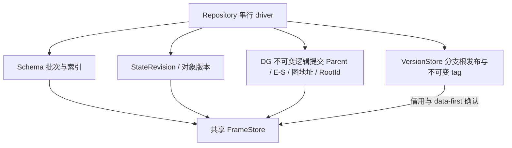

# DB-085：RBF3 / Binary / FrameStore / VersionStore 迁移可行性调研

> 日期：2026-10-11。状态：**Feasible with prerequisites / 推荐继续机制实验，未批准实施或持久格式**。
> 本轮只调查、验证隔离见证和维护文档；未替换产品引用、源码或存档。
> 产品入口：[PROJECT-STATE](../../src/PROJECT-STATE.md)；未决事项入口：[路线图](../DurableGraph-research-roadmap.md#33-rbf3--framestore--versionstore-迁移)。
> 后续上游四项 API 改进及 WSL 新源码复核见[续接记录](0085-upstream-api-refinement-review.md)；本文保留首次 `e989ba6` 基线的含义。
> 后续用户决定与实施方案见[DB-086](0086-new-storage-refactoring-plan.md)：取消全库重开确认/启动审计，采用上游正常恢复，只验收新库；本文的旧前置门及T0–T7不再作为当前施工队列。

## 1. 判断与证据范围

**偏可行，coding agents 可以通过一系列有界任务完成。** 当前需要替换的是存储接缝、地址和发布基础设施；
领域模型、Source Generator、Schema 的 exact 语义、Capture/Upgrade/两阶段物化不需要随之全面重写。
新栈已有真实持久化、随机读取、共享 data 的发布屏障、不可变 tag 与只读审计能力。
本轮独立 public API 见证也完成了共享帧、分支根发布、回退后续写、命名分支目录分叉示意、tag 和冷重开。
该分叉示意只复制历史 head 地址，没有运行 DG 的领域恢复或 mutable fork。

这不是“更改 csproj 即可等价”的升级。有六项会影响正确性或产品合同：

1. 可写打开的自动残尾恢复与 DG 现行严格无修尾规则不同。
2. opaque 地址不能承接 DG 的相对文件编码及物理先后防环证明。
3. VersionStore 发布历史不能代替 DG 的逻辑提交父链。
4. SchemaStore 的专用文件重放/whole-tail 所有权检查不能直接搬进共享 allocator。
5. VersionStore 没有旧 DG 重开流程所需的公开全库控制文件确认入口。
6. 新文件布局、State 地址格式和根发布格式需要明确的旧存档策略。

这些是前置决策和验证门，没有发现要求重做整个对象模型或 SG 的技术阻碍。
如果要求“所有旧存档原位续写、所有旧公共低层类型不变、上游无需调整、严格打开逐字等价”同时成立，
当前公开能力不足以承诺完成；不应把这个更强目标隐含进普通重构。

### 本轮问题和最小观察标准

问题：能否保持 DG 的对象图与 E/S 历史语义，用项目引用接入新 Binary、共享 FrameStore 和 VersionStore，
并形成 coding agents 可验收的重构分片？

最小标准：核对真实依赖/API 和故障边界；当前基线可运行；固定新源码的独立 consumer 能完成
帧写读→根发布→回退再写→冷重开；报告指出不可机械承接的合同以及每项下一步见证。
**通过这个标准只证明调研和机制组合，不证明完整 DG 迁移已通过。**

### 源码身份

| 对象 | 本轮依据 |
|---|---|
| DurableGraph | `/repos/Atelia-org/durable-graph`，`c900edd5b3a921b7bf46df2ac0482dc39597e606`；开始时工作树干净 |
| 指定新上游 U | Windows `E:\repos\Atelia-org\atelia-storage`，本机映射 `/mnt/e/repos/Atelia-org/atelia-storage`；`e989ba60f8866c60bd86f99388701dfbe9c6125f`；开始时工作树干净 |
| 上游隔离执行来源 | 从 U 的上述 commit 做 `git archive`，在 `/tmp/dg-storage-feasibility-20261011/upstream` 构建；没有在 Windows 工作树写入 bin/obj |
| 不能混用的来源 | Linux `/repos/Atelia-org/atelia-storage` 当时为 `50e8e28f0b44cac18a8bdd55c7b12ca5dd3fef2a`，缺少此次新栈，不用于解释新实现 |
| DG 现有公开包 | [StorageDependency.props](../../eng/StorageDependency.props)：基础三包 `0.1.1-preview.2` / `976aa345…`，SegmentStore/Journal `0.1.2-preview.1` / `883f9958…` |

下文 `U:路径:行` 都指固定新上游；DG 相对链接指本轮 DG 基线。
没有用新上游 HEAD 推断旧 pin 包的运行行为；DG 现状由本仓源码及其包模式回归核实。
已有上游验收文档用于导航，本轮实际重跑与未覆盖范围见[验证记录](0085-storage-migration-probe-evidence.md)。

## 2. 当前依赖集中点

| 接缝 | 当前事实 | 新任务的实际范围 |
|---|---|---|
| 工程接线 | [Storage.csproj](../../src/DurableGraph.Storage/DurableGraph.Storage.csproj) 引 Data/Primitives/Rbf/RbfSegmentStore；[Persistence.csproj](../../src/DurableGraph.Persistence/DurableGraph.Persistence.csproj) 引 EventJournal；[源码模式 gate](../../Directory.Build.targets) 检查旧 EventJournal 项目 | 改显式 source-mode gate、项目图、tests 和 probe 的依赖图；收束旧包闭包 |
| State | [StateRevisionStore](../../src/DurableGraph.Storage/StateRevisionStore.cs) 借用 `IRbfSegmentStore`，在 writer lease 内按实际 segment 编码，EndAppend/flush，reader lease 读 pooled frame | 新 borrowed FrameStore、opaque 地址、wire、parent/prior 验证、owned 缓存及 H/D 计量 |
| Schema | [SchemaStore](../../src/DurableGraph.Persistence/SchemaStore.cs) 借专用 `schemas.rbf`，重放全部 SCB1 批次，检查 `_acceptedTail`，单批 append/flush 后装索引 | 共享帧分类、Schema 自身的重放顺序/逻辑 frontier、登记屏障和 fault |
| 资源 | [GraphResources](../../src/DurableGraph.Persistence/GraphResources.cs) 拥有 schema file 与 State segments，严格开和全物理校验 | 单 data owner 的寿命、只读/写开资格、审计和 dispose 顺序 |
| Journal | [HistoryJournal](../../src/DurableGraph.Persistence/HistoryJournal.cs) 既管理逻辑记录，也穿透 events/refs/ref-op-log 路径、EventFrameHeader 和 raw RBF 确认 | DG commit 帧与 VS 根发布拆开；重建严格打开和全历史检查 |
| Repository | [Repository](../../src/DurableGraph.Persistence/Repository.cs) 依赖命名 branch、CAS move/advance、逻辑 ancestry、tag/outcome | 保留产品操作，替换其底层导航/发布；重做失败注入入口 |
| Serialization | [BinaryPayloadWriter](../../src/DurableGraph.Serialization/BinaryPayloadWriter.cs) / [Reader](../../src/DurableGraph.Serialization/BinaryPayloadReader.cs) 是 public ref struct，进入 Runtime 静态签名及 SG 生成结果 | 首片保留 DG facade，只下沉可等价原语和窄校验 |

文本匹配规模只用于定位工作量，不是工时估算：src 直接含旧 SegmentStore/Journal/Rbf 的文件分别为 5/5/6；
地址涉及 34 个源文件，DG reader/writer 名称涉及 29 个。tests 中旧 SegmentStore/Rbf 涉及 77/65 个文件，
experiments 中对应 31/28 个。集合有重叠，不能相加。核心接缝集中，fixtures、动态编译和真实包消费者的迁移面更大。

CLI 当前 [Program.cs](../../src/DurableGraph.Cli/Program.cs) 仅 `return 0;`；离线救援是纪律与测试素材，
不是现成 CLI 产品功能。不得给后续计划虚构已有迁移/救援入口。

## 3. 新上游能够直接提供什么

### Binary 与 Data

固定源码的实际 public 名称是 **`BareValueWriter` / `BareValueReader`**，不是 `BarePrimitiveWriter/Reader`。
`U:src/Binary/BareValueWriter.cs:30-96` 提供 byte/Boolean、固定 LE、Base128/ZigZag 和浮点原语；
reader 的单原语失败不推进 cursor。Data 提供 SizedPtr、reservable writer、CRC 与 binary escape 底座，
FrameStore 已组合这些能力，DG 不必再次拥有物理 escaping 或 frame size 计算。

但读合同不完全相同：

| DG 格式 | 承接方法 / 差异 |
|---|---|
| 整数 canonical Base128 / ZigZag | writer 可委托 `WriteVarUInt*` / `WriteVarInt*`；reader 必须继续拒绝 overlong，上游接受有界冗余表示 |
| char | DG 用 varUInt16；不能直接替换为上游固定 2B `WriteCharLE` |
| Half/float/double | 使用 LE 且保留 bits，可直接对应 |
| Guid/decimal/Temporal | 保留 DG 组合格式、完整表示和范围检查；上游原语不等于这些组合 codec |
| string | 最短 writer 为可承接候选；DG reader 还要求最短 UTF-8/UTF-16 选择，上游 reader 接受合法备选编码 |
| nullable string | DG raw-header+1、0=null；不能用另有 control byte 的上游 controlled codec 代替 |

证据：`U:src/Binary/BareValueReader.cs:83-105`、`U:tests/Binary.Tests/VarIntTests.cs:80-134`、
`U:tests/Binary.Tests/StringTests.cs:23-57`；DG [CanonicalVarInt](../../src/DurableGraph.Serialization/CanonicalVarInt.cs)、
[StringPayloadCodec](../../src/DurableGraph.Serialization/StringPayloadCodec.cs)。
canonical 校验还支撑 Dictionary 的 canonical-key 语义，不能用“输出字节一样”替代读取等价。
保留 facade 可避免改 SG 已生成消费者的签名；消除字符串重复实现是独立后续问题，不是接入前提。

### FrameStore

`U:src/FrameStore/FrameStore.cs:31-91` 的公开能力覆盖 Create/Open/RO、buffer Append、
unknown/sized Builder、提前地址、随机 CRC 校验读取、Inventory/Audit、owner-wide ConfirmDurable。
`FrameRead` 独立拥有 pooled bytes，调用方 Dispose；Builder writer 支持 reservation/backfill。
归档不改变完成帧地址。VS 借用实际 data，Dispose 不关闭它。

DG `AppendDurably` 可用完成帧后 `ConfirmDurable()` 组合；确认范围会扩为共享 owner 的此前完成输出。
正常取消未完成 Builder 是内存 reset，没有发现截断已输出尾部：
`U:src/Rbf/Internal/RbfFileImpl.cs:207-210,355-423`、`U:tests/Rbf.Tests/Internal/RbfFrameBuilderTests.cs:524,553,581`。
输出故障仍可能留下不完整尾部，后续打开策略另行裁决。

Open 成功不是全健康证明。Inventory 查 framing/TrailerCRC，Audit 完整查各帧 CRC；
两者都不认证应用引用闭包、业务历史或被外部删除的完整文件。
缓存命中前仍需检查借入 owner 可用性，不能把持久 StoreId 当活跃/健康资格。

### VersionStore

`U:src/VersionStore/VersionStore.cs` 提供 numeric ref 的 Create/Read/List/Publish，
`VersionStore.Tags.cs` 提供不可变名称 tag；发布前先 `data.ConfirmDurable()`，再输出并确认目标控制文件。
`PublicationOutcome.NotAttempted/Unknown/Confirmed` 可映射 DG 的 NotPublished/Unknown/Published，
但 Repository fault 必须单独记录，不能将 NotAttempted 解读为 owner 健康。

`ReadRefHistory`、exact ForkRef、ListForks、RO Audit 已实现；这些能力属于**根发布序列与创建关系**。
VS 不解释 DG State/Event、图 Parent 或 ObjectId，不提供旧 EventFrame append/read。
`PublishRef` 无 expected revision；`PublishRefs` 的 CU 是多个既有 ref 的共同成立判据，**不是 CAS**。
DG 当前独占、串行 driver 可在 guard 内验证 expected head，再发布，无需立即增加多 writer/CAS 平台。
失败 Result、异常、确认后交付失败必须按真实阶段分别验证。

## 4. 推荐的最小承载方向与待选项

这是施工方向建议，尚未选择新的持久格式或公共 API。

三个地址域不能混用：StateRevision 的帧地址、DG commit 的帧地址、VS `RefRevision`。
`CheckpointAddress` 仍由 DG 本次打开签发并校验 owner，不能因为上游 revision 可跨 owner 保存而放宽。
VS 的 tag payload 可冻结 DG commit 地址；relatedRevision 只是注记，不构成 DG 历史来源证明。

### 逻辑历史

将现有 `Parent/kind/StateRevisionAddress/RootId` 作为 DG immutable commit envelope 存进 FrameStore。
DG 继续解释逻辑父链及最近 State；VS 只发布 head 地址。
例如 `c1 → c2` 后 Move 到 `c1` 再提交 `c3`：DG 要求 `c3.Parent=c1`，
VS 发布历史却包含 `c3,c1,c2,c1`。本轮隔离见证实际验证了这一区别。
不能把 ReadRefHistory 的上一项当最近 State，也不需要让 DG named fork 依赖 VS ForkOrigin。

### 分支命名

| 候选 | 收益 | 成本/验证门 |
|---|---|---|
| A：一个 reserved repository-root ref，RootMap 保存 branchName→DG commit | **建议作为首个最小候选**；create/fork/move/commit 都是一条根发布；没有 ref 创建+名字登记协议 | 每次编码完整分支目录；1 MiB payload 上限；须保留 DG 名称校验，测量典型/上限分支规模 |
| B：每 branch 一个 numeric ref，payload 自带稳定名称和 head | 更新成本不随全部分支增长；无需另一 name catalog | ListRefs+ReadRef 冷重建名字；重复/变更名字必须拒绝；named fork 用 CreateRef，不能原样 clone 源名 |
| C：独立名字 catalog + 自动 numeric ref | 可以分别演化目录和 ref | 新增创建与名字共同发布问题，CU 不覆盖创建/tag；没有当前需求，不建议首片采用 |

A 已有机制见证，尚未做分支规模/资源比较，不因此冻结为产品设计。
若 RootMap 的字符合同比现有 branch API 更窄，须明确拒绝规则/API 变化，不能静默归一化名字。

### Schema 共用物理分配，不扩成版本化 Schema 视图

现有 Schema 登记是仓库全局、单调、同 exact key 一致，失败提交之前的合法登记也可保留。
共享 FrameStore 不自动改变这些语义，更不授权实现 Schema 自举或随分支回滚的 Schema 视图。
这两项仍见[原延期方向](../DurableGraph-research-roadmap.md#41-schemastore-复用-statestore-与联合版本视图)。

新 Schema 批次必须能识别、校验顺序/ID 连续性并恢复自身 frontier。可研究带 predecessor/批次序号的
schema-log，扫描全部正式用户帧后只按逻辑合同重放；文件枚举顺序没有业务含义。
不要沿用 `_file.TailOffset == _acceptedTail`，正常 State/commit append 也会改变共享 allocator。
也不能只从已发布根找 Schema 而遗漏当前语义下已接受的孤立登记。

## 5. 必须先解决的正确性边界

### 5.1 严格打开与自动残尾恢复

新 FS writable Open 自动恢复 active 用户残尾；VS 的恢复还发生在 lazy writable ref/tag/CU peer 访问。
实际操作包括补 Key/Fence 和 `SetLength` 截去 partial next frame，不是单纯内存解释。
证据：`U:tests/FrameStore.Tests/Public/PublicAdmissionTests.cs:169-208`；
`U:tests/VersionStore.Tests/Public/PublicPayloadAndRecoveryTests.cs:122-169`；
`U:src/Rbf/Internal/RbfTailRecovery.cs:94-111`。
这与 [AGENTS](../../AGENTS.md#persistent-data-discipline) 和 DG 的坏尾保持不变测试直接冲突。

可选路径：

- 保留现行纪律：上游提供 strict/no-recovery writable 路径，并覆盖 FS active、VS lazy ref/tag/history/fork/CU peer。
  **若要求底层 API 自身严格保证，这是较清晰的建议。** 不能仅在 FS 返回后检查 RecoveryReports。
- DG 持 outer lock，先 RO 两层完整审计+应用闭包验证，关闭全部资源/cache，再 writable 重开。
  这是条件性准入门候选；RO→WO 底层锁有间隙，要求没有绕过 DG driver 的外部改写。
  必须独立证明所有 lazy 目标都已覆盖，不能称上游已有 strict mode。
- 明确接受 RBF3 自动物理尾恢复：需要先修改 DG 的已选合同、失败见证与救援边界。
  恢复完整二进制帧不证明业务发布成功，Unknown 仍需重开检查，不允许透明重试。

本轮没有替用户选择放宽纪律。无论选择哪条，RO 必须不写不修，救援后 fresh owner/cache 的纪律保持。

### 5.2 地址、链终止与成本计量

旧 [FrameAddressWireCodec](../../src/DurableGraph.Storage/FrameAddressWireCodec.cs) 编 backward file distance + Serialized SizedPtr，
[FileScope](../../src/DurableGraph.Storage/FileScope.cs) 与 writer segment 强耦合。
新地址只公开 equality 与固定12B/变长 codec；固定编码用 Packed ticket，变长编码用 Serialize ticket，不能互换。
建议新 State wire 明确使用 opaque absolute 地址并升级版本，不拆12B去重建旧内部字段。

旧 [EnsureStrictlyEarlier](../../src/DurableGraph.Storage/FrameAddressValidator.cs) 还是防环基础；
[LiveObjectHeadMapMaterializer](../../src/DurableGraph.Storage/LiveObjectHeadMapMaterializer.cs) 没有 visited set。
新交错 Builder 可以较大 FileId 先完成、较小 FileId 后完成：`U:tests/FrameStore.Tests/Public/PublicLifecycleTests.cs:41-71`。
因此不能保留数值文件序当业务顺序，也不能仅删除该校验。

需在小片中选择逻辑序号/已存在目标资格/显式 DAG 检查等最小证明。
visited 防环只证明终止，单独使用还不等价于“parent/prior 在写入前已存在且符合 exact 对应”。
State parent、external heads、object prior 和 commit parent 都要审查；坏环/悬空/错误角色不能回退旧数据。

同步改 [ObjectVersionPayloadSize](../../src/DurableGraph.Storage/ObjectVersionPayloadSize.cs)、
[NormalizedRevision](../../src/DurableGraph.Persistence/NormalizedRevision.cs) 及 wire reader 的 H/D 计算。
H 必须仍是实际 object-record 编码成本；若采用变长地址，实际 consumed 不能用最短 Measure 值替代。
不要把 RBF3 overhead 或旧 Offset/Length 下界散布到 DG envelope。

### 5.3 全库检查和重开确认是两件事

旧 [HistoryJournal.ConfirmDurable](../../src/DurableGraph.Persistence/HistoryJournal.cs) 在图依赖校验/确认后，
确认全部 Journal events、ref objects、最后名称/tag 发布 frontier，含物理 orphan。
新 VS RO Audit 检查全部正式 ref/tag，却不解码应用 bytes/data；新 VS Open 不 flush，亦无公开全库 ConfirmDurable。
本次 PublishRef/CreateTag 只确认 data 和当前目标控制文件。

因此 `FrameStore.ConfirmDurable()` 或 RO Audit 不能代替旧控制文件确认。
应单列决策：证明并明确采纳更小的恢复承诺，或补上游 owned 控制资源确认入口。
通过重复 Publish 旧 payload 会新增发布事实，也不算无副作用的重开确认。
继续在 DG 猜 VS 磁盘路径进行 raw RBF flush 可以作为短期实验，但会保留旧穿透耦合，不建议作为默认终点。

物理校验要覆盖实际完整帧集合，包括 orphan。应用语义校验保留当前基线：全部 Schema 登记、
全部 commit（含 orphan）及其引用的 State/图依赖，还有 branch/tag 目标；FS Audit/VS Audit 不能替代这一层。
未被任何 commit 引用的孤立 State 仍纳入物理校验，不借迁移自动增加对它的完整领域解码要求。
不能只遍历 live branch/tag，不承诺检测已经被外部删除的所有完整历史文件。

### 5.4 旧存档与公共低层 API

建议首次纵切只操作 fresh repository，旧库识别后明确拒绝写入；这是实验范围建议，不是已批准删除兼容性。
若实际消费者要求迁移，再另开离线任务，选择历史逻辑点/全部历史保留范围、重新分配地址、重写
State parent/prior、commit parent、branch/tag、Schema 顺序并冷读验证；不能只复制可达领域根就声称完整历史迁移。
旧 RBF 可只读不意味着新 FrameStore/VS 能直接收编旧 DG 目录或原位续写。

DG 的公开 FrameAddress、使用旧 options 的创建入口、借入低层 Store 构造器会有源码/API 变化。
首片应给消费者清单和重编译要求；不默认增加兼容壳。
旧 EventJournal/SegmentStore 在新上游固定 RBF1 包，新栈引用同名 RBF3 Atelia.Rbf；
**同一消费进程不得混用两套闭包**。旧读和新写迁移器若并存，优先用独立进程交换明确中间结果。

## 6. 后续形成工单的路标

下面是任务边界和依赖建议，不是已经执行的重构计划或日期承诺。

| 工作包 | 负责范围 | 最小可观察验收 | 前置 |
|---|---|---|---|
| T0：合同/准入机制门 | strict策略、重开确认、旧数据范围、名字方案、地址/链证明 | clean/partial head/body/partial closure/corrupt complete/archive 场景；拒绝后逐字节不变；明确所有待选项 | 本报告 |
| T1：Binary facade | Serialization 内部原语；保留 SG/public facade | 全 scalar/string goldens、canonical 拒绝、失败 cursor；Dictionary canonical key 回归 | Binary 对照；可先独立做 |
| T2：FrameStore 状态见证 | 新地址 wire、parent/prior、Base/Delta、H/D、owned cache | Base→Delta→归档→冷读；环/悬空/stale prior 拒绝；borrowed fault/Dispose 后缓存不得绕过检查 | T0 地址与寿命合同 |
| T3：共享 Schema 见证 | 批次分类/逻辑次序/frontier、全局 ID、幂等/闭包、资源组合 | Schema/State/commit 交错；合法孤立登记可重放；坏批次不装索引；故障/RO 数据不变 | T0 + T2 地址合同 |
| T4：DG commit + VS 根发布见证 | immutable commit 链、branch map 或 per-ref naming、tag、逻辑查询 | 两分支 E/E/S/S、跨 branch Move、旧点 fork、rewind再写、orphan 校验、固定枚举端点 | T0；与 T2/T3 共享帧/tag合同 |
| T5：协调切换产品接线 | GraphResources/HistoryJournal/Repository/csproj/tests gate；清除旧 runtime 闭包 | 整 solution build + 相关回归；产品 Checkout/Fork/Pair、owner scoped handle、热基线保持 | T1-T4 见证通过 |
| T6：故障与冷恢复复核 | data/commit/root 屏障、outcome、fault、内存安装、严格重开 | 未开始根/tag发布的data/commit失败→NotPublished（可能fault）；根/tag发布尝试未确认→Unknown；根/tag发布已确认后失败→Published；新进程检查实际 branch/tag | T5；T0 恢复合同已选 |
| T7：消费者与交付 | fixtures/动态编译、PublicationCrashProbe、真实消费者；可选离线迁移 | fresh项目引用闭包、进程中止；如恢复包模式，再独立 package probe；如做迁移，再独立历史/tag完整性验收 | T6；旧数据/包任务单独授权 |

共享地址、帧 tag/codec、Schema 顺序、owner/fault 和 commit envelope 先由主线程统一。
然后 T2/T3/T4 可在独立新栈 witnesses 中委派；共享文件由一个执行者集成，.NET 构建测试串行。
这些工作包不要求每包立即成为产品 commit。不能为维持过渡步骤运行，在同一产品中接入新 FS 和旧 Journal。
T5 是协调切换点；各子包在此前用隔离项目证明机制，集成后必须完整构建和相关回归。

主线程保留跨包契约、发表范围、失败结果和最终集成责任。对 T0/T6 作独立质疑，对 T5/T6 作独立复核；
subagent 的完成报告不替代验收。每包交付源码/符号、实际验证和未覆盖问题，避免将全部设计讨论交给每个执行者重建。

### 可直接复用的回归路标

- [StateRevisionStoreTests](../../tests/DurableGraph.Storage.Tests/StateRevisionStoreTests.cs)、[ObjectVersionChainStoreTests](../../tests/DurableGraph.Storage.Tests/ObjectVersionChainStoreTests.cs)：atomic append、exact prior、链和 H。
- [StateRevisionReadCacheTests](../../tests/DurableGraph.Storage.Tests/StateRevisionReadCacheTests.cs)：owned 缓存、失败不 seed、borrowed lifetime、救援后 fresh cache。
- [SchemaStoreTests](../../tests/DurableGraph.Persistence.Tests/SchemaStoreTests.cs)、[SchemaCatalogReplayTests](../../tests/DurableGraph.Persistence.Tests/SchemaCatalogReplayTests.cs)：批次/ID/闭包、严格重放与 fault。
- [HistoryJournalTests](../../tests/DurableGraph.Persistence.Tests/HistoryJournalTests.cs)：orphan、严格坏尾、重开屏障；旧物理路径断言需要改写。
- [EventHistoryRepositoryTests](../../tests/DurableGraph.Persistence.Tests/EventHistoryRepositoryTests.cs)：`HistoricalForkAndMoveSelectLogicalParentRatherThanLatestPhysicalState`、E/S 自由排列、发布后才安装。
- [DB078FailureTests](../../tests/DurableGraph.Persistence.Tests/DB078FailureTests.cs)、[RepositoryTagFailureTests](../../tests/DurableGraph.Persistence.Tests/RepositoryTagFailureTests.cs)：三态 outcome/fault、tag 异常与严格冷重开；旧 reflection 注入 `_refOpLog` 不能原样照搬。
- [PackageConsumerProbe](../../experiments/PackageConsumerProbe/README.md)：EventHistory/recovery、跨库生成消费者；ProjectReference 验证不能替代包消费。

## 7. 本轮已证明与尚未证明

当前 DG 基线 Release 构建通过，0 warning / 0 error；四测试程序集共 **2976 项通过，0 跳过**。
隔离 public consumer 的 assets 只有六个新栈 Atelia 项目、DG Serialization 和 K4os 1.3.8，未混入旧 Journal/SegmentStore。
它证明了机制能组合，也实际证明了 Binary reader canonical 差异和 VS 发布历史/DG parent 的区别。
具体命令、结果、probe 源码与上游相关测试重跑结果集中于[验证记录](0085-storage-migration-probe-evidence.md)。

尚未证明完整 DG 新 State codec、Schema 重放、链安全、严格 writable 入口、旧重开屏障等价、完整产品故障恢复、
Windows 本轮执行资格、旧数据转换、新包公开交付或性能提升。上游“更可靠和快”的底座动机成立与否，
不能由这个 consumer 外推到 DG 整体保存/重开耗时；后续用相同模型与工作负载测量。

推荐下一步只形成 **T0 合同/准入实验 + T1 Binary facade** 的具体工单。
T0 选定后再冻结 T2-T6 的共享输入和验收，避免让各 coding agent 分别发明地址、历史或恢复协议。
