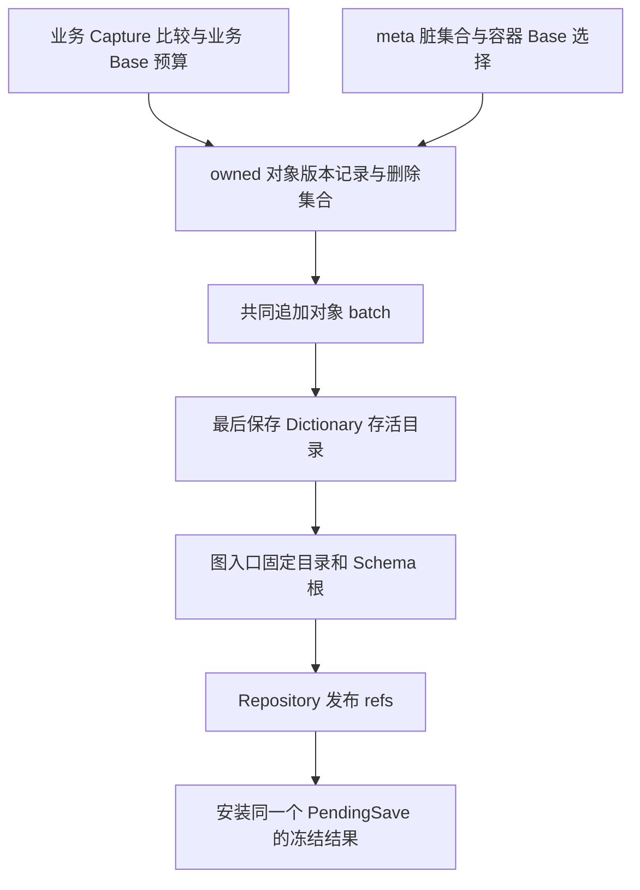

# DB-087：meta 自举与共享／私有 Schema 视图的就地重构路线

> 更新：2026-10-13。状态：**P0／P1a 已完成，P1b 有限停点已达；P1c 前十片已验；P1d 前四片限定验收完成，内部 split Repository／accepted-history 准确包门禁通过；默认公开切换、旧权威退出与完整 P1 产品门禁／P2 未完成**。
> 历史证据保留第 10–32 节；本片内部 friend PackageReference 的实际 Repository／历史故事与验证见[第 33 节](#33-p1d-第四片准确包与-accepted-history)。后继为默认接线→按调用清零退旧→非 friend 公开包，P2 后置。
> 公开产品基线仍是 [DB-086](0086-new-storage-implementation.md)。P1 公开切换、P2 private 未实施；内部 API/wire 未冻结。
> 用户明确无旧数据／旧 API 兼容负担；简单性按最终产品衡量，施工过程允许复杂。裁决与下一片见[第 9 节](#9-本轮裁决与下一片实验)。

## 1. 结论与范围

**推荐两种专用变化来源、一个窄的图保存核心、一个发布 owner。** 业务通过 Capture/比较准备对象记录；meta 通过受控编辑维护归约后的脏集合。两侧复用 body Base/Delta，交付 owned 对象版本与删除集合；共同层写对象、最后写存活目录、形成准确图根，由 Repository 发布并安装实际候选。

包括 DurableSchema 的完整逻辑内容在内，meta 使用有限固定员工布局序列化；冷读从指定 catalog 根恢复 DTO，再调用现有工厂构造不可变 Schema/TypeExpr，不需要先查 Schema Store，也不建立第二份员工 CLR 对象图。动态 Base 直接引用该 catalog 中布局 descriptor 的 **meta ObjectId**，省去独立 RepresentationId 分配器和持久映射表。固定 descriptor 的类别与完整闭包检查仍不可省。

live-object-list 指持久化 ObjectId→内容 head 目录。它使用固定员工 `Dictionary<uint, HeadLocator>`，共用 Dictionary body 与对象版本能力；目录自身排除在该目录之外，由图入口直接定位。固定 framing 是有限引导边界，不要求序列化器消除自己的所有固定规则。

保留本任务参照 0008 的业务分支目录 ref＋受管 shared ref 布局，新增共享 descriptor 与业务版本借 `PublishRefs` 同次生效；每个业务版本仍 pin 准确 Schema 根。共享只追加已接受定义，私有使用完整独立视图，不做动态 fallback。没有发现必须另建图引擎、替换 Generator/history 或修改上游存储协议的阻塞。

公开切换时，本路线直接替换 SCB1 独立发布、raw ObjectHeadMap 与旧内部保存合同，不建设兼容 reader、转换器、生产双写或迁移壳。P0 使用独立内部入口和实验文件格式，尚未替换这些公开路径。这不授权修改、删除实际存档或完整帧。专用 Schema codec 加候选发布同样能实现版本化／原子提交；选择自举的价值是复用 body、对象版本、准确根和失败处理，不预设它一定更快或代码更少。

### 1.1 需求账本与证据边界

| 要求／选择 | 来源与当前消费者 | 本轮边界 |
|---|---|---|
| Schema 与 live-directory 共享增量序列化、版本化和原子发布 | 用户本轮及前序明确目标 | 最终产品目标；不是只共享 FS 而保留两份 body 实现 |
| 共享单调、私有完整覆盖、历史准确解释 | 用户指定的 [0008](../../../atelia-storage-2/docs/0008-repository-wide-schema.md) 已选政策 | 一种目录格式；无私有 miss→最新 shared、无永久全历史占键扫描 |
| 无旧数据／API 兼容；最终产品简单优先 | 用户明确决定 | 旧 API/格式不能单凭已存在阻止简化；重构成本另计 |
| E/S 自由序列、两种祖先关系、冷读/Upgrade、tag/Fork/Move、引用共享与环 | 当前 Repository、生成器及测试；见第 2 节及第 4 节 | 除本案明确改变的 Schema 提前接受合同外，保留可观察行为 |
| append-only；串行 single owner/driver；Unknown/fault 停用冷开 | AGENTS、准确 pin 的 FS/VS、现有故障测试 | 无多 writer、CAS 平台、全库启动审计或第二事务日志 |
| 双 ref、员工 DTO 形状、保存内部类型、物理字段 | 本案方案及 0008 布局选择 | 可用反例与实现成本挑战，不能拿派生路线图作独立佐证 |
| 原分支显式重建、按操作选模型、业务 head 不动的 Schema-only | 尚无必须本片交付的消费者 | 留明确重访条件；首片 API 范围不升级为永久产品禁令 |

显式 `CommitState` 即使业务内容不变也可以产生正常 State 版本，因而可复用对象目录、只改变所 pin 的 S；这是现有能力的延续，不是伪造业务变化。登记本身不得暗中创建 E/S 或提前占共享键。若要求**业务 head 完全不动**而改变其解释入口，再独立设计该操作，不预先承诺 BranchRootDescriptor。

## 2. 调研基线与证据强度

### 2.1 当前 DurableGraph

调查开始时工作树干净，HEAD 为 `1d1412b31acbe08ae02c0567508eedd7ede722f5`。存储依据为 [StorageDependency.props](../../eng/StorageDependency.props) 中的 `974fd47abb73792f9d350af87ab91a53848952eb`；上游 checkout 干净且 HEAD 与 pin 一致。不能沿用 DB-086 以前的独立文件／日志恢复模型。

| 当前事实 | 源码入口 | 对重构的含义 |
|---|---|---|
| `GraphResources` 只打开 VS ref 1，RootMap 含 `schema` 和 `branch/名称` | [GraphResources](../../src/DurableGraph.Persistence/GraphResources.cs)、[RepositoryRootCodec](../../src/DurableGraph.Persistence/RepositoryRootCodec.cs) | 物理资源已统一；当前 Schema 与业务仍分两次更新根 |
| Schema 登记复制索引、追加完整 SCB1 快照、发布仓库根，再 install | [SchemaStore.Prepare / CommitRegistration](../../src/DurableGraph.Persistence/SchemaStore.cs) | 私有候选基础已存在；需移除登记中的独立发布权 |
| Base v4 只携带动态 RepresentationId；除 string 外需 SchemaStore 解析 | [BaseObjectBodyCodec.Decode](../../src/DurableGraph.Persistence/BaseObjectBodyCodec.cs) | 单纯注册员工 CLR model 无法完成冷自举，必须改变表示路由 |
| raw scalar/body 与容器算法不拥有 Schema 发布；Capture 使用 resolver | [CaptureSession](../../src/DurableGraph/Runtime/Capture/CaptureSession.cs)、[BuiltinStateValues](../../src/DurableGraph/Runtime/State/BuiltinStateValues.cs) | 不必重写 serializer；员工分支提供相同绑定合同 |
| DurableSchema/TypeExpr 的构造器校验并计算派生值，含 ImmutableArray | [DurableSchema](../../src/DurableGraph/Schema/DurableSchema.cs)、[TypeExpr](../../src/DurableGraph/Schema/TypeExpr.cs) | marker 或写 readonly 字段不能解决构造依赖与缓存正确性 |
| 所有历史读取仍借同一个 live SchemaStore；模型缓存观察后续登记 | [Repository](../../src/DurableGraph.Persistence/Repository.cs)、[StateModelSnapshot](../../src/DurableGraph.Persistence/StateModelSnapshot.cs) | 必须改为准确视图，不能只增加分支级 Schema 选择器 |
| reader／definition／binding 每个 key/version 只有一套形状 | [StateReaderRegistry](../../src/DurableGraph.Persistence/StateReaderRegistry.cs)、[StateBindingContext](../../src/DurableGraph/Runtime/Binding/StateBindingContext.cs) | 私有异形目录不自动授予同一代码环境的双形状执行能力 |

DB-086 记录了既有产品的 build、2798 项回归及真实包消费。它们证明调查开始时的基础能力，**不单独证明本案的员工路由、历史 Schema pin 或共同发布**。P0 本轮重新构建并执行回归，新增持久证据见第 10 节；未重做公开包交付资格。

### 2.2 实验原型

用户指定依据为 [0005 路线](../../../atelia-storage-2/docs/0005-schema-bootstrap-route.md)、[0006 设计](../../../atelia-storage-2/docs/0006-schema-bootstrap-design.md)、[0007 实施](../../../atelia-storage-2/docs/0007-schema-bootstrap-implementation.md)、[0008 共享／私有策略](../../../atelia-storage-2/docs/0008-repository-wide-schema.md)。

前期调查时原型是 **unborn Git repository**，不能引用其 HEAD；当时核对的是工作树文件。关键机制由源码而非设计互引支持：

- [FixedBindingTable](../../../atelia-storage-2/src/Storage2.Graph/Engine/FixedBindingTable.cs) 结构上没有外部 Schema lookup，按固定身份、版本、完整 layout 和精确 CLR 类型准入。
- [FixedEmployees](../../../atelia-storage-2/src/Storage2.Graph/Bootstrap/FixedEmployees.cs) 接四种员工记录与三种封闭 List，复用普通 Capture/body/Reader。
- [MetaProjection](../../../atelia-storage-2/src/Storage2.Graph/Bootstrap/MetaProjection.cs) 在记录完整恢复后，以 DFS/memo 调用现有工厂；拒绝构造依赖环，保留共享 DAG。
- [WorkspaceContractTests](../../../atelia-storage-2/tests/Storage2.Graph.Tests/WorkspaceContractTests.cs) 包含零业务注册往返、实际外部 CLR 拒绝、稳定目录/List Delta 与新 Schema Base。
- [ExactViewValidator](../../../atelia-storage-2/src/Storage2.Graph/Bootstrap/ExactViewValidator.cs) 检查 exact key、family kind/arity、base/inline 闭包；现有 CatalogWorkspace 仍拒绝已 Accept 同键改形。

顾问核对现存 TRX：首片 468/468，后续共享目录旧实验 469/469。这是历史内存证据，不是本轮运行；没有业务 binder、持久根、独立进程重开或 0008 私有模式资格。原型元数据仍可描述未知业务名字，而不要求加载该业务 CLR 类型。

为方便重查无 HEAD 的来源，前期调查记录的 SHA256 如下；不是要求文件以后维持这些字节。

| 原型文件 | SHA256 |
|---|---|
| `docs/0005-schema-bootstrap-route.md` | `2663309D5A16096DC018E5417F97F2C11CF1EB4174E6A9ECB0F02A1FC36F636F` |
| `docs/0006-schema-bootstrap-design.md` | `5A8F692FA7200A6FAF76B3ECCABA308663561A1707D12FB57AA278D0243FF705` |
| `docs/0007-schema-bootstrap-implementation.md` | `E0A035C5E6DBA925D56585250D098F6D4B27DEC2B1C69E8D0D9B0051F2177508` |
| `docs/0008-repository-wide-schema.md` | `67C5CDABE7879138B86D5A00B18F3120940E5C9C69562A9330E365F0EB31F6C7` |
| `Engine/FixedBindingTable.cs` | `ED747EDF2A40739E7EE75F25B20C018371AF3E8AFAAA94C451BBF4F47B872F03` |
| `Bootstrap/MetaProjection.cs` | `748B715607D6808A6FC65082F457E63623EFC26FE570D961DB45E3FB893EB6B9` |

### 2.3 上游实际能力

准确 pin 已实现 [VersionStore.PublishRefs](../../../atelia-storage/src/VersionStore/VersionStore.Batch.cs)。先确认绑定 FS 的完成输出，再追加全部 CU 成员、flush 全部目标 ref；全部确认后标记 Confirmed，才交付结果。共同资格读取见 [ConditionalRead](../../../atelia-storage/src/VersionStore/VersionStore.ConditionalRead.cs)。

其边界须直接进入 DG 设计：

- 仅同 owner 的既有 refs；不混合 CreateRef、tag、删除或跨仓事务。
- 无 expected-head/CAS 参数；VS 生命周期 writer 独占锁与 single driver 是基础。DG 仍需串行 guard 和私有候选的最新根资格检查。
- 没有跨多次 ReadRef 的快照隔离；随后单独更新某个 ref 是合法的。因此旧业务版本必须自己 pin Schema 根。
- 每个 root payload 为 1..1MiB；root 适合放图地址，不适合塞完整 catalog。VS 不检查应用依赖闭包。
- 正常恢复按需处理必要控制文件与不完整尾；不要求预开全部 refs/tags。完整必要事实损坏不能伪装为未发布。
- Unknown 必须停用会话并冷开裁决；Confirmed 后交付失败不能降格为未发布，完整 orphan 不删除。

[CU 验收](../../../atelia-storage/docs/VersionStore/07-versionstore-cross-ref-conditional-update-acceptance.md)记录 144 项及真实进程停止窗口，范围为 ProcessCrashOnly。本轮未重跑上游自身测试；DG 的两 ref 动作窗口见第 10 节，当时未提供进程强杀资格；当前六个真实保存进程窗口的限定证据见第 31 节，仍不代完整 P1d 门禁。原型 0006/0008 中“CU 尚未实施”的段落是先前快照，当前以 pin 源码为准。后续真实包验收仍需独立证明所用六包和 DG 消费路径，不能拿源码存在代替包资格。

## 3. 自举的最小模型

### 3.1 两种解释来源、两种变化来源，一套保存管线

布局来源分固定 builtin/employee 与准确 catalog；变化来源分业务比较与受控 meta 编辑。两条轴独立。固定员工可用 Capture 作实验对照，生产 meta 不必重捕获全图。员工根使用内部入口，公开业务根仍是非空 durable 对象。共同点是 body emitter、对象版本、目录保存和发布，不建设通用 change-tracking、策略插件或资格 token 平台，也不拆程序集。

基元值由静态槽解释，不独立占对象行。容器能否免 Schema Store 取决于完整槽闭包：`List<int>`、员工 `List<MetaFieldRecord>` 可以固定解释；用户 inline 布局仍需对应目录，实际业务对象仍需 binder。首个纵向故事仅接所需有限闭包，公开切换前补齐当前受支持的 primitive/string/Nullable/数组/List/Dictionary 组合；任意 BCL、marker 或 namespace 不自动成为员工。

### 3.2 固定身份与动态 descriptor 引用

新 Base envelope 区分 **有限 fixed 表**、**dynamic descriptor ObjectId** 与 **structural TypeExpr**。有限表由外层 ABI、类型码及完整布局选 reader；structural 准入所选 ABI 明确支持的 closed builtin-only 容器布局。未知版本、用户覆盖保留身份或容器实参逃出闭包均拒绝；不沿用旧动态整数域来划员工区间，也不用 CLR 名字或 GetHashCode 作持久身份。

P1b 首片当时采用 typed／fixed-table ABI v2，旧 typed v1 明确拒绝；外层 ABI 选择整份固定表，内部员工 `DurableType` 定义和生成 DTO 仍声明 V1。固定表格式、员工 Schema 版本与用户 Schema 版本是不同身份，不为 P0 旧实验格式建兼容通道。当时固定路由覆盖 string、员工与精确 `List<int>`；用户 Root 和 `List<Point?>` 动态引用 descriptor。后者虽然使用 BCL List 外壳，其用户 inline/Nullable exact 槽仍由准确 S 解释；首片未将全部 BCL 组合划成无需 Schema 的固定通道。历史证据见第 12 节，当前 ABI 见下段。

第三片当时采用 typed ABI3：route 0 为有限 string／员工表，route 1 为动态 descriptor，route 2 为 structural TypeExpr，移除精确 `List<int>` 专码。ABI3 常量规定 List codec 2，不另写 codec 字段；closed 全树无 Named 是结构准入条件，不能以 `ValueSchema == null` 代替。历史源码和包证据见第 14 节，fixed body、低层纯结构图与带 durable Root 的业务工作区分别限定资格。

第四片当时采用 typed ABI4，保留三路并明确 List codec 2／Array codec 1；旧 ABI3 拒绝。结构路由扩到无 Named 的 Array root，用户 exact 元素数组由 descriptor variant 4 表达。该片源码和包证据见第 15 节。

第五片选 typed ABI5：明确 Dictionary codec1／List2／Array1、拒旧4；D variant5 复用完整 Dictionary TypeExpr 与有序 Key1／Value2 Fields，Version0、Element/Base 空、显式 codec1。员工 Schema/DTO V1 和字段不变、meta 白名单不扩大。除闭合 header/body 外，本片还补所有 stored Dictionary 的完整 source lookup 校验；设计与最小验收见第 16 节。

动态分支的身份是 **`(Base 所在 batch 的 SchemaRoot, descriptor ObjectId)`**。该 ObjectId 属于 Schema 图，不是业务图内同数值对象。Delta 从终止 Base 继承解释；跨布局或固定 ABI 改变写新 Base。图所选 S 与 Base 来源 S 的职责见第 4 节，不能只按数字 ID 缓存 reader。

### 3.3 一份 descriptor 图与派生查询索引

当前 SCB1 将 Schema、数组/List/Dictionary 完整布局放入独立 RepresentationId 空间。新格式没有兼容约束，推荐直接复用这些描述对象自己的 meta ObjectId：

| 持久内容 | 加载后的派生内容 |
|---|---|
| catalog 根的合法 descriptor 集合；ReferenceObject/InlineValue Schema、容器布局及字段、TypeExpr、base/inline/nullable 依赖 | `SchemaKey → descriptor ObjectId/不可变 Schema`、`ObjectLayout → descriptor ObjectId` 及查询索引 |
| 完整 codec 版本、类型实参、槽和依赖引用 | hash/depth/nodeCount、reader/binding 缓存 |

不再持久化第二份 ID→layout 映射，也不单独分配 RepresentationId。已接受 descriptor 本体保持不可变；shared Add 沿用旧 ID/含义，同形复用。private 改形新建 descriptor ObjectId 并替换目录成员，旧 S 仍保留旧节点。不同分叉的数字可能同数异义，解释必须带 S；不增加跨全部私有历史的编号/占键账本。descriptor ID 可能更稀疏，不能据此承诺头部字节更少。

**在 S 的 live map 里存在还不够。** 动态对象头只准引用 catalog 所声明、完整验证过的对象 descriptor；TypeExpr、Field、目录等普通员工节点不得充当表示，InlineValue Schema 只能作值依赖，不能作对象头。固定身份、SchemaKind、exact key、family kind/arity、依赖种类/深度与完整 layout 都要验证。这接替 [SchemaCatalogEntry](../../src/DurableGraph.Persistence/SchemaCatalogEntry.cs) 和 [GetRepresentation](../../src/DurableGraph.Persistence/SchemaStore.cs) 的现有准入，而不是删掉它们的语义。

Dictionary comparer/lookup 模式仍属于 frozen 对象状态及 Base body，不复制进 catalog。`Named("Widget")` 是描述数据，不递归加载 Widget 实例。具体记录拆分/variant 由纵向片决定，默认 DTO 直接投影，不先引入多态记录框架。

P0 员工 records/bindings 放在已有 Persistence 并补 analyzer 构建引用。最初尝试放 Runtime 被真实编译的 DG0001 拒绝：`HasDurableContract` 有意要求属性契约来自引用程序集，不能在其声明编译中绕过身份校验。迁移位置后真实 SG 编译通过；不修改该 guard、不新增程序集，也不更改业务 `.dgschema` 语法。P1b 首片继续这一落点，选择 Descriptor/Field/TypeExpr 强类型员工引用，经现有 SG 保存为 ObjectId；目录 locator 仍用三个 uint 搬运完整地址 bits。

### 3.4 不可变投影与归约后的脏集合

从 `meta ObjectId → stored DTO/layout` 直接投影：先完成固定 reader 的全消费、引用类型及闭包验证，再按依赖调用 DurableSchema/TypeExpr/字段工厂，重算派生值、检查 variants/重复字段/限额，以 ObjectId memo 保持共享 DAG。员工可能共用 DTO CLR 类型，不能只按 CLR 类型判断记录身份。业务 nominal 环允许；构造依赖环拒绝。字段规范化只改工厂副本，不改位置 Delta 的冻结状态；完整成功后才交付 binder。

P1b 首片的语义边界是：全部 live 员工行完成 typed body 解码与完整引用／角色检查；variant、工厂、family kind/arity、构造环与限额认证 catalog 根声明的 descriptor 构造闭包，含其 TypeExpr/Field/Schema 依赖。未声明的合法 Descriptor 即使存在于 live map，也不得 ResolveLayout 或进入 SchemaKey 索引；不对未触及孤儿作语义接受承诺，不增加全历史 audit。根声明集合可以包含 InlineValue Schema，但对象头仍只能引用合法对象布局。

meta 工作区只需 accepted 不可变 view/DTO 基线，以及**按逻辑 key 归约的待改定义和布局集合**；私有替换/删除可用最终目标或删除标记。没有需要重放编辑顺序的消费者，故不保存追加操作日志。共享仅 Add：已接受同形复用、异形拒绝；未接受同键可修正。旧不可变节点沿用 head，根/容器身份稳定，更新复用现容器 Delta；外部拿不到可写员工 DTO/List 别名。

P1b 首片进一步收窄长期 dirty：只保存手工 `Set` 的最终 root 意图，不把自动 Capture 布局或递归依赖留作 dirty 根。`PrepareOwned(capturedLayouts)` 在本次候选中临时合并手工根／实际布局并收集、核对完整依赖闭包。Discard 保留手工意图和应用已经修改的领域对象，丢弃派生闭包、候选编号和 bytes；下次 Capture 重新推导。这样修正尚未接受的同 key inline 依赖不会被上次丢弃的派生项阻挡，不需要追踪平台。

Repository 在同一 guard 内取得最新共享 view 后，才给本次候选分配新 meta IDs、闭合绑定和编码业务 Base。长期工作区保留逻辑修改，不能携旧的未发布编号直接覆盖新共享 view。两个工作副本曾各自拟用 ID 100 时，第二次 Save 必须按第一笔已发布结果重新准备。accepted 编号按准确 S 可复用，未发布编号及含它的 DTO/body/cache 随候选废弃，不需要额外 ID generation。

一个私有 `PendingSave` 统筹两侧冻结结果。准备期间禁止编辑；Prepare 不清脏集合，Discard 释放候选但保留逻辑修改，Confirmed 才消费对应修改。owner 可用性、pending/基线引用相等与单次使用足以承载资格；view、模型和 ABI 留在具体不可变上下文，不各造 token/世代状态机。冷开通过完整 DTO/引用/catalog 验证重建基线，任意调用者的 NoChange 不是证据。

同一 codec 内分离“比较产生操作”和“写入操作”：List 追加给已验证旧前缀与 owned 新尾部，复用 Copy/New；Dictionary 复用 canonical key 与 Remove/Patch/Add。[ListStateReader](../../src/DurableGraph/Runtime/Containers/ListStateReader.cs) 的显式 plan 目前仍比较 Copy 区间，[DictionaryStateReader](../../src/DurableGraph/Runtime/Containers/DictionaryStateReader.cs) 仍扫描两端，不能只换 matcher。按 key 归约后，旧 key 删除再加一般为 Patch/NoChange；跨组重复、Add 覆盖既有 key 仍拒绝。Base 回退可完整编码容器，旧 Schema 节点仍不重捕获；不另造 Delta wire 或通用 Finalize/Freeze 生命周期。

### 3.5 live-directory 与固定根引导

现 [StateRevision](../../src/DurableGraph.Storage/StateRevision.cs) 的 ObjectHeadMap 有局部 records＋Remove 和版本化，但 body 是独立 raw wire。推荐以固定员工 `Dictionary<uint, HeadLocator>` 完全替换它；raw map 仅可作实验对照，生产不双写两个 live 集合。

key 为非零 ObjectId，固定 ScalarDefault comparer。value 定位包含同 ID local record 的完成 batch。**HeadLocator 首选固定员工 inline DTO 的三个 uint**：仅搬运上游公开 canonical 12B 的完整 bits，复用现有 SG Base/字段 Delta；恢复时重组 bytes 经 `FrameAddress.TryRead`。这不解析地址坐标，也不把 SG 的变长 uint body 声称为固定 12B wire；不新增 leaf TypeTag 或任意 struct codec 平台。完整表示比较，无领域 ObjectId 引用；owner 内完成帧、正确帧类别和同 ID local record 另验。Runtime DTO 不引用 Persistence/FrameStore；地址转换放已有上层接缝。若实测固定 12B 值 codec 确有收益再比较，不作为自举前置条件。

目录自身不进入 live 集合、不分配其中的业务 ObjectId，也不经该目录查自己。图封套直接保存 DirectoryRoot；固定 reader 从该地址沿目录 Base/Delta 链读取，复用相同 Dictionary body 与 ObjectVersion payload 编解码/计量。先 append 对象 batch 取得真实地址，再准备目录，write-last；禁止猜测地址或回填自身 head。

推荐的固定物理入口为：

| 入口 | 必要内容及责任 |
|---|---|
| 图封套 | role、Parent、RootId、DirectoryRoot、业务图的 SchemaRoot、可空 OwnedBatch。业务内容来源由 Parent 链的最近 State 派生；meta 来源是前版 meta，不另存重复 content-Parent 字段 |
| 对象 batch | 单份已完成 sourceGraph；动态 Base 的准确 SchemaRoot；本次 local ObjectVersion records。由 sourceGraph 取得来源目录，不再同时存 sourceDirectoryRoot |
| 目录版本 | 创建时 sourceGraph 与固定 Dictionary 的 ObjectVersion payload；Delta prior 指该 sourceGraph 的目录根，Base 截断目录内容链 |

OwnedBatch 恢复旧合帧天然具有的“本图 local records”关联。首轮保持当前一份图至多一个对象 batch 的容量范围；无对象写入为 null，不能为未来分片先造 manifest/list 平台。目录版本没有自己的领域 ObjectId；共用的是版本 payload，不强迫所有根经过 membership 寻址。具体封套字段宽度与 co-location 尚未冻结，第 4.2 节是必须满足的读写合同。

首次图 sourceGraph=null，全部对象及目录首次写 Base，禁止 Delta，无需虚拟目录。State/Event 都以准确来源集合生成最终目录：Event 的 State-only IDs 必须显式移除，之后按相同 Dictionary 规则择 Base/Delta。**Event 独立集合不等于目录必须 Base**；Event 不推进 State 基线，见第 5.2 节。

新 catalog 图 S 先完成，再写引用 S 的业务 batch、目录、图封套；没有向前引用。目录未变可复用根而仍追加真实 E/S 版本；不强写空 Delta。[IntegerMap StoryRepository](../../../atelia-storage-2/src/Storage2.Experiments.IntegerMap/StoryRepository.cs) 的专用 map codec、[StateJournal Commit](../../../atelia-statejournal/src/StateJournal/Revision.Commit.cs) 的 DurableDict 和[直接根加载](../../../atelia-statejournal/src/StateJournal/Revision.cs)仅提供 write-last/exclude-self 参照，不是 DG 新协议的运行资格。

### 3.6 共同层只接收准备好的写入

以一个内部 `PreparedGraphWrite` 概括窄接缝，名称不是公共 API：

| 输入 | 最小责任 |
|---|---|
| 准确 source 基线引用与 RootId | 所属 owner/Store 可用；根在最终 live 集合；首次来源为空 |
| owned ObjectVersion records | Base 同时覆盖 Insert、维护重写和已验证升级；Delta prior 必须是 sourceGraph 目录选定的 head。ID 唯一，不与删除集合重叠 |
| RemovedIds | 相对准确来源的显式移除；未列出旧成员隐含 Retain |

不把模型、DTO、员工 ABI、ForceBase 能力、membership 模式或通用 policy 接口塞进共同输入。业务 producer 完整 Capture/比较，执行现有业务 Base 预算，准备最终 records；meta producer 从脏集合准备新节点/变化容器，执行其小范围择 Base 规则。两侧调用同一 body/版本基础函数。typed 解释、闭包/view 相容、ID 分配与引用无悬空由具体 producer 在私有操作中完成，不向外提供任意记录的“免验证”入口。

业务 State/Event 都以完整来源集合减候选可达集合产生 Remove；私有完整重建也用普通 Base records＋移除旧成员表达，不新增 Replace 协议。可信共享只增基线可归纳复用旧闭包，仅查新增节点/边；私有替换/删除须完整验证。隐含 Retain 省的是共同层完整 NoChange rows，不省业务变化发现或政策所需的全图估计。

共同 saver 核对来源/记录合同、append batch、用实际 locator 准备并保存目录，最后形成图封套。业务/meta typed 检查与用户 callback 在首次 append 前完成；目录 locator/body 检查只能在对象 batch 完成后、目录 append 前完成。所有安装材料在 publish 前备齐；后续失败可留下完整 orphan，但不得使其成为权威。

### 3.7 策略属于生产者，计量与 wire 共用

业务保留现 [全图 Base 预算](../../src/DurableGraph.Persistence/ReadAmplificationBaseBudgetPolicy.cs)，其公开参数已有消费者。业务 planner 对完整 live 集合计量，可给未变化对象追加维护 Base；所选记录必须具备合格 Base 内容。不能以 k 项变化冒充完整预算，也不要求 meta 承担这份策略。

meta 只在变化容器上比较准确 B/D：B≤D 或 `H+D` 超过配置阈值乘 B 时选 Base，否则 Delta；不可变 descriptor 首次 Base 后沿用。live-directory 使用相同容器规则，排除自身，不进入业务全图预算。无目录内容变化直接复用根，无 catalog 变化不运行其保存/策略。共用 B/D/H 计算与必要比较函数即可，不建设策略注册体系；更换业务预算另需明确取舍。

B/D/H 按 [ObjectVersionPayloadSize](../../src/DurableGraph.Storage/ObjectVersionPayloadSize.cs) 的对象版本 payload 单位：B 含实际存在的类型头及 kind/length，D 含 prior/kind/length，H 是实际重建链消费的记录 payload。P0 的 direct 目录根由固定 framing 确定 Dictionary 布局，没有普通对象的动态类型头，也不补虚拟 ObjectId。ObjectId、batch context、目录/图 framing 另计入真实 append/冷读成本。H 不是总 I/O，阈值不是已选最优或硬上限。

本案只承诺无变化零 meta 保存、旧不可变节点不重复 Capture/编码。容器 Base、完整冷验证、字典冻结/索引/ApplyDelta、查询投影、基线复制与业务比较仍可 O(N)。现 [Store](../../src/DurableGraph.Storage/StateRevisionStore.cs)、[map materializer](../../src/DurableGraph.Storage/LiveObjectHeadMapMaterializer.cs)、[NormalizedRevision.WithAddress](../../src/DurableGraph.Persistence/NormalizedRevision.cs)提供这些成本的对照；新 Dictionary 不自动消除它们。增量索引、分页和持久树仅在测量触发时另做。

## 4. 准确视图、历史来源与缓存

### 4.1 一个发布 owner，查询 view 与编辑材料分责

不可变 Schema view 由准确 S 加载，提供定义/布局查询，不发布。catalog 工作区持有 accepted view 与逻辑脏集合。Repository 的唯一 PendingSave 引用两侧冻结输入及下一基线，串行完成追加、发布、安装；不再让两个子 workspace 各自成为发布状态机。

可提取 `SchemaStore.Prepare` 的闭包检查与私有索引构造；`CommitRegistration` 的独立根发布退出。当前 [NewSchemaPublicationBoundaryTests](../../tests/DurableGraph.Persistence.Tests/NewSchemaPublicationBoundaryTests.cs) 验证“Schema 已接受，业务失败仍保留绑定”，这是 joint Save 要替换的旧合同，不是新事务应原样通过的标准。

### 4.2 两种祖先关系保留，一种内容来源锚点

业务 Parent 指提交前 Head；内容来源 C 是该 Parent 自身或其祖先中最近 State，无 State 则 null。catalog 的 Parent 只连 meta 历史，C 就是前版 meta。图 role 区分两者，不把 meta 放入业务祖先链。`S0→E1→E2→S1` 中 E2/S1 的 C 仍为 S0；关系可由固定图元数据派生，无需同时持久保存 content Parent 和它的目录地址。

拆帧后必须保留旧 [prior 链校验](../../src/DurableGraph.Storage/StateRevisionStore.cs) 与 [错分支/旧 prior 测试](../../tests/DurableGraph.Storage.Tests/ObjectVersionChainStoreTests.cs)的强度：

1. 图声明 OwnedBatch 时，batch 的 sourceGraph 必须等于派生 C；其中每个 local ID 都在最终目录中指向该 batch，不能遗漏、删除同 ID 或改指外部 head。图没有新 batch 时 OwnedBatch=null；外部 head 仍保持现有浅声明边界——检查真实完成帧/同 ID 和所需内容链，不宣称全局实体历史认证。
2. 新 DirectoryRoot 与 C 的根不同：目录创建 sourceGraph 必须为 C。目录 Delta 的 prior 必须为 C.DirectoryRoot；目录 Base 仍检查来源关系，但不因此回读被截断的旧目录内容链。初始 C=null 时只允许首次 Base。
3. DirectoryRoot 恰为 C.DirectoryRoot：复用已有目录，不新写对象 batch，不把旧目录的创建 context 改成当前 C。RootId 或所 pin 的 S 可在通过完整兼容检查后变化，仍可生成正常图版本。
4. 读取普通对象 Delta 时，逐条按**该记录原 batch**的 sourceGraph 取得准确目录，核对 prior 等于该目录[id]；再查 prior 帧的同 ID local record。retained 旧链不要求来源等于当前图的 C。直接目录 reader 不先经目录寻找自身；完成帧、角色、循环和全消费检查保留。

Base 截断的是内容链，不删除必要的业务祖先/来源元数据关系。全 Base 且无需要追读的 external/Delta 来源时，不无条件 materialize C 的旧目录；现有 `New_Base_stops_content_validation_and_resets_H_even_if_older_Delta_edge_is_invalid` 必须继续成立。Graph 元数据导航与 body 重建须分开，防止新校验意外扩大成历史审计。

动态 Base 用**自身 batch 的 S**解析 descriptor；batch 地址不是 graph 地址，也不能从 sourceGraph 的旧 S 推导本次新 Base 的 S。图所选 S 再核对全部 retained heads 的完整解释相容。S0 中 ID 17=int、私有 S1 中 ID 17=string，即使数字相同也不能换 S 重解释旧 bytes。初期 shared/frozen fork 保留旧 descriptor 含义，私有改形先完整新 Base，不声称 selective retained 改形已经安全。

### 4.3 stored view、执行环境与缓存

stored exact view 解释持久 bytes；current binding 由所选视图约束与冻结代码能力闭合。**执行所需的 target view 不等于已编号的持久 catalog 候选**：当前模型、历史模板和显式 Upgrade 可以在内存提供尚未登记的完整目标布局；已有同 key 定义仍须完整相等。只读操作不分配 descriptor ObjectId、不调用 catalog Prepare、不追加或发布。共享写准入看最新共享 view；历史读取看所选历史 S，不借最新 shared 补解释。

P1a 已按以下顺序接线；具体运行证据见第 11 节：

1. 先以每条 Base 自身 batch 的 S 解码，并用所选图的 S 核对 retained 布局，得到完整 stored DTO、head/H 和字符串身份。
2. 用这次选定的只读 Schema 查询约束冻结模型环境，经既有 `NormalizedRevision`／`GraphReader` 做标准依赖预检、Normalize、完整 current 引用验证、可达性和两阶段物化。允许目标 key 尚不存在；已有异形不得绕过，缺 reader／Upgrade／依赖仍拒绝。标准预检保持既有每对象首次业务回调前的边界，不新承诺全图所有回调前完成一切准备。
3. 只读入口交付根，不导入 Capture 身份；可写入口保留完整 source membership、准确 State 来源、旧 head/H 和 `RequiresRewrite`。升级后仍 live 的对象在下一次 State 保存时必须写新 Base。
4. 真正 Save 才在 owner guard 内取得最新共享目录：先 Capture 得到实际 current 布局，再准备所需完整 catalog 候选并分配 meta IDs，最后编码业务 Base 和执行预算。不得先发布 Schema，也不要求调用方手动 Set 升级目标。P1b 首片将自动所需闭包收敛为临时候选材料；只有手工 Set 的最终 root 意图长期 dirty，见第 12 节。
5. Discard 保留手工逻辑修改和领域对象修改，而丢弃候选闭包／编号／bytes，下次 Save 从实际 Capture 重新推导；Confirmed Event 接受 meta，但不消除 State 的升级重写义务。只有 Confirmed State 安装新的业务 DTO、身份和 H，后继同布局保存才可用 Delta。

P1a 先接 P0 已支持的有限布局，完整 base/inline/Nullable/泛型及容器依赖的员工表示仍由 P1b 补齐。不得把这一片的 Schema 查询接缝当作完整闭包或跨 view 缓存资格。

首轮按准确 view＋冻结模型环境隔离 binding context。物理 owned frame/目录缓存可按同 owner 地址复用；DTO、reader、Normalize、Upgrade plan 和准备材料须保留来源/目标 view 资格，不能按全仓 SchemaKey 或裸 descriptor ID 命中。ReadPair 两侧先各自解码/归一化，再按原有完整状态与引用闭包证明共享；同 `(ObjectId, head)` 不足以跨 view 命中 typed DTO。DB-080 槽同样保留 stored/target 证据。

现 requirement set 只证明已登记项无冲突，不等于完整 catalog 含全部必要项；新 view 的闭包验证承担后者。代码能力/标准依赖预检仍在每对象第一次业务 Upgrade callback 前完成，失败不回退 latest view。

### 4.4 代码能力是执行条件，不是目录身份

当前 reader/definition/ModelBinding 按 key/version 单形状。首片继续用 Repository.Open 冻结代码环境：同仓两个私有形状可在两个匹配环境分别冷读，错环境明确拒绝。能读取未知业务名字的 meta，不等于能物化其 CLR 对象。

这是首片入口范围，不是“每个 Repository 永远只能有一种环境”的产品律。只有出现单次打开同时操作同键异形模型的真实消费者，才设计按操作/工作副本选冻结能力；不预建多模型平台。私有模式仍不授权删除 Generator accepted history、悄改同一模型历史的 v1 或绕过显式 Upgrade。

## 5. 共享／私有发布与 ref 布局

### 5.1 保留本任务选定的两个受管 refs

推荐业务分支目录 ref 1＋预留 shared ref；新 branch 仍是业务目录增键，不为每分支分配 VS ref。RootMap 的业务值指向图封套，所选 S 从图取得，不增加 Manifest Store 或 BranchRootDescriptor。

单个 RootMap 同时保存 shared S 和业务 heads，用一次 PublishRef 也能保持共同生效、shared 不随 branch rewind 回退和历史 pin；双 ref 不是原子性唯一解。本案保留两 ref 是沿用户指定 0008/CU 目标的布局选择，承担其初始化与故障验收成本，不据此建设通用 ref 管理平台。

两个 refs 的 payload 只放必要格式信息与根地址/分支目录。新仓先建立两个可读空根，初始化未完成则清晰拒绝；两个 CreateRef 不算 CU。无业务 head 时不认领候选图。业务 rewind 只改业务目录，shared 保留全部正式接受定义；private/orphan 不占共享键，不扫描全历史建账。

### 5.2 一个 PendingSave 的准备、发布与安装

1. 进入现串行 guard，核对 owner、准确 branch Head/State 基线及最新 roots；选择显式 shared/private 写入归属。取最新共享 view 后，才将逻辑脏集合变成本次冻结 catalog 候选和 descriptor IDs；旧根资格失效就拒绝旧候选，不能覆盖别的 branch 更新。
2. 两个具体 producer 完成 typed/layout/引用/view 预检、body 与各自 Base 选择，放入同一个 PendingSave。新 ID、绑定和含编号的缓存只属于该操作；用户 callbacks 到此完成。没有通用参与者/两阶段事务平台。
3. catalog 有变化时先经共同 saver 写 meta batch、目录和图取得 S，否则复用准确 S；再写业务 batch、目录（可复用）和 pin S 的业务图。用实际地址准备下一基线，publish 前完成所有分配/检查，不修改旧完整帧。
4. shared 有新增定义**或动态容器布局 descriptor**：一次 PublishRefs 更新 shared 与业务目录 refs。准确目录复用或 private 写入只更新业务 ref。不能只看 Schema Count；FS durability barrier 由 VS 执行，DG 不加事务日志。
5. Confirmed 后安装同一 PendingSave 的实际冻结结果。**catalog 已发布变化总要接受；State 的 DTO/身份/对象 head/H 基线仅在 State 提交时安装。Event 的业务候选丢弃，不推进 State、不清其 Upgrade 重写义务；branch/checkout.Head 在每个 Confirmed E/S 后均推进到新图。** 只消费本次 meta 脏集合，不重跑 producer 或采用发布期间新工作副本。

例如 E1 新增 Schema 并发布后，shared/meta 基线已前进；最近 State 的 bytes 仍按 S0 自己 pin 的 view 读取。下一次 shared Save 用最新共享 view 准备目标解释，内容来源仍是 S0。不能把“Event 不 Accept State”误用成“Event 不 Accept 已发布 meta”。

VS 没有 CAS，latest-root 检查是同一 single driver/guard 内的 stale 防护。原 owner 的 lifetime 不能由相等 RefRevision 代替；fault/Dispose 后即使地址相等也不复用旧候选。

### 5.3 失败与冷开

| 可观察事实 | DG 行为 |
|---|---|
| 准备／确定 pre-I/O 拒绝 | 不 install；健康 owner 可继续，逻辑脏修改保留以便修正 |
| 数据完整但共同发布未成立 | 不取得共享绑定；保留 orphan，不扫描收养或截断删除 |
| Unknown 或 owner fault | 停用全部相关旧会话/缓存，关闭重开，从必要发布证据裁决，不透明重试 |
| Confirmed 后 install/交付失败 | 已发布定义仍占共享键；废弃旧会话重开，不因未回包解除绑定 |

`GraphCommitException` 必须依据实际 outcome 映射两 ref 结果；NotPublished 也可能 fault。冷开采用 FS/VS 正常必要恢复与 peer 读取，不预开全 refs/tags、不新增全库可写预检或启动审计；只读不修尾。新 DG 故障资格仍须实测 ProcessCrashOnly，不借上游 CU 成功宣称 DG 已验收或断电安全。

### 5.4 私有覆盖与切换

private 从冻结 shared fork 完整 view，由应用明确选择写入归属；无策略可以读、写时拒绝。不能从分支名、根地址相等或上次进程内存猜模式；如将来要求无配置冷开恢复策略，再定义持久配置。

首个私有改形见证用匹配 B 环境提供完整新根、新建私有分支、全部 live 新 Base；旧 A 分支继续 pin 旧 S。保留图内共享/环，不承诺跨这种重建的数字 ObjectId 连续性。此选择缩小验收，不永久禁止在原分支显式重建。若后续需要原分支入口，应只导航旧 head/祖先元数据，接收新根并重新准备完整目录，明确对象身份规则；不要求先用 B 物化 A，也不能仅放宽旧 Capture/Checkout guard。

私有转共享对完整定义/布局闭包比较：同形复用，新项加入共同候选，异形拒绝。数字 descriptor ID 不是跨 view 身份；能否保留业务 heads 依来源 S 与目标 view 的完整相容证明，不能直接换指针。必要时显式完整重编码；不建设自动 promotion/merge/rebase 或 overlay 继承链。

## 6. 建议的重构任务顺序

P0 是已经工作的内部产品原型，P1 在它上面演进，不整体丢弃重写。最终产品只留一份恢复核心、一份业务 producer、一个 catalog 工作区和一个发布 owner；施工可有临时适配，公开切换时删除重复路径。下表记录源码支持的去向和依赖顺序，**不表示后续片已实施**。分片名称本身不构成实现授权。

### 6.1 P0 与当前产品代码的去向

| 部分 | 去向 | 接线位置与依据 |
|---|---|---|
| `ObjectVersionPayloadCodec`、现有 body 与受控 List/Dictionary emitter | **保留** | [payload](../../src/DurableGraph.Storage/ObjectVersionPayloadCodec.cs) 已供旧 StateRevision 和 P0 共用；[目录 codec](../../src/DurableGraph.Persistence/MetaBootstrapP0/P0DirectoryCodec.cs) 已直接发射已知 Removes/written heads。Base/Delta body、owned 数据与实际 H 计量继续共用 |
| `P0GraphContracts`、`P0GraphWire`、`P0GraphStore` | **演进为共同持久核心** | [Store.Append/ReadGraph/ReadObjectChain](../../src/DurableGraph.Persistence/MetaBootstrapP0/P0GraphStore.cs) 已实现 batch→目录→graph、sourceGraph/OwnedBatch、目录复用与 Base 截链；第十片接有界 owned 物理缓存，每次仍核必要 graph 关系。不恢复 raw map 权威或新增 Revision 日志，最终命名、tags 与 wire 尚未冻结 |
| 员工模型、fixed bindings、typed Base 路由 | **保留已验闭包，随公开接线演进** | [员工模型](../../src/DurableGraph.Persistence/MetaBootstrapP0/P0EmployeeModels.cs)、[fixed 表](../../src/DurableGraph.Persistence/MetaBootstrapP0/P0FixedBindings.cs)、[typed reader](../../src/DurableGraph.Persistence/MetaBootstrapP0/P0TypedBodies.cs) 的限定证据见 §12–19；List／Array／Dictionary 代表路由及各自源码／包验收见 §14–16。有限表与 builtin 结构路由分开，保留 SG 契约和 Schema 工厂。P1b 有限停点已达，不等于穷举组合或公开资格；后续具体差异由 P1c 接线触发 |
| `P0CatalogView`、`P0CatalogWorkspace` | **演进为唯一查询 view／受控 meta producer** | [view](../../src/DurableGraph.Persistence/MetaBootstrapP0/P0CatalogView.cs) 从实际 meta 图投影，[workspace](../../src/DurableGraph.Persistence/MetaBootstrapP0/P0CatalogWorkspace.cs) 基于 accepted 索引归约 dirty keys。完整 S 决定定义和 descriptor IDs；Schema 查询不拥有发布，不复制一份独立 RepresentationId 账本 |
| P0 原 `Restore`、`Restored`、分配与 Hydrate 循环 | **P1a 已并回现有恢复核心** | [P0BusinessWorkspace](../../src/DurableGraph.Persistence/MetaBootstrapP0/P0BusinessWorkspace.cs) 只转接解码与保存基线。完整 DTO/head/H/string 进入 [NormalizedRevision.Create](../../src/DurableGraph.Persistence/NormalizedRevision.cs) 和 [GraphReader.Prepare/Materialize/DeliverEditable](../../src/DurableGraph.Persistence/GraphReader.cs)，保留完整成员 Normalize、引用/字典校验、两阶段分配及身份导入 |
| P0 业务 Capture/比较与当前 `WorldWorkspace`/planner | **第三片已收共同 workspace，并通过完整源码回归** | [BusinessWorkspace／BusinessSaveCandidate](../../src/DurableGraph.Persistence/BusinessWorkspace.cs) 统一 models、Capture、完整 baseline、根与候选寿命；两 backend 保真实编码、来源检查和写计划包装。共同 planner 沿用既有全图 Base 预算，P0 保 records/Removes 与 catalog 准备顺序，不按 meta 规则重选 |
| `P0Repository`、`P0PendingSave`、`P0Session` | **第四片已集中资源 owner；第六片已接内部 Repository／checkout** | [GraphResources](../../src/DurableGraph.Persistence/GraphResources.cs) 的内部 split 工厂承接 P0 backing FS/VS、两 ref、发布基线、唯一 pending、prepare/commit/fault；[P0Repository](../../src/DurableGraph.Persistence/MetaBootstrapP0/P0Repository.cs) 为薄实验外观。catalog 工作区仍由各 P0Session 持有并按最新 accepted 准备；真实 Repository 的内部 split 工厂与 BranchCheckout 已具体接线，默认公开工厂保持旧路径。各模式只读写自身格式，不预开全部 refs/tags |
| `RevisionReadSession`、DB-080 State 槽、DB-067 物理缓存 | **保留职责，演进资格和缓存值** | [State 槽](../../src/DurableGraph.Persistence/PreparedStateRestoration.cs) 的 split 接线第九片已验；第十片复用 [StateRevisionReadCache](../../src/DurableGraph.Storage/StateRevisionReadCache.cs) 的 address／两组件／单预算 LRU，旧 adapter 保原计量，split 使用实际固定角色帧与完整目录/H。typed 行、执行环境及完整 source 资格各自保持 |
| history、Checkpoint、tag/Fork/Move/ReadPair | **第七片 history 已接，第八片 Pair 已验** | [history partial](../../src/DurableGraph.Persistence/Repository.MetaBootstrap.History.cs) 从 graph 封套导航并按 selected head 派生最近 State；默认旧路径仍保原 TailMeta／Revision Parent。split Pair 两侧经准确 ReadSplit 进入源无关恢复和现共享闭包；graph 地址不代替对象 head。句柄 owner、历史选择、完整状态与引用闭包证明保持，State 槽／物理缓存后继 |
| SCB1 独立登记、旧类型头、raw-map StateRevision 公开路径 | **替换并退出** | [SchemaStore.CommitRegistration](../../src/DurableGraph.Persistence/SchemaStore.cs) 当前先单独发布；[BaseObjectBodyCodec](../../src/DurableGraph.Persistence/BaseObjectBodyCodec.cs)、[RevisionDecoder](../../src/DurableGraph.Persistence/RevisionDecoder.cs)、[StateRevisionStore](../../src/DurableGraph.Storage/StateRevisionStore.cs) 仍绑定旧目录/合帧。新恢复、保存和公开 owner 完整接通并通过门禁后，一起移除旧入口与格式消费；不做兼容 reader、迁移或生产双写 |

### 6.2 P1 的依赖路线

最小建议是四个可独立验收的 P1 工作片。P1a 不依赖先完成全部员工闭包，也不切换公开 Repository；P1b 和 P1c 必须在最终产品门禁前闭合。每片内部仍可拆小任务。

| 片 | 问题与范围 | 可观察验收／停点 |
|---|---|---|
| **P0 最小持久纵向闭环** | 已实施内部实验：真实生成 Widget 与 List、Schema descriptor 图、员工 Dictionary 目录；两种 producer、单 PendingSave、真实 FS/VS 双 ref 发布 | 首次 Base→新增 Schema/业务 Delta→关闭全部资源冷开→继续保存；descriptor ObjectId、Event/State、无变化目录复用、Discard、Base 回退及错来源拒绝的证据见第 10 节。没有公开切换 |
| **P1a 源无关恢复与真实 Upgrade（已实施）** | `GraphReader`/`NormalizedRevision` 接完整 decoded 输入；模型 snapshot 接 readonly Schema lookup，区分 stored/selected 与 target。P0 临时恢复已并回现有核心，公开旧路径仍保持 | 真实生成 V1 存盘，只含 V1 的 S0 在 V2 环境冷读成功；读取不登记 V2。首次真实 Save 准备 V2 catalog 和强制新 Base；后续冷开/Delta 可续写。Event 接受 meta 却不消费 State rewrite，旧 V1 history 保持原解释；拒绝坏来源/错误完整布局，见第 11 节 |
| **P1b 员工与类型路由（有限停点已达）** | 当前 Schema、TypeExpr 与 CLR/BCL 槽闭包，固定路由和动态 descriptor 已有代表见证；精确运行范围保留 §12–19 | 无外部 SchemaStore 冷读 meta，未知业务名字仍可查定义；base/inline/generic/enum/Nullable/数组/List/Dictionary 和标量的描述／解码及拒绝已有限定资格。容器／generic history 与跨程序集 current 分别记证，不穷举全部组合、不宣称公开切换 |
| **P1c 保存、公开入口、history 与缓存整合** | 合并业务 producer、catalog 和唯一 pending；在 `GraphResources`/`Repository` 接共同 writer/两 ref、准确 views、公开恢复与只读 Pair/State 槽/物理缓存。接线期间仅有一个选定写入路径，不生产双写 | 新路线完整运行既有 branch/Checkout/Fork/Move/tag/ReadCheckpoint/ReadPair、Event-first/根替换、容器/共享/环、Upgrade/预算/热冷续写回归；复核全部 source heads/H 和 rewritten live 强制 Base。不得留下新 reader 配旧 SchemaStore 发布的混合停点 |
| **P1d 故障、真实包与公开切换门禁** | 在完整整合代码上验证初始化中断、两 ref ProcessCrashOnly、orphan、Unknown/Confirmed 未交付、fault/关闭缓存和真实 PackageReference；完成公开默认接入和旧路径删除 | **全部门禁通过后**才宣布 P1 产品停点。进程窗口覆盖每个 CreateRef 后、首 CU End（两旧）、全部 CU End（两新）、Confirmed/安装前（两新）；fresh 新进程检查准确根配对及续写。完整帧保留、错误 owner 拒绝、无透明重试；准确六包 feed、独立 DG 版本与新 config/cache/assets 的真实 Generator/history 消费者通过 |
| **P2 私有新增能力** | 明确策略、完整 fork/替换、同键异形新根、shared/private 切换 | 两独立匹配环境冷 typed 读取成功、错环境拒绝；旧历史准确、深层 retained 改形拒绝、转 shared 闭包冲突拒绝；不把 P1 既有能力补验推迟到此片 |
| **条件片：局部运行成本／新增 API** | 仅由测量或实际消费者触发基线/索引增量、分页，或原分支显式重建/按操作选模型/固定业务 head 的 Schema-only | 逐项给当前瓶颈或调用故事，不作为自举与共同提交前置条件 |

P1a 的最小替换边界是 **decode→normalize→materialize**，不是立刻重写保存、root 或历史 API。现 [DecodedRevision](../../src/DurableGraph.Persistence/DecodedRevision.cs) 已携带完整 DTO、实际 heads、H 和字符串目录；`NormalizedRevision`/`WorldWorkspace` 的保存资格仍直接持有旧 Store/SchemaStore，应逐步换成准确 owner/图/view 来源，不能给 P0 伪造一个旧 Store 来满足引用相等。恢复后的完整 membership、source layout、rewrite 和身份 cursor 都要保留，不能只交付可达实例。

当前 [StateModelSnapshot.TryGetSchema](../../src/DurableGraph.Persistence/StateModelSnapshot.cs) 只需查定义，发布由外层负责；[ExactSchemaRequirementSet.Validate](../../src/DurableGraph/Runtime/Binding/StateBindingContext.cs) 对已存在的同 key 定义查完整相等，缺目标定义不自动登记。这允许先用冻结代码能力恢复 V2，第一次真实 Save 才把所需 V2 闭包纳入共同候选。不能继续要求 current layout 出现在历史 S0，也不能撤掉 origin Base 解码和 selected view 对 retained 布局的完整相容检查。

P1c 可以先完成内部整合及回归接线；公开默认切换和旧路径退出必须与 P1d 门禁一起收口。施工用的旧路径或适配器不是兼容模式，最终产品不保留双目录、两份恢复循环或两套发布 owner。显式无变化 CommitState 已在 P0 范围，不需要先造独立 Schema-only 分支描述符。

初始化沿用 P0 的最小选定实现：两个 `CreateRef` 不是 CU；缺任一正式 ref 即拒绝，不补建、不删除已经完成的内容；两个正式 ref 完整后允许 fresh Open。VS 的正常 pending 恢复保持，不造 resume 日志或启动 audit。公开切换时一并删除 `SchemaStore.Register*` 立即发布／占键的调用链；新增 shared 定义只由真实 E/S 的共同 Save 发布，独立 shared-only 发布继续延期。

P2 依赖完整 P1，按四步接线：**显式策略＋完整 shared fork → 匹配环境的新根、全部 live 新 Base 与 private 同 key 异形 → 转 shared 时比较完整定义/布局闭包并在需要时完整重编码 → 两个匹配环境的独立冷读/续写及冲突回归**。同时保持旧图准确 pin 原 S、错误环境拒绝、深层 retained 改形拒绝。首片仍用新私有分支见证，不把它固化成永久产品限制；shared/private 的公开配置位置和方法签名留到 P2 决定，不增加自动 promotion/merge 或策略恢复日志。

代码改动运行 `dotnet build DurableGraph.slnx` 与相关测试，准确 source/package mode 见[依赖指南](../storage-dependency.md)。wire、生成 ABI 或包交付改变时完成隔离 PackageReference 验收，不能以 ProjectReference 代替。

### 6.3 P1d 续工入口

P0／P1a 和 P1b 的有限停点保留 §10–19，P1c 前十片已验，证据见 §20–29。P1d 初始化／正常恢复、保存进程窗口和直接初始化／实际返回分别见 §30–32；第四片已通过内部 friend 的准确 split Repository＋accepted-history 包门禁，见 §33。本片生产零改，wire／public API／默认工厂保持。后继默认接线、退出旧权威、非 friend 公开包，再接 P2 private；续工仍先核实际 HEAD／工作树。

停点覆盖现有 Schema／TypeExpr 与标量、base/inline/Nullable、generic/enum、Array/List/Dictionary 的描述与代表性 cold／增量，容器值规则和 generic provider history 分别有真实 accepted-history 见证。Application 完整 comparer 配方、rank3/4 SG 冷图、更多嵌套／约束和跨库升版仍是资格限制；没有具体接缝反例时沿用 Runtime/SG 已验算法，P1c 移接既有回归发现差异再补验。有限 P1b 不是公开 Repository/history/cache 或完整产品门禁。

| 依赖顺序／选定下一步 | 最小接受标准与边界 |
|---|---|
| **P1c 首片：共同业务规划已完成，见 §20**。[ObjectRevisionPlanner](../../src/DurableGraph.Persistence/ObjectRevisionPlanner.cs) 的 `ClassifyCaptured`／`PlanObjectWrites` 共用分类、计量／预算和 records；[EncodedBaseObjectBody](../../src/DurableGraph.Persistence/EncodedBaseObjectBody.cs) owned 壳承载 producer 的完整 typed Base，两 adapter 各自调用真实 codec | 旧 `PrepareCore` 保 exact heads/H 来源前检及 StateRevision 目录包装；[P0BusinessWorkspace.PrepareOwned](../../src/DurableGraph.Persistence/MetaBootstrapP0/P0BusinessWorkspace.cs) 保 Capture→catalog 候选→typed Encode 与 Removes；首片的独立 nextH 已由第二片共同安装材料替代。内核的结构检查不是来源认证，不查 Store/Schema、不 Append/Install，不把 tuple 变成可注入保存基线 |
| **P1c 第二片：共享 normalized 保存材料与发布前安装准备已完成，见 §21**。P0 的 rows/H/rewrite 收为一份 [NormalizedRevision](../../src/DurableGraph.Persistence/NormalizedRevision.cs)，保留两薄 backend adapter 与 owner | `ReadSplit` 内部读取准确 S 并冻结模型；具体后端读取实际追加结果，私有共同函数核完整 membership、records/prior、retained heads 与 rewrite，并按实际 payload 完成 H。meta／State 安装准备均在发布前；混合 heads/H、cold Delta、来源拒绝、安装准备失败／完整 orphan 和 typed 重入已验，既有 Upgrade/Event/Discard 由完整回归保持 |
| **P1c 第三片：共同 workspace 已完成，见 §22**。[BusinessWorkspace／BusinessSaveCandidate](../../src/DurableGraph.Persistence/BusinessWorkspace.cs) 拥有模型、Capture、完整 baseline、Root/RootId 与唯一候选；两 backend 适配和写计划壳保留 | P0 保 Capture→catalog→typed Encode 顺序，Event 不建立 next baseline；两 backend 的实际根替换／IDs/Removes／cold Delta 与安装材料误接见证通过，既有 Upgrade、重入和失败合同由完整源码回归保持。两 owner 保留，不合 history/cache |
| **P1c 第四片：内部 split owner/root 停点已达，见 §23**。[GraphResources](../../src/DurableGraph.Persistence/GraphResources.cs) 的内部 split 工厂集中 FS/VS、ref1 分支目录＋ref2 shared、发布基线和唯一 pending；P0Repository 为薄外观 | 沿用 P0 root payload／wire，不冻结新 ABI。共同 owner 新建→真实 State/Event／Schema joint Save→全部资源 cold 开→继续 Delta，source／refs／实际 heads/H／失败资格已验。catalog 工作区仍在各 P0Session，以最新 accepted 重新准备；冻结代码能力与公开 Repository/history/cache 不在本片 |
| **P1c 第五片：冻结配置＋准确 S reader 环境已完成，见 §24**。[StateModelRegistry](../../src/DurableGraph.Persistence/StateModelRegistry.cs) 的 `FrozenConfiguration` 复制配置；[DecodedRevision](../../src/DurableGraph.Persistence/DecodedRevision.cs) 私有签发 `SplitBindingEnvironment` | `ReadSplit(store, graph, frozen, reuse?)` 核实际 Store／同一 frozen 配置／准确 S，环境只从实际 S 加载、不能接外部 view。同 S 显式复用、不同 S 独立 factory/runtime memo；已 Register 的稳定 Model/Reader/Comparer 仍保原引用。定向与完整源码回归通过，不造全历史 cache／one-slot／ambient lookup |
| **P1c 第六片：Repository／checkout 执行环境已完成，见 §25**。真实 Repository 增内部 split 工厂；BranchCheckout 适配共同 workspace，Open 持冻结配置 | 仅接新建 State／Event-first、Checkout、独立 State/Event 读取与保存、readonly 和 owner／占用 guard，定向与完整源码回归通过。checkout 固定创建／恢复时的执行 S：有 State 取该 State 所 pin 的 S；无 State 取创建时最新 shared S，空库无 S。提交可推进存储 selected S，不能换旧 baseline 的 models／preparation 身份；新 cold checkout 按其 State.S 建立独立环境。只验新增 lazy closure 的具体故事，不保证任意跨 S 委托的领域值等价 |
| **P1c 第七片：history 元数据导航＋ref／tag／Fork 已完成，见 §26**。[Repository](../../src/DurableGraph.Persistence/Repository.cs) 保地址、两种 Parent 和历史选择；独立 typed 恢复接准确 S | 元数据导航只读 graph 封套，不以完整 ReadGraph 物化目录代替 GetHead／EnumerateEvents；ReadCheckpoint 两侧准确 S、共同物化保 mutable allocator guard。纯 Event 前缀、readonly 零写和历史分支／Fork／Move 经定向与完整源码回归验收；ref-only 只推进分支目录，不追加 graph 或倒退 shared S；默认公开工厂仍保持 DB-086 |
| **P1c 第八片：split ReadPair 已接并通过限定源码验收，见 §27** | 两侧完整 Decode／Normalize 准确 S；同 reader 签发环境才运行既有状态与引用闭包证明，跨 S 独立物化。共同 Materialize 保分配／两表／Hydrate 与错误 mutable allocator guard。字符串按完整 Ordinal 内容证明，只在原候选资格内生效；不新增 typed DTO cache 或 State 槽 |
| **P1c 第九片：split Checkout／Fork 的 DB-080 准备材料已验，见 §28** | 从请求 Head 独立导航最近 State，槽保原 reader-issued 环境、Selection 与完整标准依赖。命中仍独立物化并导入完整保存身份；Event-only 绕槽、失败不装槽、Fork 发布成功后才安装。既有 DB-082 候选随 context 接缝移接，默认关闭；不为热提交授 DB-081 准入资格 |
| **P1c 第十片：owned 物理缓存已验，见 §29** | address／frame+map 两组件／单预算 LRU 共用，split 缓存实际固定角色帧与完整目录/H。hit 前核 owner，每次仍核 graph/source／准确 S/model，值 owned 且只读、成功后 admit；zero／negative pre-I/O／oversize／驱逐及真实 SG cold 续写已有限定验收。不授 total heap、性能或 typed/source 资格 |
| **P1d 首片：初始化与正常恢复已验，见 §30** | tests-only 联验两正式根、第二次 lower CreateRef 的 pre-rename／Confirmed 未交付、fresh DG Open、失败锁释放和必要底座恢复；不注入 DG.CreateNew 内部窗口，不授 ProcessCrashOnly 资格 |
| **P1d 第二片：真实 DG ProcessCrashOnly 保存窗口已验，见 §31** | 实际生成 Widget／共享 List 与新增 meta 走真实两 ref CU；外部 Kill 后 fresh 核准确两根／S／完整 orphan，readonly 零写、单 List Delta 的 IDs／prior／实际 H 与再冷读。首 CU End 必须两旧，全部 End 在 flush 前已完整时必须两新；不把 Kill 当已交付内存 outcome |
| **P1d 第三片：直接初始化 Kill／实际返回 outcome，见 §32** | afterCreateRef 只在两次真实 Unwrap 成功后调用；ref1 后 fresh 拒缺 ref2、ref2 后 fresh 两空根可保存／cold Delta。实际 typed Repository 区分 healthy NotPublished、faulted NotPublished、Unknown 与 Published，拒绝旧 owner／清缓存后 fresh 裁决。宿主矩阵、新增测试定向及完整源码回归通过 |
| **P1d 第四片：准确内部 Repository／history 包已验，见 §33** | 隔离 PackageReference 消费者实际完成 V1 seed／tag→V2 readonly Upgrade→latest shared 与旧 tag Fork→同／跨 S Pair→首次 rewrite Base→fresh 单 List Delta／readonly；测试 friend 只授内部接线资格，不代 public-default |
| **P1d 后继：默认接线→按调用清零退旧→公开包** | 先接公开工厂、Repository／BranchCheckout／GraphResources 唯一路径并保 FS rotation 参数意义，再按调用依赖删除 SCB1／raw-map 旧权威及纯旧格式测试，最后以非 friend 准确包消费者验默认路径；不预设一次完成全部删除，不保永久双 backend |

首片只共用规划算法，不一次合并 workspace。施工期间旧公开 owner 仍只旧读旧写，P0 内部入口只新读／joint publish；没有生产双写或新 reader 配旧 Schema 发布的混合停点。推荐内核形状未冻结方法签名，实现证据支持更小替代时可调整，不为规划建立接口／token。

共同候选／薄返回壳、内部资源 owner 和准确 S reader 环境已通过前片验收；第六片已接真实 Repository／checkout 的持有位置。配置在 Open 固定；checkout 的执行 S 和 mutable memo 在其寿命内固定，State 确认只接受实际候选和新的存储材料。hot 此后首次闭合新类型仍查询创建时的 S，新 checkout 才选择其最近 State.S；这是稳定 models／preparation 原则的执行环境寿命界线，不是一般热冷领域值等价证明。元数据导航、Pair、State 槽与物理缓存均已通过前片限定验收；前三片初始化／进程与实际返回保原证据；当前第四片的内部 friend 准确包及后继默认接线边界见 §33。

第七片已落实两个具体接缝：一是 [GraphResources split partial](../../src/DurableGraph.Persistence/GraphResources.MetaBootstrap.cs) 从当前 `_baseline.Branches` 复制并预编码 P0R1，ref-only 更新只 PublishRef1；Confirmed 换分支基线／revision，shared ref2 保持。pending／preparing／committing 时拒绝插入，沿用 outcome／fault，不建新发布框架。二是 [NewMetaBootstrapCheckout](../../src/DurableGraph.Persistence/Repository.MetaBootstrap.cs)／[P0Session](../../src/DurableGraph.Persistence/MetaBootstrapP0/P0Session.cs) 从已签发的 selected head 派生最近 State，不借目标 branch 当前 head，以真实 ReadSplit 完整恢复并备齐交付材料，再发布新 branch。已验 E/S 链→tag→历史分支／Fork→Move→全部资源关闭后 fresh 读取，元数据导航零 body／typed 回调、ref-only 无新 graph 且 Schema 不倒退、Fork mutable 实例独立且可续写，实际资格与限制见 §26。

第八片已接 [GraphReader.ReadPair](../../src/DurableGraph.Persistence/GraphReader.cs) 的两份 decoded 输入，各由真实 ReadSplit 绑定准确 S。相同 S 只用于请求严格环境 reuse；共享还须同一 reader-issued 环境及原 Model／Preparation、完整布局／状态、未 rewrite 和引用闭包证明。不同执行环境先独立物化，即使 current DTO／layout 相同也不能合并 view-sensitive Hydrate。两图仍共同 Materialize，不用两个单图 ReadRoot 丢掉跨图 mutable allocator guard。实际见证和字符串旧假设的修订见 §27；不引入 Pair 环境公共参数、DTO cache 或 State 槽。

第九片已将 [PreparedStateRestoration](../../src/DurableGraph.Persistence/PreparedStateRestoration.cs)／DB-080 接入 split Checkout 与 Fork；实际接口和证据集中 §28。请求 Head 每次独立导航最近 State，槽持其 reader-issued 环境、Selection 与完整标准依赖；miss 从真实 ReadSplit 前收集，hit 校验准确来源后独立物化并导入完整保存身份。Event-only 绕槽，失败不换槽，Fork 发布成功后才安装。DB-082 候选沿共同 context 移接且仍默认关闭，后启须完整物化补齐证书；DB-081 热准入保持禁用，新 State 仍须真实读取证明。物理缓存已由第十片接通，当前 P1d 首片不扩建 typed cache 或通用 policy。

第十片迁 owned 物理缓存：`OwnedFrameReadCache<TFrame,TMap>` 只持地址、两个 owned 组件、一份 LRU／预算及显式 charge，不含 provider／strategy／owner callback。旧 StateRevision adapter 保原 charge/statistics，split 使用 graph metadata／batch／directory version 固定角色包装和 DirectoryResult(heads,H)。内部 Repository／GraphResources 透传预算供现消费者关闭／调小缓存，不增公开 API；默认沿现 8MiB，zero 关闭、negative 在 I/O 前拒绝，oversize bypass 与驱逐保持。目录 body 私有复制数组、只读 span；Append 末尾真实 ReadGraph 可 admit 已读实际编码值，不从 prepared/input 直接 seed。上层 graph／typed 失败不回滚正确 raw/map，关系与准确 S/model 校验每次保持。局部签名不冻结，两个施工 consumer 不成为旧路径退出后的永久平台理由；最小验收集中 §29。

第五片反例使用 S0 缺 Extra／S1 含 Extra、相同 stored Root V1，经当前 V2 Normalize 避开 exact-current 恒等。构造时与延迟查询两 lane 的 fresh 结果分别为 7／107；直接误用另一 S 的裸 binding 会保留错误 context，但实际 SourceModels guard 在 Normalize 前拒绝串用。这否定无条件跨 S 共享 lazy binding／仅正 exact 证书校验的方案，不是当前 reader 的产品失败；证书不记录负 lookup，也不分析任意闭包。

[DB-077 §3](0077-repository-model-environment-slice.md#3-固定配置之外的语义合同) 不承诺一般回调次数；旧 factory/comparer once 的测试只有一个 live Schema 权威，不能外推多个准确 S 的同 binding／次数。选定跨 S 隔离 factory/runtime memo；已显式注册的稳定能力引用和调用方稳定性合同保持，不克隆应用闭包。最小触发集合不扩成全部类型新矩阵。

内部 split `GetHead`／Commit 已将 `CheckpointAddress.RevisionAddress` 落到实际业务 graph，全部 history／ref／tag 句柄随第七片验收；实际对象 head 仅来自每行 Storage。State 槽准确环境与来源资格随第九片接线，物理缓存已验，typed keys 保原职责，不由裸 ID/address 授 typed 资格。双 ref、准确 views、初始化、shared/private、Schema-only 等已选政策保持，见 §7.1；不新增公开 API 或后端平台待办。

续工先核实际 HEAD／工作树，再读 PROJECT-STATE、本节与 §7.1。代码变化按[存储依赖指南](../storage-dependency.md)显式 source restore，运行 solution build 与相关测试；wire／生成 ABI／交付边界变化时补隔离包，不能以 ProjectReference 代替。既有历史总数不与新用例合算为本轮实跑。完整范围仍为 §6.2，测量触发的成本优化与新增 API 保条件片，不承诺总 O(k)。

## 7. 决定性验证与未冻结的细节

### 7.1 设计接缝的决定状态

下表区分本片已落实与后续尚待敲定的局部代码/格式选择；有限运行见证不等于完整产品资格。双 ref 目标、shared/private 政策、Schema-only 延后与无兼容负担保持既有裁决，不重新打开。

| 接缝 | 决定与最小边界 | 状态／剩余阻塞范围 |
|---|---|---|
| 源无关恢复输入和 readonly Schema lookup 的具体签名 | `GraphReader.Read/ReadRoot(DecodedRevision, …, GraphReadContext)` 复用原核心；`Snapshot(schemaLookup: …)` 与 legacy SchemaStore 互斥。lookup 只查选定不可变 view，不建通用 Store/provider 平台 | **P1a 已落实**；完整公开读取与缓存资格继续 P1c |
| 来源／安装内部字段和 reader/Append 签发点 | 完整 membership 含将 Remove 的 source 行；`ReadSplit` 私有签发 SplitStore／SelectedSchemaView／SourceModels，hot 新 S 与稳定 models 分责。具体后端读取实际 Append 结果后，共同完成 heads/H、完整候选和重写校验；发布前备齐 meta／State 安装材料 | **P1c 第二片已验，见 §21**；保 `RequireStorageSource` 与 Loaded/Captured 来源前检，不提供任意 map 或外部 view 补签 |
| 共同 workspace 的候选与写计划返回壳 | BusinessWorkspace／BusinessSaveCandidate 合模型、Capture、baseline、root 和候选；两 backend 适配与 prepared 写计划壳保留，P0 仍先准备 catalog 再编码，Event 不建立 next baseline | **P1c 第三片完整源码验收通过**，见 §22；之后才接 owner/history/cache，不建策略或 backend 平台 |
| current/Upgrade target view 的冻结与闭合 | 所选 S 的只读 lookup 约束冻结代码能力；允许缺目标定义，已有异形仍拒绝。target 无持久编号，真实 Save 在 owner guard 内按实际 Capture 布局准备 catalog，origin Base 不借 current/latest 补缺 | **内部 P1a/P1b 代表已落实**；公开接线由 P1c 验收 |
| catalog 长期 dirty 与自动依赖的边界 | 长期只留手工 Set 的最终 root 意图；`PrepareOwned(capturedLayouts)` 临时收集完整闭包，自动依赖不计长期 dirty。Discard 保留意图／领域修改，下次 Capture 重推；Event 仍不安装 State | **P1b 首片源码已验证**；同 key 修正、共享依赖、显式 List 冲突和 Discard 见 §12，容器替换／撤销 API 未新增 |
| 员工 records 与首片 Base 路由 | 首片时为 typed／fixed-table ABI v2，内部员工 Schema/DTO 仍 V1；Descriptor/Field/TypeExpr 强类型节点，Schema base/inline/Nullable 为构造 DAG，字段排序仅在工厂副本，按 ObjectId memo。首片精确 `List<int>` 专码由第三片 structural 路由替代；根声明含 inline，ResolveLayout 不授予 inline 对象头资格 | **P1b 首片历史证据保留于 §12**；后续 ABI 各有证据，metadata 语法不授予全部业务类型执行资格 |
| 类型执行闭包与容量边界 | 容器代表路由／history、多参／泛型继承 current、有限 provider history 和跨程序集 current 均已有分层证据，P1b 有限停点已达。内部 wire 可随接线演进，一图一个 batch、超限清晰拒绝，不自动增加分批平台 | **停点见 §19**；全部组合与公开资格未外推，没有新证据不扩矩阵 |
| 闭合泛型／enum current 执行 | 第二片用当时 ABI2／DTO V1 验真实单参数 family 的两个 closed 实例、enum/Nullable/inline 和业务 Delta；手造双有序实参／版本隔离与 exact 拒绝另有边界 | **第二片历史范围保留 §13**；Grade 宽度 history、多参／provider 和跨程序集 current 的后继资格分别见 §17–19 |
| builtin-only List 结构固定头与 codec 来源 | 第三片 ABI3 route 0/1/2 分有限表／动态 descriptor／structural TypeExpr；List root 全树无 Named，List codec 2 由 ABI 固定，无额外版本字段。meta 仍限有限员工表，Schema/DTO 仍 V1 | **第三片历史源码和包证据见 §14**；第四片 ABI4 保留 List2，并显式增 Array1 |
| Array descriptor 与 structural root | D variant4 复用完整 Array TypeExpr／Element／codec1；Version0、Fields/Base 空。重建 ArrayLayout 核 Type，并独立核 exact inline；第四片 ABI4 固定 List2/Array1，shape 在 body，不增 DTO 字段或 meta 员工资格 | **第四片历史源码／包证据见 §15**；第五片保留 Array1/List2 |
| Dictionary descriptor／root codec／source lookup | D5 Type＋有序 Key1/Value2 Fields，Version0、Element/Base 空、codec1；ABI5固定 Dictionary1/List2/Array1、拒旧4。完整引用检查后／Normalize 前核全部 stored Dictionary lookup，current lookup 不代 source；Root Nullable key 不新增 metadata 拒绝，body/binding 沿 KeyPolicy | **第五片源码与隔离包已验**；真实 cold／Delta和阶段反例见 §16，不由局部手工 Upgrade 外推完整 SG history 矩阵 |
| 容器 history／值规则与 State rewrite | 第六片以独立 SG V1/V2 accepted history 验 Array/List/Dictionary 双端 exact 升版、Nullable、Point 局部 Grade byte→ushort 依赖；Root 同 Schema／Self／alias 保持，沿既有 source→current 规则和 Event/Discard 合同 | **仅测试的源码资格已完成，生产零改**；§17 运行新12项，未增加包／完整回归资格；该片不覆盖多参／跨程序集，后继多参资格见 §18 |
| 多参／泛型继承 current 与 generic provider history | 第七片分别验证两个 closed Derived 的 base／inline／实参身份，以及真实 accepted-history 的开放 Box<int>／闭合 Box<Point> 端点和错误能力拒绝；两故事资格互不替代 | **仅测试的五用例源码资格已完成，生产零改**；§18 保当片范围，跨程序集 current 后继见 §19，未外推全部约束／provider组合 |
| 共同业务规划内核 | `ClassifyCaptured`／`PlanObjectWrites` 已共用 captured 分类、B/D/H 计量／预算和 records；旧与 P0 adapter 各自真实编码 typed Base，保全部来源检查，内核不碰 Store／发布／安装 | **P1c 首片源码已验**，见 §20；未合 workspace/owner，内部签名不作公开冻结，不新接口／token |
| 内部 backing／发布 owner 与 root | GraphResources 内部 split 工厂承接 P0 FS/VS、双 refs、发布基线、唯一 pending、prepare/commit/fault；根 payload 沿用 P0，P0Repository 为薄外观 | **第四片完整源码验收通过，内部停点见 §23；第六片内部 Repository 接线见 §25**。catalog 工作区仍由各 P0Session 持有，不授默认公开切换或全部 history 资格 |
| 冻结配置与准确 S reader 环境 | `FreezeConfiguration` 复制配置；ReadSplit 私有环境核 Store／frozen／S，只从真实 S 加载；同 S 显式复用，跨 S 独立 factory/runtime memo，稳定已注册能力保引用 | **第五片完整源码验收通过，见 §24**；真实查询反例已否定无条件跨 S lazy 共享，不建立 owner 自动 cache。一般次数非业务合同，既有 Open 冻结／同环境复用／exact 复核保持 |
| Repository／checkout 的环境持有接线 | Open 持冻结配置；checkout 创建／恢复时固定执行 S，有 State 取 State.S，无 State 取最新 shared／空库 None。State 提交只推进存储 selected S，不更换已有 models／preparation；新 checkout 使用其准确 State.S | **第六片完整源码验收通过，见 §25**；只接内部真实 Repository／BranchCheckout 的 Create／Checkout／独立读取／保存／readonly／guard，未接 history 其余功能和 Pair/cache，不承诺任意跨 S closure 的领域值等价 |
| 拆帧后的 history 导航与 `CheckpointAddress.RevisionAddress` | 内部 split 句柄表示实际业务 graph，history 只读封套并保持两种 Parent／最近 State 选择；实际对象 head 来自每行 Storage，不能把图地址作保存 prior | **第六片 GetHead／Commit 与第七片其余导航已验，见 §25–26**。ref／tag 句柄保 owner，独立 ReadCheckpoint 两侧各取准确 S、共同物化保 mutable allocator guard，不要求新增公开地址 API |
| ref-only 与历史 Fork 的交付顺序 | 当前分支基线预编码后只 PublishRef1，shared S 保持；Fork 从 selected head 的最近 State 完整恢复并预备交付，再发布新 branch。无 State 用创建时 shared 环境，不读取历史 Event 领域图 | **第七片完整源码验收通过，见 §26**；实际 owner phase 拒绝 pending／preparing／committing 插入，保持 outcome／fault 与同名失败重试，不新建 owner 或发布框架 |
| ReadPair 的准确输入与共享资格 | 两侧分别解码／Normalize 准确 S；同 reader-issued 环境才按原完整证明共享，跨环境独立物化。string 完整 Ordinal 相等在 same-ID/head 等既有候选资格内补内容证明，不授跨 ID intern 或 DTO cache | **第八片已接，限定源码验收通过，见 §27**；两侧值与独立 Read、闭包／rewrite、失败不半交付和 mutable allocator guard 分层验收 |
| DB-080 最近 State 准备材料 | 请求 head→最近 State 独立选择；槽持原 reader-issued 环境／Selection／完整 Requirements，核准确来源，hit 仍独立物化并导入可编辑身份，Event-only 绕槽 | **第九片已接并通过完整源码验收，见 §28**；两处 split 绕槽入口共同接线，DB-082 既有候选同片移接仍默认关闭，不授 DB-081 热 seed 资格 |
| 物理缓存值和 typed keys | 同 owner 下 owned 固定角色帧／完整目录/H 共用预算／LRU；typed 行、Normalize／Upgrade 保准确 view/model，完整 membership／引用与来源仍校验，不由裸 ID/address 免检 | **第十片限定源码验收通过，见 §29**；不缓存 graph/typed/source 资格，不建缓存平台，默认公开工厂不切 |
| 两正式根初始化与必要底座恢复 | 两 CreateRef 非 CU；缺任一正式根拒绝，不补建／删完成内容。fresh Open 只读取必要 refs1/2，再构造 Store/cache；正常 data tail 与 VS pending／惰性首开恢复保持 | **P1d 首片限定源码验收通过，见 §30**；lower 第二 CreateRef 故障＋fresh DG Open 是联验，不是 DG.CreateNew 内部故障或进程终止证据 |
| 真实 DG ProcessCrashOnly 保存宿主 | 独立 source host 使用实际 split Repository／生成 Widget／共享 List／新增 Extra，六个固定窗口外部 Kill；fresh 实际根／S／typed／完整帧与单 Delta 续写，首 End 两旧、全 End 两新 | **P1d 第二片有限资格已验，见 §31**；无生产变化，不授直接 factory 初始化、返回 outcome、包或断电资格 |
| 初始化进程与实际返回 outcome／故障关闭 | afterCreateRef 由内部 Repository 工厂下传，局部调用只发生在两次真实 CreateRef.Unwrap 成功后；新增 typed Repository 测试区分 VS 四窗口、healthy BeforeAppend 和安装前 hook | **第三片限定源码验收通过，见 §32**；BeforeInstall 不是实际 Install 本体故障，不新增静态全局 hook 或恢复协议 |
| 准确内部 Repository／accepted-history 包 | 新隔离 PackageReference 消费者使用独立准确六包／DG 版本，实际 split Repository／历史 Upgrade／tag／Fork／ReadPair／Delta；各侧准确 S，完整共享资格保持 | **P1d 第四片限定验收通过，见 §33**；friend 身份调用内部工厂，不授 public-default、全部类型或故障资格 |
| 默认接线与旧权威退出 | 公开工厂与三个前端先接既有新路径，随后按调用清零退旧，最后非 friend 公开包；保业务恢复／保存、Schema joint Save、身份／来源／outcome 合同 | **后继未实施**；FS rotation 与 read-cache 预算分别透传，两个 cache 常数并至存留处，不为测试或常数保旧壳；局部签名／format 名未冻结 |
| shared/private 的公开配置入口 | 政策已定：应用显式选择写入归属，缺策略可以读而写时拒绝，private 是完整 view；配置位置、方法和参数签名尚未确定。不得从 branch 名、地址相等或上次内存推断策略，不以 API 未定重开该政策 | P2；先显式策略/完整 fork，再接新根 all-Base 改形、完整闭包 promotion/必要重编码及两环境冷读验收 |

### 7.2 端到端与拒绝见证

端到端故事使用 Attribute Widget、V1/V2 显式 Upgrade、共享引用/环和 List：新建 shared 分支、追加 Schema 与业务版本、独立进程冷读 meta/历史 Widget、Checkout 继续 Delta，tag/Fork/Move 固定原解释；再以匹配环境创建 private 同键异形图。

主要拒绝/失败见证按边界组织：

- 固定布局未知、员工闭包逃逸、variant/构造环/深度/重复定义错误、全消费与坏引用；合法未知业务名字仍可读 meta。
- descriptor 指向 TypeExpr/Field/InlineValue 或不在 catalog 合法集合；不同 S 的同数字串用；两个 branch 候选曾分配同数 ID 后串行发布，第二笔须重新准备。
- pending 别名/旧基线串用、Discard 丢脏修改、Dictionary 跨组重复 key；Event 接受 meta 却不接受 State，后继 E/S 仍从 S0 保存。
- OwnedBatch 来源不符、local 行未进入目录/被外部 head 替换、目录含自身、head 无同 ID、错 prior/循环、Base 截链；目录根复用与新 Base/Delta 三例分别冷读。
- 首次/Event-first 空来源；对象已完成但目录失败、目录完成但图/CU 未成立、Confirmed 未交付；shared 新增容器 descriptor 而 Schema Count 未变也须 CU。
- private 改形保留未改 head、深层 base/inline/container 依赖或错模型能力；业务历史和旧 S 不被重新解释。

测量真实追加 bytes/帧、Base/Delta 使用、旧节点捕获/编码次数，及字典冻结/canonical 索引/ApplyDelta、投影/bind、policy、基线安装复制的时间与分配。H 另报，不冒充总冷读 I/O；不拿原型的 48B body/约 9ms Prepare 推导持久开销或加速倍率。

固定记录最小形状、容器构造描述、tag/位宽、封套 wire 与容量预算未冻结，按第 7.1 节落实；meta 多对象不自动消除单帧或目录增长上限。具体性能策略仍由测量选择，不能借缓存或减少编码次数宣布总 O(k)。

若直接 DTO 投影的维护成本确实高于局部 CLR 恢复，可再比较替代，但不得省固定 reader/引用/工厂检查。没有当前证据要求 ArtifactStore、GC/压缩、多 writer、自动模型扫描或兼容框架。

## 8. 调研验收与导航

初轮及续轮使用 bounded-delegation 保留上游/原型顾问，并由序列化、仓库与独立挑战审查定位机制。第 2 节记录来源版本和历史运行证据；它们不证明新持久自举已可用。

设计阶段采用 dialectical-simplification：需求怀疑者、最小架构者、语义守卫独立提出论点，再交叉检验；上游/原型顾问提供事实。主线亲读并裁决候选生命周期、planner/预算、SCB1/Base 路由、准确 prior 测试、FrameAddress 和原型 0008。

整合稿经仓库来源和序列化两侧限定复核通过；最后消除了 Event 推进 branch Head 与不安装 State 对象 head/H 基线的文字歧义。来源复核覆盖首次目录 Base、Event 目录 Delta、后继 Event 目录 Base，以及最终 State 复用原目录的轨迹；这是设计推演，不是测试结果。

上述审查只提供源码支持的路线。随后获授权的 P0 与 P1a 由 bounded-delegation 分包实施，主线统一构建、运行并亲读关键源码和决定性测试；独立反例包核对来源、view 和发布边界。不能把子 agent 的完成报告或设计推演当作运行验收；实际强度以第 10、11 节为准。

本案维护方案、裁决与 P0 实施证据；当前能力在 [PROJECT-STATE](../../src/PROJECT-STATE.md)，未实施导航在[路线图 §4.1](../DurableGraph-research-roadmap.md#41-schemastore-复用-statestore-与联合版本视图)。有限实验不提升为公开能力。

## 9. 本轮裁决与下一片实验

**最小产品模型：两种专用 producer，一个窄图 writer，一个 PendingSave，一个发布 owner；Schema 和存活目录共用序列化/对象版本。** 变化获取不同，持久表达和发布汇合。

| 裁决 | 删除／保留的机制 | 依据与不可丢失的语义 |
|---|---|---|
| merge | RepresentationId 合并到 descriptor 的 meta ObjectId | 旧 SCB1 的额外编号没有兼容消费者；仍按 `(来源 S, ID)` 解析，非法 descriptor 拒绝 |
| simplify | 通用 ObjectChangeSet 收窄为 records＋RemovedIds＋来源/根；两侧交由一个 PendingSave | owner/准确基线/单次使用仍检查；业务预算和 typed 责任留各 producer |
| delete | 追加操作日志、独立资格 token/世代平台、membership Replace 模式 | dirty-key 最终状态足够；显式 Remove 保证 Event 不泄漏 State-only 成员 |
| simplify | HeadLocator 用固定 inline 三 uint 与 SG body；删除新增 leaf/tag 的前置要求 | 完整 bits 往返及 TryRead/完成帧/同 ID 检查保留；不承诺固定 12B body |
| simplify / keep | sourceGraph 统一来源锚点，graph 派生内容 Parent；OwnedBatch 补本图 local 关联 | 两种因果关系、逐条 prior 校验和 Base 截链都有现有反例，不能删 |
| keep | 准确历史 S、write-last/exclude-self、双 ref 目标、Confirmed 后安装 | 自举断环、旧 bytes 解释与原子接受的实际要求；双 ref 是已选布局，不是唯一原子方案 |
| defer | 原分支重建、单次打开多模型、业务 head 不动的 Schema-only、分页 | 以真实调用/测量触发；显式无变化 CommitState 当前就成立，不受此延期限制 |
| simplify | P0 持久纵向故事；公开切换前验收全部现有能力 | 省去先造平台再接消费者的依赖，允许施工分成更多小任务 |

与前稿相比，明确去掉一套独立表示编号/映射、一种 membership 模式及 Event 强制目录 Base 分支，并取消新 leaf codec/tag 和通用 token/日志平台的要求。新增 OwnedBatch 是为恢复拆帧丢失的 local-record 关联，不是优化附加物。没有把简单性解释为少改旧代码。

P0 的真实 Widget／Schema descriptor／存活 Dictionary 持久自举证据保留 §10；P1a／P1b 与 P1c 前十片保留 §11–29。P1d 前三片初始化／恢复／ProcessCrashOnly／实际返回保原范围于 §30–32；**第四片内部 friend 的准确 split Repository＋accepted-history 包验收完成**，见 §33。下一片先接默认前端并保 rotation 配置意义，再按调用清零退旧、验非 friend 公开包；不宣布完整 P1 产品停点，P2 private 仍后置。

本轮无需新增产品语义选择。双 ref 保持原任务方向；是否后来改成单 ref、增加原分支重建或固定业务 head 的 Schema-only，只在相应目标出现时裁决。P1a 不代表完整 P1 或 P2 已完成，也不冻结实验 wire。

## 10. P0 实施证据与方案修订

### 10.1 范围与实际接线

内部入口为 [P0Session](../../src/DurableGraph.Persistence/MetaBootstrapP0/P0Session.cs)，导航和重跑命令见[实验 README](../../src/DurableGraph.Persistence/MetaBootstrapP0/README.md)。没有新增程序集，没有切换公开 Repository，也没有生产双写。

- [P0BusinessWorkspace](../../src/DurableGraph.Persistence/MetaBootstrapP0/P0BusinessWorkspace.cs) 使用真实 Capture/比较及既有 `ReadAmplificationBaseBudgetPolicy`，给出最终 records/Removes。
- [P0CatalogWorkspace](../../src/DurableGraph.Persistence/MetaBootstrapP0/P0CatalogWorkspace.cs) 保留逻辑 dirty keys，Prepare 基于最新 accepted view 分配候选 meta IDs，直接准备员工 DTO。不可变 view 从 DTO 调用现有 Schema 工厂；这条路径不调用 SchemaStore。
- [P0GraphStore](../../src/DurableGraph.Persistence/MetaBootstrapP0/P0GraphStore.cs) 是共同 writer：对象 batch → 固定 Dictionary 目录 → 图。目录用真实 SG 三 uint inline body、原 Dictionary Base/Delta 和原 reader；普通对象及 direct 目录均复用提取的 [ObjectVersionPayloadCodec](../../src/DurableGraph.Storage/ObjectVersionPayloadCodec.cs)。旧 StateRevision 也调用该函数，既有 wire/H/owned body 语义保持。
- [P0Repository](../../src/DurableGraph.Persistence/MetaBootstrapP0/P0Repository.cs) 持有唯一 PendingSave，实际使用两个 VS refs。新增 meta 走 `PublishRefs`，没有 meta 变化时只发布业务 ref。所有确认后的 Event/State 都推进分支 Head、接受选定 meta；只有 State 安装业务 DTO、身份及 H。

P0 接受非泛型、无继承的 ReferenceObject Schema，基元字段、简单命名引用和 List<int>；其余形状明确拒绝。固定闭包包含员工 records、员工 Lists、string 和 direct Dictionary/locator。**业务 List<int> 特意使用动态 container descriptor**，以验证 meta ObjectId 路由；这没有证明完整 CLR/BCL 闭包都已脱离 Schema 查询。完整 builtin 路由仍归 P1。

### 10.2 已运行的决定性见证

| 结论 | 可追溯运行证据 |
|---|---|
| 真实业务与 meta 可一起冷开续写 | [GeneratedTests](../../tests/DurableGraph.Persistence.Tests/MetaBootstrapP0GeneratedTests.cs)：真实 SG Widget、96 元素 List、两个 Widget 的共享 List 与环；关闭全部 Repository/FS/VS 后新 owner 读取，继续保存实际 List Delta。未知业务名字的 Schema 可在无相应 CLR model 时恢复 |
| descriptor ID 不再需要第二份编号 | 实际持久业务 Base 头的动态 ID 等于 catalog 中 P0D descriptor 的 meta ObjectId；跨分支曾复用的 provisional ID 在另一笔发布后重新准备，不串用旧 body。旧业务图仍 pin 原 S |
| meta 真增量、无变化不追加目录 | 40 个未知 Schema 种子后新增一项，真实 descriptor List 写 Delta，编码调用点记录的旧 descriptor 编码数为零；同形 Set 的 dirty 在 Confirmed 后清除。无变化业务 State 的 OwnedBatch=null、目录根复用，只新增一个图帧 |
| Event 的两种安装不同 | S0/E1/E2/S1 轨迹验证 meta 接受而 State 来源仍为 S0；E2 重复 E1 的业务值仍须按 S0 保存。Event 移除 child、后续接回时，实际 Capture/Removes 与原 State 目录复用共同检验 DTO/身份没有提前接受 |
| 读取端可独立拒绝错误来源且保留 Base 截链 | [IntegrityTests](../../tests/DurableGraph.Persistence.Tests/MetaBootstrapP0IntegrityTests.cs) 的 20 个 raw-frame 冷读见证：错 sourceGraph、local 行遗漏/改指外部 head、错 prior、retained Delta 原来源、目录复用、错角色/同 ID、删除后重接；新全 Base 不追读已截断的坏旧内容 |
| 目录 Base/Delta 复用实际容器能力 | [GraphStoreTests](../../tests/DurableGraph.Persistence.Tests/MetaBootstrapP0GraphStoreTests.cs)：真实 Dictionary Delta、无变化根复用、阈值触发 Base 与显式 Remove；对象 Delta 与目录 Base 独立选择，H 按实际 payload 计量 |
| 类型入口及冻结边界可拒绝坏候选 | [DescriptorTests](../../tests/DurableGraph.Persistence.Tests/MetaBootstrapP0DescriptorTests.cs)：保留名字、未知类别、Field 冒充 descriptor、在 Rows 中存在但未被 catalog 声明的合法 descriptor 均拒绝；输入字典和普通集合接口不能改写冻结 view |

[PublicationTests](../../tests/DurableGraph.Persistence.Tests/MetaBootstrapP0PublicationTests.cs) 实际注入上游 VS 动作窗口并关闭后重开：数据确认前失败是 NotPublished／两旧；首个 CU 成员完整后是 Unknown／两旧；两个成员完整后是 Unknown／两新；全部确认后未交付是 Published／两新。另覆盖 meta/业务图已完成而未发布、部分 install 失败、pending 重入、Discard 和 owner 归属；完整候选帧及旧历史保留。这里不是模拟 outcome，也不是进程强杀或断电资格。

[ControlledContainerDeltaTests](../../tests/DurableGraph.Tests/ControlledContainerDeltaTests.cs) 的 15 个用例直接比较共用 emitter：List 追加不比较旧前缀、只编码新尾；256 项 Dictionary 的受控见证只编码给定 4 个 key、调用 2 次值 Delta，完整比较路径则编码两端共 512 个 key、调用 255 次值 Delta。两条路径产生相同 wire，经原 ApplyDelta 往返且 prior 不变。该计数只证明比较/发射工作减少，**不是整个 Save 的 O(k)、总字节或吞吐收益**。

### 10.3 实验修订与明确停点

1. **否定 Runtime 内直接接 SG 员工模型的原落点。** 真实编译被契约身份 guard 拒绝；改放既有 Persistence 并接 Analyzer 后成立，保留 guard，不修改生成器 ABI。字段仍是 raw uint，没有反向存储依赖。
2. **否定“换 matcher 就等于受控变化”的实现捷径。** List 显式 plan 仍会比较旧前缀，Dictionary 原 PrepareDelta 仍遍历全部匹配值；现已提取普通路径和受控路径共享的发射函数。目录 writer 直接传已知 RemovedIds/written heads，无需两端重新发现变更。
3. **保留薄 payload 特例。** direct 目录不需要普通对象的 typed header 或虚拟 ObjectId；固定根 reader 确定布局，共用对象版本 payload、body 和计量已经足够。
4. **不接受“单版冷读已证明升级”的外推。** P0 验收时的 `Restore` 要求 Normalize 后布局也在所选历史 S 中；当 S0 只有 V1、当前模型需要 V2 时，它会在首次 Save 准备 V2 catalog 候选前拒绝。该限制已由第 11 节 P1a 的共同恢复与真实 V1→V2 见证纠正；完整公开 Upgrade 仍须 P1b/c，不能放松旧 bytes 的准确解释检查。

P0 验收时待 P1 的项目为：完整 Schema/TypeExpr/inline/base/Nullable/容器闭包与固定路由；公开 restoration/preflight、升级、缓存、tag/Fork/Move/ReadPair、预算回归；初始化中断、真正 ProcessCrashOnly 窗口和隔离 PackageReference。随后 P1a 的进度见第 11 节。P2 的 private 改形与转 shared 未实施。P0 是单进程关闭全部资源后的零 DG 缓存重开，未声称新进程、OS page-cache cold、断电安全或性能最优。

字典冻结/排序、全量 Base 候选、Schema 投影、业务 Capture/全图预算与 P0 未缓存的读取仍有全量成本。P0 当时据此选择先补 Upgrade 与既有恢复接线，现已由 P1a 完成有限见证，当前下一片见第 9 节的 P1b；不以实验成功为由建设通用追踪、token、策略或缓存平台。

### 10.4 本次验证

准确 source mode 使用 `974fd47abb73792f9d350af87ab91a53848952eb`，上游工作树保持干净。最终 `dotnet build DurableGraph.slnx -c Release`（显式 source 参数见实验 README）为 **0 警告、0 错误**；随后对同一输出执行完整 solution tests，**2857 通过、0 失败、0 跳过**：

| 测试项目 | 通过数 |
|---|---:|
| DurableGraph.Persistence.Tests | 930，其中本片 P0 44 项（含 6 条真实生成消费者轨迹） |
| DurableGraph.Tests | 1662，其中受控容器 15 项 |
| DurableGraph.Storage.Tests | 132 |
| DurableGraph.Serialization.Tests | 133 |

相对 2798 项既有基线新增 59 项。最后检查覆盖本次工作树 34 个相关文件：UTF-8 无 BOM、LF、尾换行与空白差异通过；5 份 Markdown 的 450 个本地链接、27 个锚点通过。包交付、公开切换及 P2 资格不在本次运行范围。

## 11. P1a：准确视图与共同恢复接线

### 11.1 问题、范围与验收

本片问题是：**只有 V1 descriptor 的历史图，能否在 V2 模型环境中只读升级而不发布 meta，再沿同一 State 来源经 Event／Discard 保存 V2，且仅在 State 确认后解除重写义务？**

本片只接第 4.3 节的 view 流程与共同恢复核心，保持内部持久入口及 P0 有限 Schema 闭包，不改变已有 wire、Generator ABI 或公开发布布局。可观察验收包括真实 Generator/accepted history 的 V1→V2 冷读续写；只读文件与 refs 不变；同 key 异形与来源目录缺失拒绝；Event/Discard 后仍须 Base、State 后可 Delta；同 owner 跨 session 的 Capture 重入拒绝。完整公开切换仍须 P1b–d。

### 11.2 实施与验证记录

共同恢复接缝为 [GraphReadContext](../../src/DurableGraph.Persistence/GraphReadContext.cs) 与 `GraphReader.Read/ReadRoot(DecodedRevision, …)`：前者只从原 `RevisionReadSession` 提取模型、统计和操作级实例唯一性 guard，后者调用同一 Prepare/Materialize 核心。旧 reader、ReadPair 和 DB-080 继续使用相同上下文及原来源检查。P0 转接真实 DTO、完整 heads/H 和字符串表；legacy `SourceStore/SourceSchemas` 留空，不假造旧 planner 的保存资格。

`StateModelSnapshot` 增加只读 Schema lookup，与旧 live SchemaStore 参数互斥；内部新路径只查所选历史 S。`P0BusinessWorkspace` 删除重复 Restore/Reachable/分配/身份导入，使用共同核心交付的 current DTO、完整 source 身份和 rewrite 集合。它的保存仍使用自己的准确 State 来源与普通全图预算，未提前合并 P1c 的业务 producer。

`P0Session` 的次序改为 Capture → 原子核对并登记实际布局 → catalog Prepare → 业务编码/预算。已接受的同形布局不会因自动登记再次变脏；手工 dirty 与实际布局冲突在输出前拒绝，不无声覆盖。`P0Repository.PrepareFrom` 用短时 owner guard 覆盖整个准备，防止 Capture 回调借另一个 session 保存或编辑 catalog；异常释放 Capture 和 guard，不安装基线。新目标与最新 shared 的冲突可能在 Capture 发现实际布局后才被拒绝，不承诺回滚模型回调副作用。

以上记录 P1a 的实际接线；自动布局曾与手工 Set 一起留在 dirty 集合。第 12 节 P1b 首片改为长期只保留手工最终 root 意图，自动 Capture 依赖仅在 Prepare 中派生，防止 Discard 后的同 key 修正粘住旧依赖。P1a 的 Event／State 及 Upgrade rewrite 合同保持。

首轮并行运行发现 P0 员工通道曾全局共享可变 `StateModelSnapshot`，两个独立仓库可同时修改绑定 memo，抛出 `Recursive exact model binding is unsupported`。这否定了“冻结代码目录等于内部绑定缓存可跨操作并发共享”的假设；现 [P0FixedBindings](../../src/DurableGraph.Persistence/MetaBootstrapP0/P0FixedBindings.cs) 静态表只保留不可变布局，Builder 和 meta Read 各自拥有 snapshot，Directory 仅在静态初始化中提取不可变 slot。即使提前闭合，List Normalize 的委托也可能写 context 缓存，因此未把 binding 当作天然可并发共享。没有新增全局锁或禁用测试并行。

### 11.3 运行证据与剩余边界

| 已证实 | 运行见证 |
|---|---|
| 真实历史模型无需预登记 V2 即可只读升级、再共同保存 | [Generator 纵向测试](../../tests/DurableGraph.Tests/MetaBootstrapUpgradeGeneratorTests.cs)：V1 经独立 Generator 编译实际 CLR 根并写入 S0；Publish 接受 history 后，V2 独立编译且 Verify／旧文件内容保持。关闭全部资源后只读升级，不出现 V2 meta；缺 Upgrade 能力明确拒绝。随后无需手工 Set V2，经 Discard、E1/E2、S1 Base、后继 State Delta 和再次冷读续接；原 S0 和 meta0 解释保持 |
| 历史来源与 target 约束不能互相替代 | [9 条边界测试](../../tests/DurableGraph.Persistence.Tests/MetaBootstrapUpgradeBoundaryTests.cs)：来源同 key 异形在 reader body 前拒绝；已知 target endpoint／inline 依赖冲突在 Upgrade callback 前拒绝；来源缺 descriptor 不能借最新 shared 补足。inline 用例证明冲突检查，没有声称完整 inline 员工闭包可持久化 |
| 只读零发布、完整 State 来源与 owner guard | 同一边界文件逐字节比较只读前后全部文件和两个 ref 的 revision/payload；Upgrade 切断 ID 100 后，Event/Discard 仍保留 State Base/Remove 义务与完整 ID 游标，State 接受后无变化不再重写；另一 session 发布冲突后旧工作区 Save 在 append 前拒绝，Capture 跨 session 保存重入拒绝且外层可继续 |
| 固定通道没有跨仓库可变闭合缓存共享 | 同一文件用 4 个任务 × 4 个独立仓库、首轮 barrier，执行 meta 写入、只读 Upgrade、增量共同保存与关闭后读取新旧历史；每个 owner 内仍严格串行，目录内容和精确计数相互隔离 |

以上使用同进程中独立编译的模型程序集和关闭全部资源后的新 owner，未运行独立进程崩溃或 PackageReference 验收；既有公开路径的回归不等于新后端已经接入公开 tag/Fork/ReadPair/cache。当前正向持久闭包仍限 P0 的 ReferenceObject／基元／简单引用／List<int>，完整员工语法和固定路由仍待 P1b。P1c/d 的公开整合、初始化/进程窗口、包门禁及 P2 private 均未实施，不承诺保存总成本 O(k)。

最终使用准确 pin `974fd47abb73792f9d350af87ab91a53848952eb` 的显式 source mode，执行 `dotnet build DurableGraph.slnx -c Release --no-restore -m:1 -nr:false`：**0 警告、0 错误**。在同一输出上执行完整 `dotnet test DurableGraph.slnx -c Release --no-build --no-restore -m:1 -nr:false`：**2867 通过、0 失败、0 跳过**，较 P0 增加 10 项。

| 测试项目 | 通过数 |
|---|---:|
| DurableGraph.Persistence.Tests | 939，含 P0 44 与本片独立边界／并发 9 项 |
| DurableGraph.Tests | 1663，含本片真实 Generator/history 纵向 1 项 |
| DurableGraph.Storage.Tests | 132 |
| DurableGraph.Serialization.Tests | 133 |

完整 source 参数和定向重跑入口见[内部 README](../../src/DurableGraph.Persistence/MetaBootstrapP0/README.md)。最终代码经主线亲读，恢复等价性及来源／guard／缓存所有权分别经独立限定复核；所有运行由主线执行。文档同步覆盖本案、PROJECT-STATE、路线图、设计索引及内部 README；20 个改动文件的 UTF-8/LF/空白检查，以及 5 份文档的 487 个本地链接、30 个锚点均通过。未进行包交付或公开切换。

## 12. P1b 首片：Schema 员工闭包与固定 List 路由

### 12.1 问题、选定范围与验收

本片问题是：**员工图能否表达一个真实 SG Base→Root、Point inline、Point?、int? 与 List<Point?> 的 Schema 依赖闭包，无业务 CLR 注册冷读 meta，再用匹配模型恢复业务并实际增量续写？** 另用精确 `List<int>` 证明 builtin-only 容器固定路由，不把带用户 exact 槽的 List 误当 Schema-free。

选定方案为 typed／fixed-table ABI v2，旧 typed v1 拒绝；外层 ABI 选择固定表，员工 `DurableType`/Schema 和生成 DTO 仍 V1，不等于将每个 SG 定义升为 V2。Descriptor/Field/TypeExpr 强类型节点引用，TypeExpr 走现有 closed 工厂，Schema base/inline/Nullable 依赖按 ObjectId memo 投影。字段排序只发生在工厂副本，persisted DTO 及位置 Delta 不改写。catalog 根声明所有 descriptor（含 inline）及完整 base/inline exact 依赖；动态对象头只可 ResolveLayout 为 ReferenceObject 或本片的用户 exact 槽 List 对象布局，未声明行与 inline 不能冒充对象 descriptor。精确 `List<int>` 不再动态登记 descriptor。

本片正向业务模型只使用 current V1，不再为 P1a 已通过的 Upgrade 另造一条历史能力声明。TypeExpr metadata 描述现工厂的 closed constructors；Parameter 与业务 Array/Dictionary layout 本片明确拒绝。泛型／enum／其余组合的实际执行资格仍待后续。标准语义 validator 复用旧目录对 family kind/arity 的检查，旧独立 Schema 发布机制不保留。未知码、旧 ABI、多余 variant 字段、错误引用／角色、构造环和限额明确拒绝；合法 nominal 业务环继续允许。

源码已运行的纵向轨迹：自动 Capture 完整布局并共同保存 S0 → 关闭全部 FS/VS/DG → 无业务注册冷读完整 meta → 匹配模型冷读 Root/Point?/List<Point?> → 局部 Root／List 修改形成真实 Delta → 再关闭重开，旧 S0 与新 S1 的准确内容分别恢复。包消费者使用准确六包与独立 DG 版本，在多个独立进程中完成同类轨迹，结果见第 12.3 节；这种内部员工/路由资格不代替 P1d 公开整合、故障或 ProcessCrashOnly 门禁。

本轮补充的简化裁决：自动 Capture 的依赖不得长期变成 dirty 根，否则第一次准备/Discard 后，修正 Point 同 key 定义仍会被旧派生依赖阻挡。长期 dirty 只留手工 `Set` 的最终 root 意图；`PrepareOwned(capturedLayouts)` 临时收集并核对完整闭包，auto 项不计长期 dirty。Discard 保留手工意图与领域对象修改，下次 Capture 重新推导；Confirmed Event 接受 meta，State 基线和 rewrite 仍完全不变。此处删除一个派生状态，不引入通用 tracking；拒绝与修正轨迹由下述独立反例验证。

当前手工 API 的范围不同：`Set(DurableSchema)` 按 SchemaKey 替换尚未接受的最终根；`Set(ObjectLayout)` 是完整 layout 的显式请求集合，不是按 nominal 替换或撤销容器的接口。自动 Capture 每次重新收集依赖不受残留派生项约束；私有修改／删除能力留 P2。

### 12.2 实施证据与剩余边界

生产接缝为 [P0EmployeeModels](../../src/DurableGraph.Persistence/MetaBootstrapP0/P0EmployeeModels.cs)、[P0CatalogView](../../src/DurableGraph.Persistence/MetaBootstrapP0/P0CatalogView.cs) 与 [P0CatalogWorkspace](../../src/DurableGraph.Persistence/MetaBootstrapP0/P0CatalogWorkspace.cs)：强类型 D/F/T 节点引用经 SG V1 DTO 写入 ABI v2 表；`Schema/Field/Expression` 按 ObjectId memo 构造，声明集合区分 inline 查询与对象 descriptor；`PrepareOwned` 临时闭合手工根和本次 Capture 布局。[P0CatalogSemantics](../../src/DurableGraph.Persistence/MetaBootstrapP0/P0CatalogSemantics.cs) 与旧 codec 共用提取的 [SchemaDeclarationValidator](../../src/DurableGraph.Persistence/SchemaDeclarationValidator.cs)，对已知 family kind/arity 保持同一检查。[P0FixedBindings](../../src/DurableGraph.Persistence/MetaBootstrapP0/P0FixedBindings.cs) 和 [typed codec](../../src/DurableGraph.Persistence/MetaBootstrapP0/P0TypedBodies.cs) 实现固定 `List<int>`、动态用户槽 List 及业务图员工隔离。

| 已证实 | 可追溯见证与准确边界 |
|---|---|
| 真实 SG Schema 闭包可冷读、业务可继续 Delta | [Generator 消费者](../../tests/DurableGraph.Tests/MetaBootstrapSchemaClosureGeneratorTests.cs) 独立生成 Base→Root、Point inline、Point?、int? 和 128 项 `List<Point?>`。无手工 Set，冷 meta 得 3 个完整 Schema／4 个声明 descriptor，inline 不准作对象头；业务仅 2 个对象行。关闭所有资源后匹配模型恢复，再写 Root 和 List 的两个真实 Delta／准确 prior，复用原 S，无新 meta write；再次冷读旧 S0／新 S1 内容准确 |
| 记录语义有独立拒绝边界 | [31 项 ClosureTests](../../tests/DurableGraph.Persistence.Tests/MetaBootstrapSchemaClosureTests.cs) 的小型 raw 完整帧 fresh cold 用例覆盖 base／Nullable／TypeExpr 构造环、错误角色和 exact kind、多余 variant 字段、未声明 exact 依赖、已知 inline 冒充 nominal 引用、arity 改变与空 catalog；合法 nominal 环及未知业务名字允许。不把未触及孤儿或完整历史当语义 audit |
| fixed List 与动态用户槽／员工隔离不同 | 同一测试文件的 `Fixed_List_int_has_a_real_null_catalog_round_trip…` 经真实固定 body 在 null catalog 下往返；用户 inline List 需要准确 descriptor view。旧 typed 1、未知 fixed 码、用户布局越过固定入口、inline 对象头与业务图员工逃逸明确拒绝 |
| 长期意图不粘派生依赖 | 同一文件验证未接受 root 修正、另一个 root 仍需的共享依赖、Capture/Discard 不增长期 dirty，以及 nominal owner 未变但 accepted exact List 槽异形在输出前拒绝。资格是 producer／实际 refs 的边界，不是新增私有替换／删除接口 |
| 既有限额保持 | TypeExpr 64/65、共享 DAG 展开 4095/8191、Schema 256/257、List 外壳含 inline 256/257 四组：TypeExpr 正反边界与 Schema 256 用 owned DTO 进入同一 view 投影，Schema 257 在 Prepare 收集闭包时拒绝。检查 memo、展开数和深度，不声称这些极限已通过完整 cold 图读资格 |

首轮构建出现 **DG0014**：直接把员工 `DurableType` 版本从 1 改 2，会要求真实 V1 history。该方案被否定，改为 typed／fixed-table ABI v2 而员工 Schema/DTO 仍 V1，由外层格式版本选择固定表；不伪造 history、不修改 SG guard、不建设旧格式兼容。

早期高深度 cold 用例包含数千员工行，未缓存读取反复 `ReadGraph`／逐 head `ReadBatch`，持续 CPU 超过四分钟后由主线主动停止；这没有提供产品故障或完整限额资格。极限投影与小型真实 cold 反例按上表分开后通过。该观察是 P1c 物理读缓存／操作内复用的具体重访触发，不是规模复杂度或性能收益的测量，本片不扩读取优化。

正向持久见证仍只覆盖本片 base／inline／Nullable／List 组合；完整 TypeExpr 语法不等于泛型、enum、数组／Dictionary 内容已在新后端执行。公开 Repository/SCB1/raw map 保持旧路径，P1c/P1d/P2 未实施；本片不建立兼容通道、private API、通用 resolver/token 或总 O(k) 性能承诺。

### 12.3 本轮验证与包资格

主线对准确 pin `974fd47abb73792f9d350af87ab91a53848952eb` 执行显式 source mode 的最终 solution build：**0 警告、0 错误**。同一输出定向测试为 Persistence Meta **84/84**（原 53＋本片 Closure 31）、真实 Generator Meta **2/2**（原 Upgrade＋本片闭包）。随后完整 solution 回归 **2899 通过、0 失败、0 跳过**，比 P1a 增加 32 项：

| 项目 | 通过数 |
|---|---:|
| DurableGraph.Persistence.Tests | 970 |
| DurableGraph.Tests | 1664 |
| DurableGraph.Storage.Tests | 132 |
| DurableGraph.Serialization.Tests | 133 |

隔离 [MetaBootstrapSchemaConsumer](../../experiments/PackageConsumerProbe/MetaBootstrapSchemaConsumer/README.md) 与[runner](../../experiments/PackageConsumerProbe/Run-MetaBootstrapSchemaProbe.ps1) 已通过，runner **exit 0**。准确六包来自干净 pin，DG 使用独立版本 `0.0.0-meta-schema-e2e.20261012063139.21268`；宿主位于仓外新目录，仅通过 PackageReference 消费，实际十包闭包、零 ProjectReference、独立配置／cache、包与加载 DLL 哈希均经核对。真实包内 Generator 生成 3 份模型 history，Publish 后 Verify 保持内容，两次宿主 build 均 0 警告／错误。

四个独立正常进程 `seed → read → continue → verify` 全部通过：无业务注册先读完整 meta，随后冷读实际 Root/List，续写两个真实 Delta，重新读取旧／新 State；只读进程前后整个测试库文件哈希不变。包顾问执行 runner，主线另核实际日志、receipt、十包／assets／DLL 哈希、唯一 cache 和 4 个不同 PID。这只证明本片内部闭包的 PackageReference 与正常进程冷开，不代替 P1d 公开接入、初始化中断、两 ref ProcessCrashOnly 或断电资格。

本地证据：源码日志在 `.artifacts/db087-p1b-{build,targeted,generator,regression}.log`；包 receipt 为 `.artifacts/db087-p1b-package-result.json`，SHA256 `DFB6CF448EB563B05996326DB743BFF6A031A7DF9651DFBB7A51F5AA59AD2ACA`。完整包日志、assets、模型及进程证据保留在 `W:/TEMP/dg-meta-schema-package-20261012063600-10824-b75f77bf/`。这些是本次机器上的可追溯工件，重跑入口以受版本控制的 runner 为准。

## 13. P1b 第二片：闭合泛型与 enum 执行资格

本片问题：**既有员工记录能否保留同 family 不同 closed 实参，并在无业务注册的 meta 冷读后恢复 enum／Nullable／inline 的真实业务内容、共享与环，再写实际 Delta？** 本轮只扩执行资格，生产代码、员工记录、typed／fixed-table ABI2、DTO V1 与 Generator 均未改。

| 已证实 | 见证与边界 |
|---|---|
| 真实 SG current V1 闭包与业务续写 | [GenericEnum 消费者](../../tests/DurableGraph.Tests/MetaBootstrapGenericEnumGeneratorTests.cs)：`Box<int>`／`Box<Grade?>`、`Cell<int>`／`Cell<Grade?>` 与 `Cell<Grade?>?`，Grade 为 byte enum，保留合法 unknown 233；六个 exact Schema／三个业务行，闭合 descriptor 不合并，inline 不作对象头。关闭全部资源后无业务注册 meta 查询，再恢复 alias／self／owner 环；Nullable 双向和 whole-cell Clear 后三个真实 Delta／准确 prior／同 S，后继无变化仅新增 graph 并复用目录，旧／新 State 分别冷读 |
| 身份和准确来源有独立边界 | [GenericSchemaTests](../../tests/DurableGraph.Persistence.Tests/MetaBootstrapGenericSchemaTests.cs) 七项：手造双有序实参交换与 closed 版本 descriptor 隔离；普通 inline 的 enum-like integer shape 允许；exact inline 升版要求 owner full key 改版并保留旧 S；错误 inline version／underlying tag 在 reader body callback 为零时拒绝；Nullable 实参的已知 Reference kind 拒绝；retained Base origin S 与 selected S 同数 ID／不同 closed 实参拒绝 |

enum 没有新增持久 marker；无业务 CLR 的 meta 只认证普通 InlineValue 完整布局，不能从名字推断 enum 或施加 CLR 宽度。错误宽度的拒绝资格属于 reader／完整 Schema admission。手造 Schema 的顺序／版本／传播见证不等于真实 SG 多参数、generic 继承／约束、跨程序集或 generic／enum-width／value-rule Upgrade 已验收。P1a 的历史 Upgrade、P1b 首片的包范围保留，不由本轮 current V1 代替。

部分反例使用完成 raw 帧＋`ConfirmDurable` 的 orphan 地址读取，未把全部帧发布到 refs；这证明读取准入，不冒充共同 publication 轨迹。公开路径、Array／Dictionary 内容、结构 fixed header、P1c/d 与 P2 未切换，本轮无新性能或崩溃资格。

准确 pin `974fd47abb73792f9d350af87ab91a53848952eb` 的显式 source restore 后运行 solution build，**0 警告、0 错误**；新增真实 SG **1/1** 与独立边界 **7/7** 通过。最终两个测试项目的 `FullyQualifiedName~MetaBootstrap` 相关回归 **94 通过、0 失败、0 跳过**：Persistence **91**、Runtime/Generator **3**。本轮未重复完整 solution 测试；前轮 2899 保留第 12 节历史含义。

生产／wire／SG／包交付边界未变，本轮未 pack 或重跑 PackageReference；第 12 节包证据不覆盖本轮组合。日志在 `.artifacts/db087-p1b-generic-{restore,build,boundary,generator,persistence-regression,generator-regression}.log`；下一片入口见第 6.3 节。主线统一运行并亲读两文件，生产侧独立只读复核确认现有记录足够。

## 14. P1b 第三片：builtin-only List 结构固定路由

### 14.1 问题、方案与最小验收

本片问题：**能否以一个结构 fixed header 表达 `List<long?>` 和共享 inner `List<int>` 的 `List<List<int>>`，不增补逐种闭合固定码或动态 builtin descriptor，并在真实冷读后写准确 Delta？** 本片源码及隔离包均已通过。

选 typed ABI3：route 0 为有限 string／员工表，route 1 为 dynamic descriptor ObjectId，route 2 为 structural TypeExpr；移除精确 `List<int>` 专码。结构入口只接受 List 对象 root，closed TypeExpr 全树无 Named，复用 [TypeExprWireCodec](../../src/DurableGraph.Persistence/TypeExprWireCodec.cs) 的构造编码和限额，重建完整 ObjectLayout 后按 Equals 匹配。员工 Schema／DTO 仍 V1；旧 typed ABI 明确拒绝，不新增兼容。

比较结构头显式带 codec 版本与 ABI 固定 codec 后，选择 **ABI3 常量指定 List codec 2**：本片仅授 List root 资格，外层 ABI 已是持久解释来源，无需再保存一份相同版本。未来 List codec 改变须明确新 ABI／Base；Array／Dictionary root 的版本来源待各自片裁决，不借当前默认值解释历史 body。也不逐种枚举 `List<scalar>`／nested List 固定码或建设路由 policy 框架。

全树无 Named 准入不等于 `ValueSchema == null`：`List<UserClass>`／`List<Enum>` 仍属动态目录。nested Array／Dictionary TypeExpr 可描述引用的 nominal 约束，但不由外层 List header 授予被引用对象的 Array／Dictionary head 或 body 执行资格；每个 inner 对象从自身 head 独立解释。结构 fixed 也不扩大 meta 员工白名单：`P0TypedReader` 的 `models == null` 路径仍只读有限 string／employee 表，直接 fixed reader／preparation 提供结构 List body 能力。低层纯结构 State 已以 `schemaRoot == null`＋显式空模型 snapshot 冷读完整图，throw-on-query lookup 确保不查 Schema；带 durable Root 的 `P0BusinessWorkspace` 仍需所选 S。两种入口分开验收，不外推所有业务图零 view 读取。

最小可观察验收：真实 SG Root 带 `List<long?>` 与 nested List，共享 inner 身份经共同保存、关闭全部 FS/VS 后保持；Nullable 双向变更和 inner sparse 修改形成实际 Delta／准确 prior，旧新历史均可冷读且 catalog 不登记 builtin List descriptor。独立反例拒绝旧 ABI、未知 route／固定码、open／Named／malformed／越限 TypeExpr、错误完整布局和 meta 员工逃逸；nested Array／Dictionary root 仍拒绝。typed wire 已变，本片须完成准确六包闭包、独立 DG 版本与隔离 PackageReference 冷读／续写，不以源码消费者代替。

### 14.2 源码证据与验证边界

生产落点为 [P0BuiltinLayouts](../../src/DurableGraph.Persistence/MetaBootstrapP0/P0BuiltinLayouts.cs)、[typed codec](../../src/DurableGraph.Persistence/MetaBootstrapP0/P0TypedBodies.cs) 与 [fixed bindings](../../src/DurableGraph.Persistence/MetaBootstrapP0/P0FixedBindings.cs)，不改员工记录或 Generator。主线亲读生产与两份新测试，生产侧及真实消费者均经独立静态复核。

| 已证实 | 见证与边界 |
|---|---|
| 真实 SG Root 与三个 List 续写 | [BuiltinList 消费者](../../tests/DurableGraph.Tests/MetaBootstrapBuiltinListGeneratorTests.cs)：`List<long?>` 256 项、nested List 64 项共享同一 inner `List<int>` 128 项，四个业务对象／仅 Root Schema descriptor。Nullable 双向、inner 单点与 outer append 后三个 List 真 Delta／准确 prior，Root head 保留；后继 NoChange 复用目录、OwnedBatch 为 null，仅新增 graph。meta 无业务模型冷读，匹配业务冷读共享／旧新内容；各初始 Base 可 null-catalog 解 header 并用空 snapshot 实际 Read |
| 独立结构准入与引用拒绝 | [BuiltinListTests](../../tests/DurableGraph.Persistence.Tests/MetaBootstrapBuiltinListTests.cs) 19 项：无 S 的真实 refs 双分支冷读同 ID 正确 inner `List<int>`，合法 `List<long>` 错目标拒绝；throw-on-query reader／preparation；合法结构 body 不授 meta 员工资格，动态 builtin descriptor 在 catalog 投影拒绝；深层 Named、open、非法 Nullable／截断／未知码、移除旧专码、旧 ABI2 与深度 64/65 边界。nested Array／Dictionary nominal header 与 empty List body 可描述，但其 root 对象头仍拒绝 |

准确 storage pin 的显式 source restore 与最终 solution build **0 警告、0 错误**。新增 **20 项**（独立边界 19＋真实 SG 1）；Generator meta 先行 **4/4** 通过。最终同轮源码回归汇总 **2927 通过、0 失败、0 跳过**：Persistence **996**、Runtime/Generator **1666**、Storage **132**、Serialization **133**；Persistence 在修正截断输入的预期异常断言后完整重跑，其余项目沿用同轮未变源码的完整运行。日志在 `.artifacts/db087-p1b-structural-{restore,build,generator,regression,final-build,persistence-regression}.log`。

既有第 10–13 节证据不代验 ABI3。公开 Repository／SCB1／raw map、Array／Dictionary 内容、完整 generic／enum Upgrade、P1c/d 与 P2 尚未切换，本片不新增进程崩溃或性能资格。后续执行顺序见 §6.3，局部待决问题见 §7.1。

### 14.3 隔离包资格

[真实包消费者](../../experiments/PackageConsumerProbe/MetaBootstrapSchemaConsumer/README.md) 与 [runner](../../experiments/PackageConsumerProbe/Run-MetaBootstrapSchemaProbe.ps1) 使用独立 DG 版本 `0.0.0-meta-schema-e2e.20261012073618.32580` 和准确 storage 六包 `0.1.3-dev.20261011.g974fd47`。两个 consumer build 均 **0 警告、0 错误**；三个 history 经 Publish／Verify 后 hash 不变。主线逐核 10 个 Atelia nupkg 与运行 DLL SHA、无 ProjectReference 的 assets、独立 cache 和当前消费者源码副本；另有 LZ4 传递依赖，不把 10 个 Atelia 包称为全部依赖。

runner **exit 0**；seed／read／continue／verify 四个正常独立进程全部通过，PID 为 `33056/15072/32888/15552`。此包模型保留 base／Point／用户 List，并加入 builtin Nullable／nested List，实测 ABI3、五个业务对象、五个真实 Delta、三个 Schema／四个 descriptor、准确 prior、共享及旧新历史冷读；只读阶段全文件 hash 不变。它与源码 Root-only 四对象／三个 List Delta 的模型各有范围，不合并计数。

工作目录为 `W:/TEMP/dg-meta-schema-package-20261012073618-32580-1ce55623`，仓库内 receipt 为 `.artifacts/db087-p1b-structural-package-result.json`，SHA256 `AF842A00D0BAA7C74F144F45B3CFCF328BF2FAB3AF2363051F3CB6DC760F09BD`。这证明本片内部员工闭包与结构 List 的 PackageReference 冷读／续写资格；四进程正常关闭不代替 ProcessCrashOnly、公开迁移或 P1d，P2 private 未验。

## 15. P1b 第四片：Array 结构与动态路由

### 15.1 问题、选定设计与最小验收

本片问题：**员工图能否完整表达用户 exact inline 元素数组，同时让 builtin-only 数组走结构 fixed header，并在冷读后复用既有 Array sparse Delta？** 本片源码及隔离包均已通过。

descriptor 选 variant 4，复用现有完整 Array TypeExpr、Element 和显式 codec 1；Version 为 0，Fields／Base 为 null。相对增加 constructor 字段，复用现 D/F/T 可保持员工 Schema／DTO V1 和字段形状。View 按 SZ／rank 2–4 TypeExpr、完整元素槽与 codec 重建 ArrayLayout，并核重建 Type 相等；Type 的 nominal 相等不能代替 exact inline 依赖校验。Workspace 补布局准入、依赖闭包、声明与 Builder，用户 inline 定义须完整登记；数组外壳不另增 Schema DAG 深度，shape 只在 body。

typed ABI4 明确指定 **List codec 2／Array codec 1**，旧 ABI3 拒绝，不由当前默认版本补解释历史 bytes。三路有限表／dynamic descriptor／structural TypeExpr 保持；structural root 增 Array，closed 全树无 Named、重建完整 layout 后匹配。用户 exact 槽数组动态引用所选 catalog；有限 meta 员工白名单不扩大，nested Dictionary 表达仍不授对象头资格。没有新 DTO 字段、policy 或兼容路径。

最小验收模型为真实 SG Root：`int?[]` 128 项与 `Point?[,]` 16×8。无业务模型先 cold 读完整 meta；匹配模型恢复 shape／Nullable 内容，共同保存两个真实 sparse Delta／准确 prior，Root head 保留，NoChange 时目录 root 复用；全 FS/VS 关闭后读旧新历史。独立 raw 完成帧边界验证 variant 多余字段、Type／Element 不一致、错误 codec／rank／Named、exact inline 改形、错误引用和员工逃逸；合法头或 orphan 读取与 refs publication 分层记证，不互相代验。wire 已改，另用准确六包闭包、独立 DG 版本、隔离 cache／assets 的四个正常独立进程验 PackageReference 冷读和续写。

### 15.2 验证边界

生产落点为 [P0BuiltinLayouts](../../src/DurableGraph.Persistence/MetaBootstrapP0/P0BuiltinLayouts.cs) 的 ABI4 codec 常量与结构 Array 重建、[typed codec](../../src/DurableGraph.Persistence/MetaBootstrapP0/P0TypedBodies.cs) 的三路头、[P0CatalogView](../../src/DurableGraph.Persistence/MetaBootstrapP0/P0CatalogView.cs) 的 D4 投影和 Type 核对，以及 [Workspace](../../src/DurableGraph.Persistence/MetaBootstrapP0/P0CatalogWorkspace.cs)／[Semantics](../../src/DurableGraph.Persistence/MetaBootstrapP0/P0CatalogSemantics.cs) 的完整元素依赖闭包。复用现有 Array reader／preparation，不改员工 DTO 或 Generator。

| 已运行的限定见证 | 事实与边界 |
|---|---|
| 真实 SG Array cold／续写 | [Array 消费者](../../tests/DurableGraph.Tests/MetaBootstrapArrayGeneratorTests.cs)：Root 的 `int?[]` 128 项与 `Point?[,]` 16×8，三个业务对象、Root/Point 两 Schema、含 inline 的三个 descriptor。builtin vector 的 Base 可 null-catalog＋空 snapshot 实际读；用户数组动态指准确 meta ID，无 S 拒绝。每数组三槽变化形成两个真 Delta／准确 prior，Root head 保留；后继 NoChange 复用目录、OwnedBatch 为 null、只追加 graph。全资源关闭后先无业务注册 cold meta，再匹配业务读完整 shape／zero bounds／值；旧 S0、新 S1 和 NoChange S2 分别 fresh 读取 |
| 18 项独立边界分层 | [ArrayTests](../../tests/DurableGraph.Persistence.Tests/MetaBootstrapArrayTests.cs)：真实 refs cold 用同样合法 body 区分 vector／rank2，错误引用 rank 拒绝；完整 raw orphan meta 经 typed 员工成功后拒 D4 Type/F 不一致、非 Array Type、codec／inactive 字段／FieldId 错误。builtin 动态双权威和 meta 额外结构 Array 拒绝各有正控制；纯 codec/body/preparation 验 rank1–4、Nullable int 与 throw-on-S lookup。未知 Named 引用元素可查询完整 meta 但仍 dynamic；不同 exact inline 版本 descriptor 隔离、同 key 改形 preappend 拒绝、Discard 后自动依赖重推。256/257 wrapper 深度仅 owned DTO 投影，不称 full cold 限额资格 |

准确 pin 的显式 source restore 后，最终 solution build **0 警告、0 错误**，完整 solution test **exit 0、2946 通过、0 失败、0 跳过**：Persistence **1014**、Runtime/Generator **1667**、Storage **132**、Serialization **133**。新增 **19 项**（独立边界 18＋真实 SG 1），Generator meta 先行 **5/5** 通过。日志在 `.artifacts/db087-p1b-array-{restore,build,final-build,generator,regression}.log`；主线亲读生产与新测试，生产／SG 经独立静态复核，无必须修复项。

raw orphan 读取、纯 body、Prepare 和 refs cold 的证据各有范围，不把它们全部描述为共同发布。包组合模型不包含 NoChange S2，该资格只来自源码 SG，历史包不代验 ABI4。

第 10–14 节不代验 ABI4。本片代表模型不等于全部数组组合／历史 Upgrade；真实 SG 只验 SZ／rank2 current V1，rank3/4 的 body 正控制不代替其 SG／冷图组合，未验 Array element Upgrade。Dictionary、真实 SG 多参数／继承／跨程序集及 generic／enum-width／value-rule Upgrade 矩阵仍见 §6.3／7.1。公开 Repository／SCB1／raw map、P1c/d 与 P2 不切换，不新增进程崩溃或性能资格。

### 15.3 隔离包资格

[包消费者](../../experiments/PackageConsumerProbe/MetaBootstrapSchemaConsumer/README.md) 与 [runner](../../experiments/PackageConsumerProbe/Run-MetaBootstrapSchemaProbe.ps1) 使用独立 DG 版本 `0.0.0-meta-schema-e2e.20261012080848.22948` 和准确 storage pin 的六包。两个 build 均 **0 警告、0 错误**，runner **exit 0**；seed／read／continue／verify 四个正常独立进程通过，PID 为 `23600/22628/29528/24364`。组合 base／Point／用户 List／builtin List／Array 模型实测 ABI4、七个业务对象、七个真实 Delta、三个 Schema／五个 descriptor，完整 cold meta／业务、准确 prior 和旧新历史内容；三个 history 的 Verify hash 不变，只读阶段全部文件 hash 不变。该包不含源码 SG 的 NoChange S2。

主线独立逐核 10 个 Atelia nupkg／runtime DLL SHA、无 ProjectReference 的 assets、唯一 cache、当前源码副本、history、四进程 evidence/PID／加载 DLL 与全部 command exit／成功 marker；另有 LZ4 传递依赖，不把 10 个 Atelia 包称为全部依赖。源码侧及包消费者亦经独立静态复核，正常进程冷开不代替 ProcessCrashOnly、公开迁移或 P1d。

工作目录 `W:/TEMP/dg-meta-schema-package-20261012080848-22948-cfb30a1e`；receipt `.artifacts/db087-p1b-array-package-result.json`，SHA256 `F58B1E59EFB3EC0EAA1B92268E15BF43D22BB3819CF972C6679AD2F34CE9981D`，完整日志 `.artifacts/db087-p1b-array-package.log`。本片仅授内部员工闭包与 Array 结构／动态路由的包冷读／续写资格，完整 P1b、P1c/d 和 P2 仍未完成。

## 16. P1b 第五片：Dictionary 双槽与 source lookup

### 16.1 问题、选定设计与最小验收

本片问题：**meta 能否完整保留 Dictionary key/value 的 exact 依赖，并让 builtin 双槽走固定结构路由、用户 inline 双槽走动态 descriptor，cold 后保存 canonical-key Delta；坏 stored lookup 是否能在 Normalize 前拒绝？** 本片源码与隔离包均已通过。

选 D variant5，复用完整 Dictionary TypeExpr 与 Fields 中有序 Key1／Value2 两个 F，Version0、Element/Base null、显式 codec1。相比新增双槽字段，复用当前员工字段不改 Schema／DTO V1；没有足够收益另升员工 Schema。重建完整 DictionaryLayout 核 Type 一致，并分别核 key/value exact inline 依赖；count／comparer 留 body。typed ABI5 明确 Dictionary1／List2／Array1、拒旧4，全树无 Named 的结构 root 增 Dictionary；meta 有限白名单不扩大。

`P0TypedReader` 复用 [RevisionDecoder](../../src/DurableGraph.Persistence/RevisionDecoder.cs) 的 `DictionaryStateReader.ValidateLookupKeys`：整批 typed 解码和引用验证完成后，Normalize 前检查所有 stored Dictionary，包含不可达行；[NormalizedRevision](../../src/DurableGraph.Persistence/NormalizedRevision.cs) 的 current lookup 不能代替这一步。Root Nullable key 不另加 metadata 语法拒绝，body／binding 继续沿既有 KeyPolicy；闭合 TypeExpr 可描述不等于当前 CLR／body 可执行。

最小真实 SG Root 含 `Dictionary<int,long?>` 与 128 项 `Dictionary<Key,Point?>`，Key 为 int＋int? inline，Point 沿既有定义；实测三业务对象／Root、Key、Point 三 Schema／含 inline 四 descriptor。无业务注册 cold meta，再匹配模型恢复；两个 Dictionary 各 Remove／PatchValue／Add 形成实际 Delta／准确 prior、Root head 保留，后继 NoChange 复用目录，旧新 cold 内容／comparer 准确。独立拒绝涵盖 D5 roles／顺序／Type／codec、双端 exact 改形、canonical 与 source lookup 冲突、员工逃逸和旧 ABI；合法 key 正控制及实际 Root V1→V2 Normalize callback 计数定位坏 lookup 的拒绝阶段，不能只凭 exact-current 零次调用证明。准确六包与独立 DG 版本的四进程 PackageReference 验证见 §16.3。

### 16.2 验证边界

生产接线见 [P0CatalogWorkspace](../../src/DurableGraph.Persistence/MetaBootstrapP0/P0CatalogWorkspace.cs)、[P0CatalogView](../../src/DurableGraph.Persistence/MetaBootstrapP0/P0CatalogView.cs)、[P0CatalogSemantics](../../src/DurableGraph.Persistence/MetaBootstrapP0/P0CatalogSemantics.cs) 的双端依赖和 D5；[P0BuiltinLayouts](../../src/DurableGraph.Persistence/MetaBootstrapP0/P0BuiltinLayouts.cs)／[typed codec/reader](../../src/DurableGraph.Persistence/MetaBootstrapP0/P0TypedBodies.cs) 明确 ABI5，并在完整引用验证后复用既有 Dictionary source lookup。员工 DTO 不改，body／preparation／lookup 沿 Runtime 现有实现。

| 已运行的限定见证 | 事实与边界 |
|---|---|
| 真实 SG Dictionary current cold／续写 | [Dictionary 消费者](../../tests/DurableGraph.Tests/MetaBootstrapDictionaryGeneratorTests.cs)：builtin `Dictionary<int,long?>` 与 inline `Dictionary<Key,Point?>`，CurrentDefault key 比较使用两个持久字段。实际 canonical Delta 每字典一 Remove／三 Patch／一 Add，两个真 Delta／准确 prior，Root head 保留；重排枚举后的 NoChange 仅 graph，旧新内容 fresh 读取。属于 current 模型和相同布局增量，不是 Dictionary 历史 Upgrade 见证 |
| 19 项独立边界分层 | [DictionaryTests](../../tests/DurableGraph.Persistence.Tests/MetaBootstrapDictionaryTests.cs)：三种标准 lookup 碰撞经真实 refs cold 拒绝，含 unreachable 行；独立 body 和完整引用合法，Root 真正 V1→V2 正控制 Normalize 调用 1、坏输入 0，定位在任何 Normalize 前。无 S builtin 真 Base→canonical Delta；4/5 source-only 的 ±0 不同 bits 合法且不解析 current comparer。D5 count／顺序／重复 FieldId／Type／codec／inactive 合法员工可 typed cold，Catalog 再拒；双端 accepted exact 冲突、真实 Discard 依赖重推保显式根、未知 reference 动态、builtin 双权威／meta finite。Nullable key metadata 可描述，body/binding policy 拒绝 |

显式 source restore 后，最终 solution build **0 警告、0 错误**，完整 solution test **exit 0、2966 通过、0 失败、0 跳过**：Persistence **1033**、Runtime/Generator **1668**、Storage **132**、Serialization **133**。新增 **20 项**（独立边界 19＋真实 SG 1），Generator meta 先行 **6/6** 通过。日志在 `.artifacts/db087-p1b-dictionary-{restore,build,final-build,generator,regression}.log`。

主线亲读七个生产文件与两份新测试，生产／SG／包消费者静态配对均经独立复核；源码冻结后完成隔离包。raw meta、纯 body、Prepare 和 refs cold 的证据分别保留层次；新 19 项未另加错误引用专门反例，完整引用合同继续由既有回归保持。

第 10–15 节不代验 ABI5。当前 SG 模型与手工 Root 升级阶段控制分别记证，不声明完整 Dictionary comparer 配方或泛型／enum-width／value-rule SG 历史矩阵已验。后继有限矩阵与停止条件见 §6.3；当前只接内部原型，P1c/d、公开 SCB1／raw map 切换和 P2 未实施，不新增崩溃或性能资格。

### 16.3 隔离包资格

[包消费者](../../experiments/PackageConsumerProbe/MetaBootstrapSchemaConsumer/README.md) 与 [runner](../../experiments/PackageConsumerProbe/Run-MetaBootstrapSchemaProbe.ps1) 使用独立 DG 版本 `0.0.0-meta-schema-e2e.20261012084312.30572` 和准确 storage pin。两个 consumer build 均 **0 警告、0 错误**，runner **exit 0**；seed／read／continue／verify 四个正常独立进程通过，PID 为 `35724/31024/35880/34960`。组合模型实测 ABI5、九个业务对象／九个真实 Delta、四个 Schema／七个 descriptor、完整 cold meta／业务、准确 prior 与旧新内容；四个 history 的 Verify 保持 hash，只读文件 hash 不变。该模型与源码三对象／两 Dictionary Delta 的范围分开，不外推其 NoChange 见证。

主线对外部与复制 receipt 独立验证：10 个 Atelia 包及 host DLL SHA、pin／版本、零 ProjectReference 的 assets、唯一 cache、当前源码副本、history、四进程 evidence／PID 和所有 command exit／成功 marker 一致；另有 LZ4 传递依赖。正常关闭的四进程不代替 ProcessCrashOnly、公开迁移或 P1d。

工作目录 `W:/TEMP/dg-meta-schema-package-20261012084312-30572-455d2ed0`；receipt `.artifacts/db087-p1b-dictionary-package-result.json`，SHA256 `11037A8D55390B51A5D58F3082F0469F02863D211A7E0F4BFAB2408F068FE168`；完整日志 `.artifacts/db087-p1b-dictionary-package.log`，SHA256 `BC23B52607CA70F2930A1963C80CE9DD810030AC691C44F09B47ED9F156E553F`。本片只授内部 Dictionary 双槽／fixed与dynamic路由／source lookup 的限定源码与包资格，完整 P1b 与 P1c/d/P2 未完成。

## 17. P1b 第六片：真实 history 容器 Upgrade

### 17.1 问题、范围与最小验收

本片问题：**经过真实 SG／accepted history 的 Key、Point、Grade V1→V2 能否在旧 meta 准确解释下升级 Array/List/Dictionary，并保持 readonly 零写与 Event/Discard 的 State rewrite，首 State 写新 Base 后继续 Delta？** 本片仅新增测试，生产零改，限定源码资格已通过。

选一个四对象模型：Root＋`Point?[]`＋`List<Point?>`＋`Dictionary<Key,Point?>`；Root 的 Schema、Self／alias 保持，Key／Point exact 升版，Grade byte→ushort 作为 Point 规则的局部依赖，不另开 enum 对象或泛型矩阵。独立编译真实 V1/V2，Publish／Verify accepted history 并保留旧文件／hash；历史 DTO／body 不手造。显式选择 Array/List/key/value 值规则和 Nullable lifting，复用既有 source→current 端点，不扩相邻路径搜索或自动规则发现。

最小可观察验收：关闭全部资源后无业务注册 cold 读旧 meta／exact 布局，再用 V2 能力恢复完整值、ID／shape／count／comparer、Self／alias；readonly 不追加、不改 refs 或文件。三个容器标 rewrite、Root head 保留；Discard 不安装，Event 可接受 meta 但不消费 State rewrite，首个 State 对升级容器强制 Base，后续同布局局部修改写真 Delta／准确 prior，旧／新历史再次 fresh 读取。独立负例先验空／全 absent 的缺 Point 规则预绑定、present Dictionary 缺 Point 时 key/value callback 不运行、target Point 冲突和 Key 升级 canonical collision；缺 Key／Grade 规则或关闭 Nullable lifting 的全部组合未纳入本片新增资格。按该 owner 观察失败，不要求其他 owner 回调计数为零；Grade 局部依赖与 lifting 的成功由 SG 正向验收。

### 17.2 实证与准确边界

| 已证实 | 见证与层次 |
|---|---|
| 真实 SG／accepted history 的容器 Upgrade | [ContainerUpgrade 消费者](../../tests/DurableGraph.Tests/MetaBootstrapContainerUpgradeGeneratorTests.cs)：独立 V1/V2 四对象、三个 128 项容器，Root 保持 V1，Key/Point int→long，Grade byte→ushort，经 Point 局部依赖把合法 unknown233 显式转为1233，Nullable lifting 成功。初四 Schema／七 descriptor，终七 Schema／十三 descriptor；当前 host 按完整历史 Key/Point V1 DTO 解真实 source bytes 且 callback 为零。readonly 全文件 SHA／refs 不变；Discard/E1/E2 不消费 rewrite，逐 Event 核 GetHead／GetStateHead／SharedRoot／Accepted.Snapshot 并读回两 ref payload；首 State 三新 Base，后继默认预算三真 Delta／准确 prior，Root 旧 head、Self／alias、comparer语义保持。最终 NoChange 复用目录，fresh 读全部 old/new State/Event |
| 11 项独立拒绝与控制 | [ContainerUpgradeTests](../../tests/DurableGraph.Persistence.Tests/MetaBootstrapContainerUpgradeTests.cs)：三个容器×empty／all absent 的缺 Point 规则六项；present Dictionary 缺 value 规则一项，失败 key/value callback 为零，合法控制各二；target PointV2 exact 冲突三项；Dictionary Key 升级 canonical collision 一项。采用真实 P0 source／refs 关闭后的 cold 入口，与 SG 正向分别记证；不宣称新测缺 Key/Grade 或关闭 lifting 的全部组合 |

显式 source restore 与准确上游 pin 后，最终 solution build **exit 0、0 警告、0 错误**；独立 **11/11** 已于 `.artifacts/db087-p1b-container-upgrade-targeted-2.log` 通过且文件随后未改，最终 SG **1/1** 经 `.artifacts/db087-p1b-container-upgrade-generator-final.log` 复验通过；本轮共 **12 个新用例实际通过**，重复 SG 运行不累加。最终 build 日志为 `.artifacts/db087-p1b-container-upgrade-final-build.log`。本轮按测试改动运行 build＋相关新用例，未重跑完整 solution tests；§16 的 2966 保留历史，不能加12声称实跑2978。

生产／wire／history和SG ABI／包交付均未变，没有新 PackageReference 验证或包资格；前轮包保原范围，最后 assets 为 source mode。本片不证明全部泛型、跨程序集、comparer 配方、rank／嵌套或所有值升级组合，后续顺序与停点只维护 §6.3／7.1。公开 P1c/d、P2、进程崩溃与性能资格均未扩张。

## 18. P1b 第七片：多参泛型继承与 provider history

### 18.1 问题、范围与成功标准

本片问题：**同一 generic family 的两个有序 closed 实参能否从自举 meta 恢复完整继承／inline 布局并冷开增量续写；真实 SG／accepted history 能否执行开放和必要闭合的 provider 端点，准确拒绝缺失或错误能力？** 本片两故事及三项 history 拒绝均通过，仅新增测试，生产零改。

current 故事为 Root＋`Derived<int,long>`／`Derived<long,int>` 三对象，`Derived<T,U>:Base<U>`；Base<U> 有 private U、readonly Root owner 与四 double，Derived 有 private `Pair<T>` inline 和 Self，Root 保留 alias／owner／Self 环。实测七个 exact Schema／descriptor；无业务注册先 cold meta，核有序实参、base 实际 U 与 inline 实际 T，再匹配模型恢复。修改两个 leaf 的继承标量和 Pair，默认预算形成两真 Delta／准确 prior、Root head 保留；NoChange 复用目录，fresh 旧新内容、closed CLR 类型和身份，cold 不调用 constructor。只验 current V1 图历史，不代证定义 V1→V2。

provider history 故事为不变 Root V1＋`Box<int>`／`Box<Point>` V1→V2，Point int→long；独立真实 SG／Publish／Verify accepted history 写 S0，再 cold 准确读取 origin／历史 DTO。开放 Box<> 与必要闭合 Box<Point> 同时注册，输出 Stamp100／200 和 callback 计数核各自端点；readonly 零写，首 State 两 Base／Root retained，后继两 Delta／准确 prior／同 S，fresh 旧新内容。独立负例用单 Box 真根验缺 open、缺必要 closed、错误 closed source DTO 在 generic 能力存在时拒绝，合法 host／source 解码保正控制；不据此泛称全部 provider 仲裁。Event/Discard rewrite 已有第六片证据，本片不重复扩大。

### 18.2 实证与准确边界

| 已证实 | 见证与层次 |
|---|---|
| 多参／继承 current 冷读和增量 | [GenericInheritance 消费者](../../tests/DurableGraph.Tests/MetaBootstrapGenericInheritanceGeneratorTests.cs) 真实 SG current 正向如 §18.1；NoChange 的 records／Removes 空、目录和全部 heads 复用，实测仅新增 graph。三个错误 layout 另由 warm catalog／exact reader 拒绝，与 cold 正向分别记证；未将它们写入坏帧，不称持久损坏反例 |
| generic provider history 与三拒绝 | [GenericUpgrade 消费者](../../tests/DurableGraph.Tests/MetaBootstrapGenericUpgradeGeneratorTests.cs) 真实独立 SG／accepted history 正向及缺 open／必要 closed／错误 source DTO 三项。负例从真实 source/ref cold 读取并保持文件 hash；仅替换真实生成 definition 的 provider 能力，DTO／body 不手造。开放及闭合的输出／计数控制证明所选端点；NoChange 验 records 空、OwnedBatch 空、目录复用和 Root head 保留，不另称 graph-only 计数资格 |

准确 pin 的显式 source restore 后，solution build **exit 0、0 警告、0 错误**；新用例定向运行 **exit 0、5 通过、0 失败、0 跳过**，用时约 1m8s。计数为 current **1**＋history 正向 **1**＋Theory 拒绝 **3**；warm layout 断言属于 current Fact，不另加用例。日志 `.artifacts/db087-p1b-generic-{restore,build-2,targeted}.log`。两份新测试经绑定／序列化与持久轨迹两侧独立静态复核，主线亲读并统一运行；本轮没有生产、ABI／wire、SG／history交付或包变化。

未运行完整 solution tests 或新 PackageReference，不将历史2966／第六片12与新5相加冒称本轮全套；已有完整回归和包保各自历史范围，最后 assets 为 source mode。跨程序集、更多 constraints／phantom／provider组合及必要合同差异仍见 §6.3；本片不新增全部泛型矩阵、公开迁移、进程崩溃或性能资格。§10–17 保留原文，完整 P1b/P1c/d/P2 未完成。

## 19. P1b 第八片：跨程序集继承与有限停点

### 19.1 问题、范围与最小验收

本片问题：**三程序集各自拥有的 hidden generic base／middle／leaf 模板，能否在内部自举入口冷读完整 meta、恢复业务继承状态和共享身份，并以整 leaf Delta 续写？** [新见证](../../tests/DurableGraph.Tests/MetaBootstrapCrossAssemblyInheritanceTests.cs) 完全复用 [CrossAssemblyInheritanceGraphTests](../../tests/DurableGraph.Tests/CrossAssemblyInheritanceGraphTests.cs) 的三份独立 SG 编译／声明与真实模板导入，只改接 P0 host，不新增类型机制。源码验收已通过，生产零改。

图为 Leaf、Other 和其 shared List 三对象；Base 的内部 `HiddenPair<int>`／`HiddenPoint?` 经过 Base→Middle→Local→Leaf 链恢复，共七 Schema／八 descriptor。全部资源关闭后先无业务注册 cold meta，以纯工厂核完整 closed/base/inline/Nullable；再用逆序注册的匹配模型恢复全部 segments、Guid、shared List／alias／环。cold 不运行 constructor 或 Transient initializer；readonly refs／全文件 hash 保持。

同时修改 base 与 leaf 字段，默认预算只写一个整 leaf 真 Delta／准确 prior，Other／List head 保留，meta 不改；Base→Delta 链与完整 DTO 都读回。NoChange 的 records／Removes 空、OwnedBatch 空、全部对象 head 和目录复用，仅新增一个 graph；再次关闭全部资源后 fresh 读 S0／S1／S2 的旧新完整内容和身份。

### 19.2 实测、有限停点与后继

准确 pin 的显式 source restore 后，solution build **exit 0、0 警告、0 错误**；定向测试 **exit 0、3 通过、0 失败、0 跳过**，约 40 秒。计数为新 `MetaBootstrapThreeAssemblyHiddenInheritanceColdReadsAndContinuesWholeLeafDelta` **1**＋旧 `CrossAssemblyInheritanceGraphPreservesHiddenStateIdentityAndWholeLeafDeltas` 的 false／true **2**，不将旧用例重复算成新增。日志 `.artifacts/db087-p1b-crossassembly-{restore,build-2,targeted}.log`。主线亲读测试与生产接缝，独立绑定／序列化和持久两侧复核均通过，无生产缺陷或新接缝。

没有生产、wire／ABI、SG／history 或包交付更改，未运行完整 solution tests 或新 PackageReference，最后 assets 为 source mode；旧完整回归／包证据保各自历史范围。本片没有新拒绝或 Upgrade 用例，三程序集 current 不代证跨库定义升版或自动外部规则发现；Application 全部 comparer 配方、rank3/4 SG 冷图和更广组合保留资格限制，没有具体差异不追加为 P1b 前置。

代表验收没有暴露新的具体合同差异，**P1b 有限停点已达**，精确范围保留 §12–19，旧 §10–18 未改。下一 **P1c 首片只提纯业务规划内核，未实施**；后续才收一份业务 workspace、公开 owner/history 与 Pair／缓存。依赖、最小接受标准和三个待决接缝集中 §6.3／7.1；公开默认切换／旧路径退出仍受 P1d 门禁约束，P2、进程崩溃及性能资格未扩张。

## 20. P1c 首片：共同业务规划内核

### 20.1 问题、落点与最小验收

本片问题：**旧公开和内部自举入口能否共用 captured 分类、B/D/H 预算与 ObjectVersion records 生成，同时各自保留真实 typed 编码、完整来源前检和原保存／安装语义？** 已提取 `ClassifyCaptured`／`PlanObjectWrites`，复用 owned `EncodedBaseObjectBody` 壳；两 adapter 保真实 codec，不引入 encoder 接口或可注入保存来源。实现与完整源码回归通过。

生产落点共五个文件：[ObjectRevisionPlanner](../../src/DurableGraph.Persistence/ObjectRevisionPlanner.cs) 新增分类／规划函数；[LoadedRevisionPlanner](../../src/DurableGraph.Persistence/LoadedRevisionPlanner.cs)／[CapturedRevisionPlanner](../../src/DurableGraph.Persistence/CapturedRevisionPlanner.cs) 只改真实 Register/编码后的分类调用，全部来源前检保留；[P0BusinessWorkspace](../../src/DurableGraph.Persistence/MetaBootstrapP0/P0BusinessWorkspace.cs) 删除重复分类／计量／预算／records 循环；[EncodedBaseObjectBody](../../src/DurableGraph.Persistence/EncodedBaseObjectBody.cs) owned 壳明确接各 producer 的实际 typed 头。

共同内核生成 records／estimates／plan，不查 Store／Schema，不 Append／发布／安装；其纯结构检查不认证来源。旧 `PrepareCore` 保 heads/H 来源前检和 StateRevision 包装，P0 保 Capture→catalog 候选→typed Encode、Removes 和实际 records→nextH 安装。完整 source 资格仍由各入口证明，含将 Remove 的 source 行；不合 workspace／owner，不改 wire／API／SG，不公开切换。

### 20.2 计量见证、完整回归与边界

| 验收边界 | 实际见证 |
|---|---|
| 两 producer 的真实 typed Base／严格预算／实际 H | [BusinessPlanningAccountingTests](../../tests/DurableGraph.Persistence.Tests/BusinessPlanningAccountingTests.cs) 新增两 Fact。旧 adapter 用真实 representation-ID 头，在 H==typed B、阈值1时保持 NoChange。P0 structural ABI5 的 List raw body 124B，typed body跨128B；B准确包含头与额外 length-prefix 1B。hot Delta 的 H=B+D，head是实际batch地址且不等graph地址；Discard/Event的optional Base不重置State H，Confirmed State Base才重置，再NoChange；全资源关闭后的cold H／继续Delta与真实链相等 |
| 完整来源、rewrite／事件与热保存合同 | 既有 [WorldWorkspaceStorageBaselineTests](../../tests/DurableGraph.Persistence.Tests/WorldWorkspaceStorageBaselineTests.cs) 与 planner／meta回归保持 hot不读旧链、optional Event Base不重置State、升级安装Discard保source／重试、missing/foreign来源含Remove行拒绝；既有wrong prior／分支／ticket／membership及reentry等完整回归保留。新增两Fact不冒充这些合同的新独立反例 |

准确 pin 的显式 source restore 后，solution build **exit 0、0 警告、0 错误**；完整 source solution test **exit 0、2986通过、0失败、0跳过**：Persistence **1046**、Runtime/Generator **1675**、Storage **132**、Serialization **133**。新增两项为上述两个计量Fact，历史分片用例本轮一并由完整回归覆盖；总数来自本轮实际工具结果，不将旧数字相加冒称实跑。日志 `.artifacts/db087-p1c-planning-{restore,build-2,regression}.log`。

主线亲读五个生产文件与两Fact，独立持久静态复核通过，无必须修复项。wire／ABI、SG／history和包交付未变，未运行新PackageReference；既有包证据保原范围，最后assets为source mode。本片只完成共同业务规划，没有否定已选产品语义，不新增性能或总O(k)承诺。下一片先共享完整normalized保存材料、actual-head installation／publish前准备，保两薄adapter／owner；再合workspace，具体签名与签发检查仍待实施，见§6.3／7.1。旧§10–19保持原文，整个P1c／公开切换／P1d／P2未完成。

## 21. P1c 第二片：normalized 保存材料与发布前安装准备

### 21.1 问题、范围与最小验收

本片问题：**内部自举工作区能否复用完整 NormalizedRevision 保存材料，按实际 batch heads／payload H 预备安装，再共同发布，避免 Confirmed 后才构造或校验业务基线？** 已实施并通过定向与完整源码回归；保留两个 owner／workspace，不改 wire／公开 API／SG，不提前公开切换。

| 已落源码 | 保存／安装边界 |
|---|---|
| [DecodedRevision.ReadSplit](../../src/DurableGraph.Persistence/DecodedRevision.cs) | 具体reader自行ReadGraph→从所选graph的S加载P0CatalogView→构造lookup／模型snapshot→TypedReader，私有构造才携split来源；普通DTO/mapfixture与ToDecodedRevision可读但不获保存资格 |
| [NormalizedRevision](../../src/DurableGraph.Persistence/NormalizedRevision.cs) | P0保留GraphReader交付的完整baseline，删独立rows/H/rewrite。RequireSplitSource核同Store／稳定models、准确State／所选S、全部membership及每行head/layout/model，含将Remove的行；FromSplitCandidate保私有候选。WithAddress／WithSplitGraph各自读取实际追加结果后调用私有CompleteInstallation，核完整候选、实际records/prior、retainedhead与rewrite必须Base；H用真实记录EncodedPayloadBytes累计或Base替换，heads取实际map而非graph地址 |
| [P0BusinessWorkspace／P0PreparedBusiness](../../src/DurableGraph.Persistence/MetaBootstrapP0/P0BusinessWorkspace.cs)、[P0CatalogWorkspace](../../src/DurableGraph.Persistence/MetaBootstrapP0/P0CatalogWorkspace.cs)、[P0Repository.Commit](../../src/DurableGraph.Persistence/MetaBootstrapP0/P0Repository.cs) | Append完成后／Publish前预备meta与State安装材料；Confirmed之后接受候选、换引用。typed Event仍可构造共享normalized候选，但不调用实际PrepareInstall/CompleteInstallation或接受State，不声称零候选分配；Event推进Head／接受meta，保State和rewrite |

稳定models与每个已完成State的新selectedS分责，hot安装不重建模型snapshot。失败仍沿已有outcome/fault／完整orphan合同，不truncate或补建ref；完整来源不靠伪legacyStore或任意map＋地址。普通公开路径仍旧读旧写，内部P0新读／joint publish，没有混合发布停点。

### 21.2 否定与修复

否定“ReadSplit接外部models/selectedView，只核Snapshot地址／issuer即可补签来源”：内部普通view可以AttachSnapshot并混入不在实际S中的定义，地址与issuer相同不能认证内容。选定最小替代是上述具体ReadSplit自己加载准确S并建模型snapshot，不提供外部view的签发入口；该理由为源码／静审裁决，不新增格式或token。

[P0SessionSave](../../src/DurableGraph.Persistence/MetaBootstrapP0/P0Session.cs) 同时修复拒绝Commit／Dispose重入仍在finally释放outer Capture的问题：Commit在进入清理finally前核pending仍Prepared，Dispose仅在Pending.Dispose成功后释放Business。这保留outer候选的真实寿命，新增两个checkpoint用例分别覆盖BeforePublication和BeforeInstall；未改变已选State/Event业务语义。

### 21.3 实证与剩余范围

| 定向见证 | 精确层次 |
|---|---|
| [P0NormalizedBusinessBaselineTests](../../tests/DurableGraph.Persistence.Tests/P0NormalizedBusinessBaselineTests.cs) 新七用例 | 四对象混合新Child Base／Root更新／旧List Delta／另一List retained，并Remove旧Child，shared heads/H与全关闭cold续Delta；将Remove成员missing／graphHead两项；真实复制库同地址跨owner及合成等值DTO不获来源一项；安装准备缺unwrittenChild在Publish前失败，refs／State／acceptedmeta不变、fault，完整orphan fresh typed读且旧State续写一项；拒绝typed Commit/Dispose重入但outer成功两项 |
| [BusinessPlanningAccountingTests](../../tests/DurableGraph.Persistence.Tests/BusinessPlanningAccountingTests.cs) 的既有P0一项 | 反射改查共享baseline的Storage，保实际H／Event／Discard计量资格。既有Upgrade Discard/E1/E2／首State Base→Delta和其他来源／故障合同由完整回归保持，没有复制新的SG升级故事 |

准确 pin 的 source restore 后，solution build **exit 0、0 警告、0 错误**；定向测试 **exit 0、8/8 通过**（新7＋改原accounting1）。完整 source solution test **exit 0、2993 通过、0 失败、0 跳过**：Persistence **1053**、Runtime/Generator **1675**、Storage **132**、Serialization **133**，均为本轮实际输出。日志 `.artifacts/db087-p1c-baseline-{restore,build-3,focused-2,regression}.log`。主线亲读九个生产文件与测试、运行上述验收，独立持久静审通过。首编译缺命名空间引用和定向夹具漏复制空目录均已修正；后者未执行到来源 guard，不记作产品语义失败。

wire／ABI、SG／history、公开API与包交付边界不变，未新pack、没有新PackageReference或Crash资格；assets为source。下一片合workspace的范围、候选／写计划壳及最小验收见§6.3／7.1，尚未实施；再后接owner/history→Pair/cache→P1d→P2。§10–20保持原文，整个P1c和公开切换未完成，不新增性能承诺。

## 22. P1c 第三片：共同业务 workspace 与候选寿命

### 22.1 问题、范围与最小验收

本片问题：**两条已共用规划和 normalized 安装材料的保存路径，能否再共享模型、Capture、完整基线、根及候选生命周期，保持真实编码和 State/Event、身份、失败合同？** 已实施并通过定向见证与完整源码回归。

| 实施形状 | 职责与验收边界 |
|---|---|
| [BusinessWorkspace／BusinessSaveCandidate](../../src/DurableGraph.Persistence/BusinessWorkspace.cs) | 唯一 models、Capture、完整 baseline、Root/RootId、pending/staging。候选通过实际 DTO table 与 issuing backend/model 身份认领安装材料，保持单次使用；State Confirmed 接受同一冻结候选，Event 不建立 next baseline／不接受 State 身份或清 rewrite |
| [WorldWorkspace](../../src/DurableGraph.Persistence/WorldWorkspace.cs)／[P0BusinessWorkspace](../../src/DurableGraph.Persistence/MetaBootstrapP0/P0BusinessWorkspace.cs) 与两 prepared 壳 | 两 backend 各保真实编码、来源／实际追加检查；共享 Capture、准备、安装和释放。P0 保 Capture→catalog→typed Encode，以 source−candidate 算 Removes；第二片来源签发、完整成员、实际 heads/H 和发布前准备保持。两个 owner 暂保留 |

最小验收跨两 adapter 覆盖新建／cold 恢复、State Base/Delta、Event/Discard／升级 rewrite、实际类型根替换、IDs/Removes/NoChange、候选互斥／重入／单次安装及准备失败。具体源码和实际计数只填本节，旧 §10–21 保持原文；不改 wire、公开 API 或 SG，不接公开 history、Pair/cache。

下一 owner/root 先形成可新读新写的内部接线停点，再完整移接既有功能；P1d 门禁后才默认切换，不留新 reader 配旧 Schema 发布或公开半切换。确定合同与具体未落实接缝见 §6.3／7.1；本片不新增性能或包资格。

### 22.2 定向证据与验证边界

| 见证 | 实际观察／资格边界 |
|---|---|
| 两 backend 的实际根与保存身份 | [SharedBusinessWorkspaceRootTests](../../tests/DurableGraph.Persistence.Tests/SharedBusinessWorkspaceRootTests.cs) 的两用例分别走真实 Repository 和 P0Session refs。Widget 环与共享 List 经 child 升根、另一实际类型 Envelope 替根；Discard／Event 不接受其新身份，State 接受原实例。全资源关闭后的 List 真 Delta 核 prior／H 与另三 retained heads；移除两旧 Widget、NoChange 和 fresh 旧新历史准确。P0 NoChange 复用目录／无 batch／只增图帧；旧 backend 新增无 local records 的 Revision，存活目录仍完整。本次 Capture 游标的 ID 烧号不外推跨重开合同 |
| 另一真实候选的安装材料拒绝 | [BusinessSaveCandidateInstallationTests](../../tests/DurableGraph.Persistence.Tests/BusinessSaveCandidateInstallationTests.cs) 在同一真实 Store、冻结模型和同数 ObjectId 上 Append 并读回两个不同候选。误接材料在安装前拒绝，原候选和安装槽未消费；正确材料仍可安装且不能重复接受。此为真实 Append／read 的机制见证，没有 refs publication，不能代替上一行的发布轨迹 |
| 既有来源、Upgrade 和失败合同 | 原会计／完整来源／重入测试仅迁移到共同 core/candidate；历史 DB-080/081/082 的反射 helper 随字段归属迁移。新的三用例不另验 Upgrade/rewrite、Event-first 或 readonly hash 矩阵，既有断言由本轮完整回归保持 |

主线亲读五个生产文件、七份原测试 helper 和两个新测试文件，独立生产静审及新用例复核通过。先行新用例定向 **3/3** 与既有定向 **41/41** 分别记于 `.artifacts/db087-p1c-workspace-new.log`／`-existing.log`，不与完整回归相加。首次完整回归暴露三份历史 helper 仍反射旧字段，迁移共同 core 后重新构建和完整运行，既有断言未改。

最终 solution build 实跑 **0 警告／0 错误**、exit 0，日志 `.artifacts/db087-p1c-workspace-build-final-3.log`；同一冻结源码的完整 source solution 回归 exit 0，**2996 通过、0 失败、0 跳过**，日志 `.artifacts/db087-p1c-workspace-regression-2.log`：

| 项目 | 实跑通过数 |
|---|---:|
| Persistence | 1056 |
| Serialization | 133 |
| Storage | 132 |
| Runtime／Generator | 1675 |

wire／公开 API／SG／history 交付未变，未新 pack 或运行 PackageReference／Crash；assets 为 source mode。后继 owner/history、Pair/cache、P1d 默认切换及 P2 均未实施；§10–21 保持原文，不新增性能结论。

## 23. P1c 第四片：内部 split owner/root

### 23.1 问题、选定范围与最小验收

本片问题：**能否把内部自举路径的 backing 资源、双 refs、最新发布基线与唯一 pending 收入 GraphResources，让同一 owner 新读新写，并保原 prepare/commit/fault／候选安装合同？** 已实施并通过定向与完整源码验收，内部 owner/root 停点已达。

GraphResources 增内部 split 工厂／partial，承接原 P0 FS/VS 生命周期、ref1 分支目录＋ref2 shared、发布基线、prepare/commit/fault 和唯一 pending；P0Repository 留薄实验外观。根 payload 沿用 P0R1／P0S1 RootMap 和现有 graph/batch/目录 wire，不新冻结 ABI。catalog 工作区仍由各 P0Session 持有，以 owner 最新 accepted 重新准备；P0Session 与 Repository 外层未完全合并，公共工厂仍旧读旧写，不公开半切换。

最小验收为内部新建→真实 State/Event 与 Schema joint Save→关闭全部 FS/VS/DG→fresh 读取准确根并继续 Delta；直接检查 owner 同一性、跨 session 唯一 pending／准备 guard、准确 branch/shared 基线和单次消费。owner fault／关闭后拒绝旧 Store 新读写与 pending.Commit，候选清理沿原 Discard 合同。meta／State 安装材料仍在 publish 前备齐，Event 接受 meta／推进 Head，却不接受 State DTO、身份、H 或 rewrite。旧 P0 发布窗口、来源和完整 orphan 见证可重跑；同进程 fault 注入与正常关闭重开不替代 ProcessCrashOnly。

初始化仍须先读两个必要正式 refs，再构造 DG Store；缺任一拒绝、不补建或删除完整内容。新增动态容器 descriptor 即使 Schema Count 不变也须 CU；Discard 不消费逻辑 dirty，未发布编号随候选丢弃。准确 sourceGraph／OwnedBatch、Base 截链、origin S 与 selected S、完整 source membership／实际 heads/H 均不因 owner 搬迁放宽。完整历史和前片计数不代本轮运行。

### 23.2 验证记录与后继边界

源码与测试已冻结，最终构建、定向验收和完整源码回归通过。具体实施与见证如下：

| 落点／见证 | 范围与边界 |
|---|---|
| [GraphResources.MetaBootstrap](../../src/DurableGraph.Persistence/GraphResources.MetaBootstrap.cs) 与 [GraphResources](../../src/DurableGraph.Persistence/GraphResources.cs) | 三个内部 split 工厂从必要双 refs 构造 Store；拥有发布基线、准备／提交 guard、唯一 pending、joint publish 和 outcome/fault。公共工厂继续创建旧模式；两模式的 Schema／State 和 split 操作明确拒绝误接，关闭按 Store→VS→FS 释放 |
| [P0Repository](../../src/DurableGraph.Persistence/MetaBootstrapP0/P0Repository.cs)／[P0PendingSave](../../src/DurableGraph.Persistence/MetaBootstrapP0/P0PendingSave.cs) | 外观仅委托资源 owner；工厂外观拥有资源，显式借用外观只释放自身、不关闭资源或完成 owner 的 pending。pending 的 Owner 和精确 publication baseline 直接绑定 GraphResources；同 owner 的两个借用外观可共享同一 pending，foreign owner 拒绝 |
| [GraphResourcesSplitOwnerTests](../../tests/DurableGraph.Persistence.Tests/GraphResourcesSplitOwnerTests.cs) | 两个 Widget 成环并共享一份 List（共三对象）：State0→新增未知 Schema 的 Event1；Event1 pin 新 Schema1，内容来源仍 State0／Schema0。全部资源关闭只读 cold meta／业务且文件 bytes 不变，随后 writable cold List 真 Delta／prior／H、retained heads、meta 复用、NoChange 和 fresh 旧新。另有 fault／Dispose／实际 FS/VS 关闭后的旧 Store 读写及 pending.Commit 拒绝、fault Discard 清理正控制、owned body 仍可读；同资源多外观 pending、两模式与真实旧 RootUpdate 误接控制。六项定向通过，不授公开 history/private 或 crash/package 资格 |

主线亲读四个生产文件和新六项测试，独立持久静审通过，无必须修复项。保持 fault 后 Discard 清理的搬运尾修后，最终 solution build **exit 0、0 警告／0 错误**，日志 `.artifacts/db087-p1c-owner-build-final.log`；定向验收 **exit 0、27/27 通过、0 失败／跳过**，日志 `.artifacts/db087-p1c-owner-focused-final.log`，包含新 owner 六项及既有 GraphResources／P0 publication／normalized baseline／共同 workspace 合同。

同一冻结源码的完整 source solution 回归 **exit 0、3002 通过、0 失败／跳过**，日志 `.artifacts/db087-p1c-owner-regression-final.log`：

| 项目 | 实跑通过数 |
|---|---:|
| Persistence | 1062 |
| Serialization | 133 |
| Storage | 132 |
| Runtime／Generator | 1675 |

构建、定向与完整回归各自记证，不累加重复用例；首轮主动停止的回归不作完整资格。历史 §10–22 保持原文，§22 的 2996 保留原运行范围。

root payload、wire／ABI、公开 API、SG／history 交付未变，未新 pack 或运行 PackageReference／Crash，assets 为 source mode。本片不接 frozen-code→exact-S bindings、公开 Repository/history、Pair/cache、P1d 默认切换或 P2，不新增性能资格。后继先做冻结配置、成功闭合／comparer 复用与准确 S 的最小探针并裁决绑定形状，再移 Repository/history；catalog／checkout 外层归属按实际接缝落实，具体依赖和待决只维护 §6.3／7.1。

## 24. P1c 第五片：冻结配置与准确 S 绑定

### 24.1 问题、裁决与最小验收

本片问题：**同一 frozen 代码配置读取不同准确 S 时，能否避免 factory／返回委托捕获首 view，又在同 S 显式复用成功闭合，保留真实来源资格？** 两文件内部接缝已实现，定向和完整源码验收通过。

最小实现留在两个现有文件：StateModelRegistry 的嵌套 `FrozenConfiguration` 经 `FreezeConfiguration` 私有复制 builder 配置，只用于 CreateSnapshot；DecodedRevision 的嵌套 `SplitBindingEnvironment` 私有构造，从实际 Store／graph 所 pin 的 S 加载 view，并通过 `BindingEnvironment` 交付。ReadSplit 接 frozen 配置及可选 reader 签发的 reuse，核实际 Store、同一配置实例和准确 S；原低层 registry 便捷入口委托此路。不同 S 隔离 factory/runtime memo，同 S 显式复用；稳定已 Register 的 Model/Reader/Comparer 保原引用，不克隆应用闭包，不造 owner 自动历史 cache／one-slot 或 ambient lookup。

最小验收包含配置冻结后 builder 修改仅影响新配置，惰性闭合、同 S lazy 成功／comparer 缓存、跨 S 不误用捕获 view 的闭包，以及 wrong Store／frozen／S、外部 view 补签和标准 exact 冲突拒绝。SourceModels 是执行环境，SelectedSchemaView 是存储资格，两者在既有 hot 安装中可以不同 S；本片不修改 hot workspace/P0Session 或公开 Open，不宣布完整 hot／cold 新 closure 行为等价。该具体故事留下一 Repository／checkout 接线片，而非新增独立平台待办。

### 24.2 首批反例与验证边界

[SplitModelEnvironmentTests](../../tests/DurableGraph.Persistence.Tests/SplitModelEnvironmentTests.cs) 使用实际共同保存的 S0／S1，Root V1 布局、ObjectId 与 head 相同，S0 缺 Extra、S1 含 Extra。显式手工 current V2 factory 经真实 GraphReader 恢复，构造时 lookup／Normalize 延迟 lookup 两 lane 各得 7／107，缺持久 target V2 仍允许只读派生当前布局。直接把首 S 的裸 binding 用到另一 S 得错误值；实际 SourceModels guard 在任何 Normalize 前拒绝，fresh per-S 为正控制。读操作不追加帧、Head／StateHead／shared root 不变、源 DTO 不变；这不是新 SG accepted-history、冷进程或全文件 hash 资格，也不是当前 reader 的产品故障。

首批 solution build **exit 0、0 警告／0 错误**，日志 `.artifacts/db087-p1c-model-probe-build.log`；反例 **2/2 通过**，日志 `.artifacts/db087-p1c-model-probe-test.log`。它们只证明首批反例部分，最终实现／定向／完整回归见 §24.3，不与 §23 历史计数累加。§10–23 保持原文。

DB-077 保冻结配置、语义稳定与成功闭合可复用，但不承诺一般回调次数。新准确 S 是执行上下文边界，同 view memo 与跨 view 隔离符合该合同；explicit 注册能力仍须稳定，不分析任意委托闭包或增加负 lookup 追踪协议。后继 Repository／checkout 环境持有→公开 history→Pair/cache→P1d→P2 保未实施，当前不授新包、Crash 或性能资格。

### 24.3 实施验收与剩余接线

最终生产只改 [StateModelRegistry](../../src/DurableGraph.Persistence/StateModelRegistry.cs) 与 [DecodedRevision](../../src/DurableGraph.Persistence/DecodedRevision.cs)，保原 Snapshot 直接构造及 registry 便捷入口。前者只保存注册配置、为准确 view 创建新的 mutable memo；后者私有加载 view、交付环境并在每次 reuse 读取实际 graph 后核 Store／frozen／S，随后完成原 typed 解码。没有新增配置文件、全历史环境 cache、P0Session 或 hot 保存行为更改。

| 新四用例 | 实际观察与限定范围 |
|---|---|
| 构造／延迟 query 两 lane | 同一 frozen 配置读不同准确 S，GraphReader V1→V2 交付 7／107；错误 S 环境与 SourceModels 串用拒绝，裸 binding 误用只作为否定方案的反例。计数定位 current factory 和历史 Normalize，不宣称计量全部 historical reader／body callbacks |
| 冻结配置、same-S 显式 reuse 与 owner 隔离 | Freeze 后追加 Model、修改 List writer／Dictionary comparer 只影响新配置；lazy 初始未闭合。同 S 两个实际图显式 reuse 环境／SourceModels／view，共 current factory1／comparer1，fresh 环境各加一次，且领域图 mutable 独立；错误配置和已关闭 owner 拒绝。只读全文件 bytes 不变；全部资源关闭后的克隆库保相同实际地址，跨 Store 环境拒绝，fresh 另一 owner 成功。未新增 closed-owned DTO/body 继续使用的正控制 |
| 所选 target 异形与旧 S 缺目标 | 新 S 中 current V2 异形在历史 Normalize 前拒绝；原 S 缺 target 仍从代码派生读取成功，不能借最新 S 补解释。stored Root head／V1 不变，不以 target 冲突修改旧历史 |

主线亲读最终源码与测试并统一运行。最终 solution build **exit 0、0 警告／0 错误**，日志 `.artifacts/db087-p1c-model-build.log`；定向验收 **19/19 通过、0 失败／跳过**，日志 `.artifacts/db087-p1c-model-focused.log`，包含新四用例及既有 Repository 模型环境、split owner 和 normalized 保存基线。首批两 lane 已包含在最终四用例中，不累加。

同一冻结源码的完整 source solution 回归 **exit 0、3006 通过、0 失败／跳过**，日志 `.artifacts/db087-p1c-model-regression.log`：

| 项目 | 实跑通过数 |
|---|---:|
| Persistence | 1066 |
| Serialization | 133 |
| Storage | 132 |
| Runtime／Generator | 1675 |

首批探针、最终定向和完整回归各自记证，不累加重复用例；历史 §10–23 保持原运行范围。

本片消除了无条件跨 S lazy 共享的方案阻塞，同 S 显式 reuse 已可消费；没有 owner 自动缓存或跨 S 一般次数承诺。热 SourceModels／基线 preparation 身份保持，存储 selected S 可推进；公开 Open 持配置、operation／checkout 持环境与具体新增 closure 的热冷故事仍待下一片，不能将新 reader 接缝称作完整产品等价。wire／API、SG／history 与包交付未变，未新 pack 或运行 PackageReference／Crash，assets 为 source mode，不新增性能资格。

## 25. P1c 第六片：Repository／checkout 执行环境

### 25.1 问题、选定范围与验收目标

本片起点 `b83e139`。问题：**能否让真实 Repository 在内部 split Open 固定代码配置，由独立读取与 BranchCheckout 选择准确执行环境，接入共同保存和 owner 发布，同时保住已有基线与 preparation 身份？** 已实施并通过构建、定向验收和完整源码回归。

范围只包含 Repository 的内部 split 工厂、BranchCheckout 的具体 adapter、CreateBranch／Event-first、Checkout、独立 ReadState／ReadEvent、State/Event 保存、readonly 和 owner／分支占用 guard。内部工厂返回真实 Repository，调用这些已经移接的现有 public 方法；不是另一套 Repository owner。复用前片 GraphResources、共同 BusinessWorkspace／候选、catalog 准备和 joint publish，不新增通用 backend、rebind API 或持久执行视图字段。默认 public CreateNew／OpenExisting／OpenReadOnlyExisting 继续走 DB-086；history 其余功能、Fork／Move／tag、ReadPair、prepared State 槽／物理缓存、P1d／P2 不随本片接线。

选定执行环境的寿命：

- Repository Open 冻结注册配置，后续修改 builder 只影响新 Open；闭合仍按需发生。
- 有 State 的 checkout 按最近 State 的 SchemaRoot 建立环境，Event 的新 S 不代替 State.S；无 State 的创建／恢复取当时最新 shared S，真正空库没有 S。
- 同一 checkout 的执行 lookup、models、memo 和 preparation 身份保持。其后首次闭合新模型仍查创建／恢复时的 S；State 确认接受实际候选及新的存储 SelectedSchemaView、heads/H，不原地重绑执行环境。Event／Discard 保留 State、身份、H 和 rewrite。
- 新 checkout 或独立读取按实际所选图／State 的 S 建立独立环境。同一 checkout 复用其执行 memo；独立 ReadState／ReadEvent 每次建立 fresh 环境，本片不新增 owner cache 或读取复用重载。低层第五片的显式 reuse 仍只允许相同准确 S、配置和 owner。

这是稳定 models／preparation 原则的执行环境寿命界线。不同 S 是不同执行上下文；依赖 view 的合法 factory／返回委托可以产生可观察差异，不能把固定完整 Schema／DTO 等同于任意跨环境领域值等价。验收用构造 lookup 的布尔观察区分环境，业务 Capture／Hydrate 保持普通 DTO roundtrip；不通过分析应用闭包或追踪负 lookup 强求一般等价。

最小已验轨迹：同一次内部 Open 固定配置，State0／S0 缺 Extra；Discard 不发布，Event 引入 Extra／S1 却不换 State 环境；一个预先注册但尚未闭合的 NextRoot 首次 hot Capture 仍观察 S0，State 接受该原实例和新存储 S；全部资源关闭后，新 checkout 的 lazy factory 查询其实际 State.S，普通领域值／别名和后续 Delta／NoChange 正确。后注册能力在旧 Open 不可见，新 Open 可见；readonly 不写文件，空／仅 Event 的 checkout 使用规定的 shared 环境。

### 25.2 接线与拒绝边界

| 具体落点／已验项 | 最小合同 |
|---|---|
| [Repository split partial](../../src/DurableGraph.Persistence/Repository.MetaBootstrap.cs) 与 [Repository dispatch](../../src/DurableGraph.Persistence/Repository.cs) | 内部 `CreateMetaBootstrapNew`／`OpenMetaBootstrapExisting`／`OpenMetaBootstrapReadOnlyExisting` 持同一个 FrozenConfiguration，实际读取 graph 封套与准确 S；空 registry 仍可导航。现有 busy 覆盖恢复、Capture、catalog/body 准备、发布安装和交付；只读拒绝写入，fault／Dispose 后旧入口停用 |
| [BranchCheckout](../../src/DurableGraph.Persistence/BranchCheckout.cs) 的 split adapter | 分支最多一个可编辑 checkout；创建／恢复失败或未交付须释放占用，拒绝重入 Dispose 不释放外层占用。有 State 的环境不借 Event／最新 shared 的 S，根替换接受原候选身份 |
| [P0Session](../../src/DurableGraph.Persistence/MetaBootstrapP0/P0Session.cs)、[P0BusinessWorkspace](../../src/DurableGraph.Persistence/MetaBootstrapP0/P0BusinessWorkspace.cs) 与实际保存 | session 持创建时的准确环境，固定执行 models 与完整旧 baseline 保持，含将 Remove 的 source 行。最新 catalog 对实际 captured layouts 做完整检查；Append 后／Publish 前准备实际安装与待交付 Head 句柄，Confirmed 才接受 State／赋值。任何错来源／安装准备失败不得推进 refs |
| [P0Repository 外观](../../src/DurableGraph.Persistence/MetaBootstrapP0/P0Repository.cs) 与 [GraphResources split 发布](../../src/DurableGraph.Persistence/GraphResources.MetaBootstrap.cs) | 继续使用唯一资源 owner／pending；窄 `prepareBusinessDelivery` 在实际 E/S graph 完成后／发布前准备 Head 句柄，不把新读路交给旧 Schema 独立发布 |
| 暂未移接的入口 | split 模式在 I/O／业务回调前明确拒绝 ListBranches、ReadFrames、EnumerateEvents、GetPreviousState、ReadCheckpoint、Fork／Move／tag、仅 ref 创建和 ReadPair；prepared State 槽／物理缓存未接，不调用旧 Schema 独立发布或旧 State reader |

七个生产文件与[新测试包](../../tests/DurableGraph.Persistence.Tests/SplitRepositoryEnvironmentTests.cs) 已冻结；前片 §10–24 原运行记录保留原字节和边界，其测试数不作为本片运行结果。

### 25.3 验证记录

主线在同一冻结源码运行：

- 最终 source solution build：exit0，0 warnings／0 errors，8.86s，日志 `.artifacts/db087-p1c-checkout-build.log`。
- 定向 Persistence：26 passed／0 failed／0 skipped，约 5s，含本片新 7 项与前片 19 项，日志 `.artifacts/db087-p1c-checkout-focused.log`。
- 完整 source solution tests：exit0，3013 passed／0 failed／0 skipped，其中 Persistence 1073（44s）、Serialization 133（153ms）、Storage 132（9s）、Runtime／Generator 1675（7m42s），日志 `.artifacts/db087-p1c-checkout-regression.log`。定向数不再与完整数相加。

七个生产文件与新测试共八个 `.cs` 的源码哈希冻结 receipt 为 `.artifacts/db087-p1c-checkout-tested-files.json`；最终构建、定向及完整回归使用同一冻结源码。主线与独立顾问复核源码、测试和边界，静态复核未发现本片阻塞。

新增测试用手写 NextRoot 记录构造时 lookup 观察，业务 Capture／Hydrate 为普通 DTO；真实 SG Widget 环、128 元素共享 List、cold Delta 的 exact prior／H 与 NoChange 保留可执行证据。side 分支实际写 Event pin S1，再 cold checkout 核最近 State.S0；readonly 核只读打开前与关闭后的全文件集合和字节相同。late registration／checkout 占用／重入／失败后 fresh owner 有正反控制。新增 meta 的 Event 经真实双 ref 成功发布；AfterPublication 故障案例复用 S、走单分支 PublishRef，不能作为新增双 ref 故障矩阵。未移接方法的 executable 拒绝见证只选 ListBranches，其他入口由源码 guard 复核，不声称逐项运行。

本片未改变 wire／公开 API 签名或运行新 PackageReference、ProcessCrashOnly、性能实验；assets 为 source mode，默认公开切换仍等 P1d 门禁。下一片 history 元数据导航＋ref／tag／Fork 的两个具体接缝与最小验收集中 §6.3，随后接 Pair／缓存，再完成 P1d 默认切换与退旧，最后 P2。前片 §10–24 保持原字节和各自证据边界。

## 26. P1c 第七片：history 元数据与 ref 操作

### 26.1 问题、范围与验收目标

本片起点 `0df5122`。问题：**内部 split Repository 能否保持原历史选点、最近 State 与两种 Parent、tag／分支移动和 Fork 的产品合同，将元数据导航与 ref-only 发布接入共同 owner，且历史恢复不借当前 branch／latest shared 解释旧内容？** 已实施并通过构建、定向验收和完整源码回归。

范围仅为 ListBranches、ReadFrames、EnumerateEvents、GetPreviousState、独立 ReadCheckpoint、历史 ref-only CreateBranch、CreateTag／ResolveTag、MoveBranch 和 Fork；默认公开工厂仍 DB-086。复用现有 graph 封套、冻结配置、ReadSplit／共同恢复、GraphResources 唯一 owner 与 VS ref／tag 协议，不改 wire，不新建 owner 或通用发布框架。ReadPair、DB-080 槽、物理缓存、P1d／P2 仍后置。

最小合同与决定性反例：

- 元数据查询只读所选逻辑链的 graph 封套，保 owner／role／cycle／lifetime 检查，不解目录、batch 或 typed 业务内容；空 registry 可导航。Event 范围先核 afterExclusive 是祖先，逐次 MoveNext 检查 owner，yield 之间不保 busy／lease。
- 所选历史 E1 的源 branch 已推进 S2，新目标 branch 尚不存在；Fork 必须恢复 E1 的最近 S0，保持 Head=E1，不读取 Event 领域图或当前 S2。新分支下次保存 business Parent=E1，内容 sourceGraph=S0；完整基线含将 Remove 的 source 成员，实际 heads/H 与 rewrite 身份保持。
- Event-only 历史选点没有 State：返回空可编辑 workspace，不物化 Event；执行环境使用创建时最新 shared S，真正空库没有 S。首 State 的内容来源 None／新 Base，业务 Parent 仍为所选 Event。
- ReadCheckpoint 最多恢复两图，两侧分别从实际图的准确 S 解码／Normalize，独立领域实例与实际根类型保持；Event 的 S1 不替代前一 State.S0。复用源无关 ReadIndependent 与共同 Materialize，保跨图错误 allocator 返回同一 mutable 实例时拒绝；不能用两次单图 ReadRoot 丢掉这一 guard。两侧都成功后才交付，不接受 State 基线或发布 meta。
- ref-only 从当前分支 baseline 复制并预编码 P0R1；Repository busy 覆盖公开操作，资源实际发布核准确 baseline／revision 并拒绝 pending／preparing／committing 插入。只推进 ref1，shared ref2 不动、无新 graph。Fork 在发布前完成恢复及 checkout／Head 交付材料；Confirmed 仅换 owner 基线／引用。正常失败不占用 branch 名；发布不确定或 Confirmed 后故障沿既有 outcome／fault，旧 facades 停用，fresh owner 检查实际 refs。

最小已验轨迹：S0→E1→E2→S1，固定旧 E／S tag；源 branch 继续变化时从旧选点 CreateBranch／Fork，再 MoveBranch 并全部资源关闭，fresh 解析 tag、导航历史和继续 Delta。已核 metadata 零 typed／body 回调、ref-only 的 data 帧与 shared ref 不变、Fork mutable 独立与共享／环保持、最近 State 与 business/content Parent 分责，以及恢复／发布失败的无半交付边界。

### 26.2 接线与后继边界

六个生产文件已冻结：[Repository history／ref dispatch](../../src/DurableGraph.Persistence/Repository.cs)、[split partial](../../src/DurableGraph.Persistence/Repository.MetaBootstrap.cs)、[history partial](../../src/DurableGraph.Persistence/Repository.MetaBootstrap.History.cs)、[P0Session](../../src/DurableGraph.Persistence/MetaBootstrapP0/P0Session.cs)、[GraphReader](../../src/DurableGraph.Persistence/GraphReader.cs) 和 [GraphResources split owner](../../src/DurableGraph.Persistence/GraphResources.MetaBootstrap.cs)。`ReadHistoryCore` 转接 `ReadMetaBootstrapHistory`，`MutateBranchCore` 先准备具体 `MetaBootstrapBranchUpdate`，资源发布再次核 owner／baseline／revision；tag 保不可变协议。P0Session 增 selectedHead 的具体构造路径，不借目标 branch 选 State；`ReadMetaBootstrapCheckpointCore` 接 `GraphReader.ReadIndependent`，两份准确输入共同物化。metadata 与 typed 恢复分层，不沿用旧 Schema 独立发布，也不把 ReadGraph 物化当 metadata 导航。现 busy 覆盖恢复／交付与 publication callbacks，checkout 占用／关闭和句柄 owner 资格保持。

[SplitRepositoryHistoryTests](../../tests/DurableGraph.Persistence.Tests/SplitRepositoryHistoryTests.cs) 九项提供真实 SG Widget／共享 List 的 history、tag／Fork／Move 与 cold Delta、invalid-directory role 的 metadata-only 分层、双准确 S 的只读 ReadCheckpoint、Event-only／失败恢复、ref-only 发布窗口及跨图错误 mutable allocator 的正反控制；手写 Probe 只见证 context／拒绝边界，不代 SG history Upgrade。另 [SplitRepositoryRefGuardTests](../../tests/DurableGraph.Persistence.Tests/SplitRepositoryRefGuardTests.cs) 三项以 opaque records 隔离 owner 的 pending／preparing／committing、foreign/stale root 更新资格，观察真实 refs revision／payload、shared root 与 frame 计数，不授这些 raw bodies typed 资格。

ref-only 不建立业务 PendingSave，资源 guard 对实际发布阶段生效；内部故障注入 Checkpoint 不是公开 ref／tag 的领域回调。借用 facades 仍须串行、不重叠使用；若内部 hook 主动插入另一借用 facade 的提交，原预编码分支候选会在 hook 后按 baseline／revision 拒绝陈旧发布，不覆盖嵌套变化。本片没有为这个内部注入区间新增 owner 框架。

后继先做准确 S 双侧 ReadPair，再做 DB-080 准备材料槽，最后迁物理缓存；选定安全边界、候选实现与最小验收集中 §6.3／7.1。跨 S 独立物化是符合既有跨图身份不保证合同的最小安全替代，不是新的产品语义阻塞；同 S 共享、槽值与物理缓存形状仍须实际代码和测试选择。本片不实施这些机制或冻结额外公开 API。

### 26.3 验证记录

首次 production 项目 source build：exit0，0 errors、41 个既有上游 XML 警告（Data 21／Rbf 20，DG 0 warnings），19.20s，日志 `.artifacts/db087-p1c-history-production-build.log`；source restore 已 exit0，日志 `.artifacts/db087-p1c-history-restore.log`。此初步结果不代最终 solution build／测试验收，最终同冻结源码的完整构建与运行结果分别如下。

主线在同一冻结源码运行：

- 最终 source solution build：exit0，0 warnings／0 errors，9.17s，日志 `.artifacts/db087-p1c-history-build.log`。
- 定向 Persistence：exit0，29 passed／0 failed／0 skipped，约 6s，含新 History 9 项、RefGuard 3 项和既有 17 项，日志 `.artifacts/db087-p1c-history-focused.log`。
- 完整 source solution tests：exit0，3025 passed／0 failed／0 skipped，其中 Persistence 1085（41s）、Serialization 133（152ms）、Storage 132（9s）、Runtime／Generator 1675（7m8s），日志 `.artifacts/db087-p1c-history-regression.log`。定向数不与完整数相加。

九个 changed `.cs` 的源码哈希冻结 receipt 为 `.artifacts/db087-p1c-history-tested-files.json`；最终构建、定向与完整回归使用同一冻结源码。主线与独立顾问复核源码、测试和限定合同，未发现本片阻塞。先前 production-only 的上游警告不冒称为最终 solution 的运行结果。

前片 §10–25 保持原字节和各自运行范围，不代本片验收，也不把定向与完整回归累加重复计数。本片未运行新 PackageReference、ProcessCrashOnly 或性能实验；默认公开切换仍等 P1d 门禁。

## 27. P1c 第八片：split ReadPair

### 27.1 问题、范围与共享资格

本片起点 `13033ca`。问题：**split Repository 能否按两个实际 graph 的准确 S 恢复只读 Pair，在同执行环境中复用现有完整状态／引用闭包证明，并在不同环境或失败时保持两侧结果与独立读取相容？** 四个生产文件已接线，构建、定向与完整源码回归通过。

范围只含内部 split 工厂返回的真实 Repository.ReadPair、源无关双 decoded 恢复、同准确 S 的操作内环境 reuse 和字符串内容 proof。默认公开工厂仍 DB-086；wire、SG、保存／发布不改，不新增 DTO cache、owner 环境 cache、State 槽或公共参数。只读包括可观察的 Transient，结果不导入可编辑保存基线，不保证跨图 ReferenceEquals；应用每视图的 context／cache 放图外。共享资格是实现验证，不升级为用户身份合同。

两侧分别实际 ReadSplit／完整 Prepare。相同 SchemaRoot 仅允许尝试复用第一侧的 reader-issued 环境，ReadSplit 再核实际 Store／同一 frozen 配置／准确 S；源无关 Pair 必须看到同一环境引用才求共享候选。随后仍核 same ObjectId／真实 object head、current Model／Preparation 引用身份、完整 layout／state equality、未 rewrite，并沿反向引用剔除依赖非候选的对象。跨 S 环境独立，即使 current DTO 相同也不能合并捕获 view 的 Hydrate；两侧共同 Materialize 保完整两表先于 Hydrate、跨图错误 mutable allocator 拒绝和失败不半交付。

### 27.2 实际接线与否定的旧前提

[Repository.ReadPair](../../src/DurableGraph.Persistence/Repository.cs) 接 split dispatch；[ReadMetaBootstrapPairCore](../../src/DurableGraph.Persistence/Repository.MetaBootstrap.History.cs) 读取两图及其准确 S，操作内严格环境复用后交给 [GraphReader](../../src/DurableGraph.Persistence/GraphReader.cs) 的双 decoded overload。旧 backend 保原路线；无调用的 RequireLegacyBackend 删除于 [split partial](../../src/DurableGraph.Persistence/Repository.MetaBootstrap.cs)，不是切换默认工厂。

真实 split 分别解码会为同一 string ID／head 产生不同 CLR string 引用；旧 `ReferenceEquals(StringContent)` 依赖操作内解码复用的隐藏前提，反向排除字符串及持有它的稳定闭包。最小替代是在原 same-ID/head 等候选门禁内采用 `ReferenceEquals` 快路或完整 `StringComparer.Ordinal` 内容相等；不编码 Base／Delta、不 intern 不同 ID 的等值非空字符串、不借此授 typed DTO cache。Empty 保既有规范实例例外。该修正共用原 FindSharedClosure 和完整引用证明，不新建 sharing flag 或缓存平台。

[SplitRepositoryPairTests](../../tests/DurableGraph.Persistence.Tests/SplitRepositoryPairTests.cs) 六项覆盖：真实 SG Envelope＋Widget 环／128项共享 List／两个等值不同 ID 非空 string 与 Empty，稳定图共享／changed child 向祖先传播分裂；不同 S 的手写 Hydrate lookup 观察各侧 7／107且等价单读；手写 V1→V2 rewrite 即使同环境也不共享，真实 Confirmed Base 后恢复资格；第二侧 Hydrate 失败不交付 Pair；错误 mutable allocator 在两侧任一 Hydrate 前拒绝；owner／lifetime／callback 重入与全关闭 readonly 文件字节正反控制。身份断言仅证当前优化。手写 Probe 是环境／rewrite 边界见证，不代真实 SG accepted-history 或其持久 roundtrip 资格。

曾考虑用稳定相同 Model／Preparation 搭配不同 S reader 派生非持久 Hydrate marker 来单独证明环境门禁的必要性；该反例未成立。[StateModelSnapshot](../../src/DurableGraph.Persistence/StateModelSnapshot.cs) 与 [StateModelBinding](../../src/DurableGraph/Runtime/Binding/StateModelBinding.cs) 已要求 current exact reader 引用一致，不能让同一个 Model 合法持有两份不同 current reader；借 ambient／调用次数改变状态也违背稳定性合同。没有绕过 guard 或新增测试，以上是静态推演，不是运行反例。同环境门禁保留为已选保守资格，本轮不宣称证明它在全部合法模型下逻辑不可删。

### 27.3 验证记录与后继

主线按准确 pin 显式 source restore，并运行 solution build 与测试：

- 首次 solution build：exit0、0 warnings／0 errors、20.45s，日志 `.artifacts/db087-p1c-pair-build.log`。先行 production-only build 同为零警告／错误，14.91s，日志 `.artifacts/db087-p1c-pair-production-build.log`。
- 完整 source solution 回归：exit0，3031 passed／0 failed／0 skipped；Persistence 1091（46s）、Serialization 133（147ms）、Storage 132（9s）、Runtime／Generator 1675（7m8s）。日志 `.artifacts/db087-p1c-pair-regression.log`，当时六个改动 C# 的 hash receipt 为 `.artifacts/db087-p1c-pair-regression-files.json`。
- 最终复核仅修正手写测试夹具：factory 固定 offset，Hydrate 加偏移、Capture 减偏移，保证投影可逆。生产代码与其余测试未变。修正后 solution build 再次 exit0、0 warnings／0 errors、15.01s，日志 `.artifacts/db087-p1c-pair-final-build.log`；相关 47 项定向复验全部通过（0 failed／0 skipped，约10s），日志 `.artifacts/db087-p1c-pair-final-focused.log`。过滤器覆盖新六项及 SplitRepositoryHistoryTests／SplitRepositoryEnvironmentTests／SplitModelEnvironmentTests／SharedGraphReaderTests；首次相同过滤器也通过，日志 `.artifacts/db087-p1c-pair-focused.log`。

最终六个改动 C# 的 hash receipt 为 `.artifacts/db087-p1c-pair-tested-files.json`；主线核对四个生产文件与完整回归时一致，唯一后改文件为上述测试夹具，已定向复验。未把夹具修正后的定向结果表述为再次完整回归，也不将定向数与完整数重复相加。没有后追加测试，不把撤回的静态设想算入用例。历史 §10–26 保持原字节和各自证据边界。本片未运行新 PackageReference、ProcessCrashOnly 或性能实验，不授默认公开切换或 P1d／P2 资格，assets 为 source mode。

下一片 DB-080 的现有 record／split 早返接缝、reader-issued 环境／Selection 的持有与最小验收集中 §6.3／7.1；随后迁物理缓存。默认关闭 DB-082 候选是否随片移接按现有消费者决定，不影响 DB-080 正确性停点。本片不预建这些机制或冻结其公共 API。

## 28. P1c 第九片：split Checkout／Fork 准备材料复用

### 28.1 问题、选定范围与最小验收

本片起点 `2be3018`。问题：**split Checkout／Fork 能否复用最近 State 的完整准备材料，持准确执行环境与标准依赖证书，每次仍独立物化并导入可续写来源，而不改变历史选点、Event-only 或失败后的状态？** 本片已通过构建、定向与完整源码回归；证据与未覆盖范围见 §28.3。

范围仅为内部 split Repository 的 DB-080 单 State 槽接线，以及 DB-082 既有默认关闭叶复用候选随源无关 context 的移接。默认公开工厂继续 DB-086；不改 wire／SG／保存发布，不引入 owner 历史环境 cache、typed DTO cache、热 seed、通用 backend 或新公开参数。只读 State/Event／Checkpoint／Pair 不借该槽。

| 选定合同 | 最小可观察验收 |
|---|---|
| 请求 Head→最近 State 每次独立导航；State 取其自身 pin 的 S，不借当前 shared 或 Event.S | 同 State 后不同 Event 请求保持各自 Head，并复用准确 State 准备；纯 Event 前缀完全绕槽，不读 Event DTO、不替换已有槽 |
| 槽持原 reader-issued 环境、Selection 与完整标准 Schema 依赖，核 owner／准确 State／Root／S／frozen 配置／Models／完整 source | cold miss 在实际 ReadSplit 前开始收集，覆盖 reader/body、全部 source/current 行及首次物化的标准检查；hit 复用原环境，不 fresh Models 伪造命中，wrong owner/view/model 拒绝 |
| hit 用新 GraphReadContext 独立恢复可变领域图，导入完整成员、实际 heads/H、rewrite、IDs 与 cursor | 环、共享容器与独立编辑保持；命中后热保存及全部资源关闭后的 cold Delta 可续写，Upgrade rewrite 不因材料复用消失 |
| 完整恢复与 checkout 交付材料先准备；Fork 还须 ref 发布成功后安装槽 | 恢复失败／NotPublished 保旧槽与分支占用可重试；fault／Dispose 清槽；Confirmed 后未交付仍保 Published/fault 合同，不把未交付候选安装为健康槽 |
| DB-082 仍默认关闭；仅合格叶可由同 State 材料复用，后启开关须完整重收集省略步骤的标准依赖 | 有限开关正反控制，mutable allocator guard 与独立可变图保持；不新增默认启用或性能资格 |

### 28.2 施工接缝与后继边界

实际接线已通过本片源码验收：[Repository.RestoreCheckout](../../src/DurableGraph.Persistence/Repository.cs) 将 split 路线交给 [RestoreMetaBootstrapCheckout](../../src/DurableGraph.Persistence/Repository.MetaBootstrap.cs)，split Checkout 也进入同一分支。槽在 [PreparedStateRestoration](../../src/DurableGraph.Persistence/PreparedStateRestoration.cs) 保可选 reader-issued 环境，ValidateSplit 核实际 State／Root／S、同 Store／frozen 配置／Models、完整 normalized 来源与标准依赖；原 legacy Validate 保留。miss 在真实 ReadSplit 前开始词法收集，覆盖全部 source/current 行及首次物化；hit 使用原环境与新的 GraphReadContext。

[GraphReader](../../src/DurableGraph.Persistence/GraphReader.cs) 增源无关 PrepareState／RestorePreparedState 接缝，仍用原 Prepare／Materialize／可编辑身份导入；[P0BusinessWorkspace.FromLoaded](../../src/DurableGraph.Persistence/MetaBootstrapP0/P0BusinessWorkspace.cs) 从 [NormalizedRevision.RequireSplitSource](../../src/DurableGraph.Persistence/NormalizedRevision.cs) 返回的实际 snapshot 导入工作区，不二次 ReadSplit。已恢复工作区交给 [P0Session](../../src/DurableGraph.Persistence/MetaBootstrapP0/P0Session.cs) 前核 SourceOwner 为自身 Store，在 catalog 读取前拒绝 foreign 内部材料误接；这是内部接缝补强，不是已观测公开漏洞。Checkout 完整准备后安装槽；Fork 沿原 ref 发布成功后安装。

[SplitPreparedStateReuseTests](../../tests/DurableGraph.Persistence.Tests/SplitPreparedStateReuseTests.cs) 已冻结新见证：真实 SG Widget 环／共享 List 的同 State 不同 Event 选点、准确 IDs/head/H 与全部资源 cold Delta；手写 V1／V2 模型的 rewrite 经 Discard／两 Event 保留后首 State Base；reader body 中布局之外的标准 BindSchema 依赖与实际新 S 冲突；真实 foreign Store／配置／Models／已恢复工作区拒绝；DB-082 后启叶表 backfill 失败保旧槽、关闭失败注入后同名重试及 trusted-leaf 预登记 guard；Fork 发布前实查 ref1 revision／payload、发布后 fault 清槽。Event-only／只读读取不借槽，普通 body／Normalize／Hydrate 失败保健康及旧材料。手写边界不代真实 SG accepted-history 或新的不可变叶生成资格；具体运行结果见 §28.3。

新 State 即使无业务内容变化也有新的读取证明义务；本片不以 Capture、热安装 baseline 或旧证书替代 reader 资格，保留 DB-081 热 seed 禁用。最新 accepted catalog 只负责之后真实 Save 的准入，与该 State 的执行环境分责。材料槽只有一个条目，数量有界不等于总字节／堆有界；命中仍保必要 source 校验，不承诺零 I/O 或总 O(k)。

下一片迁物理缓存，源码支持的候选接缝是 [StateRevisionReadCache](../../src/DurableGraph.Storage/StateRevisionReadCache.cs) 现地址键、frame／map 两组件的预算／LRU；Storage 已向 Persistence 开内部访问，不需要拆程序集。可提纯一个只按 owned 值及显式 charge 工作的小内部缓存，legacy adapter 保现计量，split 只接固定角色的 graph metadata／batch／directory version，以及按 DirectoryRoot 的完整 frozen heads／链长材料。泛型形状与局部值类型未冻结，实际施工可选择更小替代。

确定检查点是缓存值归属与别名：directory body 必须 owned 且只读，完整目录重建成功后才 admit；ReadGraph 每次仍核必要 source／OwnedBatch／prior／membership 关系，不把缓存 P0GraphSnapshot 当 typed／保存资格。沿现默认预算、zero／oversize／驱逐、append-only 和 owner lifetime／fault 纪律，hit 前先检查 owner 可用；以 cache-off／fresh-cold 同结果与拒绝、实际 decode／replay 计数、预算／别名／Base 截链和关闭／fault 小见证验收，不宣称总堆有界或总 O(k)。P1d 门禁后才默认公开切换／退旧；P2 再接已选 private 政策。

### 28.3 验证记录

主线按准确 pin 显式 source restore，并亲读生产与新测试，独立持久／序列化复核确认限定边界。七个生产文件与新增测试文件共八个改动 C# 已冻结，新增测试为上述七个方法／十一项用例。最终 solution build exit0、0 warnings／0 errors、9.10s，日志 `.artifacts/db087-p1c-prepared-final-build.log`；最终相关定向 102 passed／0 failed／0 skipped、约11s，日志 `.artifacts/db087-p1c-prepared-final-focused.log`，覆盖新 SplitPreparedStateReuseTests 与 DB080／081／082、SplitRepository／SplitModelEnvironment 回归。源码 hash receipt 为 `.artifacts/db087-p1c-prepared-tested-files.json`。

完整 source solution 回归 exit0：3042 passed／0 failed／0 skipped，Persistence 1102（44s）、Serialization 133（146ms）、Storage 132（9s）、Runtime／Generator 1675（7m9s）；日志 `.artifacts/db087-p1c-prepared-regression.log`。主线核对完整回归结束后的八个 C# 与上述 receipt 一致，最终回归后没有代码或测试尾修。先行 production-only build 在最后内部来源 guard 前运行，不代最终冻结源码资格；最终 build／focused 已覆盖 guard 与 DB-082 backfill 失败见证尾修。历史 §10–27 保持原字节与各自运行范围，定向数不与完整数重复相加。本片未运行新 PackageReference、ProcessCrashOnly 或性能实验；默认公开工厂仍 DB-086，DB-082 仍默认关闭、DB-081 热 seed 禁用，不授 P1d／P2 资格，assets 为 source mode。

## 29. P1c 第十片：owned 物理缓存

### 29.1 问题、选定范围与最小验收

本片起点 `2ec90a4`。问题：**能否复用一份有界 LRU／预算机制，减少 split 重复帧解析和目录重建，同时保持准确 S／source 关系、Base 截链及 owner 寿命检查？** 本片接线、构建、定向与完整源码回归均已验收；不同证据分别记证，不由历史回归代本片验收。

范围仅为 owned 物理值缓存与实际 split 读取接线。`OwnedFrameReadCache<TFrame,TMap>` 只负责地址键、frame／map 两组件、单 LRU／预算及显式 charge；无 provider、策略平台、owner callback 或并发消费。旧 StateRevisionReadCache 薄 adapter 保原 charge／statistics，split 使用固定角色值与完整目录/H。默认公开工厂仍 DB-086，wire、SG 与保存发布不变；不接 typed DTO／Schema／Model／Normalize／Upgrade cache，不把 P0GraphSnapshot 缓存成已认证图。

| 边界 | 最小可观察验收 |
|---|---|
| 真实完成帧按固定角色解析；完整目录重建成功才 admit map/H，body／records／heads owned 且只读 | cache-off、开启缓存与全部资源 fresh cold 结果及拒绝一致；暖读实际减少物理 decode／replay，返回值无可写 alias 能污染后续读取 |
| 每次 ReadGraph 仍核 source／OwnedBatch／prior／membership；typed 路线仍解释 origin S 并核准确 selected／target 环境 | raw 值或目录已暖时，坏关系／错角色／错 S 仍拒绝；目录失败重试不命中未完成 map，正确 raw 组件不需因上层失败回滚 |
| 单地址／两组件共用 LRU 和 charge，沿现默认预算；内部预算透传而不扩公共 API | zero 禁用、negative 在 I/O 前拒绝、oversize bypass、组件合并计费与驱逐正反控制；charge 估算驻留 owned 值，不授总堆／峰值有界或 O(k) |
| owner／backing 可用检查先于缓存 hit，fault／Dispose 释放驻留引用 | 暖 Store／borrowed facade 在 owner fault／关闭后也拒绝；已交付 owned 内容按原合同可查询，不用旧 cache 做离线救援或跨 owner 续用 |
| 只缓存实际读取的编码值，不拿 prepared/input 授来源资格；Base 停止被替代的旧链 | 真实 SG shared／环／容器的 hot／cold 保存与准确 prior/H 保持；Base 截链不追旧坏链，目录复用不误省每图检查 |

### 29.2 实施接缝与后继门禁

实际生产接线共七个文件：[OwnedFrameReadCache](../../src/DurableGraph.Storage/OwnedFrameReadCache.cs) 提取地址／两组件／单预算 LRU，[StateRevisionReadCache](../../src/DurableGraph.Storage/StateRevisionReadCache.cs) 保 legacy 薄 adapter；[P0GraphReadCache](../../src/DurableGraph.Persistence/MetaBootstrapP0/P0GraphReadCache.cs) 包装固定 tag 角色与完整目录/H，[P0GraphStore](../../src/DurableGraph.Persistence/MetaBootstrapP0/P0GraphStore.cs) 在实际读取后 admit。目录版本在 [P0GraphContracts](../../src/DurableGraph.Persistence/MetaBootstrapP0/P0GraphContracts.cs) 持私有复制数组／只读 span；[GraphResources](../../src/DurableGraph.Persistence/GraphResources.MetaBootstrap.cs) 和 [Repository](../../src/DurableGraph.Persistence/Repository.MetaBootstrap.cs) 的内部工厂透传预算并在 I/O 前拒 negative。Storage 已有内部访问，不拆程序集。模型资格和 graph 关系验证不进入缓存值；H-only 读取不提前 admit 尚未完成的目录 map。

实际新增测试为两个 Persistence 文件中的八个方法／十四项用例；真实 SG 使用已有 DB087Widget 绑定，没有新增生成器 history。

| 实际见证 | 证据范围 |
|---|---|
| [P0OwnedReadCacheTests](../../tests/DurableGraph.Persistence.Tests/P0OwnedReadCacheTests.cs)：七方法／十二项 | 真实完成帧 cold→warm，graph/batch/directory version 与完整 map/H 复用；H-only 不授未完成 map、同地址组件计费／LRU／oversize／zero／negative pre-I/O；缓存暖后错角色、creator／OwnedBatch／prior 仍拒，失败目录重建不 admit，Base 截旧坏链；private copied body 的输入数组修改与输出 copy 修改不污染、readonly span 由源码确认，跨 Store 同地址隔离；Store／owner fault／owner dispose／FS或VS关闭前置 guard 与驻留释放 |
| [SplitRepositoryReadCacheTests](../../tests/DurableGraph.Persistence.Tests/SplitRepositoryReadCacheTests.cs)：同一真实 SG 故事 cache-off／on 两项 | Widget 环＋共享 128项 List，E/S／新增 Extra／无变化目录复用；全部资源关闭后 meta 在零业务注册下加载，readonly 旧新／Event／Pair 与全文件集合及字节不变；当前根和容器独立，缓存暖后 actual-S 环境串用／完整异形模型仍拒。新 writable owner 的 cold Checkout 保准确 IDs/head/H，继续 List Delta／prior，并在同一 owner 读取确认；没有随后第三次 cold reopen |

物理诊断只计实际 frame decode、目录 materialization／replay，不等于磁盘 I/O、typed callback 或总运行时间。新增见证未提供新的 Upgrade／真实 SG accepted-history、wire／包、ProcessCrashOnly 或性能资格。

本片否定了一条测试前提：S1 只新增 Extra 且保留 S0 完整布局时，低层 P0TypedReader 的完整布局相容 helper 可以接受 additive selected view；该入口不承诺所传 view 的地址等于业务 graph 的 actual S，也不由此签发保存来源。真正准确 S 环境资格在 [DecodedRevision.ReadSplit](../../src/DurableGraph.Persistence/DecodedRevision.cs) 内由实际 graph 和环境 RequireMatches 核对。决定性反例改为同一 frozen 配置的实际 S1 环境复用于旧 S0 graph 时拒绝，并保同 S 正控制；不是放宽合同、产品设计否定或新增生产 guard。

Append 末尾真实 ReadGraph 已读回实际编码，可沿读取入口 admit；不新增 prepared seed 通道。上层 graph／typed 验证失败时，成功解析的 raw 帧、已完整重建的合法目录可保留；失败不认证整个 graph，也不需要缓存事务、失败世代或回滚日志。两个施工 adapter 支持复用这段机制，legacy 随 P1d 退出，不作为永久扩展平台理由。退旧后只有 split consumer，允许把小 generic LRU 与固定角色 wrapper 合为更小 concrete 存留缓存，不把施工分层固化为产品要求；这不是本轮 cleanup 或进入 P1d 的阻塞。当前 split 目录 charge 复用旧 GetMapCharge 的双数组／实际 FrameAddress 位宽，默认预算复用旧 StateRevisionStore 常量；退旧时将这两个小计量／默认常量并至存留的 physical cache concrete helper，不为此保留 legacy adapter 或新增 charge 框架。

本片已通过，机制层 P1c 可进入 P1d 的内部停点，先收口初始化／失败边界：两个 CreateRef 不是 CU，ref1 已完成而 ref2 缺失时 fresh Open 拒绝，不自动补建／删帧／repair；两正式 refs 完整后允许 fresh Open，底座正常不完整尾恢复与控制文件惰性首开保持。随后验 DG 真实 ProcessCrashOnly 窗口、Unknown／Confirmed 未交付、完整 orphan、fault／关闭与准确 PackageReference，再默认切换及退出 SCB1／raw-map 旧路径。不提前宣布 P1 产品停点、完整组合或性能资格；DB-081 热 seed 禁用，DB-082 仍默认关闭。

P1d 首片可先做 tests-only 初始化联验，沿 [GraphResources 的现 Open/create 顺序](../../src/DurableGraph.Persistence/GraphResources.MetaBootstrap.cs)、准确 pin 的 [VersionStore.CreateRef](../../../atelia-storage/src/VersionStore/VersionStore.cs) 和 [StorageTestData](../../tests/DurableGraph.Persistence.Tests/StorageTestData.cs) 的窄故障 stage，不增加生产初始化 checkpoint 或通用 crash 框架。优先两个最小见证：正式 ref1 完整而 ref2 缺失时 readonly／writable DG Open 均拒绝，不补建／删除完成内容，失败 cleanup 后 backing 能再次独占打开；第二次底层 CreateRef 在 BeforeNewRefRename 失败与 AfterPublicationConfirmed 未交付时，关闭全部资源后分别验证 only-ref1 拒绝／两正式 refs 完整可 fresh DG Open。这是 lower CreateRef 窗口＋DG Open 联验，不能称为直接注入 DG.CreateNew 内部失败或 ProcessCrashOnly。

正常不完整 data tail 的 readonly 不修／writer 正常恢复、完成内容与地址稳定，以及额外 ref3 的惰性首开可作同片候选补口；DG 只读必要 refs1/2、不审计未选择 orphan，真正 ReadRef3 才触发该控制文件恢复。具体三到四夹具的组织由代码／测试选择，不把四 lane 平台作为首两项的前置。这些后继尚未实施。

P2 private 的完整视图／改形／切换仍后置，尚待具体公开 policy 签名；P1d 宿主局部形状由代码和测试选择，当前无实质产品阻塞，不新增恢复协议或缓存平台。

### 29.3 验证记录

主线统一 source 验收。最终 solution build exit0、0 warnings／0 errors、8.75s，日志 `.artifacts/db087-p1c-physical-cache-final-build.log`；最终 Persistence 相关定向 108 passed／0 failed／0 skipped、约6s，日志 `.artifacts/db087-p1c-physical-cache-final-focused.log`。旧 Storage cache 定向 21 项通过，约601ms，日志 `.artifacts/db087-p1c-physical-cache-storage-focused.log`；该 adapter 对应源码未在这些运行间再改。七个生产文件与两个新测试共九个 C# 的最终 hash receipt 为 `.artifacts/db087-p1c-physical-cache-tested-files.json`。

同一冻结源码的完整 source solution 回归已 exit0，**3056 passed／0 failed／0 skipped**：Persistence **1116（14s）**、Serialization **133（146ms）**、Storage **132（9s）**、Runtime／Generator **1675（3m33s）**，日志 `.artifacts/db087-p1c-physical-cache-regression.log`。主线核对九个 C# 与最终 receipt 完全一致，准确 storage pin 保持 `974fd47abb73792f9d350af87ab91a53848952eb` 且 checkout 干净；最终运行后无源码或测试尾修。定向数不与完整数重复相加。先行 production-only 构建不代最终 solution 资格。历史 §10–28 保持原字节与各自运行范围；本片未运行新 PackageReference、ProcessCrashOnly 或性能实验，默认公开工厂不切，完整 P1 产品停点／P2 尚未交付，assets 为 source mode。

## 30. P1d 首片：初始化与正常恢复

### 30.1 问题、范围与最小验收

2026-10-13，起点 `f5faa5c`。问题是内部 split owner 的两个正式根初始化与正常 backing recovery 是否落实已有合同：两个 CreateRef 不构成 CU，fresh Open 必须先取得 ref1 分支目录与 ref2 shared 根，再构造 DG Store／cache；缺任一正式根不能自动补建、删除完成内容或进入恢复业务。

本片仅增加 [SplitRepositoryInitializationTests](../../tests/DurableGraph.Persistence.Tests/SplitRepositoryInitializationTests.cs)、[SplitRepositoryBackingRecoveryTests](../../tests/DurableGraph.Persistence.Tests/SplitRepositoryBackingRecoveryTests.cs) 两文件，共四个测试方法／五个用例，以及 [StorageTestData](../../tests/DurableGraph.Persistence.Tests/StorageTestData.cs) 的两行窄 hook；生产代码零改。沿 [GraphResources.OpenMetaBootstrap](../../src/DurableGraph.Persistence/GraphResources.MetaBootstrap.cs) 和准确 pin 的 [VersionStore.CreateRef](../../../atelia-storage/src/VersionStore/VersionStore.cs) 验证现有实现，不改生产接口、wire、默认工厂、包或恢复协议。

| 边界 | 最小可观察验收 |
|---|---|
| ref1 已正式完成、ref2 缺失 | readonly／writable DG Open 均拒绝；不补 ref2，不改变完成 data／正式 ref1。失败 cleanup 后 bare FS／VS 可再次独占打开，不能只观察异常类型 |
| 第二次 lower CreateRef 的 pre-rename／Confirmed 未交付 | BeforeNewRefRename 异常后 fresh DG Open 仍因缺 ref2 拒绝；AfterPublicationConfirmed 异常后两正式根存在，fresh DG Open 可成功。精确观察正式根，而不把异常当未发布 |
| data 不完整尾与必要内容 | readonly 拒绝且不修写；writable 沿 FS 正常恢复，完成帧字节与地址保持，既有 E/S 历史与准确根可读并可继续真实 Delta |
| 额外 ref3 的不完整尾 | DG Open 只读取必要 refs1/2，不预开 ref3；实际访问 ref3 时才沿 VS 正常惰性首开恢复 |

### 30.2 证据层次与控制文件边界

第二次 CreateRef 的故障注入发生在实际底层 VS 实例。DG 创建工厂内部自建 VS，外部 reflection 在工厂返回后才取得该实例，不能覆盖其两个 CreateRef。本片因此是 **lower CreateRef 窗口＋fresh DG Open 联验**，不是直接注入 DG.CreateNew 内部失败，也不是进程终止见证。

BeforeNewRefRename 抛异常时，完成的私有 `versions/creating/pending.rbf` 可能保留。准确 pin 的 [QualifyPending](../../../atelia-storage/src/VersionStore/Internal/Storage/DirectoryVersionStoreFiles.cs) 在 fresh writable VS Open 中按控制协议清理 pending；该 lane 不要求整棵文件树字节不变。完成 data 与正式 ref1 的稳定性、ref2 不补建仍须独立检查。无 pending 的单根夹具才可用完整文件集合／字节比较。这与 DG 完成帧 append-only 不冲突：创建中控制文件和正式发布 refs 遵循 VS 自身协议。

初轮两处异常断言使用了错误的测试前提：准确 pin 的缺 ref Result 为 `VersionStore.RefNotFound`，DG 的 `Unwrap` 抛出包含该 code 的 `InvalidOperationException`，不是 `AteliaException`。bare VS 直接检查 Result 的 ErrorCode。健康 writable FS 可以报告 `None`，readonly 不产生该恢复报告；地址文件号通过公开 canonical `TryWrite` helper 读取，不借 internal 属性。这里纠正的是测试断言与访问方式，未发现需要生产修复或改变初始化方案的证据。

本片沿正常不完整尾恢复与必要读取，不恢复 strict writable preflight、全库 reconfirmation 或启动 audit。普通关闭重开与同进程 hook 异常不提供 ProcessCrashOnly、OS crash／断电、设备故障、目录元数据耐久或新 PackageReference 资格。

### 30.3 验证记录

主线统一 source 验收。最终 solution build exit0、0 warnings／0 errors、9.04s，日志 `.artifacts/db087-p1d-initialization-final-build.log`；最终定向 **22 passed／0 failed／0 skipped**、5s，日志 `.artifacts/db087-p1d-initialization-final-focused.log`，范围为两个新测试类及 GraphResourcesTests、SplitRepositoryReadCacheTests、SplitRepositoryEnvironmentTests。新增四个方法／五个用例包含在该运行内，不额外累计。三个改动 C# 均为 tests：两个新增文件与 StorageTestData，最终 hash receipt 为 `.artifacts/db087-p1d-initialization-tested-files.json`。

初次定向为 20 passed／2 failed，两项失败均是 §30.2 所述错误的异常类型断言；修正精确类型与 code 后由上述最终 build／定向覆盖。生产零改，编译前的地址访问／报告断言修正也不提供新产品机制或方案否定。

通过的 after-Confirmed lane 在 fresh 空根 DG 中保存真实 SG Widget 环和共享 128 项 List、tag，关闭全部资源后导入完整 IDs／实际 heads/H，追加准确 prior 的单 List Delta，再 fresh readonly 核新旧值与根。backing 两 Fact 保存真实 S/E/S 和 Extra catalog：不完整 data tail 的 readonly 拒绝零写、writable 恢复完整字节／地址／历史、随后 cold Delta；ref3 未实际访问前保持其不完整字节，首次 ReadRef3 正常恢复且重复读取不新增恢复动作。普通 FS sentinel 与合法 Seed 不证明无效 DG orphan；完整 orphan 的进程窗口仍属后继。

同一冻结源码的完整 source solution 回归已 exit0，**3061 passed／0 failed／0 skipped**：Persistence **1121（15s）**、Serialization **133（147ms）**、Storage **132（9s）**、Runtime／Generator **1675（3m35s）**，日志 `.artifacts/db087-p1d-initialization-regression.log`。主线实核三个测试 C# 与最终 receipt 完全一致，准确 storage pin 为 `974fd47abb73792f9d350af87ab91a53848952eb`，上游 checkout 干净；最终运行后无代码或测试尾修。

**P1d 首片初始化／正常恢复的限定源码验收完成**；完整 P1d／P1 产品门禁仍未完成。历史 §10–29 保持原字节与各自运行范围，定向数不与完整数重复累计。本片生产零改、无新 Upgrade／wire 资格，未运行 ProcessCrashOnly、新 PackageReference 或性能实验；不授断电、真实包或默认公开切换资格，assets 为 source mode。后继顺序为真实 DG 进程／outcome／完整 orphan→准确包→默认切换退旧→P2 private。

### 30.4 后继：DG ProcessCrashOnly 宿主接线

下一片优先形成真实 split writer 与独立 fresh verifier，复用 [PublicationCrashProbe](../../experiments/PublicationCrashProbe/README.md) 的 READY→父进程外部 Kill→新进程验证形状。该旧 Probe 仅保存 substrate 单 ref ordinal，不是 DG wire／meta／双 ref 资格；新的小宿主须直接消费内部 split Repository。已有 [MetaBootstrapSchemaConsumer 项目](../../experiments/PackageConsumerProbe/MetaBootstrapSchemaConsumer/MetaBootstrapSchemaConsumer.csproj) 以测试 friend 的 AssemblyName 使用现有 IVT，提供一个不新增 public API 的实际宿主接缝。source crash 小宿主可沿该方式或选择更小源码形状，不冻结永久宿主名；不把持久语义移进 CLI，也不建通用 crash 平台。

以真实 Widget／List 和新增 Schema 强制实际两 ref CU。利用准确 pin 的 [VS hooks](../../../atelia-storage/src/VersionStore/Internal/Runtime/VersionStoreTestHooks.cs) 按两个成员的 AfterRefRecordAppended 定位首／全部 End、AfterPublicationConfirmed 定位结果未交付；DG 现 BeforeInstall 可定位确认后未安装，必要时以现 AfterMetaAppend／AfterBusinessAppend 实测完整 orphan 的保留；本片普通 FS sentinel 和合法 Seed 不代替该证据。fresh DG 只读必要根，核两旧／两新、所 pin S、typed 根与后继续写，不复制上游测试的全库 Audit。完整 Ends 在 ProcessCrashOnly 下的可见性由准确上游 [CU process host](../../../atelia-storage/tests/VersionStore.Tests/InternalProcess/ConditionalUpdateProcessHost.cs) 提供窗口含义，仍须 DG 实跑。

被 Kill 的进程不能交付内存 outcome；窗口证据和 fresh refs 判据不能冒充 GraphCommitException 返回结果。Unknown／Confirmed 未交付的返回映射仍与既有同进程故障见证分层记录。若后继需要直接终止 DG 初始化工厂，只能另选最窄的具体内部 test seam；本片不声称已覆盖该窗口。随后补独立准确包门禁，再默认切换及退出旧路径，P2 private 后置。

## 31. P1d 第二片：真实 DG ProcessCrashOnly 保存窗口

### 31.1 问题、范围与窗口判据

2026-10-13，起点 `9a72091`。问题是实际生成模型、meta 自举与两 ref CU 在 writer 被外部终止后，fresh DG 是否按准确发布根恢复并继续真实 Delta。范围为新增 [MetaBootstrapCrashProbe](../../experiments/MetaBootstrapCrashProbe/README.md) 的五个文件；宿主在根 solution 外，以现有测试 friend 身份直接调用内部 split Repository，source assets 的六个 storage 依赖均为实际 ProjectReference。生产、solution 和 tests 源码零改，wire／默认公开工厂不切，不运行新 PackageReference。

模型为真实 SG `CrashWidget` V1：两 Widget 成环，共享一个 128 项 List；writer 增加 `CrashExtra` 的 Int64 定义并修改 List，强制实际 meta＋业务两 ref CU。每个窗口使用独立新夹具和 seed／writer／verifier 三个不同 PID。writer 在相应实际追加调用完成后写 READY 并停住，controller 外部 Kill，等待非零退出后才启动 verifier；不执行正常 Dispose 或用抛异常代替进程终止。

| 外部 Kill 窗口 | 完成 CU End 数 | BeforeCuFlushCalls | fresh 实际 refs1/2 必须选择 |
|---|---:|---:|---|
| AfterMetaAppend | 0 | 0 | 两旧 |
| AfterBusinessAppend | 0 | 0 | 两旧 |
| AfterFirstCuEnd | 1 | 0 | 两旧 |
| AfterAllCuEnd | 2 | 0 | 两新 |
| AfterPublicationConfirmed | 2 | 2 | 两新 |
| BeforeInstall | 2 | 2 | 两新 |

`BeforeCuFlushCalls` 只计实际 flush 调用前 hook，不计 native flush 完成。全部两个 End 已完整写入、flush 尚未开始时，ProcessCrashOnly 的 OS 可见性与 CU 成员表完整性要求 fresh **两新**，不放宽为任意一致两旧／两新；首 End 只有一个成员完成，必须两旧。该判据与 Unknown 返回含义分责，不外推 OS crash、断电或目录耐久。

### 31.2 fresh 根、完整帧与续写证据

每个 seed 有六个旧完成帧；AfterMetaAppend 捕获三个新完成帧，其余窗口捕获六个。fresh readonly 实际 ReadRef1／ReadRef2 的正式地址精确匹配 READY 的旧／已完成候选地址；同时核业务 State 的准确 S、meta 中 Extra 的存在性与完整 Int64 定义、保留 Widget descriptor ObjectId。三个前期窗口的完成候选仍是 orphan，不可因可读取就当已发布。

全部 READY 旧／新完成帧在 readonly、writable 续写及再次 fresh readonly 中保持同地址、tag、payload SHA256 与 tail-meta SHA256。这里针对夹具明确记录的完成地址检查，不把测试诊断变成 DG Open 的全库 audit。先只读核全部文件集合／SHA 不变，关闭只读 owner 后以新 writable owner cold Checkout：完整 IDs／selected State／实际 heads/H 保持，追加一个实际 List Delta，准确 prior 来自选定对象 head，batch source／S 与图相符，H 为原 H 加实际 encoded payload。再关闭并 fresh readonly 核 old tag、新旧值与续写根。所有窗口没有非 None 的 backing recovery；不以丢失完成候选作为恢复成功。

被 Kill 的 writer 没有交付 Commit 结果；VS confirmed hook 与 fresh 两新证明发布可见，不能冒充实际 `GraphCommitException` 返回 outcome。实际返回映射／fault 关闭仍须分层验收。本片只覆盖上述 V1 模型及固定保存窗口，不提供新 Upgrade/history 组合、直接 DG factory 初始化 Kill、native flush 中间点、性能、总堆、断电或包资格，DB-081 热 seed 禁用、DB-082 默认关闭。

初次 host 编译缺 alias 对应的根 namespace，修正在宿主内；初次进程运行在 READY 前调用 Repository Store getter，触发已有 busy/reentry guard，尚未发生真正 Kill。修正为 Commit 前借具体 Store，在数据追加完成后收集候选材料，VS callbacks 仅复用这些 READY 材料；未改或绕过生产 guard，也不在 CU writer lease 内新增 backing 读取。失败夹具／日志保留，最终矩阵使用全部新夹具重跑。这两项是探针层错误，不是自举／发布方案否定。

### 31.3 验证记录

主线统一 source 验收。最终独立 host accepted build exit0、0 warnings／0 errors、7.38s，日志 `.artifacts/db087-p1d-crash-host-accepted-build.log`；solution build exit0、0 warnings／0 errors、20.71s，日志 `.artifacts/db087-p1d-crash-solution-build.log`。产品源码从初步构建到最终宿主尾修均未变化；宿主尾修后单独重建，不把根 solution build 当成该 solution 外宿主的编译资格。

最终六窗口全 PASS，controller exit0，日志 `.artifacts/db087-p1d-crash-final-process.log`；证据入口 `.artifacts/db087-p1d-crash-final-run-20261013/receipt.json`，SHA256 `e81c79331002e763985740e441329c86aa1707e5e7133c388adc496bff1be97b`。receipt 记录每窗口 seed／writer／verifier 的不同 PID、seed／verify exit0 与被 Kill writer 非零退出、READY 及实际验证结果；主线核四个执行输入 hash 与 `.artifacts/db087-p1d-crash-tested-files.json` 一致，并核运行的 11 个 DLL 与矩阵 receipt 中的 hash 一致；receipt 另含 README 与 assets hash。准确 storage HEAD 为 `974fd47abb73792f9d350af87ab91a53848952eb`，上游 checkout 干净。

完整 source solution 回归 exit0：**3061 passed／0 failed／0 skipped**，Persistence **1121（15s）**、Serialization **133（156ms）**、Storage **132（9s）**、Runtime／Generator **1675（3m36s）**，日志 `.artifacts/db087-p1d-crash-regression.log`。独立 host 的六个进程窗口不在 solution 中，不与该回归数累计。历史 §10–30 保持原字节和各自运行范围；assets 为 source mode，完整 P1d／P1 产品门禁与默认公开切换未完成。

### 31.4 后继施工接缝

先补直接 DG 初始化工厂的每个 CreateRef 后 Kill。最窄候选是在 internal CreateMetaBootstrap 工厂传一个具体 `Action<uint>` after-successful-create callback，只在两次真实 `CreateRef(...).Unwrap()` 成功后调用，由 Repository 内部实验工厂向下传；不用静态全局 hook、配置平台或第二日志。宿主 READY＋Kill：ref1 后 fresh 拒绝缺 ref2、不补建／删完成内容；ref2 后 fresh 两空根可打开并保存真实图。这是局部施工候选，当前未实施、不冻结参数签名；§30 的 lower CreateRef 异常联验不能替代这个直接 factory 进程窗口。

随后复核实际 Repository 返回 outcome／故障关闭；已有等价同进程测试优先以源码核对复用，缺口才补最小拒绝／发布后失败见证。再完成独立准确六包／DG 版本／Generator 与 history 消费者门禁，最后默认切换及退出 SCB1／raw-map 旧路径，P2 private 后置。宿主局部形状不构成新的产品语义阻塞，不扩 crash 平台、透明重试或全库修复。

## 32. P1d 第三片：直接初始化 Kill 与实际返回 outcome

### 32.1 问题、最小接缝与初始化判据

2026-10-13，起点 `b16c0fd`。问题是补齐直接 DG 初始化工厂的进程窗口，以及实际 typed Repository 返回 outcome／fault 的消费边界；不把 §30 的 lower CreateRef 异常联验或 §31 的 Kill 判据当成这些证据。

生产只改 [Repository.MetaBootstrap](../../src/DurableGraph.Persistence/Repository.MetaBootstrap.cs) 和 [GraphResources.MetaBootstrap](../../src/DurableGraph.Persistence/GraphResources.MetaBootstrap.cs)：internal Create 工厂可下传具体 `Action<uint>? afterCreateRef`，只在实际 ref1／ref2 `CreateRef(...).Unwrap()` 成功后调用，默认 null。该局部实验接缝没有静态全局 hook、恢复日志、配置平台或生产默认行为变化；wire／public API／默认工厂保持。现 [MetaBootstrapCrashProbe](../../experiments/MetaBootstrapCrashProbe/README.md) 的 Program／controller 扩展一个有限初始化 mode，不新增宿主或占位 State。

| 直接工厂停点 | fresh 实际验收 |
|---|---|
| AfterFirstCreateRef | 实际正式 ref1 已完成而 ref2 缺失；fresh readonly／writable DG Open 因 RefNotFound 拒绝，不补建或删完成内容。随后 bare FS／VS 独占打开，证明失败 cleanup 释放锁；没有可用领域图，四个 typed continuation marker 均 false |
| AfterSecondCreateRef | 两个正式空根已完成；fresh readonly 可打开、branches 为空／shared 为 None，初始用户 data 帧为零。关只读后 RW 保存真实 Widget 环与共享 List，再关闭全部资源 cold Checkout，准确单 List Delta／prior／完整 IDs／实际 H 和最终 fresh readonly 都成立；四个 marker 均 true |

两个 init lane 没有 seed 进程：真实 factory writer 写 READY 后外部 Kill，另一个 fresh verifier 裁决；writer 没有返回 Repository 或初始化 outcome。正式 ref images／SHA 与初始完整文件集合在只读验证、缺根拒绝及 bare backing 检查期间保持；该比较发生在 Seed 前。第二窗随后实际保存会正常推进 refs，后写阶段只按已捕获的完成 data frame images 保留地址／内容，不把初始化控制文件字节不变外推到后续 Save。两窗均无非 None backing 恢复，不以底座补建 ref2 为成功。

### 32.2 实际 typed Repository 返回与故障边界

[SplitRepositoryPublicationOutcomeTests](../../tests/DurableGraph.Persistence.Tests/SplitRepositoryPublicationOutcomeTests.cs) 新增三个测试方法／六个用例，使用实际 SG Widget 环／共享 List、显式新 Extra 和真实两 ref CU；与低层 opaque P0 测试、外部 Kill 分责。新增依赖实际 Capture→catalog→typed Encode／Append，不注入另一套 publisher。

| 中断点 | 实际返回与 owner | fresh 必须选择 |
|---|---|---|
| BeforeAppend | NotPublished，健康；candidate 地址为空，无数据／ref 输出，旧 head／State 基线／accepted catalog 与手工 dirty 保持；没有自动重试，移除注入后显式重试成功 | 重试前两旧，显式重试后两新 |
| VS BeforeDataConfirm | NotPublished，faulted | 两旧 |
| VS 首 CU End 后 | Unknown，faulted | 两旧 |
| VS 全部 CU End 后 | Unknown，faulted | 两新 |
| VS AfterPublicationConfirmed | Published，faulted，结果未交付 | 两新 |
| DG BeforeInstall | Published，faulted，结果未交付／State 未接受 | 两新 |

faulted lane 保留旧 checkout Head、State 保存基线与 accepted catalog／dirty 意图；State 槽清除、物理缓存驻留释放，旧 Store 的新读／目录／Append 与再次 Commit 拒绝，完整候选不删除。关闭旧资源后 fresh 从实际 refs1/2、准确 S 与 Extra 定义裁决，旧 tag／完成帧仍可读，导入完整 IDs／heads/H 后继续准确 Delta，再 fresh 核新旧结果。领域实例修改不被回滚。

BeforeInstall 只证明实际发布后的**安装前 hook**失败，不是实际内存 Install 本体或部分安装故障；没有为测试新增 production install seam。低层 partial-install 的既有证据保原范围。NotPublished 与健康分别判断；Unknown 即使 fresh 可见两新也不能在旧 owner 继续或透明重试。本片不改这些产品语义，不新增全库 audit。

### 32.3 验证记录

主线 source host build exit0、0 warnings／0 errors、14.40s，日志 `.artifacts/db087-p1d-initkill-host-build.log`。实际初始化两窗全 PASS：`.artifacts/db087-p1d-initkill-run-20261013/receipt.json`，SHA256 `ca17c49b8445569e4d4304be014d77d7692c1dd745832d48d7280657c4b71e05`；原六保存窗口以新夹具重跑全 PASS：`.artifacts/db087-p1d-initkill-save-regression-20261013/receipt.json`，SHA256 `59a38e217173c0c6835732480145a3999890ec13238476cf85a3b97e99edbaa1`。主线核 init writer／verifier 不同 PID、writer 被 Kill 后非零／verifier exit0、首窗四 marker false／次窗 true，以及原保存窗的准确根配对；两份矩阵均核 source assets、11 个 DLL hash 和执行输入一致。

最终 solution build exit0、0 warnings／0 errors、21.30s，日志 `.artifacts/db087-p1d-initkill-solution-build.log`；新增六个返回／故障用例定向 **6 passed／0 failed／0 skipped**、1s，日志 `.artifacts/db087-p1d-initkill-focused.log`。冻结生产／宿主执行输入和新测试由主线核对，receipt 为 `.artifacts/db087-p1d-initkill-tested-files.json`；宿主独立构建与进程矩阵不以根 solution build 替代。

完整 source solution 回归已 exit0：**3067 passed／0 failed／0 skipped**，Persistence **1127（15s）**、Serialization **133（148ms）**、Storage **132（9s）**、Runtime／Generator **1675（3m33s）**，日志 `.artifacts/db087-p1d-initkill-regression.log`。完整计数包含上述新增六个用例；定向结果与初始化二窗／保存六窗均不重复累计。主线核七项生产／宿主执行／测试输入 hash 与冻结 receipt 一致，两侧独立复核限定 PASS、无 must-fix，最终运行后没有源码尾修。

**P1d 第三片的限定源码验收完成**。本片 assets 为 source mode，生产两文件的局部 internal callback 已变化，不沿用 §31 的生产零改总括；没有新 PackageReference、默认切换、wire、Upgrade 组合或性能资格。历史 §10–31 保持原字节；完整 P1d／P1 产品门禁未完成，后继准确包→默认切换退旧→P2。

### 32.4 后继：准确包消费者与默认切换

下一片复用现准确六包 feed、独立 DG 版本、隔离 NuGet.Config／cache／assets、DLL／输入 hash 和 accepted-history 工具，新增一个**实际 split Repository** 的代表消费者。可沿现测试 friend 身份调用 internal factories，先取得内部接线的真实 PackageReference 资格，不声称 public-default 已切换。旧 P1b 第五片 current 容器包仅保原范围，不能替代这份 Repository／历史资格。

最小故事为 V1 Widget／List seed＋tag，V2 真实 accepted-history cold 读取／Upgrade 零写，历史 tag 的有 State Fork 按其 State.S 恢复并执行 V2 Normalize；ReadPair 两侧各取准确 S，只有同 reader-issued 环境及原完整证明才可共享，不因同为 V2 DTO 就合并。首 State rewrite Base、后继 Delta 与 fresh 旧 tag／新分支组成一个有限消费者；不全面重做全部类型、comparer、private 或泛型矩阵。包门禁后另一个有限片完成默认切换与旧路径退出，再进入 P2 private。

## 33. P1d 第四片：准确包与 accepted history

本片起点 `f4f81ec`，日期 2026-10-13。问题：**内部 split Repository 的共同保存、准确 Schema 视图与真实 accepted-history Upgrade，能否由隔离的 PackageReference 消费者完成 tag／历史 Fork／ReadPair／首次 rewrite 和后继 Delta，而不借源码引用或默认旧路径？** 已通过限定包验收及独立复核。本片新增一个有限消费者和 runner，生产零改；默认公开工厂仍走 DB-086，不据内部 friend 包门禁宣布完整 P1d／P1 产品停点。

### 33.1 最小故事与观察边界

[SplitRepositoryConsumer](../../experiments/PackageConsumerProbe/SplitRepositoryConsumer/README.md) 以现有测试 friend 身份调用内部工厂，使用包内 Generator／Build targets；[runner](../../experiments/PackageConsumerProbe/Run-SplitRepositoryProbe.ps1) 将下列五阶段放在不同正常进程。领域模型只有 V1／V2 Widget 环和共享 128 项 List，V2 Value 从 int 升至 long 并显式加 100；Extra 是不要求 CLR 业务模型的 Int64 meta 定义。

| 阶段 | 实际观察 |
|---|---|
| V1 seed | 真实 State 与 `initial` tag、Widget 环／共享 List、两正式 refs 和准确 catalog；保存完整 IDs／heads/H 与完成帧图像 |
| V2 readonly Upgrade | 保留的 V1 reader 解码原 DTO，当前模型升级两个 Widget；相同 S 的旧图 Pair 保 rewrite 对象独立，可复用合格 List。全文件集合／长度／SHA 不变，不登记 V2 |
| V2 rewrite／历史 Fork／Pair | main 首 State 写两个 Widget Base，List retained；新增 Extra 后 shared 进入 S1。旧 tag Fork 按 State.S0 恢复，以 latest S1 作写入准入，ref-only 不追加图或倒退 shared。fork 首 State 同样 rewrite 两 Base，retained List 的原 Base 仍来自 S0。同 S 完整环 Pair 可共享；跨 S 的同 List ID／head／DTO 仍独立 |
| fresh continuation | 关闭全部资源后，新 checkout 导入实际 IDs／heads/H；修改 List 只写一个 Delta，prior、batch sourceGraph 与 S 准确，H 按实际对象版本 payload 累加，Widget heads retained |
| fresh readonly verify | 从旧 tag／新 main／fork 各自准确 S 恢复并查 meta；完成帧保持，全文件集合／长度／SHA 不变 |

Pair 身份断言只验当前优化，不能从相同 current DTO 推导跨 S 共享能力，也不授公共 ReferenceEquals 保证。完成帧图像核地址、tag、user payload 与 tail-meta SHA：6 个 seed、9 个 rewrite 新帧、3 个 continuation 新帧；不是 raw RBF 全字节图像或全库 audit。本故事只使用当前默认 FS rotation 配置，不外推小文件或自定义 rotation 矩阵。

### 33.2 准确来源与最终验证

DG 包版本为 `0.0.0-split-repository-e2e.20261012181015`，六个 Storage 包为 `0.1.3-dev.20261011.g974fd47`，准确 storage revision 为 `974fd47abb73792f9d350af87ab91a53848952eb`。feed 位于 `.artifacts/db087-p1d-repository-package-20261012181015/feed`。本片 pack 使用既有全局 pack cache；消费者的工作目录、NuGet.Config／cache／assets 为全新隔离，assets 只有包来源、没有 ProjectReference。不能将消费者隔离表述为 pack restore 全隔离。

主线核对十个包的版本／commit／nupkg 和 runtime DLL 到隔离 cache、两阶段输出；每阶段实际加载的四个程序集（Runtime、Persistence、Storage、Host）另有来源／hash 证据，不将十个输出 DLL 的核对扩大为全部实际加载检查。Runtime 包内四项 SG／Build 输入逐 ZIP entry 对齐，包内工具完成 V1／V2 Publish 与 Verify。accepted history 从一份到两份，原 V1 文件 hash 不变。pack provenance 含 214 项记录，其中 209 项非 Markdown 的源码／工程／构建输入在验收后保持；这些记录不全部等同实际编译输入。

| 验证 | 主线实际结果与证据 home |
|---|---|
| 最终隔离包运行 | 五进程均 exit0；两个 restore 通过，四次消费者构建均 0 warnings／0 errors（4.88s／1.45s／1.71s／1.43s）。最终 receipt `.artifacts/db087-p1d-repository-package-result.json`，SHA256 `B16D1E3A70E1A935594B46C31179448D1C7B2AE633246C5F8930180A1D69CA44`；主线核验记录 `.artifacts/db087-p1d-repository-acceptance.json` |
| source solution 构建 | exit0，0 warnings／0 errors，25.38s；`.artifacts/db087-p1d-repository-solution-build.log` |
| 完整 source solution 回归 | **3067 passed／0 failed／0 skipped**：Persistence 1127（16s）、Serialization 133（156ms）、Storage 132（9s）、Runtime／Generator 1675（3m34s）；`.artifacts/db087-p1d-repository-regression.log` |
| 冻结与独立复核 | 五个实际执行输入由 `.artifacts/db087-p1d-repository-tested-files.json` 记录；主线核输入、包／实际加载与帧／readonly 证据。序列化、存储两侧独立限定复核 PASS，无 must-fix |

首次包运行五阶段通过，但 V2 编译有一项 CS8602；作者只补 null-forgiving 标注，最终用全新 fixture／工作目录重跑，全部构建无 warning。该修正属于消费者探针，不是产品方案被否定。生产输入未变化；source 完整回归与最终包运行是分开的验收，外部消费者不在 solution 内，不将五进程或四次构建累加到 3067。两个 readonly 阶段均比较打开前与关闭后的完整文件集合及字节。

### 33.3 已验停点与限制

本片取得**内部 friend split Repository＋accepted-history 的准确包资格**，不是公开默认路径资格。没有新增 Kill／断电／性能实验，不扩展 P2 private、全部类型／comparer／泛型／跨程序集或 Upgrade 矩阵，也不冻结内部 wire／format 命名。前三片故障证据仍保各自范围；本片正常多进程包消费不能替代故障窗口。历史 §10–32 保持原字节和各自运行范围。

### 33.4 下一片：默认接线、按调用退旧、公开包

依赖顺序已选，局部签名由实际源码和回归裁决，不预设一片完成全部删除：

1. 先将公开工厂与 [Repository](../../src/DurableGraph.Persistence/Repository.cs)、[BranchCheckout](../../src/DurableGraph.Persistence/BranchCheckout.cs)、[GraphResources](../../src/DurableGraph.Persistence/GraphResources.cs) 的默认分派接到已验新路径，并运行相关产品故事。保准确来源／视图、根与身份、Event／State、history／mutable 隔离、唯一 pending 和发布前安装；不能形成新 reader 配旧 Schema 提前发布的混合停点。
2. 按调用清零删除 SCB1 独立 `SchemaStore.Register*` 发布权威、raw-map StateRevision 消费和纯旧格式测试。保共同 BusinessWorkspace／candidate、规划与 body／ObjectVersion payload 算法；独立旧低层测试不成为保留生产残壳的理由。最终不保永久双 backend、兼容 reader、迁移或双写。
3. 新路径与旧权威退出后，以**非 friend 的公开默认 PackageReference 消费者**验实际默认路径；此项与前两项共同构成完整 P1 停点。P2 再接已选 private 政策，不将未穷举组合追加为前置。

下一片有一个必须保住的配置差异：现公开第三位置参数是 `rotationThresholdBytes`，真正下传 FrameStore；内部 split 第三位置是 `readCacheBudgetBytes`，当前使用 FS 默认 rotation。默认接线必须保 FS rotation 的可观察意义，并分别透传 cache 预算或收敛局部签名，**不能把现 rotation 数值机械传成 cache 预算**。无旧 API 兼容负担允许改签名，不允许静默改变存储配置。

退旧时，[P0GraphReadCache](../../src/DurableGraph.Persistence/MetaBootstrapP0/P0GraphReadCache.cs) 的目录 charge 所借 `StateRevisionReadCache.GetMapCharge`（双数组／实际 FrameAddress 位宽）及所借 `StateRevisionStore.DefaultReadCacheBudgetBytes` 两个小依赖并至存留 cache/helper；不为常数保旧 adapter，不建 charge 框架。只剩新 consumer 后，可将施工期 generic LRU／固定 wrapper 收成更小 concrete cache。格式命名、公开 meta 查询／受控编辑的局部形状未冻结；当前没有需要重开已选政策的实质产品语义阻塞。
