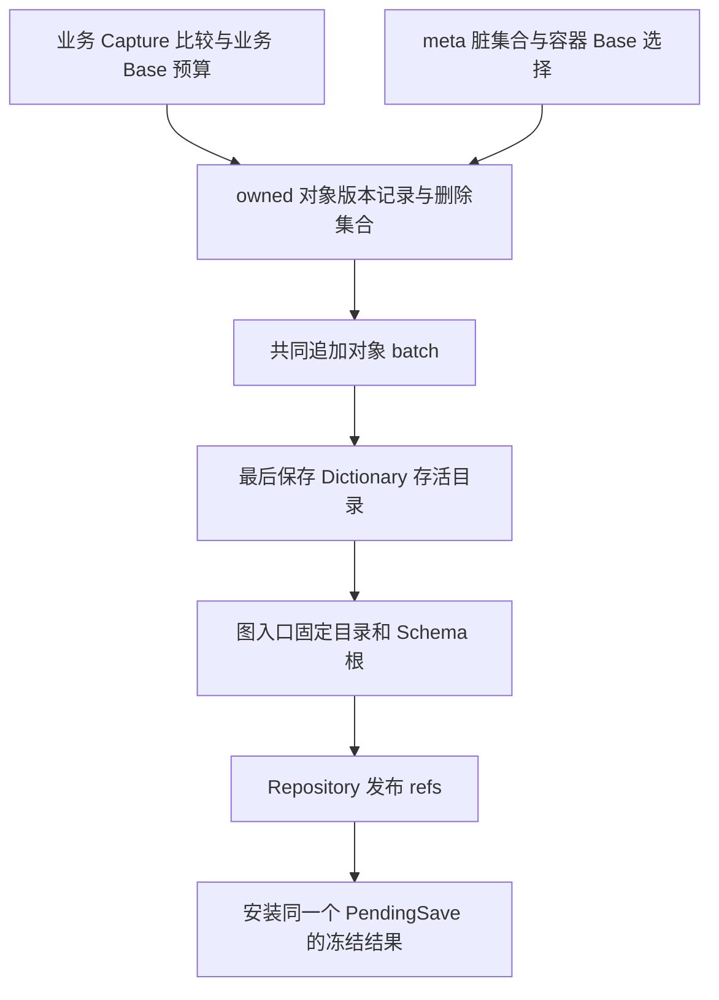

# DB-087：meta 自举与共享／私有 Schema 视图的就地重构路线

> 更新：2026-10-12。状态：**P0、P1a 与 P1b 前五个限定片已验证；完整类型／历史组合能力与公开切换仍待后续 P1b/P1c/P1d**。
> 已完成的证据保留第 10–15 节；本轮 ABI5、双槽 descriptor 和 source lookup 的选择／最小验收见[第 16 节](#16-p1b-第五片dictionary-双槽与-source-lookup)。代码去向、后续依赖和待决问题见第 6、7 节。
> 公开产品基线仍是 [DB-086](0086-new-storage-implementation.md)。P1 公开切换、P2 private 未实施；内部 API/wire 未冻结。
> 用户明确无旧数据／旧 API 兼容负担；简单性按最终产品衡量，施工过程允许复杂。裁决与下一片见[第 9 节](#9-本轮裁决与下一片实验)。

## 1. 结论与范围

**推荐两种专用变化来源、一个窄的图保存核心、一个发布 owner。** 业务通过 Capture/比较准备对象记录；meta 通过受控编辑维护归约后的脏集合。两侧复用 body Base/Delta，交付 owned 对象版本与删除集合；共同层写对象、最后写存活目录、形成准确图根，由 Repository 发布并安装实际候选。

包括 DurableSchema 的完整逻辑内容在内，meta 使用有限固定员工布局序列化；冷读从指定 catalog 根恢复 DTO，再调用现有工厂构造不可变 Schema/TypeExpr，不需要先查 Schema Store，也不建立第二份员工 CLR 对象图。动态 Base 直接引用该 catalog 中布局 descriptor 的 **meta ObjectId**，省去独立 RepresentationId 分配器和持久映射表。固定 descriptor 的类别与完整闭包检查仍不可省。

live-object-list 指持久化 ObjectId→内容 head 目录。它使用固定员工 `Dictionary<uint, HeadLocator>`，共用 Dictionary body 与对象版本能力；目录自身排除在该目录之外，由图入口直接定位。固定 framing 是有限引导边界，不要求序列化器消除自己的所有固定规则。

保留本任务参照 0008 的业务分支目录 ref＋受管 shared ref 布局，新增共享 descriptor 与业务版本借 `PublishRefs` 同次生效；每个业务版本仍 pin 准确 Schema 根。共享只追加已接受定义，私有使用完整独立视图，不做动态 fallback。没有发现必须另建图引擎、替换 Generator/history 或修改上游存储协议的阻塞。

公开切换时，本路线直接替换 SCB1 独立发布、raw ObjectHeadMap 与旧内部保存合同，不建设兼容 reader、转换器、生产双写或迁移壳。P0 使用独立内部入口和实验文件格式，尚未替换这些公开路径。这不授权修改、删除实际存档或完整帧。专用 Schema codec 加候选发布同样能实现版本化／原子提交；选择自举的价值是复用 body、对象版本、准确根和失败处理，不预设它一定更快或代码更少。

### 1.1 需求账本与证据边界

| 要求／选择 | 来源与当前消费者 | 本轮边界 |
|---|---|---|
| Schema 与 live-directory 共享增量序列化、版本化和原子发布 | 用户本轮及前序明确目标 | 最终产品目标；不是只共享 FS 而保留两份 body 实现 |
| 共享单调、私有完整覆盖、历史准确解释 | 用户指定的 [0008](../../../atelia-storage-2/docs/0008-repository-wide-schema.md) 已选政策 | 一种目录格式；无私有 miss→最新 shared、无永久全历史占键扫描 |
| 无旧数据／API 兼容；最终产品简单优先 | 用户明确决定 | 旧 API/格式不能单凭已存在阻止简化；重构成本另计 |
| E/S 自由序列、两种祖先关系、冷读/Upgrade、tag/Fork/Move、引用共享与环 | 当前 Repository、生成器及测试；见第 2 节及第 4 节 | 除本案明确改变的 Schema 提前接受合同外，保留可观察行为 |
| append-only；串行 single owner/driver；Unknown/fault 停用冷开 | AGENTS、准确 pin 的 FS/VS、现有故障测试 | 无多 writer、CAS 平台、全库启动审计或第二事务日志 |
| 双 ref、员工 DTO 形状、保存内部类型、物理字段 | 本案方案及 0008 布局选择 | 可用反例与实现成本挑战，不能拿派生路线图作独立佐证 |
| 原分支显式重建、按操作选模型、业务 head 不动的 Schema-only | 尚无必须本片交付的消费者 | 留明确重访条件；首片 API 范围不升级为永久产品禁令 |

显式 `CommitState` 即使业务内容不变也可以产生正常 State 版本，因而可复用对象目录、只改变所 pin 的 S；这是现有能力的延续，不是伪造业务变化。登记本身不得暗中创建 E/S 或提前占共享键。若要求**业务 head 完全不动**而改变其解释入口，再独立设计该操作，不预先承诺 BranchRootDescriptor。

## 2. 调研基线与证据强度

### 2.1 当前 DurableGraph

调查开始时工作树干净，HEAD 为 `1d1412b31acbe08ae02c0567508eedd7ede722f5`。存储依据为 [StorageDependency.props](../../eng/StorageDependency.props) 中的 `974fd47abb73792f9d350af87ab91a53848952eb`；上游 checkout 干净且 HEAD 与 pin 一致。不能沿用 DB-086 以前的独立文件／日志恢复模型。

| 当前事实 | 源码入口 | 对重构的含义 |
|---|---|---|
| `GraphResources` 只打开 VS ref 1，RootMap 含 `schema` 和 `branch/名称` | [GraphResources](../../src/DurableGraph.Persistence/GraphResources.cs)、[RepositoryRootCodec](../../src/DurableGraph.Persistence/RepositoryRootCodec.cs) | 物理资源已统一；当前 Schema 与业务仍分两次更新根 |
| Schema 登记复制索引、追加完整 SCB1 快照、发布仓库根，再 install | [SchemaStore.Prepare / CommitRegistration](../../src/DurableGraph.Persistence/SchemaStore.cs) | 私有候选基础已存在；需移除登记中的独立发布权 |
| Base v4 只携带动态 RepresentationId；除 string 外需 SchemaStore 解析 | [BaseObjectBodyCodec.Decode](../../src/DurableGraph.Persistence/BaseObjectBodyCodec.cs) | 单纯注册员工 CLR model 无法完成冷自举，必须改变表示路由 |
| raw scalar/body 与容器算法不拥有 Schema 发布；Capture 使用 resolver | [CaptureSession](../../src/DurableGraph/Runtime/Capture/CaptureSession.cs)、[BuiltinStateValues](../../src/DurableGraph/Runtime/State/BuiltinStateValues.cs) | 不必重写 serializer；员工分支提供相同绑定合同 |
| DurableSchema/TypeExpr 的构造器校验并计算派生值，含 ImmutableArray | [DurableSchema](../../src/DurableGraph/Schema/DurableSchema.cs)、[TypeExpr](../../src/DurableGraph/Schema/TypeExpr.cs) | marker 或写 readonly 字段不能解决构造依赖与缓存正确性 |
| 所有历史读取仍借同一个 live SchemaStore；模型缓存观察后续登记 | [Repository](../../src/DurableGraph.Persistence/Repository.cs)、[StateModelSnapshot](../../src/DurableGraph.Persistence/StateModelSnapshot.cs) | 必须改为准确视图，不能只增加分支级 Schema 选择器 |
| reader／definition／binding 每个 key/version 只有一套形状 | [StateReaderRegistry](../../src/DurableGraph.Persistence/StateReaderRegistry.cs)、[StateBindingContext](../../src/DurableGraph/Runtime/Binding/StateBindingContext.cs) | 私有异形目录不自动授予同一代码环境的双形状执行能力 |

DB-086 记录了既有产品的 build、2798 项回归及真实包消费。它们证明调查开始时的基础能力，**不单独证明本案的员工路由、历史 Schema pin 或共同发布**。P0 本轮重新构建并执行回归，新增持久证据见第 10 节；未重做公开包交付资格。

### 2.2 实验原型

用户指定依据为 [0005 路线](../../../atelia-storage-2/docs/0005-schema-bootstrap-route.md)、[0006 设计](../../../atelia-storage-2/docs/0006-schema-bootstrap-design.md)、[0007 实施](../../../atelia-storage-2/docs/0007-schema-bootstrap-implementation.md)、[0008 共享／私有策略](../../../atelia-storage-2/docs/0008-repository-wide-schema.md)。

前期调查时原型是 **unborn Git repository**，不能引用其 HEAD；当时核对的是工作树文件。关键机制由源码而非设计互引支持：

- [FixedBindingTable](../../../atelia-storage-2/src/Storage2.Graph/Engine/FixedBindingTable.cs) 结构上没有外部 Schema lookup，按固定身份、版本、完整 layout 和精确 CLR 类型准入。
- [FixedEmployees](../../../atelia-storage-2/src/Storage2.Graph/Bootstrap/FixedEmployees.cs) 接四种员工记录与三种封闭 List，复用普通 Capture/body/Reader。
- [MetaProjection](../../../atelia-storage-2/src/Storage2.Graph/Bootstrap/MetaProjection.cs) 在记录完整恢复后，以 DFS/memo 调用现有工厂；拒绝构造依赖环，保留共享 DAG。
- [WorkspaceContractTests](../../../atelia-storage-2/tests/Storage2.Graph.Tests/WorkspaceContractTests.cs) 包含零业务注册往返、实际外部 CLR 拒绝、稳定目录/List Delta 与新 Schema Base。
- [ExactViewValidator](../../../atelia-storage-2/src/Storage2.Graph/Bootstrap/ExactViewValidator.cs) 检查 exact key、family kind/arity、base/inline 闭包；现有 CatalogWorkspace 仍拒绝已 Accept 同键改形。

顾问核对现存 TRX：首片 468/468，后续共享目录旧实验 469/469。这是历史内存证据，不是本轮运行；没有业务 binder、持久根、独立进程重开或 0008 私有模式资格。原型元数据仍可描述未知业务名字，而不要求加载该业务 CLR 类型。

为方便重查无 HEAD 的来源，前期调查记录的 SHA256 如下；不是要求文件以后维持这些字节。

| 原型文件 | SHA256 |
|---|---|
| `docs/0005-schema-bootstrap-route.md` | `2663309D5A16096DC018E5417F97F2C11CF1EB4174E6A9ECB0F02A1FC36F636F` |
| `docs/0006-schema-bootstrap-design.md` | `5A8F692FA7200A6FAF76B3ECCABA308663561A1707D12FB57AA278D0243FF705` |
| `docs/0007-schema-bootstrap-implementation.md` | `E0A035C5E6DBA925D56585250D098F6D4B27DEC2B1C69E8D0D9B0051F2177508` |
| `docs/0008-repository-wide-schema.md` | `67C5CDABE7879138B86D5A00B18F3120940E5C9C69562A9330E365F0EB31F6C7` |
| `Engine/FixedBindingTable.cs` | `ED747EDF2A40739E7EE75F25B20C018371AF3E8AFAAA94C451BBF4F47B872F03` |
| `Bootstrap/MetaProjection.cs` | `748B715607D6808A6FC65082F457E63623EFC26FE570D961DB45E3FB893EB6B9` |

### 2.3 上游实际能力

准确 pin 已实现 [VersionStore.PublishRefs](../../../atelia-storage/src/VersionStore/VersionStore.Batch.cs)。先确认绑定 FS 的完成输出，再追加全部 CU 成员、flush 全部目标 ref；全部确认后标记 Confirmed，才交付结果。共同资格读取见 [ConditionalRead](../../../atelia-storage/src/VersionStore/VersionStore.ConditionalRead.cs)。

其边界须直接进入 DG 设计：

- 仅同 owner 的既有 refs；不混合 CreateRef、tag、删除或跨仓事务。
- 无 expected-head/CAS 参数；VS 生命周期 writer 独占锁与 single driver 是基础。DG 仍需串行 guard 和私有候选的最新根资格检查。
- 没有跨多次 ReadRef 的快照隔离；随后单独更新某个 ref 是合法的。因此旧业务版本必须自己 pin Schema 根。
- 每个 root payload 为 1..1MiB；root 适合放图地址，不适合塞完整 catalog。VS 不检查应用依赖闭包。
- 正常恢复按需处理必要控制文件与不完整尾；不要求预开全部 refs/tags。完整必要事实损坏不能伪装为未发布。
- Unknown 必须停用会话并冷开裁决；Confirmed 后交付失败不能降格为未发布，完整 orphan 不删除。

[CU 验收](../../../atelia-storage/docs/VersionStore/07-versionstore-cross-ref-conditional-update-acceptance.md)记录 144 项及真实进程停止窗口，范围为 ProcessCrashOnly。本轮未重跑上游自身测试；DG 新增的真实两 ref 动作窗口见第 10 节，尚非进程强杀资格。原型 0006/0008 中“CU 尚未实施”的段落是先前快照，当前以 pin 源码为准。后续真实包验收仍需独立证明所用六包和 DG 消费路径，不能拿源码存在代替包资格。

## 3. 自举的最小模型

### 3.1 两种解释来源、两种变化来源，一套保存管线

布局来源分固定 builtin/employee 与准确 catalog；变化来源分业务比较与受控 meta 编辑。两条轴独立。固定员工可用 Capture 作实验对照，生产 meta 不必重捕获全图。员工根使用内部入口，公开业务根仍是非空 durable 对象。共同点是 body emitter、对象版本、目录保存和发布，不建设通用 change-tracking、策略插件或资格 token 平台，也不拆程序集。

基元值由静态槽解释，不独立占对象行。容器能否免 Schema Store 取决于完整槽闭包：`List<int>`、员工 `List<MetaFieldRecord>` 可以固定解释；用户 inline 布局仍需对应目录，实际业务对象仍需 binder。首个纵向故事仅接所需有限闭包，公开切换前补齐当前受支持的 primitive/string/Nullable/数组/List/Dictionary 组合；任意 BCL、marker 或 namespace 不自动成为员工。

### 3.2 固定身份与动态 descriptor 引用

新 Base envelope 区分 **有限 fixed 表**、**dynamic descriptor ObjectId** 与 **structural TypeExpr**。有限表由外层 ABI、类型码及完整布局选 reader；structural 准入所选 ABI 明确支持的 closed builtin-only 容器布局。未知版本、用户覆盖保留身份或容器实参逃出闭包均拒绝；不沿用旧动态整数域来划员工区间，也不用 CLR 名字或 GetHashCode 作持久身份。

P1b 首片当时采用 typed／fixed-table ABI v2，旧 typed v1 明确拒绝；外层 ABI 选择整份固定表，内部员工 `DurableType` 定义和生成 DTO 仍声明 V1。固定表格式、员工 Schema 版本与用户 Schema 版本是不同身份，不为 P0 旧实验格式建兼容通道。当时固定路由覆盖 string、员工与精确 `List<int>`；用户 Root 和 `List<Point?>` 动态引用 descriptor。后者虽然使用 BCL List 外壳，其用户 inline/Nullable exact 槽仍由准确 S 解释；首片未将全部 BCL 组合划成无需 Schema 的固定通道。历史证据见第 12 节，当前 ABI 见下段。

第三片当时采用 typed ABI3：route 0 为有限 string／员工表，route 1 为动态 descriptor，route 2 为 structural TypeExpr，移除精确 `List<int>` 专码。ABI3 常量规定 List codec 2，不另写 codec 字段；closed 全树无 Named 是结构准入条件，不能以 `ValueSchema == null` 代替。历史源码和包证据见第 14 节，fixed body、低层纯结构图与带 durable Root 的业务工作区分别限定资格。

第四片当时采用 typed ABI4，保留三路并明确 List codec 2／Array codec 1；旧 ABI3 拒绝。结构路由扩到无 Named 的 Array root，用户 exact 元素数组由 descriptor variant 4 表达。该片源码和包证据见第 15 节。

第五片选 typed ABI5：明确 Dictionary codec1／List2／Array1、拒旧4；D variant5 复用完整 Dictionary TypeExpr 与有序 Key1／Value2 Fields，Version0、Element/Base 空、显式 codec1。员工 Schema/DTO V1 和字段不变、meta 白名单不扩大。除闭合 header/body 外，本片还补所有 stored Dictionary 的完整 source lookup 校验；设计与最小验收见第 16 节。

动态分支的身份是 **`(Base 所在 batch 的 SchemaRoot, descriptor ObjectId)`**。该 ObjectId 属于 Schema 图，不是业务图内同数值对象。Delta 从终止 Base 继承解释；跨布局或固定 ABI 改变写新 Base。图所选 S 与 Base 来源 S 的职责见第 4 节，不能只按数字 ID 缓存 reader。

### 3.3 一份 descriptor 图与派生查询索引

当前 SCB1 将 Schema、数组/List/Dictionary 完整布局放入独立 RepresentationId 空间。新格式没有兼容约束，推荐直接复用这些描述对象自己的 meta ObjectId：

| 持久内容 | 加载后的派生内容 |
|---|---|
| catalog 根的合法 descriptor 集合；ReferenceObject/InlineValue Schema、容器布局及字段、TypeExpr、base/inline/nullable 依赖 | `SchemaKey → descriptor ObjectId/不可变 Schema`、`ObjectLayout → descriptor ObjectId` 及查询索引 |
| 完整 codec 版本、类型实参、槽和依赖引用 | hash/depth/nodeCount、reader/binding 缓存 |

不再持久化第二份 ID→layout 映射，也不单独分配 RepresentationId。已接受 descriptor 本体保持不可变；shared Add 沿用旧 ID/含义，同形复用。private 改形新建 descriptor ObjectId 并替换目录成员，旧 S 仍保留旧节点。不同分叉的数字可能同数异义，解释必须带 S；不增加跨全部私有历史的编号/占键账本。descriptor ID 可能更稀疏，不能据此承诺头部字节更少。

**在 S 的 live map 里存在还不够。** 动态对象头只准引用 catalog 所声明、完整验证过的对象 descriptor；TypeExpr、Field、目录等普通员工节点不得充当表示，InlineValue Schema 只能作值依赖，不能作对象头。固定身份、SchemaKind、exact key、family kind/arity、依赖种类/深度与完整 layout 都要验证。这接替 [SchemaCatalogEntry](../../src/DurableGraph.Persistence/SchemaCatalogEntry.cs) 和 [GetRepresentation](../../src/DurableGraph.Persistence/SchemaStore.cs) 的现有准入，而不是删掉它们的语义。

Dictionary comparer/lookup 模式仍属于 frozen 对象状态及 Base body，不复制进 catalog。`Named("Widget")` 是描述数据，不递归加载 Widget 实例。具体记录拆分/variant 由纵向片决定，默认 DTO 直接投影，不先引入多态记录框架。

P0 员工 records/bindings 放在已有 Persistence 并补 analyzer 构建引用。最初尝试放 Runtime 被真实编译的 DG0001 拒绝：`HasDurableContract` 有意要求属性契约来自引用程序集，不能在其声明编译中绕过身份校验。迁移位置后真实 SG 编译通过；不修改该 guard、不新增程序集，也不更改业务 `.dgschema` 语法。P1b 首片继续这一落点，选择 Descriptor/Field/TypeExpr 强类型员工引用，经现有 SG 保存为 ObjectId；目录 locator 仍用三个 uint 搬运完整地址 bits。

### 3.4 不可变投影与归约后的脏集合

从 `meta ObjectId → stored DTO/layout` 直接投影：先完成固定 reader 的全消费、引用类型及闭包验证，再按依赖调用 DurableSchema/TypeExpr/字段工厂，重算派生值、检查 variants/重复字段/限额，以 ObjectId memo 保持共享 DAG。员工可能共用 DTO CLR 类型，不能只按 CLR 类型判断记录身份。业务 nominal 环允许；构造依赖环拒绝。字段规范化只改工厂副本，不改位置 Delta 的冻结状态；完整成功后才交付 binder。

P1b 首片的语义边界是：全部 live 员工行完成 typed body 解码与完整引用／角色检查；variant、工厂、family kind/arity、构造环与限额认证 catalog 根声明的 descriptor 构造闭包，含其 TypeExpr/Field/Schema 依赖。未声明的合法 Descriptor 即使存在于 live map，也不得 ResolveLayout 或进入 SchemaKey 索引；不对未触及孤儿作语义接受承诺，不增加全历史 audit。根声明集合可以包含 InlineValue Schema，但对象头仍只能引用合法对象布局。

meta 工作区只需 accepted 不可变 view/DTO 基线，以及**按逻辑 key 归约的待改定义和布局集合**；私有替换/删除可用最终目标或删除标记。没有需要重放编辑顺序的消费者，故不保存追加操作日志。共享仅 Add：已接受同形复用、异形拒绝；未接受同键可修正。旧不可变节点沿用 head，根/容器身份稳定，更新复用现容器 Delta；外部拿不到可写员工 DTO/List 别名。

P1b 首片进一步收窄长期 dirty：只保存手工 `Set` 的最终 root 意图，不把自动 Capture 布局或递归依赖留作 dirty 根。`PrepareOwned(capturedLayouts)` 在本次候选中临时合并手工根／实际布局并收集、核对完整依赖闭包。Discard 保留手工意图和应用已经修改的领域对象，丢弃派生闭包、候选编号和 bytes；下次 Capture 重新推导。这样修正尚未接受的同 key inline 依赖不会被上次丢弃的派生项阻挡，不需要追踪平台。

Repository 在同一 guard 内取得最新共享 view 后，才给本次候选分配新 meta IDs、闭合绑定和编码业务 Base。长期工作区保留逻辑修改，不能携旧的未发布编号直接覆盖新共享 view。两个工作副本曾各自拟用 ID 100 时，第二次 Save 必须按第一笔已发布结果重新准备。accepted 编号按准确 S 可复用，未发布编号及含它的 DTO/body/cache 随候选废弃，不需要额外 ID generation。

一个私有 `PendingSave` 统筹两侧冻结结果。准备期间禁止编辑；Prepare 不清脏集合，Discard 释放候选但保留逻辑修改，Confirmed 才消费对应修改。owner 可用性、pending/基线引用相等与单次使用足以承载资格；view、模型和 ABI 留在具体不可变上下文，不各造 token/世代状态机。冷开通过完整 DTO/引用/catalog 验证重建基线，任意调用者的 NoChange 不是证据。

同一 codec 内分离“比较产生操作”和“写入操作”：List 追加给已验证旧前缀与 owned 新尾部，复用 Copy/New；Dictionary 复用 canonical key 与 Remove/Patch/Add。[ListStateReader](../../src/DurableGraph/Runtime/Containers/ListStateReader.cs) 的显式 plan 目前仍比较 Copy 区间，[DictionaryStateReader](../../src/DurableGraph/Runtime/Containers/DictionaryStateReader.cs) 仍扫描两端，不能只换 matcher。按 key 归约后，旧 key 删除再加一般为 Patch/NoChange；跨组重复、Add 覆盖既有 key 仍拒绝。Base 回退可完整编码容器，旧 Schema 节点仍不重捕获；不另造 Delta wire 或通用 Finalize/Freeze 生命周期。

### 3.5 live-directory 与固定根引导

现 [StateRevision](../../src/DurableGraph.Storage/StateRevision.cs) 的 ObjectHeadMap 有局部 records＋Remove 和版本化，但 body 是独立 raw wire。推荐以固定员工 `Dictionary<uint, HeadLocator>` 完全替换它；raw map 仅可作实验对照，生产不双写两个 live 集合。

key 为非零 ObjectId，固定 ScalarDefault comparer。value 定位包含同 ID local record 的完成 batch。**HeadLocator 首选固定员工 inline DTO 的三个 uint**：仅搬运上游公开 canonical 12B 的完整 bits，复用现有 SG Base/字段 Delta；恢复时重组 bytes 经 `FrameAddress.TryRead`。这不解析地址坐标，也不把 SG 的变长 uint body 声称为固定 12B wire；不新增 leaf TypeTag 或任意 struct codec 平台。完整表示比较，无领域 ObjectId 引用；owner 内完成帧、正确帧类别和同 ID local record 另验。Runtime DTO 不引用 Persistence/FrameStore；地址转换放已有上层接缝。若实测固定 12B 值 codec 确有收益再比较，不作为自举前置条件。

目录自身不进入 live 集合、不分配其中的业务 ObjectId，也不经该目录查自己。图封套直接保存 DirectoryRoot；固定 reader 从该地址沿目录 Base/Delta 链读取，复用相同 Dictionary body 与 ObjectVersion payload 编解码/计量。先 append 对象 batch 取得真实地址，再准备目录，write-last；禁止猜测地址或回填自身 head。

推荐的固定物理入口为：

| 入口 | 必要内容及责任 |
|---|---|
| 图封套 | role、Parent、RootId、DirectoryRoot、业务图的 SchemaRoot、可空 OwnedBatch。业务内容来源由 Parent 链的最近 State 派生；meta 来源是前版 meta，不另存重复 content-Parent 字段 |
| 对象 batch | 单份已完成 sourceGraph；动态 Base 的准确 SchemaRoot；本次 local ObjectVersion records。由 sourceGraph 取得来源目录，不再同时存 sourceDirectoryRoot |
| 目录版本 | 创建时 sourceGraph 与固定 Dictionary 的 ObjectVersion payload；Delta prior 指该 sourceGraph 的目录根，Base 截断目录内容链 |

OwnedBatch 恢复旧合帧天然具有的“本图 local records”关联。首轮保持当前一份图至多一个对象 batch 的容量范围；无对象写入为 null，不能为未来分片先造 manifest/list 平台。目录版本没有自己的领域 ObjectId；共用的是版本 payload，不强迫所有根经过 membership 寻址。具体封套字段宽度与 co-location 尚未冻结，第 4.2 节是必须满足的读写合同。

首次图 sourceGraph=null，全部对象及目录首次写 Base，禁止 Delta，无需虚拟目录。State/Event 都以准确来源集合生成最终目录：Event 的 State-only IDs 必须显式移除，之后按相同 Dictionary 规则择 Base/Delta。**Event 独立集合不等于目录必须 Base**；Event 不推进 State 基线，见第 5.2 节。

新 catalog 图 S 先完成，再写引用 S 的业务 batch、目录、图封套；没有向前引用。目录未变可复用根而仍追加真实 E/S 版本；不强写空 Delta。[IntegerMap StoryRepository](../../../atelia-storage-2/src/Storage2.Experiments.IntegerMap/StoryRepository.cs) 的专用 map codec、[StateJournal Commit](../../../atelia-statejournal/src/StateJournal/Revision.Commit.cs) 的 DurableDict 和[直接根加载](../../../atelia-statejournal/src/StateJournal/Revision.cs)仅提供 write-last/exclude-self 参照，不是 DG 新协议的运行资格。

### 3.6 共同层只接收准备好的写入

以一个内部 `PreparedGraphWrite` 概括窄接缝，名称不是公共 API：

| 输入 | 最小责任 |
|---|---|
| 准确 source 基线引用与 RootId | 所属 owner/Store 可用；根在最终 live 集合；首次来源为空 |
| owned ObjectVersion records | Base 同时覆盖 Insert、维护重写和已验证升级；Delta prior 必须是 sourceGraph 目录选定的 head。ID 唯一，不与删除集合重叠 |
| RemovedIds | 相对准确来源的显式移除；未列出旧成员隐含 Retain |

不把模型、DTO、员工 ABI、ForceBase 能力、membership 模式或通用 policy 接口塞进共同输入。业务 producer 完整 Capture/比较，执行现有业务 Base 预算，准备最终 records；meta producer 从脏集合准备新节点/变化容器，执行其小范围择 Base 规则。两侧调用同一 body/版本基础函数。typed 解释、闭包/view 相容、ID 分配与引用无悬空由具体 producer 在私有操作中完成，不向外提供任意记录的“免验证”入口。

业务 State/Event 都以完整来源集合减候选可达集合产生 Remove；私有完整重建也用普通 Base records＋移除旧成员表达，不新增 Replace 协议。可信共享只增基线可归纳复用旧闭包，仅查新增节点/边；私有替换/删除须完整验证。隐含 Retain 省的是共同层完整 NoChange rows，不省业务变化发现或政策所需的全图估计。

共同 saver 核对来源/记录合同、append batch、用实际 locator 准备并保存目录，最后形成图封套。业务/meta typed 检查与用户 callback 在首次 append 前完成；目录 locator/body 检查只能在对象 batch 完成后、目录 append 前完成。所有安装材料在 publish 前备齐；后续失败可留下完整 orphan，但不得使其成为权威。

### 3.7 策略属于生产者，计量与 wire 共用

业务保留现 [全图 Base 预算](../../src/DurableGraph.Persistence/ReadAmplificationBaseBudgetPolicy.cs)，其公开参数已有消费者。业务 planner 对完整 live 集合计量，可给未变化对象追加维护 Base；所选记录必须具备合格 Base 内容。不能以 k 项变化冒充完整预算，也不要求 meta 承担这份策略。

meta 只在变化容器上比较准确 B/D：B≤D 或 `H+D` 超过配置阈值乘 B 时选 Base，否则 Delta；不可变 descriptor 首次 Base 后沿用。live-directory 使用相同容器规则，排除自身，不进入业务全图预算。无目录内容变化直接复用根，无 catalog 变化不运行其保存/策略。共用 B/D/H 计算与必要比较函数即可，不建设策略注册体系；更换业务预算另需明确取舍。

B/D/H 按 [ObjectVersionPayloadSize](../../src/DurableGraph.Storage/ObjectVersionPayloadSize.cs) 的对象版本 payload 单位：B 含实际存在的类型头及 kind/length，D 含 prior/kind/length，H 是实际重建链消费的记录 payload。P0 的 direct 目录根由固定 framing 确定 Dictionary 布局，没有普通对象的动态类型头，也不补虚拟 ObjectId。ObjectId、batch context、目录/图 framing 另计入真实 append/冷读成本。H 不是总 I/O，阈值不是已选最优或硬上限。

本案只承诺无变化零 meta 保存、旧不可变节点不重复 Capture/编码。容器 Base、完整冷验证、字典冻结/索引/ApplyDelta、查询投影、基线复制与业务比较仍可 O(N)。现 [Store](../../src/DurableGraph.Storage/StateRevisionStore.cs)、[map materializer](../../src/DurableGraph.Storage/LiveObjectHeadMapMaterializer.cs)、[NormalizedRevision.WithAddress](../../src/DurableGraph.Persistence/NormalizedRevision.cs)提供这些成本的对照；新 Dictionary 不自动消除它们。增量索引、分页和持久树仅在测量触发时另做。

## 4. 准确视图、历史来源与缓存

### 4.1 一个发布 owner，查询 view 与编辑材料分责

不可变 Schema view 由准确 S 加载，提供定义/布局查询，不发布。catalog 工作区持有 accepted view 与逻辑脏集合。Repository 的唯一 PendingSave 引用两侧冻结输入及下一基线，串行完成追加、发布、安装；不再让两个子 workspace 各自成为发布状态机。

可提取 `SchemaStore.Prepare` 的闭包检查与私有索引构造；`CommitRegistration` 的独立根发布退出。当前 [NewSchemaPublicationBoundaryTests](../../tests/DurableGraph.Persistence.Tests/NewSchemaPublicationBoundaryTests.cs) 验证“Schema 已接受，业务失败仍保留绑定”，这是 joint Save 要替换的旧合同，不是新事务应原样通过的标准。

### 4.2 两种祖先关系保留，一种内容来源锚点

业务 Parent 指提交前 Head；内容来源 C 是该 Parent 自身或其祖先中最近 State，无 State 则 null。catalog 的 Parent 只连 meta 历史，C 就是前版 meta。图 role 区分两者，不把 meta 放入业务祖先链。`S0→E1→E2→S1` 中 E2/S1 的 C 仍为 S0；关系可由固定图元数据派生，无需同时持久保存 content Parent 和它的目录地址。

拆帧后必须保留旧 [prior 链校验](../../src/DurableGraph.Storage/StateRevisionStore.cs) 与 [错分支/旧 prior 测试](../../tests/DurableGraph.Storage.Tests/ObjectVersionChainStoreTests.cs)的强度：

1. 图声明 OwnedBatch 时，batch 的 sourceGraph 必须等于派生 C；其中每个 local ID 都在最终目录中指向该 batch，不能遗漏、删除同 ID 或改指外部 head。图没有新 batch 时 OwnedBatch=null；外部 head 仍保持现有浅声明边界——检查真实完成帧/同 ID 和所需内容链，不宣称全局实体历史认证。
2. 新 DirectoryRoot 与 C 的根不同：目录创建 sourceGraph 必须为 C。目录 Delta 的 prior 必须为 C.DirectoryRoot；目录 Base 仍检查来源关系，但不因此回读被截断的旧目录内容链。初始 C=null 时只允许首次 Base。
3. DirectoryRoot 恰为 C.DirectoryRoot：复用已有目录，不新写对象 batch，不把旧目录的创建 context 改成当前 C。RootId 或所 pin 的 S 可在通过完整兼容检查后变化，仍可生成正常图版本。
4. 读取普通对象 Delta 时，逐条按**该记录原 batch**的 sourceGraph 取得准确目录，核对 prior 等于该目录[id]；再查 prior 帧的同 ID local record。retained 旧链不要求来源等于当前图的 C。直接目录 reader 不先经目录寻找自身；完成帧、角色、循环和全消费检查保留。

Base 截断的是内容链，不删除必要的业务祖先/来源元数据关系。全 Base 且无需要追读的 external/Delta 来源时，不无条件 materialize C 的旧目录；现有 `New_Base_stops_content_validation_and_resets_H_even_if_older_Delta_edge_is_invalid` 必须继续成立。Graph 元数据导航与 body 重建须分开，防止新校验意外扩大成历史审计。

动态 Base 用**自身 batch 的 S**解析 descriptor；batch 地址不是 graph 地址，也不能从 sourceGraph 的旧 S 推导本次新 Base 的 S。图所选 S 再核对全部 retained heads 的完整解释相容。S0 中 ID 17=int、私有 S1 中 ID 17=string，即使数字相同也不能换 S 重解释旧 bytes。初期 shared/frozen fork 保留旧 descriptor 含义，私有改形先完整新 Base，不声称 selective retained 改形已经安全。

### 4.3 stored view、执行环境与缓存

stored exact view 解释持久 bytes；current binding 由所选视图约束与冻结代码能力闭合。**执行所需的 target view 不等于已编号的持久 catalog 候选**：当前模型、历史模板和显式 Upgrade 可以在内存提供尚未登记的完整目标布局；已有同 key 定义仍须完整相等。只读操作不分配 descriptor ObjectId、不调用 catalog Prepare、不追加或发布。共享写准入看最新共享 view；历史读取看所选历史 S，不借最新 shared 补解释。

P1a 已按以下顺序接线；具体运行证据见第 11 节：

1. 先以每条 Base 自身 batch 的 S 解码，并用所选图的 S 核对 retained 布局，得到完整 stored DTO、head/H 和字符串身份。
2. 用这次选定的只读 Schema 查询约束冻结模型环境，经既有 `NormalizedRevision`／`GraphReader` 做标准依赖预检、Normalize、完整 current 引用验证、可达性和两阶段物化。允许目标 key 尚不存在；已有异形不得绕过，缺 reader／Upgrade／依赖仍拒绝。标准预检保持既有每对象首次业务回调前的边界，不新承诺全图所有回调前完成一切准备。
3. 只读入口交付根，不导入 Capture 身份；可写入口保留完整 source membership、准确 State 来源、旧 head/H 和 `RequiresRewrite`。升级后仍 live 的对象在下一次 State 保存时必须写新 Base。
4. 真正 Save 才在 owner guard 内取得最新共享目录：先 Capture 得到实际 current 布局，再准备所需完整 catalog 候选并分配 meta IDs，最后编码业务 Base 和执行预算。不得先发布 Schema，也不要求调用方手动 Set 升级目标。P1b 首片将自动所需闭包收敛为临时候选材料；只有手工 Set 的最终 root 意图长期 dirty，见第 12 节。
5. Discard 保留手工逻辑修改和领域对象修改，而丢弃候选闭包／编号／bytes，下次 Save 从实际 Capture 重新推导；Confirmed Event 接受 meta，但不消除 State 的升级重写义务。只有 Confirmed State 安装新的业务 DTO、身份和 H，后继同布局保存才可用 Delta。

P1a 先接 P0 已支持的有限布局，完整 base/inline/Nullable/泛型及容器依赖的员工表示仍由 P1b 补齐。不得把这一片的 Schema 查询接缝当作完整闭包或跨 view 缓存资格。

首轮按准确 view＋冻结模型环境隔离 binding context。物理 owned frame/目录缓存可按同 owner 地址复用；DTO、reader、Normalize、Upgrade plan 和准备材料须保留来源/目标 view 资格，不能按全仓 SchemaKey 或裸 descriptor ID 命中。ReadPair 两侧先各自解码/归一化，再按原有完整状态与引用闭包证明共享；同 `(ObjectId, head)` 不足以跨 view 命中 typed DTO。DB-080 槽同样保留 stored/target 证据。

现 requirement set 只证明已登记项无冲突，不等于完整 catalog 含全部必要项；新 view 的闭包验证承担后者。代码能力/标准依赖预检仍在每对象第一次业务 Upgrade callback 前完成，失败不回退 latest view。

### 4.4 代码能力是执行条件，不是目录身份

当前 reader/definition/ModelBinding 按 key/version 单形状。首片继续用 Repository.Open 冻结代码环境：同仓两个私有形状可在两个匹配环境分别冷读，错环境明确拒绝。能读取未知业务名字的 meta，不等于能物化其 CLR 对象。

这是首片入口范围，不是“每个 Repository 永远只能有一种环境”的产品律。只有出现单次打开同时操作同键异形模型的真实消费者，才设计按操作/工作副本选冻结能力；不预建多模型平台。私有模式仍不授权删除 Generator accepted history、悄改同一模型历史的 v1 或绕过显式 Upgrade。

## 5. 共享／私有发布与 ref 布局

### 5.1 保留本任务选定的两个受管 refs

推荐业务分支目录 ref 1＋预留 shared ref；新 branch 仍是业务目录增键，不为每分支分配 VS ref。RootMap 的业务值指向图封套，所选 S 从图取得，不增加 Manifest Store 或 BranchRootDescriptor。

单个 RootMap 同时保存 shared S 和业务 heads，用一次 PublishRef 也能保持共同生效、shared 不随 branch rewind 回退和历史 pin；双 ref 不是原子性唯一解。本案保留两 ref 是沿用户指定 0008/CU 目标的布局选择，承担其初始化与故障验收成本，不据此建设通用 ref 管理平台。

两个 refs 的 payload 只放必要格式信息与根地址/分支目录。新仓先建立两个可读空根，初始化未完成则清晰拒绝；两个 CreateRef 不算 CU。无业务 head 时不认领候选图。业务 rewind 只改业务目录，shared 保留全部正式接受定义；private/orphan 不占共享键，不扫描全历史建账。

### 5.2 一个 PendingSave 的准备、发布与安装

1. 进入现串行 guard，核对 owner、准确 branch Head/State 基线及最新 roots；选择显式 shared/private 写入归属。取最新共享 view 后，才将逻辑脏集合变成本次冻结 catalog 候选和 descriptor IDs；旧根资格失效就拒绝旧候选，不能覆盖别的 branch 更新。
2. 两个具体 producer 完成 typed/layout/引用/view 预检、body 与各自 Base 选择，放入同一个 PendingSave。新 ID、绑定和含编号的缓存只属于该操作；用户 callbacks 到此完成。没有通用参与者/两阶段事务平台。
3. catalog 有变化时先经共同 saver 写 meta batch、目录和图取得 S，否则复用准确 S；再写业务 batch、目录（可复用）和 pin S 的业务图。用实际地址准备下一基线，publish 前完成所有分配/检查，不修改旧完整帧。
4. shared 有新增定义**或动态容器布局 descriptor**：一次 PublishRefs 更新 shared 与业务目录 refs。准确目录复用或 private 写入只更新业务 ref。不能只看 Schema Count；FS durability barrier 由 VS 执行，DG 不加事务日志。
5. Confirmed 后安装同一 PendingSave 的实际冻结结果。**catalog 已发布变化总要接受；State 的 DTO/身份/对象 head/H 基线仅在 State 提交时安装。Event 的业务候选丢弃，不推进 State、不清其 Upgrade 重写义务；branch/checkout.Head 在每个 Confirmed E/S 后均推进到新图。** 只消费本次 meta 脏集合，不重跑 producer 或采用发布期间新工作副本。

例如 E1 新增 Schema 并发布后，shared/meta 基线已前进；最近 State 的 bytes 仍按 S0 自己 pin 的 view 读取。下一次 shared Save 用最新共享 view 准备目标解释，内容来源仍是 S0。不能把“Event 不 Accept State”误用成“Event 不 Accept 已发布 meta”。

VS 没有 CAS，latest-root 检查是同一 single driver/guard 内的 stale 防护。原 owner 的 lifetime 不能由相等 RefRevision 代替；fault/Dispose 后即使地址相等也不复用旧候选。

### 5.3 失败与冷开

| 可观察事实 | DG 行为 |
|---|---|
| 准备／确定 pre-I/O 拒绝 | 不 install；健康 owner 可继续，逻辑脏修改保留以便修正 |
| 数据完整但共同发布未成立 | 不取得共享绑定；保留 orphan，不扫描收养或截断删除 |
| Unknown 或 owner fault | 停用全部相关旧会话/缓存，关闭重开，从必要发布证据裁决，不透明重试 |
| Confirmed 后 install/交付失败 | 已发布定义仍占共享键；废弃旧会话重开，不因未回包解除绑定 |

`GraphCommitException` 必须依据实际 outcome 映射两 ref 结果；NotPublished 也可能 fault。冷开采用 FS/VS 正常必要恢复与 peer 读取，不预开全 refs/tags、不新增全库可写预检或启动审计；只读不修尾。新 DG 故障资格仍须实测 ProcessCrashOnly，不借上游 CU 成功宣称 DG 已验收或断电安全。

### 5.4 私有覆盖与切换

private 从冻结 shared fork 完整 view，由应用明确选择写入归属；无策略可以读、写时拒绝。不能从分支名、根地址相等或上次进程内存猜模式；如将来要求无配置冷开恢复策略，再定义持久配置。

首个私有改形见证用匹配 B 环境提供完整新根、新建私有分支、全部 live 新 Base；旧 A 分支继续 pin 旧 S。保留图内共享/环，不承诺跨这种重建的数字 ObjectId 连续性。此选择缩小验收，不永久禁止在原分支显式重建。若后续需要原分支入口，应只导航旧 head/祖先元数据，接收新根并重新准备完整目录，明确对象身份规则；不要求先用 B 物化 A，也不能仅放宽旧 Capture/Checkout guard。

私有转共享对完整定义/布局闭包比较：同形复用，新项加入共同候选，异形拒绝。数字 descriptor ID 不是跨 view 身份；能否保留业务 heads 依来源 S 与目标 view 的完整相容证明，不能直接换指针。必要时显式完整重编码；不建设自动 promotion/merge/rebase 或 overlay 继承链。

## 6. 建议的重构任务顺序

P0 是已经工作的内部产品原型，P1 在它上面演进，不整体丢弃重写。最终产品只留一份恢复核心、一份业务 producer、一个 catalog 工作区和一个发布 owner；施工可有临时适配，公开切换时删除重复路径。下表记录源码支持的去向和依赖顺序，**不表示后续片已实施**。分片名称本身不构成实现授权。

### 6.1 P0 与当前产品代码的去向

| 部分 | 去向 | 接线位置与依据 |
|---|---|---|
| `ObjectVersionPayloadCodec`、现有 body 与受控 List/Dictionary emitter | **保留** | [payload](../../src/DurableGraph.Storage/ObjectVersionPayloadCodec.cs) 已供旧 StateRevision 和 P0 共用；[目录 codec](../../src/DurableGraph.Persistence/MetaBootstrapP0/P0DirectoryCodec.cs) 已直接发射已知 Removes/written heads。Base/Delta body、owned 数据与实际 H 计量继续共用 |
| `P0GraphContracts`、`P0GraphWire`、`P0GraphStore` | **演进为共同持久核心** | [Store.Append/ReadGraph/ReadObjectChain](../../src/DurableGraph.Persistence/MetaBootstrapP0/P0GraphStore.cs) 已实现 batch→目录→graph、sourceGraph/OwnedBatch、目录复用与 Base 截链。扩展完整类型路由和有界物理缓存；不恢复 raw map 权威，不新增 Revision 日志。最终命名、tags 与 wire 尚未冻结 |
| 员工模型、fixed bindings、typed Base 路由 | **演进完整闭包** | [员工模型](../../src/DurableGraph.Persistence/MetaBootstrapP0/P0EmployeeModels.cs)、[fixed 表](../../src/DurableGraph.Persistence/MetaBootstrapP0/P0FixedBindings.cs)、[typed reader](../../src/DurableGraph.Persistence/MetaBootstrapP0/P0TypedBodies.cs) 的 base/inline/Nullable 与代表性泛型／enum 证据见 §12–13；List／Array／Dictionary 代表路由及各自源码／包验收状态见 §14–16。有限表与 builtin 结构路由分开，保留 SG 契约和 Schema 工厂；完整组合／历史 Upgrade 仍按 §6.3 有限矩阵验收，不以当前代表见证宣布完整 P1b |
| `P0CatalogView`、`P0CatalogWorkspace` | **演进为唯一查询 view／受控 meta producer** | [view](../../src/DurableGraph.Persistence/MetaBootstrapP0/P0CatalogView.cs) 从实际 meta 图投影，[workspace](../../src/DurableGraph.Persistence/MetaBootstrapP0/P0CatalogWorkspace.cs) 基于 accepted 索引归约 dirty keys。完整 S 决定定义和 descriptor IDs；Schema 查询不拥有发布，不复制一份独立 RepresentationId 账本 |
| P0 原 `Restore`、`Restored`、分配与 Hydrate 循环 | **P1a 已并回现有恢复核心** | [P0BusinessWorkspace](../../src/DurableGraph.Persistence/MetaBootstrapP0/P0BusinessWorkspace.cs) 只转接解码与保存基线。完整 DTO/head/H/string 进入 [NormalizedRevision.Create](../../src/DurableGraph.Persistence/NormalizedRevision.cs) 和 [GraphReader.Prepare/Materialize/DeliverEditable](../../src/DurableGraph.Persistence/GraphReader.cs)，保留完整成员 Normalize、引用/字典校验、两阶段分配及身份导入 |
| P0 业务 Capture/比较与当前 `WorldWorkspace`/planner | **并回一份业务 producer** | [WorldWorkspace.StageCore](../../src/DurableGraph.Persistence/WorldWorkspace.cs) 与 [LoadedRevisionPlanner.Prepare](../../src/DurableGraph.Persistence/LoadedRevisionPlanner.cs) 已维护升级重写、身份和 head/H；结合 P0 records/Removes 输出，替换旧 [ObjectRevisionPlanner.PrepareCore](../../src/DurableGraph.Persistence/ObjectRevisionPlanner.cs) 对 `StateRevision`/完整 prepared rows 的输出依赖。既有全图 Base 预算继续使用，不按 meta 规则重选 |
| `P0Repository`、`P0PendingSave`、`P0Session` | **并回公开 owner／checkout** | [P0Repository.Commit](../../src/DurableGraph.Persistence/MetaBootstrapP0/P0Repository.cs) 的双 ref、唯一 pending、Confirmed 安装与 fault 规则接入 [Repository.Publish](../../src/DurableGraph.Persistence/Repository.cs) 和 [GraphResources](../../src/DurableGraph.Persistence/GraphResources.cs)。新库预留 2，先读两个必要 refs，再构造 DG views/caches；保留公开 branch 占用、只读、tag、资源与 reentry 合同，不预开全部 refs/tags，不长期并列两个 owner |
| `RevisionReadSession`、DB-080 State 槽、DB-067 物理缓存 | **保留职责，演进资格和缓存值** | [read session](../../src/DurableGraph.Persistence/RevisionReadSession.cs) 当前按 `(Id, head)` 并用一个 live SchemaStore；[State 槽](../../src/DurableGraph.Persistence/PreparedStateRestoration.cs) 核对 Store/SchemaStore/model 引用。改为准确 owner、stored/selected S 与 target binding context；[有界物理缓存](../../src/DurableGraph.Storage/StateRevisionReadCache.cs) 的统一预算/LRU 可复用，但旧 `StateRevision` 值改为 batch/目录/graph owned 值，不把裸地址命中当 typed 资格 |
| history、Checkpoint、tag/Fork/Move/ReadPair | **保留功能，替换帧导航接缝** | [GraphResources.ReadHistory](../../src/DurableGraph.Persistence/GraphResources.cs) 当前从 StateRevision TailMeta 读业务 Parent；[Repository.NearestStateCore/ValidateSelectedGraphParent](../../src/DurableGraph.Persistence/Repository.cs) 又依赖 Revision Parent。改读 graph 封套并派生内容 Parent；graph/batch 分离后不再假定图地址等于对象 head。句柄 owner、历史选择和 Pair 闭包证明保持 |
| SCB1 独立登记、旧类型头、raw-map StateRevision 公开路径 | **替换并退出** | [SchemaStore.CommitRegistration](../../src/DurableGraph.Persistence/SchemaStore.cs) 当前先单独发布；[BaseObjectBodyCodec](../../src/DurableGraph.Persistence/BaseObjectBodyCodec.cs)、[RevisionDecoder](../../src/DurableGraph.Persistence/RevisionDecoder.cs)、[StateRevisionStore](../../src/DurableGraph.Storage/StateRevisionStore.cs) 仍绑定旧目录/合帧。新恢复、保存和公开 owner 完整接通并通过门禁后，一起移除旧入口与格式消费；不做兼容 reader、迁移或生产双写 |

### 6.2 P1 的依赖路线

最小建议是四个可独立验收的 P1 工作片。P1a 不依赖先完成全部员工闭包，也不切换公开 Repository；P1b 和 P1c 必须在最终产品门禁前闭合。每片内部仍可拆小任务。

| 片 | 问题与范围 | 可观察验收／停点 |
|---|---|---|
| **P0 最小持久纵向闭环** | 已实施内部实验：真实生成 Widget 与 List、Schema descriptor 图、员工 Dictionary 目录；两种 producer、单 PendingSave、真实 FS/VS 双 ref 发布 | 首次 Base→新增 Schema/业务 Delta→关闭全部资源冷开→继续保存；descriptor ObjectId、Event/State、无变化目录复用、Discard、Base 回退及错来源拒绝的证据见第 10 节。没有公开切换 |
| **P1a 源无关恢复与真实 Upgrade（已实施）** | `GraphReader`/`NormalizedRevision` 接完整 decoded 输入；模型 snapshot 接 readonly Schema lookup，区分 stored/selected 与 target。P0 临时恢复已并回现有核心，公开旧路径仍保持 | 真实生成 V1 存盘，只含 V1 的 S0 在 V2 环境冷读成功；读取不登记 V2。首次真实 Save 准备 V2 catalog 和强制新 Base；后续冷开/Delta 可续写。Event 接受 meta 却不消费 State rewrite，旧 V1 history 保持原解释；拒绝坏来源/错误完整布局，见第 11 节 |
| **P1b 完整员工与类型路由** | 在已有员工/目录/typed codec 上补齐当前完整 Schema、TypeExpr 与 CLR/BCL 槽闭包；确定固定路由和动态 descriptor 的具体编码 | 无外部 SchemaStore 冷读 meta，未知业务名字仍可查定义；已有 base/inline/generic/enum/Nullable/数组/List/Dictionary 和标量均能正确描述与静态解码，坏 variant/深度/重复引用拒绝；不宣称公开切换 |
| **P1c 保存、公开入口、history 与缓存整合** | 合并业务 producer、catalog 和唯一 pending；在 `GraphResources`/`Repository` 接共同 writer/两 ref、准确 views、公开恢复与只读 Pair/State 槽/物理缓存。接线期间仅有一个选定写入路径，不生产双写 | 新路线完整运行既有 branch/Checkout/Fork/Move/tag/ReadCheckpoint/ReadPair、Event-first/根替换、容器/共享/环、Upgrade/预算/热冷续写回归；复核全部 source heads/H 和 rewritten live 强制 Base。不得留下新 reader 配旧 SchemaStore 发布的混合停点 |
| **P1d 故障、真实包与公开切换门禁** | 在完整整合代码上验证初始化中断、两 ref ProcessCrashOnly、orphan、Unknown/Confirmed 未交付、fault/关闭缓存和真实 PackageReference；完成公开默认接入和旧路径删除 | **全部门禁通过后**才宣布 P1 产品停点。进程窗口覆盖每个 CreateRef 后、首 CU End、全部 CU End、Confirmed/安装前；fresh 新进程检查两旧/两新及续写。完整帧保留、错误 owner 拒绝、无透明重试；准确六包 feed、独立 DG 版本与新 config/cache/assets 的真实 Generator/history 消费者通过 |
| **P2 私有新增能力** | 明确策略、完整 fork/替换、同键异形新根、shared/private 切换 | 两独立匹配环境冷 typed 读取成功、错环境拒绝；旧历史准确、深层 retained 改形拒绝、转 shared 闭包冲突拒绝；不把 P1 既有能力补验推迟到此片 |
| **条件片：局部运行成本／新增 API** | 仅由测量或实际消费者触发基线/索引增量、分页，或原分支显式重建/按操作选模型/固定业务 head 的 Schema-only | 逐项给当前瓶颈或调用故事，不作为自举与共同提交前置条件 |

P1a 的最小替换边界是 **decode→normalize→materialize**，不是立刻重写保存、root 或历史 API。现 [DecodedRevision](../../src/DurableGraph.Persistence/DecodedRevision.cs) 已携带完整 DTO、实际 heads、H 和字符串目录；`NormalizedRevision`/`WorldWorkspace` 的保存资格仍直接持有旧 Store/SchemaStore，应逐步换成准确 owner/图/view 来源，不能给 P0 伪造一个旧 Store 来满足引用相等。恢复后的完整 membership、source layout、rewrite 和身份 cursor 都要保留，不能只交付可达实例。

当前 [StateModelSnapshot.TryGetSchema](../../src/DurableGraph.Persistence/StateModelSnapshot.cs) 只需查定义，发布由外层负责；[ExactSchemaRequirementSet.Validate](../../src/DurableGraph/Runtime/Binding/StateBindingContext.cs) 对已存在的同 key 定义查完整相等，缺目标定义不自动登记。这允许先用冻结代码能力恢复 V2，第一次真实 Save 才把所需 V2 闭包纳入共同候选。不能继续要求 current layout 出现在历史 S0，也不能撤掉 origin Base 解码和 selected view 对 retained 布局的完整相容检查。

P1c 可以先完成内部整合及回归接线；公开默认切换和旧路径退出必须与 P1d 门禁一起收口。施工用的旧路径或适配器不是兼容模式，最终产品不保留双目录、两份恢复循环或两套发布 owner。显式无变化 CommitState 已在 P0 范围，不需要先造独立 Schema-only 分支描述符。

初始化沿用 P0 的最小选定实现：两个 `CreateRef` 不是 CU；缺任一正式 ref 即拒绝，不补建、不删除已经完成的内容；两个正式 ref 完整后允许 fresh Open。VS 的正常 pending 恢复保持，不造 resume 日志或启动 audit。公开切换时一并删除 `SchemaStore.Register*` 立即发布／占键的调用链；新增 shared 定义只由真实 E/S 的共同 Save 发布，独立 shared-only 发布继续延期。

P2 依赖完整 P1，按四步接线：**显式策略＋完整 shared fork → 匹配环境的新根、全部 live 新 Base 与 private 同 key 异形 → 转 shared 时比较完整定义/布局闭包并在需要时完整重编码 → 两个匹配环境的独立冷读/续写及冲突回归**。同时保持旧图准确 pin 原 S、错误环境拒绝、深层 retained 改形拒绝。首片仍用新私有分支见证，不把它固化成永久产品限制；shared/private 的公开配置位置和方法签名留到 P2 决定，不增加自动 promotion/merge 或策略恢复日志。

代码改动运行 `dotnet build DurableGraph.slnx` 与相关测试，准确 source/package mode 见[依赖指南](../storage-dependency.md)。wire、生成 ABI 或包交付改变时完成隔离 PackageReference 验收，不能以 ProjectReference 代替。

### 6.3 P1b 后续续工入口

已提交基线为 P0 `12f3eb2`、P1a `2740bf1`、P1b 首片 `a6f1797`、第二片 `e5e7ac1`、第三片 `93f5120`、Array 第四片 `9f6454e`；各片证据保留于第 10–15 节。续工核对实际 HEAD／工作树，读取 PROJECT-STATE、本节和 §7.1，不把 current V1 闭包当完整历史 Upgrade 资格。

当前[第五片 Dictionary](#16-p1b-第五片dictionary-双槽与-source-lookup) 已完成源码与隔离包验收，问题、D5／ABI5 和完整引用检查后／Normalize 前 source lookup 的证据只记录于 §16。下一片用下述有限代表矩阵收尾 P1b；这是续工建议，模型与分片验收须主线再裁决，不是无限组合平台。

| 建议顺序与可执行入口 | 最低观察／明确未覆盖 |
|---|---|
| **先：真实 history 的容器值规则 Upgrade**。Root 保留 `Point?[]`／`List<Point?>`／`Dictionary<Key,Point?>`，独立 SG V1/V2 和 accepted history 让 Key/Point exact 升版，显式选择 Array/List/key/value 规则及 Nullable lifting。复用 [ArrayUpgradeTests](../../tests/DurableGraph.Tests/ArrayUpgradeTests.cs)、[ListUpgradeTests](../../tests/DurableGraph.Tests/ListUpgradeTests.cs)、[DictionaryUpgradeTests](../../tests/DurableGraph.Tests/DictionaryUpgradeTests.cs) 与 [P1a history driver](../../tests/DurableGraph.Tests/MetaBootstrapUpgradeGeneratorTests.cs) | old meta／DTO 准确，readonly Upgrade 不发布；三个容器按 source→current 端点 Normalize，保 ID／shape／count／comparer。Event/Discard 保留 rewrite，首 State 写新 Base，随后局部修改可 Delta；即使空／absent 也预绑定能力，缺任一必要规则在该 owner 首次 callback 前拒绝，不许诺全图零 callback。对一个值规则端点选 enum 宽度变化，复用 [EnumUpgradeTests](../../tests/DurableGraph.Tests/EnumUpgradeTests.cs)；不扩相邻路径搜索、自动规则发现或所有数值迁移 |
| **再：多参数／泛型继承 current 图**。移接 [GenericGeneratedStateTests](../../tests/DurableGraph.Tests/GenericGeneratedStateTests.cs) 的 `Derived<T,U>:Base<U>`、inline 与共享引用模型到共同持久入口；两个不同 closed 实例及有序实参 | 无业务注册 cold meta 的完整 base／inline／实参身份；真实 SG 冷图与 Base→Delta／NoChange，错误闭合／完整 Schema 拒绝。不以 current 图代验泛型历史：开放／特例 provider 另取 [GenericUpgradeBindingTests](../../tests/DurableGraph.Tests/GenericUpgradeBindingTests.cs) 的最小 history 端点，缺规则／错误实参拒绝 |
| **随后：跨程序集与剩余合同门槛**。以 [CrossAssemblyInheritanceGraphTests](../../tests/DurableGraph.Tests/CrossAssemblyInheritanceGraphTests.cs) 的 hidden generic base／middle／leaf 或 [真实包消费者](../../experiments/PackageConsumerProbe/InheritanceLibraryConsumer/README.md) 为入口，保留独立程序集和真实导入模板 | P0 入口 cold meta／业务、继承状态、身份和整 leaf Delta；模板导入／包边界变化时完成隔离包见证。按已有 [CompositeDictionaryUpgradeTests](../../tests/DurableGraph.Tests/CompositeDictionaryUpgradeTests.cs) 等合同补必要 comparer／canonical collision、rank3/4 或嵌套组合拒绝，列出已覆盖与剩余差异，不再枚举笛卡尔积 |

P1b 停点是当前支持的类型都能准确描述／解码，各类新持久接缝均有至少一个真实 cold／增量与历史 Upgrade 代表见证，既有重要拒绝合同没有未处理差异；沿用 Runtime/SG 已验算法，无证据缺口不新增机制。上述旧路径测试是移接依据，不是新后端通过证据。公开 Repository/history/cache 与完整既有产品门禁继续归 P1c/d；private 和未请求的公开策略不在本矩阵冻结。
- 继续保持内部入口、准确 S、append-only/outcome/owner 与 memo 归操作／builder；不顺带公开 P1c/P2。wire/生成 ABI/交付边界改变时补对应隔离包验收；物理读取成本和缓存仍在 P1c 收口。

继续按 bounded-delegation 分开生产闭包、真实 SG 消费者、独立反例与包验证，主线裁决接口、统一验收并同步本地提交。先前约 8–13 轮的量级估计是实施前的滚动估计，不是剩余轮数或验收承诺；后续以本片实际工作与新反例重估。完整范围仍为第 6.2 节 P0–P2，条件片按触发条件延期。

第五片最后 package pack 已更新根 assets；下一轮 source 验证先按[存储依赖指南](../storage-dependency.md)显式 source restore，再用 `--no-restore` build/test，不能混用 package 输出。

## 7. 决定性验证与未冻结的细节

### 7.1 设计接缝的决定状态

下表区分本片已落实与后续尚待敲定的局部代码/格式选择；有限运行见证不等于完整产品资格。双 ref 目标、shared/private 政策、Schema-only 延后与无兼容负担保持既有裁决，不重新打开。

| 接缝 | 决定与最小边界 | 状态／剩余阻塞范围 |
|---|---|---|
| 源无关恢复输入和 readonly Schema lookup 的具体签名 | `GraphReader.Read/ReadRoot(DecodedRevision, …, GraphReadContext)` 复用原核心；`Snapshot(schemaLookup: …)` 与 legacy SchemaStore 互斥。lookup 只查选定不可变 view，不建通用 Store/provider 平台 | **P1a 已落实**；完整公开读取与缓存资格继续 P1c |
| `SourceStore/SourceSchemas` 保存资格的替代形状 | 用同 owner lifetime、准确图与所选 views 证明 decoded/normalized 来源；heads/H 必须来自真实链。origin S 解 Base，selected S 核对 retained，target context 绑定 current；地址相等不能跨 owner 或 view 复用 | P1a 确定恢复证据，P1c 接完整保存及 State 槽；不得省去现 `RequireStorageSource` 合同 |
| current/Upgrade target view 的冻结与闭合 | 所选 S 的只读 lookup 约束冻结代码能力；允许缺目标定义，已有异形仍拒绝。target 无持久编号，真实 Save 在 owner guard 内按实际 Capture 布局准备 catalog，origin Base 不借 current/latest 补缺 | **P1a 有限闭包已落实**；完整闭包由 P1b、公开接线由 P1c 验收 |
| catalog 长期 dirty 与自动依赖的边界 | 长期只留手工 Set 的最终 root 意图；`PrepareOwned(capturedLayouts)` 临时收集完整闭包，自动依赖不计长期 dirty。Discard 保留意图／领域修改，下次 Capture 重推；Event 仍不安装 State | **P1b 首片源码已验证**；同 key 修正、共享依赖、显式 List 冲突和 Discard 见 §12，容器替换／撤销 API 未新增 |
| 员工 records 与首片 Base 路由 | 首片时为 typed／fixed-table ABI v2，内部员工 Schema/DTO 仍 V1；Descriptor/Field/TypeExpr 强类型节点，Schema base/inline/Nullable 为构造 DAG，字段排序仅在工厂副本，按 ObjectId memo。首片精确 `List<int>` 专码由第三片 structural 路由替代；根声明含 inline，ResolveLayout 不授予 inline 对象头资格 | **P1b 首片历史证据保留于 §12**；后续 ABI 各有证据，metadata 语法不授予全部业务类型执行资格 |
| 剩余类型执行闭包、最终 wire 与容量 | TypeExpr metadata 描述现工厂 closed constructors；代表性泛型／enum current 执行已验，其余组合、数组／Dictionary 和完整固定容器路由仍逐片验收。最终码／位宽及容量未冻结；一图一个 batch，超限清晰拒绝，不自动增加分批平台 | P1b 后续；阻塞完整当前类型能力与公开切换 |
| 闭合泛型／enum current 执行 | 第二片用既有 ABI2／DTO V1 验真实单参数 family 的两个 closed 实例、enum/Nullable/inline 和业务 Delta；手造双有序实参／版本隔离与 exact 拒绝另有边界 | **有限 current 执行已验证**；真实 SG 多参、generic/enum Upgrade、跨程序集及 Array/Dictionary 内容未由本片授予资格 |
| builtin-only List 结构固定头与 codec 来源 | 第三片 ABI3 route 0/1/2 分有限表／动态 descriptor／structural TypeExpr；List root 全树无 Named，List codec 2 由 ABI 固定，无额外版本字段。meta 仍限有限员工表，Schema/DTO 仍 V1 | **第三片历史源码和包证据见 §14**；第四片 ABI4 保留 List2，并显式增 Array1 |
| Array descriptor 与 structural root | D variant4 复用完整 Array TypeExpr／Element／codec1；Version0、Fields/Base 空。重建 ArrayLayout 核 Type，并独立核 exact inline；第四片 ABI4 固定 List2/Array1，shape 在 body，不增 DTO 字段或 meta 员工资格 | **第四片历史源码／包证据见 §15**；第五片保留 Array1/List2 |
| Dictionary descriptor／root codec／source lookup | D5 Type＋有序 Key1/Value2 Fields，Version0、Element/Base 空、codec1；ABI5固定 Dictionary1/List2/Array1、拒旧4。完整引用检查后／Normalize 前核全部 stored Dictionary lookup，current lookup 不代 source；Root Nullable key 不新增 metadata 拒绝，body/binding 沿 KeyPolicy | **第五片源码与隔离包已验**；真实 cold／Delta和阶段反例见 §16，不由局部手工 Upgrade 外推完整 SG history 矩阵 |
| 分离 graph/batch 后的公开诊断与 typed/cache 键 | `CheckpointAddress.RevisionAddress` 目前等于合帧地址；确定新诊断字段含义，不再当对象 head。物理 owned 缓存可按同 owner 地址，typed 行、Normalize、Upgrade/State 槽须带准确 view/model 资格；命中仍验证实际视图 membership/引用 | P1c；阻塞 history/Pair/缓存整合，具体 API 与缓存条目尚未冻结 |
| 初始化和真实崩溃/包门禁的测试宿主 | 实现第 6.2 节已选初始化合同及真实进程终止窗口，观察必要 publication refs 与 fresh owner 续写，不新增恢复协议；为准确六包 feed、独立 DG 版本准备新的 config/cache/assets 与真实 history 消费者 | P1d；宿主和具体注入接线待实施，阻塞产品资格；P0 同进程关闭重开不能替代 |
| shared/private 的公开配置入口 | 政策已定：应用显式选择写入归属，缺策略可以读而写时拒绝，private 是完整 view；配置位置、方法和参数签名尚未确定。不得从 branch 名、地址相等或上次内存推断策略，不以 API 未定重开该政策 | P2；先显式策略/完整 fork，再接新根 all-Base 改形、完整闭包 promotion/必要重编码及两环境冷读验收 |

### 7.2 端到端与拒绝见证

端到端故事使用 Attribute Widget、V1/V2 显式 Upgrade、共享引用/环和 List：新建 shared 分支、追加 Schema 与业务版本、独立进程冷读 meta/历史 Widget、Checkout 继续 Delta，tag/Fork/Move 固定原解释；再以匹配环境创建 private 同键异形图。

主要拒绝/失败见证按边界组织：

- 固定布局未知、员工闭包逃逸、variant/构造环/深度/重复定义错误、全消费与坏引用；合法未知业务名字仍可读 meta。
- descriptor 指向 TypeExpr/Field/InlineValue 或不在 catalog 合法集合；不同 S 的同数字串用；两个 branch 候选曾分配同数 ID 后串行发布，第二笔须重新准备。
- pending 别名/旧基线串用、Discard 丢脏修改、Dictionary 跨组重复 key；Event 接受 meta 却不接受 State，后继 E/S 仍从 S0 保存。
- OwnedBatch 来源不符、local 行未进入目录/被外部 head 替换、目录含自身、head 无同 ID、错 prior/循环、Base 截链；目录根复用与新 Base/Delta 三例分别冷读。
- 首次/Event-first 空来源；对象已完成但目录失败、目录完成但图/CU 未成立、Confirmed 未交付；shared 新增容器 descriptor 而 Schema Count 未变也须 CU。
- private 改形保留未改 head、深层 base/inline/container 依赖或错模型能力；业务历史和旧 S 不被重新解释。

测量真实追加 bytes/帧、Base/Delta 使用、旧节点捕获/编码次数，及字典冻结/canonical 索引/ApplyDelta、投影/bind、policy、基线安装复制的时间与分配。H 另报，不冒充总冷读 I/O；不拿原型的 48B body/约 9ms Prepare 推导持久开销或加速倍率。

固定记录最小形状、容器构造描述、tag/位宽、封套 wire 与容量预算未冻结，按第 7.1 节落实；meta 多对象不自动消除单帧或目录增长上限。具体性能策略仍由测量选择，不能借缓存或减少编码次数宣布总 O(k)。

若直接 DTO 投影的维护成本确实高于局部 CLR 恢复，可再比较替代，但不得省固定 reader/引用/工厂检查。没有当前证据要求 ArtifactStore、GC/压缩、多 writer、自动模型扫描或兼容框架。

## 8. 调研验收与导航

初轮及续轮使用 bounded-delegation 保留上游/原型顾问，并由序列化、仓库与独立挑战审查定位机制。第 2 节记录来源版本和历史运行证据；它们不证明新持久自举已可用。

设计阶段采用 dialectical-simplification：需求怀疑者、最小架构者、语义守卫独立提出论点，再交叉检验；上游/原型顾问提供事实。主线亲读并裁决候选生命周期、planner/预算、SCB1/Base 路由、准确 prior 测试、FrameAddress 和原型 0008。

整合稿经仓库来源和序列化两侧限定复核通过；最后消除了 Event 推进 branch Head 与不安装 State 对象 head/H 基线的文字歧义。来源复核覆盖首次目录 Base、Event 目录 Delta、后继 Event 目录 Base，以及最终 State 复用原目录的轨迹；这是设计推演，不是测试结果。

上述审查只提供源码支持的路线。随后获授权的 P0 与 P1a 由 bounded-delegation 分包实施，主线统一构建、运行并亲读关键源码和决定性测试；独立反例包核对来源、view 和发布边界。不能把子 agent 的完成报告或设计推演当作运行验收；实际强度以第 10、11 节为准。

本案维护方案、裁决与 P0 实施证据；当前能力在 [PROJECT-STATE](../../src/PROJECT-STATE.md)，未实施导航在[路线图 §4.1](../DurableGraph-research-roadmap.md#41-schemastore-复用-statestore-与联合版本视图)。有限实验不提升为公开能力。

## 9. 本轮裁决与下一片实验

**最小产品模型：两种专用 producer，一个窄图 writer，一个 PendingSave，一个发布 owner；Schema 和存活目录共用序列化/对象版本。** 变化获取不同，持久表达和发布汇合。

| 裁决 | 删除／保留的机制 | 依据与不可丢失的语义 |
|---|---|---|
| merge | RepresentationId 合并到 descriptor 的 meta ObjectId | 旧 SCB1 的额外编号没有兼容消费者；仍按 `(来源 S, ID)` 解析，非法 descriptor 拒绝 |
| simplify | 通用 ObjectChangeSet 收窄为 records＋RemovedIds＋来源/根；两侧交由一个 PendingSave | owner/准确基线/单次使用仍检查；业务预算和 typed 责任留各 producer |
| delete | 追加操作日志、独立资格 token/世代平台、membership Replace 模式 | dirty-key 最终状态足够；显式 Remove 保证 Event 不泄漏 State-only 成员 |
| simplify | HeadLocator 用固定 inline 三 uint 与 SG body；删除新增 leaf/tag 的前置要求 | 完整 bits 往返及 TryRead/完成帧/同 ID 检查保留；不承诺固定 12B body |
| simplify / keep | sourceGraph 统一来源锚点，graph 派生内容 Parent；OwnedBatch 补本图 local 关联 | 两种因果关系、逐条 prior 校验和 Base 截链都有现有反例，不能删 |
| keep | 准确历史 S、write-last/exclude-self、双 ref 目标、Confirmed 后安装 | 自举断环、旧 bytes 解释与原子接受的实际要求；双 ref 是已选布局，不是唯一原子方案 |
| defer | 原分支重建、单次打开多模型、业务 head 不动的 Schema-only、分页 | 以真实调用/测量触发；显式无变化 CommitState 当前就成立，不受此延期限制 |
| simplify | P0 持久纵向故事；公开切换前验收全部现有能力 | 省去先造平台再接消费者的依赖，允许施工分成更多小任务 |

与前稿相比，明确去掉一套独立表示编号/映射、一种 membership 模式及 Event 强制目录 Base 分支，并取消新 leaf codec/tag 和通用 token/日志平台的要求。新增 OwnedBatch 是为恢复拆帧丢失的 local-record 关联，不是优化附加物。没有把简单性解释为少改旧代码。

P0 已围绕这个最小问题实施：**一个真实 Widget 的共享保存，能否把 Schema descriptor 和存活 Dictionary 都交给共同 writer，经真实 refs 发布后从零 DG 缓存恢复并续写？** 运行证据见第 10 节。P1a 的真实 V1→V2、只读 target view 和共同恢复见第 11 节；P1b 员工、代表性泛型／enum、结构 List／Array／Dictionary 见第 12–16 节。**下一片按 §6.3 的有限代表矩阵收尾 P1b**，不扩建通用 P0 平台。

本轮无需新增产品语义选择。双 ref 保持原任务方向；是否后来改成单 ref、增加原分支重建或固定业务 head 的 Schema-only，只在相应目标出现时裁决。P1a 不代表完整 P1 或 P2 已完成，也不冻结实验 wire。

## 10. P0 实施证据与方案修订

### 10.1 范围与实际接线

内部入口为 [P0Session](../../src/DurableGraph.Persistence/MetaBootstrapP0/P0Session.cs)，导航和重跑命令见[实验 README](../../src/DurableGraph.Persistence/MetaBootstrapP0/README.md)。没有新增程序集，没有切换公开 Repository，也没有生产双写。

- [P0BusinessWorkspace](../../src/DurableGraph.Persistence/MetaBootstrapP0/P0BusinessWorkspace.cs) 使用真实 Capture/比较及既有 `ReadAmplificationBaseBudgetPolicy`，给出最终 records/Removes。
- [P0CatalogWorkspace](../../src/DurableGraph.Persistence/MetaBootstrapP0/P0CatalogWorkspace.cs) 保留逻辑 dirty keys，Prepare 基于最新 accepted view 分配候选 meta IDs，直接准备员工 DTO。不可变 view 从 DTO 调用现有 Schema 工厂；这条路径不调用 SchemaStore。
- [P0GraphStore](../../src/DurableGraph.Persistence/MetaBootstrapP0/P0GraphStore.cs) 是共同 writer：对象 batch → 固定 Dictionary 目录 → 图。目录用真实 SG 三 uint inline body、原 Dictionary Base/Delta 和原 reader；普通对象及 direct 目录均复用提取的 [ObjectVersionPayloadCodec](../../src/DurableGraph.Storage/ObjectVersionPayloadCodec.cs)。旧 StateRevision 也调用该函数，既有 wire/H/owned body 语义保持。
- [P0Repository](../../src/DurableGraph.Persistence/MetaBootstrapP0/P0Repository.cs) 持有唯一 PendingSave，实际使用两个 VS refs。新增 meta 走 `PublishRefs`，没有 meta 变化时只发布业务 ref。所有确认后的 Event/State 都推进分支 Head、接受选定 meta；只有 State 安装业务 DTO、身份及 H。

P0 接受非泛型、无继承的 ReferenceObject Schema，基元字段、简单命名引用和 List<int>；其余形状明确拒绝。固定闭包包含员工 records、员工 Lists、string 和 direct Dictionary/locator。**业务 List<int> 特意使用动态 container descriptor**，以验证 meta ObjectId 路由；这没有证明完整 CLR/BCL 闭包都已脱离 Schema 查询。完整 builtin 路由仍归 P1。

### 10.2 已运行的决定性见证

| 结论 | 可追溯运行证据 |
|---|---|
| 真实业务与 meta 可一起冷开续写 | [GeneratedTests](../../tests/DurableGraph.Persistence.Tests/MetaBootstrapP0GeneratedTests.cs)：真实 SG Widget、96 元素 List、两个 Widget 的共享 List 与环；关闭全部 Repository/FS/VS 后新 owner 读取，继续保存实际 List Delta。未知业务名字的 Schema 可在无相应 CLR model 时恢复 |
| descriptor ID 不再需要第二份编号 | 实际持久业务 Base 头的动态 ID 等于 catalog 中 P0D descriptor 的 meta ObjectId；跨分支曾复用的 provisional ID 在另一笔发布后重新准备，不串用旧 body。旧业务图仍 pin 原 S |
| meta 真增量、无变化不追加目录 | 40 个未知 Schema 种子后新增一项，真实 descriptor List 写 Delta，编码调用点记录的旧 descriptor 编码数为零；同形 Set 的 dirty 在 Confirmed 后清除。无变化业务 State 的 OwnedBatch=null、目录根复用，只新增一个图帧 |
| Event 的两种安装不同 | S0/E1/E2/S1 轨迹验证 meta 接受而 State 来源仍为 S0；E2 重复 E1 的业务值仍须按 S0 保存。Event 移除 child、后续接回时，实际 Capture/Removes 与原 State 目录复用共同检验 DTO/身份没有提前接受 |
| 读取端可独立拒绝错误来源且保留 Base 截链 | [IntegrityTests](../../tests/DurableGraph.Persistence.Tests/MetaBootstrapP0IntegrityTests.cs) 的 20 个 raw-frame 冷读见证：错 sourceGraph、local 行遗漏/改指外部 head、错 prior、retained Delta 原来源、目录复用、错角色/同 ID、删除后重接；新全 Base 不追读已截断的坏旧内容 |
| 目录 Base/Delta 复用实际容器能力 | [GraphStoreTests](../../tests/DurableGraph.Persistence.Tests/MetaBootstrapP0GraphStoreTests.cs)：真实 Dictionary Delta、无变化根复用、阈值触发 Base 与显式 Remove；对象 Delta 与目录 Base 独立选择，H 按实际 payload 计量 |
| 类型入口及冻结边界可拒绝坏候选 | [DescriptorTests](../../tests/DurableGraph.Persistence.Tests/MetaBootstrapP0DescriptorTests.cs)：保留名字、未知类别、Field 冒充 descriptor、在 Rows 中存在但未被 catalog 声明的合法 descriptor 均拒绝；输入字典和普通集合接口不能改写冻结 view |

[PublicationTests](../../tests/DurableGraph.Persistence.Tests/MetaBootstrapP0PublicationTests.cs) 实际注入上游 VS 动作窗口并关闭后重开：数据确认前失败是 NotPublished／两旧；首个 CU 成员完整后是 Unknown／两旧；两个成员完整后是 Unknown／两新；全部确认后未交付是 Published／两新。另覆盖 meta/业务图已完成而未发布、部分 install 失败、pending 重入、Discard 和 owner 归属；完整候选帧及旧历史保留。这里不是模拟 outcome，也不是进程强杀或断电资格。

[ControlledContainerDeltaTests](../../tests/DurableGraph.Tests/ControlledContainerDeltaTests.cs) 的 15 个用例直接比较共用 emitter：List 追加不比较旧前缀、只编码新尾；256 项 Dictionary 的受控见证只编码给定 4 个 key、调用 2 次值 Delta，完整比较路径则编码两端共 512 个 key、调用 255 次值 Delta。两条路径产生相同 wire，经原 ApplyDelta 往返且 prior 不变。该计数只证明比较/发射工作减少，**不是整个 Save 的 O(k)、总字节或吞吐收益**。

### 10.3 实验修订与明确停点

1. **否定 Runtime 内直接接 SG 员工模型的原落点。** 真实编译被契约身份 guard 拒绝；改放既有 Persistence 并接 Analyzer 后成立，保留 guard，不修改生成器 ABI。字段仍是 raw uint，没有反向存储依赖。
2. **否定“换 matcher 就等于受控变化”的实现捷径。** List 显式 plan 仍会比较旧前缀，Dictionary 原 PrepareDelta 仍遍历全部匹配值；现已提取普通路径和受控路径共享的发射函数。目录 writer 直接传已知 RemovedIds/written heads，无需两端重新发现变更。
3. **保留薄 payload 特例。** direct 目录不需要普通对象的 typed header 或虚拟 ObjectId；固定根 reader 确定布局，共用对象版本 payload、body 和计量已经足够。
4. **不接受“单版冷读已证明升级”的外推。** P0 验收时的 `Restore` 要求 Normalize 后布局也在所选历史 S 中；当 S0 只有 V1、当前模型需要 V2 时，它会在首次 Save 准备 V2 catalog 候选前拒绝。该限制已由第 11 节 P1a 的共同恢复与真实 V1→V2 见证纠正；完整公开 Upgrade 仍须 P1b/c，不能放松旧 bytes 的准确解释检查。

P0 验收时待 P1 的项目为：完整 Schema/TypeExpr/inline/base/Nullable/容器闭包与固定路由；公开 restoration/preflight、升级、缓存、tag/Fork/Move/ReadPair、预算回归；初始化中断、真正 ProcessCrashOnly 窗口和隔离 PackageReference。随后 P1a 的进度见第 11 节。P2 的 private 改形与转 shared 未实施。P0 是单进程关闭全部资源后的零 DG 缓存重开，未声称新进程、OS page-cache cold、断电安全或性能最优。

字典冻结/排序、全量 Base 候选、Schema 投影、业务 Capture/全图预算与 P0 未缓存的读取仍有全量成本。P0 当时据此选择先补 Upgrade 与既有恢复接线，现已由 P1a 完成有限见证，当前下一片见第 9 节的 P1b；不以实验成功为由建设通用追踪、token、策略或缓存平台。

### 10.4 本次验证

准确 source mode 使用 `974fd47abb73792f9d350af87ab91a53848952eb`，上游工作树保持干净。最终 `dotnet build DurableGraph.slnx -c Release`（显式 source 参数见实验 README）为 **0 警告、0 错误**；随后对同一输出执行完整 solution tests，**2857 通过、0 失败、0 跳过**：

| 测试项目 | 通过数 |
|---|---:|
| DurableGraph.Persistence.Tests | 930，其中本片 P0 44 项（含 6 条真实生成消费者轨迹） |
| DurableGraph.Tests | 1662，其中受控容器 15 项 |
| DurableGraph.Storage.Tests | 132 |
| DurableGraph.Serialization.Tests | 133 |

相对 2798 项既有基线新增 59 项。最后检查覆盖本次工作树 34 个相关文件：UTF-8 无 BOM、LF、尾换行与空白差异通过；5 份 Markdown 的 450 个本地链接、27 个锚点通过。包交付、公开切换及 P2 资格不在本次运行范围。

## 11. P1a：准确视图与共同恢复接线

### 11.1 问题、范围与验收

本片问题是：**只有 V1 descriptor 的历史图，能否在 V2 模型环境中只读升级而不发布 meta，再沿同一 State 来源经 Event／Discard 保存 V2，且仅在 State 确认后解除重写义务？**

本片只接第 4.3 节的 view 流程与共同恢复核心，保持内部持久入口及 P0 有限 Schema 闭包，不改变已有 wire、Generator ABI 或公开发布布局。可观察验收包括真实 Generator/accepted history 的 V1→V2 冷读续写；只读文件与 refs 不变；同 key 异形与来源目录缺失拒绝；Event/Discard 后仍须 Base、State 后可 Delta；同 owner 跨 session 的 Capture 重入拒绝。完整公开切换仍须 P1b–d。

### 11.2 实施与验证记录

共同恢复接缝为 [GraphReadContext](../../src/DurableGraph.Persistence/GraphReadContext.cs) 与 `GraphReader.Read/ReadRoot(DecodedRevision, …)`：前者只从原 `RevisionReadSession` 提取模型、统计和操作级实例唯一性 guard，后者调用同一 Prepare/Materialize 核心。旧 reader、ReadPair 和 DB-080 继续使用相同上下文及原来源检查。P0 转接真实 DTO、完整 heads/H 和字符串表；legacy `SourceStore/SourceSchemas` 留空，不假造旧 planner 的保存资格。

`StateModelSnapshot` 增加只读 Schema lookup，与旧 live SchemaStore 参数互斥；内部新路径只查所选历史 S。`P0BusinessWorkspace` 删除重复 Restore/Reachable/分配/身份导入，使用共同核心交付的 current DTO、完整 source 身份和 rewrite 集合。它的保存仍使用自己的准确 State 来源与普通全图预算，未提前合并 P1c 的业务 producer。

`P0Session` 的次序改为 Capture → 原子核对并登记实际布局 → catalog Prepare → 业务编码/预算。已接受的同形布局不会因自动登记再次变脏；手工 dirty 与实际布局冲突在输出前拒绝，不无声覆盖。`P0Repository.PrepareFrom` 用短时 owner guard 覆盖整个准备，防止 Capture 回调借另一个 session 保存或编辑 catalog；异常释放 Capture 和 guard，不安装基线。新目标与最新 shared 的冲突可能在 Capture 发现实际布局后才被拒绝，不承诺回滚模型回调副作用。

以上记录 P1a 的实际接线；自动布局曾与手工 Set 一起留在 dirty 集合。第 12 节 P1b 首片改为长期只保留手工最终 root 意图，自动 Capture 依赖仅在 Prepare 中派生，防止 Discard 后的同 key 修正粘住旧依赖。P1a 的 Event／State 及 Upgrade rewrite 合同保持。

首轮并行运行发现 P0 员工通道曾全局共享可变 `StateModelSnapshot`，两个独立仓库可同时修改绑定 memo，抛出 `Recursive exact model binding is unsupported`。这否定了“冻结代码目录等于内部绑定缓存可跨操作并发共享”的假设；现 [P0FixedBindings](../../src/DurableGraph.Persistence/MetaBootstrapP0/P0FixedBindings.cs) 静态表只保留不可变布局，Builder 和 meta Read 各自拥有 snapshot，Directory 仅在静态初始化中提取不可变 slot。即使提前闭合，List Normalize 的委托也可能写 context 缓存，因此未把 binding 当作天然可并发共享。没有新增全局锁或禁用测试并行。

### 11.3 运行证据与剩余边界

| 已证实 | 运行见证 |
|---|---|
| 真实历史模型无需预登记 V2 即可只读升级、再共同保存 | [Generator 纵向测试](../../tests/DurableGraph.Tests/MetaBootstrapUpgradeGeneratorTests.cs)：V1 经独立 Generator 编译实际 CLR 根并写入 S0；Publish 接受 history 后，V2 独立编译且 Verify／旧文件内容保持。关闭全部资源后只读升级，不出现 V2 meta；缺 Upgrade 能力明确拒绝。随后无需手工 Set V2，经 Discard、E1/E2、S1 Base、后继 State Delta 和再次冷读续接；原 S0 和 meta0 解释保持 |
| 历史来源与 target 约束不能互相替代 | [9 条边界测试](../../tests/DurableGraph.Persistence.Tests/MetaBootstrapUpgradeBoundaryTests.cs)：来源同 key 异形在 reader body 前拒绝；已知 target endpoint／inline 依赖冲突在 Upgrade callback 前拒绝；来源缺 descriptor 不能借最新 shared 补足。inline 用例证明冲突检查，没有声称完整 inline 员工闭包可持久化 |
| 只读零发布、完整 State 来源与 owner guard | 同一边界文件逐字节比较只读前后全部文件和两个 ref 的 revision/payload；Upgrade 切断 ID 100 后，Event/Discard 仍保留 State Base/Remove 义务与完整 ID 游标，State 接受后无变化不再重写；另一 session 发布冲突后旧工作区 Save 在 append 前拒绝，Capture 跨 session 保存重入拒绝且外层可继续 |
| 固定通道没有跨仓库可变闭合缓存共享 | 同一文件用 4 个任务 × 4 个独立仓库、首轮 barrier，执行 meta 写入、只读 Upgrade、增量共同保存与关闭后读取新旧历史；每个 owner 内仍严格串行，目录内容和精确计数相互隔离 |

以上使用同进程中独立编译的模型程序集和关闭全部资源后的新 owner，未运行独立进程崩溃或 PackageReference 验收；既有公开路径的回归不等于新后端已经接入公开 tag/Fork/ReadPair/cache。当前正向持久闭包仍限 P0 的 ReferenceObject／基元／简单引用／List<int>，完整员工语法和固定路由仍待 P1b。P1c/d 的公开整合、初始化/进程窗口、包门禁及 P2 private 均未实施，不承诺保存总成本 O(k)。

最终使用准确 pin `974fd47abb73792f9d350af87ab91a53848952eb` 的显式 source mode，执行 `dotnet build DurableGraph.slnx -c Release --no-restore -m:1 -nr:false`：**0 警告、0 错误**。在同一输出上执行完整 `dotnet test DurableGraph.slnx -c Release --no-build --no-restore -m:1 -nr:false`：**2867 通过、0 失败、0 跳过**，较 P0 增加 10 项。

| 测试项目 | 通过数 |
|---|---:|
| DurableGraph.Persistence.Tests | 939，含 P0 44 与本片独立边界／并发 9 项 |
| DurableGraph.Tests | 1663，含本片真实 Generator/history 纵向 1 项 |
| DurableGraph.Storage.Tests | 132 |
| DurableGraph.Serialization.Tests | 133 |

完整 source 参数和定向重跑入口见[内部 README](../../src/DurableGraph.Persistence/MetaBootstrapP0/README.md)。最终代码经主线亲读，恢复等价性及来源／guard／缓存所有权分别经独立限定复核；所有运行由主线执行。文档同步覆盖本案、PROJECT-STATE、路线图、设计索引及内部 README；20 个改动文件的 UTF-8/LF/空白检查，以及 5 份文档的 487 个本地链接、30 个锚点均通过。未进行包交付或公开切换。

## 12. P1b 首片：Schema 员工闭包与固定 List 路由

### 12.1 问题、选定范围与验收

本片问题是：**员工图能否表达一个真实 SG Base→Root、Point inline、Point?、int? 与 List<Point?> 的 Schema 依赖闭包，无业务 CLR 注册冷读 meta，再用匹配模型恢复业务并实际增量续写？** 另用精确 `List<int>` 证明 builtin-only 容器固定路由，不把带用户 exact 槽的 List 误当 Schema-free。

选定方案为 typed／fixed-table ABI v2，旧 typed v1 拒绝；外层 ABI 选择固定表，员工 `DurableType`/Schema 和生成 DTO 仍 V1，不等于将每个 SG 定义升为 V2。Descriptor/Field/TypeExpr 强类型节点引用，TypeExpr 走现有 closed 工厂，Schema base/inline/Nullable 依赖按 ObjectId memo 投影。字段排序只发生在工厂副本，persisted DTO 及位置 Delta 不改写。catalog 根声明所有 descriptor（含 inline）及完整 base/inline exact 依赖；动态对象头只可 ResolveLayout 为 ReferenceObject 或本片的用户 exact 槽 List 对象布局，未声明行与 inline 不能冒充对象 descriptor。精确 `List<int>` 不再动态登记 descriptor。

本片正向业务模型只使用 current V1，不再为 P1a 已通过的 Upgrade 另造一条历史能力声明。TypeExpr metadata 描述现工厂的 closed constructors；Parameter 与业务 Array/Dictionary layout 本片明确拒绝。泛型／enum／其余组合的实际执行资格仍待后续。标准语义 validator 复用旧目录对 family kind/arity 的检查，旧独立 Schema 发布机制不保留。未知码、旧 ABI、多余 variant 字段、错误引用／角色、构造环和限额明确拒绝；合法 nominal 业务环继续允许。

源码已运行的纵向轨迹：自动 Capture 完整布局并共同保存 S0 → 关闭全部 FS/VS/DG → 无业务注册冷读完整 meta → 匹配模型冷读 Root/Point?/List<Point?> → 局部 Root／List 修改形成真实 Delta → 再关闭重开，旧 S0 与新 S1 的准确内容分别恢复。包消费者使用准确六包与独立 DG 版本，在多个独立进程中完成同类轨迹，结果见第 12.3 节；这种内部员工/路由资格不代替 P1d 公开整合、故障或 ProcessCrashOnly 门禁。

本轮补充的简化裁决：自动 Capture 的依赖不得长期变成 dirty 根，否则第一次准备/Discard 后，修正 Point 同 key 定义仍会被旧派生依赖阻挡。长期 dirty 只留手工 `Set` 的最终 root 意图；`PrepareOwned(capturedLayouts)` 临时收集并核对完整闭包，auto 项不计长期 dirty。Discard 保留手工意图与领域对象修改，下次 Capture 重新推导；Confirmed Event 接受 meta，State 基线和 rewrite 仍完全不变。此处删除一个派生状态，不引入通用 tracking；拒绝与修正轨迹由下述独立反例验证。

当前手工 API 的范围不同：`Set(DurableSchema)` 按 SchemaKey 替换尚未接受的最终根；`Set(ObjectLayout)` 是完整 layout 的显式请求集合，不是按 nominal 替换或撤销容器的接口。自动 Capture 每次重新收集依赖不受残留派生项约束；私有修改／删除能力留 P2。

### 12.2 实施证据与剩余边界

生产接缝为 [P0EmployeeModels](../../src/DurableGraph.Persistence/MetaBootstrapP0/P0EmployeeModels.cs)、[P0CatalogView](../../src/DurableGraph.Persistence/MetaBootstrapP0/P0CatalogView.cs) 与 [P0CatalogWorkspace](../../src/DurableGraph.Persistence/MetaBootstrapP0/P0CatalogWorkspace.cs)：强类型 D/F/T 节点引用经 SG V1 DTO 写入 ABI v2 表；`Schema/Field/Expression` 按 ObjectId memo 构造，声明集合区分 inline 查询与对象 descriptor；`PrepareOwned` 临时闭合手工根和本次 Capture 布局。[P0CatalogSemantics](../../src/DurableGraph.Persistence/MetaBootstrapP0/P0CatalogSemantics.cs) 与旧 codec 共用提取的 [SchemaDeclarationValidator](../../src/DurableGraph.Persistence/SchemaDeclarationValidator.cs)，对已知 family kind/arity 保持同一检查。[P0FixedBindings](../../src/DurableGraph.Persistence/MetaBootstrapP0/P0FixedBindings.cs) 和 [typed codec](../../src/DurableGraph.Persistence/MetaBootstrapP0/P0TypedBodies.cs) 实现固定 `List<int>`、动态用户槽 List 及业务图员工隔离。

| 已证实 | 可追溯见证与准确边界 |
|---|---|
| 真实 SG Schema 闭包可冷读、业务可继续 Delta | [Generator 消费者](../../tests/DurableGraph.Tests/MetaBootstrapSchemaClosureGeneratorTests.cs) 独立生成 Base→Root、Point inline、Point?、int? 和 128 项 `List<Point?>`。无手工 Set，冷 meta 得 3 个完整 Schema／4 个声明 descriptor，inline 不准作对象头；业务仅 2 个对象行。关闭所有资源后匹配模型恢复，再写 Root 和 List 的两个真实 Delta／准确 prior，复用原 S，无新 meta write；再次冷读旧 S0／新 S1 内容准确 |
| 记录语义有独立拒绝边界 | [31 项 ClosureTests](../../tests/DurableGraph.Persistence.Tests/MetaBootstrapSchemaClosureTests.cs) 的小型 raw 完整帧 fresh cold 用例覆盖 base／Nullable／TypeExpr 构造环、错误角色和 exact kind、多余 variant 字段、未声明 exact 依赖、已知 inline 冒充 nominal 引用、arity 改变与空 catalog；合法 nominal 环及未知业务名字允许。不把未触及孤儿或完整历史当语义 audit |
| fixed List 与动态用户槽／员工隔离不同 | 同一测试文件的 `Fixed_List_int_has_a_real_null_catalog_round_trip…` 经真实固定 body 在 null catalog 下往返；用户 inline List 需要准确 descriptor view。旧 typed 1、未知 fixed 码、用户布局越过固定入口、inline 对象头与业务图员工逃逸明确拒绝 |
| 长期意图不粘派生依赖 | 同一文件验证未接受 root 修正、另一个 root 仍需的共享依赖、Capture/Discard 不增长期 dirty，以及 nominal owner 未变但 accepted exact List 槽异形在输出前拒绝。资格是 producer／实际 refs 的边界，不是新增私有替换／删除接口 |
| 既有限额保持 | TypeExpr 64/65、共享 DAG 展开 4095/8191、Schema 256/257、List 外壳含 inline 256/257 四组：TypeExpr 正反边界与 Schema 256 用 owned DTO 进入同一 view 投影，Schema 257 在 Prepare 收集闭包时拒绝。检查 memo、展开数和深度，不声称这些极限已通过完整 cold 图读资格 |

首轮构建出现 **DG0014**：直接把员工 `DurableType` 版本从 1 改 2，会要求真实 V1 history。该方案被否定，改为 typed／fixed-table ABI v2 而员工 Schema/DTO 仍 V1，由外层格式版本选择固定表；不伪造 history、不修改 SG guard、不建设旧格式兼容。

早期高深度 cold 用例包含数千员工行，未缓存读取反复 `ReadGraph`／逐 head `ReadBatch`，持续 CPU 超过四分钟后由主线主动停止；这没有提供产品故障或完整限额资格。极限投影与小型真实 cold 反例按上表分开后通过。该观察是 P1c 物理读缓存／操作内复用的具体重访触发，不是规模复杂度或性能收益的测量，本片不扩读取优化。

正向持久见证仍只覆盖本片 base／inline／Nullable／List 组合；完整 TypeExpr 语法不等于泛型、enum、数组／Dictionary 内容已在新后端执行。公开 Repository/SCB1/raw map 保持旧路径，P1c/P1d/P2 未实施；本片不建立兼容通道、private API、通用 resolver/token 或总 O(k) 性能承诺。

### 12.3 本轮验证与包资格

主线对准确 pin `974fd47abb73792f9d350af87ab91a53848952eb` 执行显式 source mode 的最终 solution build：**0 警告、0 错误**。同一输出定向测试为 Persistence Meta **84/84**（原 53＋本片 Closure 31）、真实 Generator Meta **2/2**（原 Upgrade＋本片闭包）。随后完整 solution 回归 **2899 通过、0 失败、0 跳过**，比 P1a 增加 32 项：

| 项目 | 通过数 |
|---|---:|
| DurableGraph.Persistence.Tests | 970 |
| DurableGraph.Tests | 1664 |
| DurableGraph.Storage.Tests | 132 |
| DurableGraph.Serialization.Tests | 133 |

隔离 [MetaBootstrapSchemaConsumer](../../experiments/PackageConsumerProbe/MetaBootstrapSchemaConsumer/README.md) 与[runner](../../experiments/PackageConsumerProbe/Run-MetaBootstrapSchemaProbe.ps1) 已通过，runner **exit 0**。准确六包来自干净 pin，DG 使用独立版本 `0.0.0-meta-schema-e2e.20261012063139.21268`；宿主位于仓外新目录，仅通过 PackageReference 消费，实际十包闭包、零 ProjectReference、独立配置／cache、包与加载 DLL 哈希均经核对。真实包内 Generator 生成 3 份模型 history，Publish 后 Verify 保持内容，两次宿主 build 均 0 警告／错误。

四个独立正常进程 `seed → read → continue → verify` 全部通过：无业务注册先读完整 meta，随后冷读实际 Root/List，续写两个真实 Delta，重新读取旧／新 State；只读进程前后整个测试库文件哈希不变。包顾问执行 runner，主线另核实际日志、receipt、十包／assets／DLL 哈希、唯一 cache 和 4 个不同 PID。这只证明本片内部闭包的 PackageReference 与正常进程冷开，不代替 P1d 公开接入、初始化中断、两 ref ProcessCrashOnly 或断电资格。

本地证据：源码日志在 `.artifacts/db087-p1b-{build,targeted,generator,regression}.log`；包 receipt 为 `.artifacts/db087-p1b-package-result.json`，SHA256 `DFB6CF448EB563B05996326DB743BFF6A031A7DF9651DFBB7A51F5AA59AD2ACA`。完整包日志、assets、模型及进程证据保留在 `W:/TEMP/dg-meta-schema-package-20261012063600-10824-b75f77bf/`。这些是本次机器上的可追溯工件，重跑入口以受版本控制的 runner 为准。

## 13. P1b 第二片：闭合泛型与 enum 执行资格

本片问题：**既有员工记录能否保留同 family 不同 closed 实参，并在无业务注册的 meta 冷读后恢复 enum／Nullable／inline 的真实业务内容、共享与环，再写实际 Delta？** 本轮只扩执行资格，生产代码、员工记录、typed／fixed-table ABI2、DTO V1 与 Generator 均未改。

| 已证实 | 见证与边界 |
|---|---|
| 真实 SG current V1 闭包与业务续写 | [GenericEnum 消费者](../../tests/DurableGraph.Tests/MetaBootstrapGenericEnumGeneratorTests.cs)：`Box<int>`／`Box<Grade?>`、`Cell<int>`／`Cell<Grade?>` 与 `Cell<Grade?>?`，Grade 为 byte enum，保留合法 unknown 233；六个 exact Schema／三个业务行，闭合 descriptor 不合并，inline 不作对象头。关闭全部资源后无业务注册 meta 查询，再恢复 alias／self／owner 环；Nullable 双向和 whole-cell Clear 后三个真实 Delta／准确 prior／同 S，后继无变化仅新增 graph 并复用目录，旧／新 State 分别冷读 |
| 身份和准确来源有独立边界 | [GenericSchemaTests](../../tests/DurableGraph.Persistence.Tests/MetaBootstrapGenericSchemaTests.cs) 七项：手造双有序实参交换与 closed 版本 descriptor 隔离；普通 inline 的 enum-like integer shape 允许；exact inline 升版要求 owner full key 改版并保留旧 S；错误 inline version／underlying tag 在 reader body callback 为零时拒绝；Nullable 实参的已知 Reference kind 拒绝；retained Base origin S 与 selected S 同数 ID／不同 closed 实参拒绝 |

enum 没有新增持久 marker；无业务 CLR 的 meta 只认证普通 InlineValue 完整布局，不能从名字推断 enum 或施加 CLR 宽度。错误宽度的拒绝资格属于 reader／完整 Schema admission。手造 Schema 的顺序／版本／传播见证不等于真实 SG 多参数、generic 继承／约束、跨程序集或 generic／enum-width／value-rule Upgrade 已验收。P1a 的历史 Upgrade、P1b 首片的包范围保留，不由本轮 current V1 代替。

部分反例使用完成 raw 帧＋`ConfirmDurable` 的 orphan 地址读取，未把全部帧发布到 refs；这证明读取准入，不冒充共同 publication 轨迹。公开路径、Array／Dictionary 内容、结构 fixed header、P1c/d 与 P2 未切换，本轮无新性能或崩溃资格。

准确 pin `974fd47abb73792f9d350af87ab91a53848952eb` 的显式 source restore 后运行 solution build，**0 警告、0 错误**；新增真实 SG **1/1** 与独立边界 **7/7** 通过。最终两个测试项目的 `FullyQualifiedName~MetaBootstrap` 相关回归 **94 通过、0 失败、0 跳过**：Persistence **91**、Runtime/Generator **3**。本轮未重复完整 solution 测试；前轮 2899 保留第 12 节历史含义。

生产／wire／SG／包交付边界未变，本轮未 pack 或重跑 PackageReference；第 12 节包证据不覆盖本轮组合。日志在 `.artifacts/db087-p1b-generic-{restore,build,boundary,generator,persistence-regression,generator-regression}.log`；下一片入口见第 6.3 节。主线统一运行并亲读两文件，生产侧独立只读复核确认现有记录足够。

## 14. P1b 第三片：builtin-only List 结构固定路由

### 14.1 问题、方案与最小验收

本片问题：**能否以一个结构 fixed header 表达 `List<long?>` 和共享 inner `List<int>` 的 `List<List<int>>`，不增补逐种闭合固定码或动态 builtin descriptor，并在真实冷读后写准确 Delta？** 本片源码及隔离包均已通过。

选 typed ABI3：route 0 为有限 string／员工表，route 1 为 dynamic descriptor ObjectId，route 2 为 structural TypeExpr；移除精确 `List<int>` 专码。结构入口只接受 List 对象 root，closed TypeExpr 全树无 Named，复用 [TypeExprWireCodec](../../src/DurableGraph.Persistence/TypeExprWireCodec.cs) 的构造编码和限额，重建完整 ObjectLayout 后按 Equals 匹配。员工 Schema／DTO 仍 V1；旧 typed ABI 明确拒绝，不新增兼容。

比较结构头显式带 codec 版本与 ABI 固定 codec 后，选择 **ABI3 常量指定 List codec 2**：本片仅授 List root 资格，外层 ABI 已是持久解释来源，无需再保存一份相同版本。未来 List codec 改变须明确新 ABI／Base；Array／Dictionary root 的版本来源待各自片裁决，不借当前默认值解释历史 body。也不逐种枚举 `List<scalar>`／nested List 固定码或建设路由 policy 框架。

全树无 Named 准入不等于 `ValueSchema == null`：`List<UserClass>`／`List<Enum>` 仍属动态目录。nested Array／Dictionary TypeExpr 可描述引用的 nominal 约束，但不由外层 List header 授予被引用对象的 Array／Dictionary head 或 body 执行资格；每个 inner 对象从自身 head 独立解释。结构 fixed 也不扩大 meta 员工白名单：`P0TypedReader` 的 `models == null` 路径仍只读有限 string／employee 表，直接 fixed reader／preparation 提供结构 List body 能力。低层纯结构 State 已以 `schemaRoot == null`＋显式空模型 snapshot 冷读完整图，throw-on-query lookup 确保不查 Schema；带 durable Root 的 `P0BusinessWorkspace` 仍需所选 S。两种入口分开验收，不外推所有业务图零 view 读取。

最小可观察验收：真实 SG Root 带 `List<long?>` 与 nested List，共享 inner 身份经共同保存、关闭全部 FS/VS 后保持；Nullable 双向变更和 inner sparse 修改形成实际 Delta／准确 prior，旧新历史均可冷读且 catalog 不登记 builtin List descriptor。独立反例拒绝旧 ABI、未知 route／固定码、open／Named／malformed／越限 TypeExpr、错误完整布局和 meta 员工逃逸；nested Array／Dictionary root 仍拒绝。typed wire 已变，本片须完成准确六包闭包、独立 DG 版本与隔离 PackageReference 冷读／续写，不以源码消费者代替。

### 14.2 源码证据与验证边界

生产落点为 [P0BuiltinLayouts](../../src/DurableGraph.Persistence/MetaBootstrapP0/P0BuiltinLayouts.cs)、[typed codec](../../src/DurableGraph.Persistence/MetaBootstrapP0/P0TypedBodies.cs) 与 [fixed bindings](../../src/DurableGraph.Persistence/MetaBootstrapP0/P0FixedBindings.cs)，不改员工记录或 Generator。主线亲读生产与两份新测试，生产侧及真实消费者均经独立静态复核。

| 已证实 | 见证与边界 |
|---|---|
| 真实 SG Root 与三个 List 续写 | [BuiltinList 消费者](../../tests/DurableGraph.Tests/MetaBootstrapBuiltinListGeneratorTests.cs)：`List<long?>` 256 项、nested List 64 项共享同一 inner `List<int>` 128 项，四个业务对象／仅 Root Schema descriptor。Nullable 双向、inner 单点与 outer append 后三个 List 真 Delta／准确 prior，Root head 保留；后继 NoChange 复用目录、OwnedBatch 为 null，仅新增 graph。meta 无业务模型冷读，匹配业务冷读共享／旧新内容；各初始 Base 可 null-catalog 解 header 并用空 snapshot 实际 Read |
| 独立结构准入与引用拒绝 | [BuiltinListTests](../../tests/DurableGraph.Persistence.Tests/MetaBootstrapBuiltinListTests.cs) 19 项：无 S 的真实 refs 双分支冷读同 ID 正确 inner `List<int>`，合法 `List<long>` 错目标拒绝；throw-on-query reader／preparation；合法结构 body 不授 meta 员工资格，动态 builtin descriptor 在 catalog 投影拒绝；深层 Named、open、非法 Nullable／截断／未知码、移除旧专码、旧 ABI2 与深度 64/65 边界。nested Array／Dictionary nominal header 与 empty List body 可描述，但其 root 对象头仍拒绝 |

准确 storage pin 的显式 source restore 与最终 solution build **0 警告、0 错误**。新增 **20 项**（独立边界 19＋真实 SG 1）；Generator meta 先行 **4/4** 通过。最终同轮源码回归汇总 **2927 通过、0 失败、0 跳过**：Persistence **996**、Runtime/Generator **1666**、Storage **132**、Serialization **133**；Persistence 在修正截断输入的预期异常断言后完整重跑，其余项目沿用同轮未变源码的完整运行。日志在 `.artifacts/db087-p1b-structural-{restore,build,generator,regression,final-build,persistence-regression}.log`。

既有第 10–13 节证据不代验 ABI3。公开 Repository／SCB1／raw map、Array／Dictionary 内容、完整 generic／enum Upgrade、P1c/d 与 P2 尚未切换，本片不新增进程崩溃或性能资格。后续执行顺序见 §6.3，局部待决问题见 §7.1。

### 14.3 隔离包资格

[真实包消费者](../../experiments/PackageConsumerProbe/MetaBootstrapSchemaConsumer/README.md) 与 [runner](../../experiments/PackageConsumerProbe/Run-MetaBootstrapSchemaProbe.ps1) 使用独立 DG 版本 `0.0.0-meta-schema-e2e.20261012073618.32580` 和准确 storage 六包 `0.1.3-dev.20261011.g974fd47`。两个 consumer build 均 **0 警告、0 错误**；三个 history 经 Publish／Verify 后 hash 不变。主线逐核 10 个 Atelia nupkg 与运行 DLL SHA、无 ProjectReference 的 assets、独立 cache 和当前消费者源码副本；另有 LZ4 传递依赖，不把 10 个 Atelia 包称为全部依赖。

runner **exit 0**；seed／read／continue／verify 四个正常独立进程全部通过，PID 为 `33056/15072/32888/15552`。此包模型保留 base／Point／用户 List，并加入 builtin Nullable／nested List，实测 ABI3、五个业务对象、五个真实 Delta、三个 Schema／四个 descriptor、准确 prior、共享及旧新历史冷读；只读阶段全文件 hash 不变。它与源码 Root-only 四对象／三个 List Delta 的模型各有范围，不合并计数。

工作目录为 `W:/TEMP/dg-meta-schema-package-20261012073618-32580-1ce55623`，仓库内 receipt 为 `.artifacts/db087-p1b-structural-package-result.json`，SHA256 `AF842A00D0BAA7C74F144F45B3CFCF328BF2FAB3AF2363051F3CB6DC760F09BD`。这证明本片内部员工闭包与结构 List 的 PackageReference 冷读／续写资格；四进程正常关闭不代替 ProcessCrashOnly、公开迁移或 P1d，P2 private 未验。

## 15. P1b 第四片：Array 结构与动态路由

### 15.1 问题、选定设计与最小验收

本片问题：**员工图能否完整表达用户 exact inline 元素数组，同时让 builtin-only 数组走结构 fixed header，并在冷读后复用既有 Array sparse Delta？** 本片源码及隔离包均已通过。

descriptor 选 variant 4，复用现有完整 Array TypeExpr、Element 和显式 codec 1；Version 为 0，Fields／Base 为 null。相对增加 constructor 字段，复用现 D/F/T 可保持员工 Schema／DTO V1 和字段形状。View 按 SZ／rank 2–4 TypeExpr、完整元素槽与 codec 重建 ArrayLayout，并核重建 Type 相等；Type 的 nominal 相等不能代替 exact inline 依赖校验。Workspace 补布局准入、依赖闭包、声明与 Builder，用户 inline 定义须完整登记；数组外壳不另增 Schema DAG 深度，shape 只在 body。

typed ABI4 明确指定 **List codec 2／Array codec 1**，旧 ABI3 拒绝，不由当前默认版本补解释历史 bytes。三路有限表／dynamic descriptor／structural TypeExpr 保持；structural root 增 Array，closed 全树无 Named、重建完整 layout 后匹配。用户 exact 槽数组动态引用所选 catalog；有限 meta 员工白名单不扩大，nested Dictionary 表达仍不授对象头资格。没有新 DTO 字段、policy 或兼容路径。

最小验收模型为真实 SG Root：`int?[]` 128 项与 `Point?[,]` 16×8。无业务模型先 cold 读完整 meta；匹配模型恢复 shape／Nullable 内容，共同保存两个真实 sparse Delta／准确 prior，Root head 保留，NoChange 时目录 root 复用；全 FS/VS 关闭后读旧新历史。独立 raw 完成帧边界验证 variant 多余字段、Type／Element 不一致、错误 codec／rank／Named、exact inline 改形、错误引用和员工逃逸；合法头或 orphan 读取与 refs publication 分层记证，不互相代验。wire 已改，另用准确六包闭包、独立 DG 版本、隔离 cache／assets 的四个正常独立进程验 PackageReference 冷读和续写。

### 15.2 验证边界

生产落点为 [P0BuiltinLayouts](../../src/DurableGraph.Persistence/MetaBootstrapP0/P0BuiltinLayouts.cs) 的 ABI4 codec 常量与结构 Array 重建、[typed codec](../../src/DurableGraph.Persistence/MetaBootstrapP0/P0TypedBodies.cs) 的三路头、[P0CatalogView](../../src/DurableGraph.Persistence/MetaBootstrapP0/P0CatalogView.cs) 的 D4 投影和 Type 核对，以及 [Workspace](../../src/DurableGraph.Persistence/MetaBootstrapP0/P0CatalogWorkspace.cs)／[Semantics](../../src/DurableGraph.Persistence/MetaBootstrapP0/P0CatalogSemantics.cs) 的完整元素依赖闭包。复用现有 Array reader／preparation，不改员工 DTO 或 Generator。

| 已运行的限定见证 | 事实与边界 |
|---|---|
| 真实 SG Array cold／续写 | [Array 消费者](../../tests/DurableGraph.Tests/MetaBootstrapArrayGeneratorTests.cs)：Root 的 `int?[]` 128 项与 `Point?[,]` 16×8，三个业务对象、Root/Point 两 Schema、含 inline 的三个 descriptor。builtin vector 的 Base 可 null-catalog＋空 snapshot 实际读；用户数组动态指准确 meta ID，无 S 拒绝。每数组三槽变化形成两个真 Delta／准确 prior，Root head 保留；后继 NoChange 复用目录、OwnedBatch 为 null、只追加 graph。全资源关闭后先无业务注册 cold meta，再匹配业务读完整 shape／zero bounds／值；旧 S0、新 S1 和 NoChange S2 分别 fresh 读取 |
| 18 项独立边界分层 | [ArrayTests](../../tests/DurableGraph.Persistence.Tests/MetaBootstrapArrayTests.cs)：真实 refs cold 用同样合法 body 区分 vector／rank2，错误引用 rank 拒绝；完整 raw orphan meta 经 typed 员工成功后拒 D4 Type/F 不一致、非 Array Type、codec／inactive 字段／FieldId 错误。builtin 动态双权威和 meta 额外结构 Array 拒绝各有正控制；纯 codec/body/preparation 验 rank1–4、Nullable int 与 throw-on-S lookup。未知 Named 引用元素可查询完整 meta 但仍 dynamic；不同 exact inline 版本 descriptor 隔离、同 key 改形 preappend 拒绝、Discard 后自动依赖重推。256/257 wrapper 深度仅 owned DTO 投影，不称 full cold 限额资格 |

准确 pin 的显式 source restore 后，最终 solution build **0 警告、0 错误**，完整 solution test **exit 0、2946 通过、0 失败、0 跳过**：Persistence **1014**、Runtime/Generator **1667**、Storage **132**、Serialization **133**。新增 **19 项**（独立边界 18＋真实 SG 1），Generator meta 先行 **5/5** 通过。日志在 `.artifacts/db087-p1b-array-{restore,build,final-build,generator,regression}.log`；主线亲读生产与新测试，生产／SG 经独立静态复核，无必须修复项。

raw orphan 读取、纯 body、Prepare 和 refs cold 的证据各有范围，不把它们全部描述为共同发布。包组合模型不包含 NoChange S2，该资格只来自源码 SG，历史包不代验 ABI4。

第 10–14 节不代验 ABI4。本片代表模型不等于全部数组组合／历史 Upgrade；真实 SG 只验 SZ／rank2 current V1，rank3/4 的 body 正控制不代替其 SG／冷图组合，未验 Array element Upgrade。Dictionary、真实 SG 多参数／继承／跨程序集及 generic／enum-width／value-rule Upgrade 矩阵仍见 §6.3／7.1。公开 Repository／SCB1／raw map、P1c/d 与 P2 不切换，不新增进程崩溃或性能资格。

### 15.3 隔离包资格

[包消费者](../../experiments/PackageConsumerProbe/MetaBootstrapSchemaConsumer/README.md) 与 [runner](../../experiments/PackageConsumerProbe/Run-MetaBootstrapSchemaProbe.ps1) 使用独立 DG 版本 `0.0.0-meta-schema-e2e.20261012080848.22948` 和准确 storage pin 的六包。两个 build 均 **0 警告、0 错误**，runner **exit 0**；seed／read／continue／verify 四个正常独立进程通过，PID 为 `23600/22628/29528/24364`。组合 base／Point／用户 List／builtin List／Array 模型实测 ABI4、七个业务对象、七个真实 Delta、三个 Schema／五个 descriptor，完整 cold meta／业务、准确 prior 和旧新历史内容；三个 history 的 Verify hash 不变，只读阶段全部文件 hash 不变。该包不含源码 SG 的 NoChange S2。

主线独立逐核 10 个 Atelia nupkg／runtime DLL SHA、无 ProjectReference 的 assets、唯一 cache、当前源码副本、history、四进程 evidence/PID／加载 DLL 与全部 command exit／成功 marker；另有 LZ4 传递依赖，不把 10 个 Atelia 包称为全部依赖。源码侧及包消费者亦经独立静态复核，正常进程冷开不代替 ProcessCrashOnly、公开迁移或 P1d。

工作目录 `W:/TEMP/dg-meta-schema-package-20261012080848-22948-cfb30a1e`；receipt `.artifacts/db087-p1b-array-package-result.json`，SHA256 `F58B1E59EFB3EC0EAA1B92268E15BF43D22BB3819CF972C6679AD2F34CE9981D`，完整日志 `.artifacts/db087-p1b-array-package.log`。本片仅授内部员工闭包与 Array 结构／动态路由的包冷读／续写资格，完整 P1b、P1c/d 和 P2 仍未完成。

## 16. P1b 第五片：Dictionary 双槽与 source lookup

### 16.1 问题、选定设计与最小验收

本片问题：**meta 能否完整保留 Dictionary key/value 的 exact 依赖，并让 builtin 双槽走固定结构路由、用户 inline 双槽走动态 descriptor，cold 后保存 canonical-key Delta；坏 stored lookup 是否能在 Normalize 前拒绝？** 本片源码与隔离包均已通过。

选 D variant5，复用完整 Dictionary TypeExpr 与 Fields 中有序 Key1／Value2 两个 F，Version0、Element/Base null、显式 codec1。相比新增双槽字段，复用当前员工字段不改 Schema／DTO V1；没有足够收益另升员工 Schema。重建完整 DictionaryLayout 核 Type 一致，并分别核 key/value exact inline 依赖；count／comparer 留 body。typed ABI5 明确 Dictionary1／List2／Array1、拒旧4，全树无 Named 的结构 root 增 Dictionary；meta 有限白名单不扩大。

`P0TypedReader` 复用 [RevisionDecoder](../../src/DurableGraph.Persistence/RevisionDecoder.cs) 的 `DictionaryStateReader.ValidateLookupKeys`：整批 typed 解码和引用验证完成后，Normalize 前检查所有 stored Dictionary，包含不可达行；[NormalizedRevision](../../src/DurableGraph.Persistence/NormalizedRevision.cs) 的 current lookup 不能代替这一步。Root Nullable key 不另加 metadata 语法拒绝，body／binding 继续沿既有 KeyPolicy；闭合 TypeExpr 可描述不等于当前 CLR／body 可执行。

最小真实 SG Root 含 `Dictionary<int,long?>` 与 128 项 `Dictionary<Key,Point?>`，Key 为 int＋int? inline，Point 沿既有定义；实测三业务对象／Root、Key、Point 三 Schema／含 inline 四 descriptor。无业务注册 cold meta，再匹配模型恢复；两个 Dictionary 各 Remove／PatchValue／Add 形成实际 Delta／准确 prior、Root head 保留，后继 NoChange 复用目录，旧新 cold 内容／comparer 准确。独立拒绝涵盖 D5 roles／顺序／Type／codec、双端 exact 改形、canonical 与 source lookup 冲突、员工逃逸和旧 ABI；合法 key 正控制及实际 Root V1→V2 Normalize callback 计数定位坏 lookup 的拒绝阶段，不能只凭 exact-current 零次调用证明。准确六包与独立 DG 版本的四进程 PackageReference 验证见 §16.3。

### 16.2 验证边界

生产接线见 [P0CatalogWorkspace](../../src/DurableGraph.Persistence/MetaBootstrapP0/P0CatalogWorkspace.cs)、[P0CatalogView](../../src/DurableGraph.Persistence/MetaBootstrapP0/P0CatalogView.cs)、[P0CatalogSemantics](../../src/DurableGraph.Persistence/MetaBootstrapP0/P0CatalogSemantics.cs) 的双端依赖和 D5；[P0BuiltinLayouts](../../src/DurableGraph.Persistence/MetaBootstrapP0/P0BuiltinLayouts.cs)／[typed codec/reader](../../src/DurableGraph.Persistence/MetaBootstrapP0/P0TypedBodies.cs) 明确 ABI5，并在完整引用验证后复用既有 Dictionary source lookup。员工 DTO 不改，body／preparation／lookup 沿 Runtime 现有实现。

| 已运行的限定见证 | 事实与边界 |
|---|---|
| 真实 SG Dictionary current cold／续写 | [Dictionary 消费者](../../tests/DurableGraph.Tests/MetaBootstrapDictionaryGeneratorTests.cs)：builtin `Dictionary<int,long?>` 与 inline `Dictionary<Key,Point?>`，CurrentDefault key 比较使用两个持久字段。实际 canonical Delta 每字典一 Remove／三 Patch／一 Add，两个真 Delta／准确 prior，Root head 保留；重排枚举后的 NoChange 仅 graph，旧新内容 fresh 读取。属于 current 模型和相同布局增量，不是 Dictionary 历史 Upgrade 见证 |
| 19 项独立边界分层 | [DictionaryTests](../../tests/DurableGraph.Persistence.Tests/MetaBootstrapDictionaryTests.cs)：三种标准 lookup 碰撞经真实 refs cold 拒绝，含 unreachable 行；独立 body 和完整引用合法，Root 真正 V1→V2 正控制 Normalize 调用 1、坏输入 0，定位在任何 Normalize 前。无 S builtin 真 Base→canonical Delta；4/5 source-only 的 ±0 不同 bits 合法且不解析 current comparer。D5 count／顺序／重复 FieldId／Type／codec／inactive 合法员工可 typed cold，Catalog 再拒；双端 accepted exact 冲突、真实 Discard 依赖重推保显式根、未知 reference 动态、builtin 双权威／meta finite。Nullable key metadata 可描述，body/binding policy 拒绝 |

显式 source restore 后，最终 solution build **0 警告、0 错误**，完整 solution test **exit 0、2966 通过、0 失败、0 跳过**：Persistence **1033**、Runtime/Generator **1668**、Storage **132**、Serialization **133**。新增 **20 项**（独立边界 19＋真实 SG 1），Generator meta 先行 **6/6** 通过。日志在 `.artifacts/db087-p1b-dictionary-{restore,build,final-build,generator,regression}.log`。

主线亲读七个生产文件与两份新测试，生产／SG／包消费者静态配对均经独立复核；源码冻结后完成隔离包。raw meta、纯 body、Prepare 和 refs cold 的证据分别保留层次；新 19 项未另加错误引用专门反例，完整引用合同继续由既有回归保持。

第 10–15 节不代验 ABI5。当前 SG 模型与手工 Root 升级阶段控制分别记证，不声明完整 Dictionary comparer 配方或泛型／enum-width／value-rule SG 历史矩阵已验。后继有限矩阵与停止条件见 §6.3；当前只接内部原型，P1c/d、公开 SCB1／raw map 切换和 P2 未实施，不新增崩溃或性能资格。

### 16.3 隔离包资格

[包消费者](../../experiments/PackageConsumerProbe/MetaBootstrapSchemaConsumer/README.md) 与 [runner](../../experiments/PackageConsumerProbe/Run-MetaBootstrapSchemaProbe.ps1) 使用独立 DG 版本 `0.0.0-meta-schema-e2e.20261012084312.30572` 和准确 storage pin。两个 consumer build 均 **0 警告、0 错误**，runner **exit 0**；seed／read／continue／verify 四个正常独立进程通过，PID 为 `35724/31024/35880/34960`。组合模型实测 ABI5、九个业务对象／九个真实 Delta、四个 Schema／七个 descriptor、完整 cold meta／业务、准确 prior 与旧新内容；四个 history 的 Verify 保持 hash，只读文件 hash 不变。该模型与源码三对象／两 Dictionary Delta 的范围分开，不外推其 NoChange 见证。

主线对外部与复制 receipt 独立验证：10 个 Atelia 包及 host DLL SHA、pin／版本、零 ProjectReference 的 assets、唯一 cache、当前源码副本、history、四进程 evidence／PID 和所有 command exit／成功 marker 一致；另有 LZ4 传递依赖。正常关闭的四进程不代替 ProcessCrashOnly、公开迁移或 P1d。

工作目录 `W:/TEMP/dg-meta-schema-package-20261012084312-30572-455d2ed0`；receipt `.artifacts/db087-p1b-dictionary-package-result.json`，SHA256 `11037A8D55390B51A5D58F3082F0469F02863D211A7E0F4BFAB2408F068FE168`；完整日志 `.artifacts/db087-p1b-dictionary-package.log`，SHA256 `BC23B52607CA70F2930A1963C80CE9DD810030AC691C44F09B47ED9F156E553F`。本片只授内部 Dictionary 双槽／fixed与dynamic路由／source lookup 的限定源码与包资格，完整 P1b 与 P1c/d/P2 未完成。
