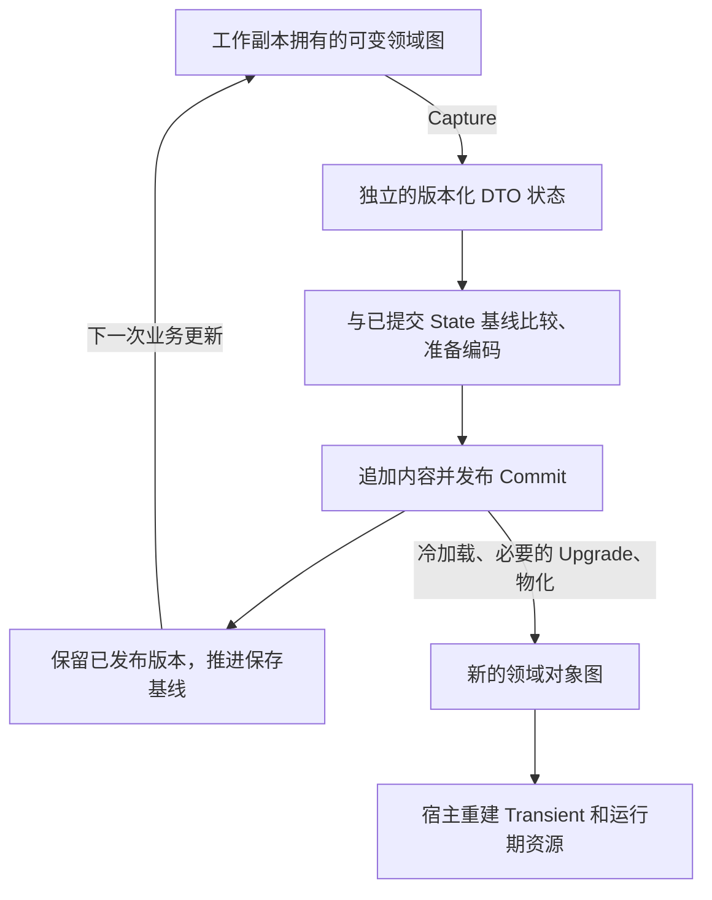

# 心智模型与架构迁移

[使用指南入口](README.md)

## 可变领域模型是持续使用的 Builder

可以把工作副本中的领域对象图理解为一个长期存在的 Builder：
业务方法直接修改它，每次保存捕获一个独立版本，保存成功后仍可在同一批对象上继续操作。

上图描述 State 保存。Event 另外捕获独立完整图，见[提交、事件与恢复](events-and-recovery.md)。

需要区分三种“不可变”：

- 捕获状态不受后续领域修改影响；比较、编码在独立状态材料上进行。
- 已发布版本保留当时的持久事实；后续 Commit 不把它改成新状态。
- 领域 CLR 实例本身仍可以是普通可变 class、List 或 Dictionary。

从历史加载出的普通领域对象，也不会因此变成 CLR 深不可变对象。
独立加载、ReadPair 的只读使用和工作副本有各自合同；不要把“历史版本不可变”
解释成“所有读取结果都能随意共享、并发修改或提交”。详细区别见[术语表](../DurableGraph-glossary.md)。

## DG 集中承担什么复杂性

领域代码负责业务规则、身份和更新边界；DG 负责捕获、强类型比较、版本编码、引用关系和历史恢复。
应用不需要使用 setter hook、代理或手动 MarkDirty 来告诉 DG 哪些字段改了。

例如把一个物品从角色 A 转交给角色 B，领域方法可以依次更新两个背包和物品归属，
在不变量全部恢复之后提交。无需为这次更新复制所有祖先节点，也无需手工维护保存用的 dirty 集合。
不过，“哪些字段共同构成一次正确转交”仍须由业务代码定义。

Source Generator 把已知类型知识变成专用代码，有机会降低通用序列化和比较的常数开销。
这是用计算工作换取应用代码简单性的设计取舍：
扫描活跃图、冻结内容、集合比较、编码、分配和持久发布仍然有成本。
小改动不等于只扫描改动部分；少写磁盘字节也不等于少做 CPU 工作。
成本如何测量见[接入与验收](adoption-and-validation.md)。

## 从熟悉的架构带来什么

| 既有经验 | 可以继续使用 | 采用 DG 时需要重新决定 |
| --- | --- | --- |
| 状态机 / 消息循环 | 显式阶段、合法转换、操作关联、串行驱动 | 转换可以原位修改；是否为每个输入保留 Event 由业务选择 |
| 函数式编程 | 确定性计算、不可变输入、I/O 边界、局部纯函数 | 不必要求整个世界每次返回新根；纯计算结果可以应用到一个可变 owner |
| TEA | Model / Message / Update / Effect 的职责划分 | 可借用消息驱动组织方式，采用原位更新的变体；UI 差分和旧视图保留另行设计 |
| Event sourcing | 业务事件命名、顺序、关联 ID、幂等和审计意识 | 常规恢复直接加载已保存 State；事件只补应用协议认定的未处理部分 |
| DDD | 聚合、不变量、业务身份、边界清晰的领域行为 | 保存边界按需要的一致性选定，不为每个类机械创建分支 |
| checkpoint / 存档 | 保存权威状态、恢复运行环境、版本迁移 | 可使用 DG 的对象图增量和历史定位；不自动获得执行栈或外部资源恢复 |

这些架构可以组合，但要选清楚恢复的依据。若应用确实把“全部状态由事件重算”作为业务要求，
仍可以实现自己的事件重放；不应因为采用 DG 就自动增加这层要求。

## 确定性与内存不可变性是不同的性质

给定相同的初始事实与输入，原位 `Apply(state, event)` 可以产生相同结果。
测试可以在两个独立世界上应用相同输入，然后比较业务事实；
不必要求每次转换都保留旧 CLR 图。

推荐把时钟、随机选择、外部返回值等不确定输入显式化：
由输入携带，或由 State 中保存的逻辑时间和 PRNG 状态驱动。
原位更新函数不应顺便发网络请求或启动进程，否则很难独立定义重做边界。

如果已有不可变模型确有收益，例如并发只读消费者、算法内大量快照或廉价内存分叉，
可以保留它。DG 支持的 record/根替换不意味着深不可变，也不把 `with` 产生的新实例当成原实例。
同样，替换一个 List 会产生新的集合身份；不要预期它天然获得原 List 原位修改时的 Delta 收益。
先比较真实工作负载，再决定是否需要第二套内存表示。

## 保存结果与重算过程

加载某个已提交 State，DG 读取保存材料、解码 Base/Delta、按需执行 Schema Upgrade，再恢复领域图。
这个过程不重新执行当年的业务事件处理器，不重新询问模型，也不重新运行战斗。

因此，旧版本的业务规则不必仅为了“把历史事件重新算成当时结果”而常驻。
仍需保留读取旧 Schema 的能力和明确的迁移语义；从旧存档继续运行时，
新程序采用什么业务规则也是应用决策。
如果存在已保存但尚未应用的 Event，处理它时使用的语义还要单独兼容，见[恢复协议](events-and-recovery.md)。

## 当前实现依据

- [WorkingCopy](../../src/DurableGraph.Persistence/WorkingCopy.cs)：保存边界、基线、根替换及失败合同。
- [CaptureContext](../../src/DurableGraph/Runtime/Capture/CaptureContext.cs) 与
  [CaptureSession](../../src/DurableGraph/Runtime/Capture/CaptureSession.cs)：稳定图捕获、引用身份和候选比较。
- [产品目标](../DurableGraph-target-design-v0.md)：接受活跃图扫描，以测量决定优化。

这些依据说明机制与边界；不构成某个应用的吞吐证明。
